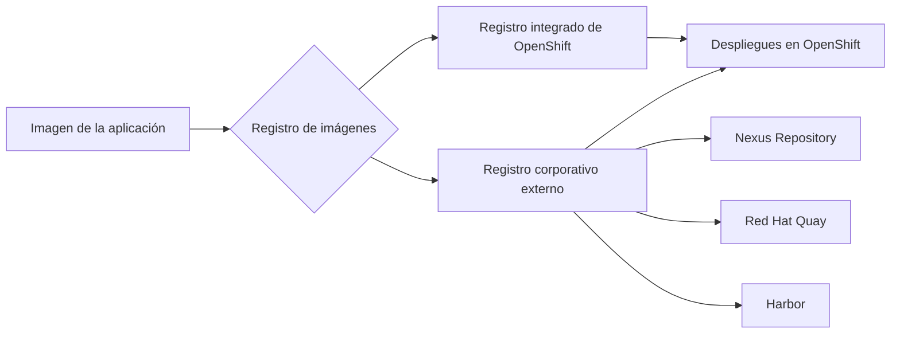
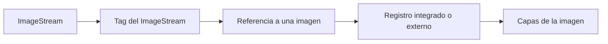
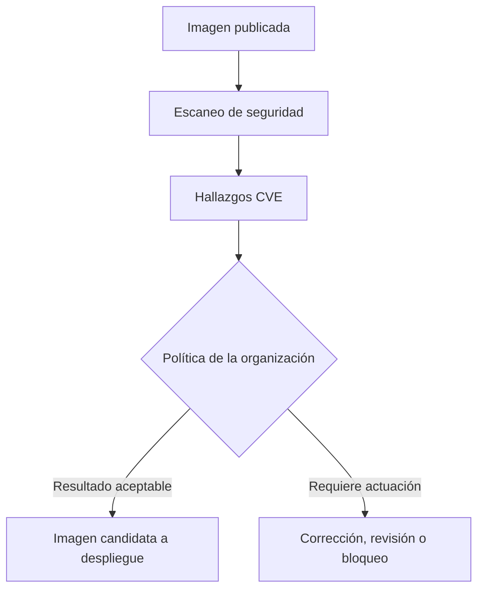

# 4.4 Registro, gestión y seguridad de imágenes

## Objetivos de aprendizaje

Al finalizar este apartado serás capaz de:

- Comprender cómo el gobierno de la plataforma se extiende también a las imágenes que se ejecutan en el clúster.
- Diferenciar el registro integrado de OpenShift de un registro corporativo o público externo.
- Interpretar una referencia de imagen y aplicar una convención de nomenclatura coherente.
- Comprender cómo los tags permiten identificar versiones y cómo el SHA del commit facilita la trazabilidad entre código, imagen y despliegue.
- Explicar por qué una etiqueta mutable como `latest` no resulta adecuada cuando se necesita reproducibilidad y control.
- Entender el papel de los **ImageStreams** como abstracción nativa de OpenShift y su posible convivencia con registros corporativos externos.
- Conocer el escaneo de vulnerabilidades y el reparto de responsabilidades ante los hallazgos de seguridad.

---

## De gobernar la plataforma a gobernar los artefactos

En los apartados anteriores hemos visto cómo una organización puede gobernar una plataforma compartida: quién puede realizar determinadas acciones, cuántos recursos puede consumir cada proyecto y qué comunicaciones de red se permiten.

Esa gobernanza también debe extenderse a los artefactos que se ejecutan en el clúster. Antes de desplegar una aplicación conviene poder responder preguntas como estas:

- ¿Dónde se almacena su imagen?
- ¿Qué versión concreta se está utilizando?
- ¿De qué revisión del código procede?
- ¿Ha sido analizada antes de llegar a un entorno sensible?
- ¿Quién puede autorizar una excepción si aparece una vulnerabilidad?

De este modo, el apartado 4.4 completa la visión de gobierno desarrollada en los apartados anteriores y actúa como transición hacia la industrialización del ciclo de vida de las aplicaciones que abordaremos a continuación.

---

## Registro integrado de OpenShift frente a registro corporativo externo

Un **registro de imágenes** es el servicio que almacena y distribuye imágenes de contenedores. OpenShift puede trabajar tanto con su registro integrado como con registros externos públicos o corporativos.



### 1. El registro integrado de OpenShift

OpenShift incorpora un registro de imágenes integrado en la plataforma, gestionado mediante el **Image Registry Operator**. Este registro puede utilizarse para almacenar las imágenes generadas y utilizadas dentro del clúster.

Entre sus posibles usos se encuentran:

- almacenar imágenes generadas por procesos de construcción ejecutados en el clúster;
- compartir imágenes entre proyectos cuando la política de permisos lo permite;
- integrarse con recursos propios de OpenShift, como los ImageStreams;
- mantener dentro de la plataforma las imágenes utilizadas por sus aplicaciones.

### 2. El registro corporativo externo

Muchas organizaciones utilizan un registro corporativo centralizado, como **Red Hat Quay**, **Harbor** o **Nexus Repository**, para almacenar las imágenes de sus aplicaciones.

Este modelo permite, entre otras posibilidades:

- centralizar imágenes utilizadas por varios clústeres o entornos;
- aplicar políticas comunes de acceso, retención y auditoría;
- integrar el registro con procesos de construcción, despliegue y análisis de seguridad;
- separar el ciclo de vida de las imágenes del ciclo de vida de un clúster concreto.

El registro integrado y el registro corporativo pueden convivir. Una organización puede utilizar recursos nativos de OpenShift para determinadas imágenes gestionadas dentro de la plataforma y almacenar las imágenes de negocio en un registro corporativo externo.

!!! note "Decisión de arquitectura"
    El registro integrado resulta especialmente útil para los procesos propios de un clúster, por ejemplo, para almacenar imágenes generadas por construcciones realizadas en la plataforma. Cuando existen **varios clústeres o entornos separados** y una misma imagen debe estar disponible entre ellos, es habitual disponer además de un **registro corporativo externo**, como Red Hat Quay, Harbor o Nexus Repository, que actúe como punto común para almacenar y gobernar los artefactos.

---

## Nomenclatura y estructura de una referencia de imagen

Una referencia de imagen permite indicar al clúster qué artefacto debe descargar y ejecutar. Aunque cada organización puede definir su propia convención, una estructura coherente facilita la operación y la trazabilidad.

```text
<registro>/<organización-o-equipo>/<proyecto>/<servicio>:<tag>
```

Por ejemplo:

```text
registry.corp.internal/es.ief/tramites/app-backend:7f3a9b1
```

### Desglose de la referencia

| Elemento | Ejemplo | Función |
|---|---|---|
| Registro | `registry.corp.internal` | Servicio en el que se almacena la imagen. |
| Organización o equipo | `es.ief` | Agrupa imágenes bajo un ámbito corporativo. |
| Proyecto | `tramites` | Identifica la aplicación o iniciativa. |
| Servicio | `app-backend` | Identifica el componente desplegable. |
| Tag | `7f3a9b1` | Identifica la versión de la imagen. |

Esta estructura es una **convención organizativa**, no un formato impuesto por OpenShift. Lo importante es que el patrón elegido sea estable, comprensible y aplicable de manera uniforme.

!!! note "Buenas prácticas de nombrado"
    - Utiliza nombres breves y descriptivos.
    - Mantén una convención común para todos los equipos.
    - Evita introducir en la ruta información que pueda quedar obsoleta rápidamente.
    - Documenta qué parte identifica al equipo, al proyecto, al servicio y a la versión.

---

## Etiquetado y trazabilidad de imágenes

Un **tag** es una etiqueta empleada para identificar una versión de una imagen dentro de un repositorio:

```text
app-backend:v1
app-backend:1.4.0
app-backend:7f3a9b1
```

Una práctica habitual consiste en utilizar como tag el identificador corto del commit de Git con el que se generó la imagen:

```text
Commit Git
7f3a9b1
    │
    ▼
Imagen
app-backend:7f3a9b1
```

De esta forma se puede relacionar con facilidad una imagen desplegada con la versión del código fuente que la generó:

```text
código → imagen → despliegue
```

El formato concreto de los tags forma parte de la convención adoptada por cada organización. Lo importante es utilizar un criterio estable que permita reconocer la versión desplegada y rastrear su origen.

### Por qué evitar `latest` en despliegues controlados

`latest` es únicamente un tag convencional. No significa necesariamente «la imagen más reciente» ni identifica de forma inequívoca una versión determinada.

```text
app-backend:latest
```

Hoy puede apuntar a una imagen y mañana a otra distinta. Esto dificulta:

- reproducir un despliegue;
- auditar qué versión se ejecutó;
- relacionar un incidente con una revisión concreta del código;
- repetir una validación en otro entorno;
- realizar un *rollback* de forma controlada.

Por ello, en despliegues gobernados se recomienda utilizar tags versionados o asociados al commit, de manera que pueda identificarse la versión desplegada y relacionarla con el código que la generó.

!!! warning "Evitar referencias ambiguas"
    `latest` puede resultar útil en pruebas puntuales o flujos locales, pero no debería utilizarse como identificador de una versión destinada a promoción o producción.

En el apartado 4.6 retomaremos esta idea para explicar cómo una misma imagen puede avanzar entre entornos manteniendo su identidad y cambiando únicamente la configuración propia de cada entorno.

---

## Uso conceptual de ImageStreams

En la sesión inicial presentamos los **ImageStreams** como uno de los recursos propios que OpenShift añade sobre Kubernetes. Ahora podemos situarlos dentro del ciclo de vida de las imágenes.

Un ImageStream es una abstracción de OpenShift que mantiene referencias y metadatos sobre imágenes y sus tags. **No almacena por sí mismo las capas de la imagen**: esas capas residen en un registro.



### ¿Qué aporta un ImageStream?

Puede utilizarse para:

- ofrecer una referencia estable dentro de OpenShift;
- agrupar versiones relacionadas de una imagen;
- importar o seguir imágenes alojadas en un registro;
- integrarse con construcciones y despliegues de OpenShift;
- activar automatizaciones cuando cambia una referencia, si así se configura.

No es necesario utilizar ImageStreams para desplegar una imagen. Un `Deployment` también puede apuntar directamente a la URL de una imagen en un registro externo.

### Convivencia con registros corporativos

Su utilización depende de la arquitectura adoptada. Por ejemplo, una organización puede usar ImageStreams para catalogar determinadas imágenes base o runtimes disponibles en la plataforma y, al mismo tiempo, referenciar directamente desde sus aplicaciones las imágenes almacenadas en un registro corporativo.

Por tanto, no debe interpretarse que los ImageStreams sean exclusivamente para imágenes base ni que todas las imágenes de una organización deban gestionarse mediante ellos. Son una capacidad específica de OpenShift que puede incorporarse cuando aporta valor al modelo operativo.

!!! note "Profundidad necesaria en este curso"
    En este punto es suficiente comprender qué problema resuelve un ImageStream y cómo se relaciona con un registro. La configuración avanzada de importaciones, políticas de referencia y disparadores queda fuera del alcance de este curso introductorio.

---

## Escaneo de vulnerabilidades y gestión de hallazgos

Publicar correctamente una imagen no garantiza que sea segura. Sus capas pueden contener paquetes del sistema operativo, bibliotecas o dependencias afectadas por vulnerabilidades conocidas, registradas habitualmente como **CVE**.

Una vez publicada, la imagen puede analizarse antes de considerarla apta para su uso en entornos controlados:



### 1. El análisis de seguridad

Una herramienta como **Trivy**, **Clair** o las capacidades de seguridad de **Red Hat Quay** puede analizar los componentes presentes en las capas de la imagen y compararlos con bases de datos de vulnerabilidades conocidas.

El resultado puede incluir:

- identificador de la vulnerabilidad;
- severidad estimada;
- paquete y versión afectados;
- disponibilidad de una versión corregida;
- información adicional para valorar la exposición real.

### 2. El escaneo no decide por sí solo

El escáner produce hallazgos. La decisión de bloquear o permitir un artefacto corresponde a la política definida por la organización.

Algunos modelos habituales son:

| Modelo | Comportamiento |
|---|---|
| Informativo | El informe se publica y debe revisarse antes de continuar. |
| Bloqueo automático | El proceso se detiene al superar un umbral definido. |
| Aprobación manual | Un responsable analiza el resultado y autoriza o rechaza el uso de la imagen. |
| Modelo mixto | Determinados hallazgos bloquean automáticamente y otros requieren evaluación. |

No todos los hallazgos de igual severidad implican el mismo riesgo. También deben valorarse la exposición del componente, la existencia de una corrección, los controles compensatorios y el contexto de uso.

### 3. Responsabilidades y excepciones

El equipo de desarrollo debe corregir las dependencias vulnerables cuando exista una actualización viable y aportar la información técnica necesaria para valorar el hallazgo.

La aceptación del riesgo no debería recaer únicamente en quien desarrolla la aplicación. Debe seguir el procedimiento de gobierno establecido por la organización y contar con las responsabilidades formalmente asignadas.

!!! warning "Regla de gobernanza ante bloqueos de seguridad"
    Cuando una vulnerabilidad impide desplegar un artefacto necesario, una posible excepción debe quedar justificada, aprobada y limitada en el tiempo. Como mínimo, el procedimiento debería contemplar:

    1. **Análisis de impacto:** determinar si la vulnerabilidad es explotable en el contexto real de la aplicación.
    2. **Evaluación del riesgo:** valorar severidad, exposición y controles compensatorios, como NetworkPolicies, SCC u otras medidas de plataforma.
    3. **Decisión formal:** aprobar o rechazar la excepción por parte del rol competente.
    4. **Caducidad y seguimiento:** fijar una fecha límite y revisar la excepción cuando exista una corrección.

---

## Ideas clave para recordar

!!! tip "Resumen"
    - El gobierno de la plataforma también debe controlar **qué artefactos se ejecutan**, dónde se almacenan, cómo se identifican y qué controles de seguridad deben superar.
    - OpenShift incorpora un **registro integrado**, que puede convivir con un **registro corporativo externo**.
    - Cuando existen varios clústeres o entornos separados que deben compartir artefactos, un registro corporativo externo puede actuar como punto común de almacenamiento y gobierno.
    - La nomenclatura de las imágenes es una convención organizativa que debe facilitar la identificación del equipo, el proyecto, el servicio y la versión.
    - Un **tag** permite identificar una versión de una imagen; etiquetarla con el **SHA del commit de Git** facilita la trazabilidad entre código, imagen y despliegue.
    - `latest` no identifica una versión concreta y dificulta la reproducibilidad, la auditoría y los *rollbacks*.
    - Un **ImageStream** mantiene referencias y metadatos sobre imágenes; no almacena sus capas y no es obligatorio para desplegar desde un registro externo.
    - El escaneo detecta vulnerabilidades, pero la decisión de permitir, revisar o bloquear una imagen depende de la política de seguridad adoptada.
    - Las excepciones de seguridad deben justificarse, aprobarse formalmente, limitarse en el tiempo y mantenerse bajo seguimiento.

---

Hasta ahora hemos visto distintas dimensiones del gobierno de una plataforma OpenShift compartida. En este apartado hemos añadido una más: **el control sobre los artefactos que permitimos ejecutar**, dónde se almacenan, cómo los identificamos y qué controles de seguridad aplicamos sobre ellos.

Una vez establecido qué esperamos de una imagen gobernada y trazable, el siguiente paso es preguntarnos **cómo generarla de forma automatizada y reproducible**. Ese será el objetivo del siguiente apartado.
