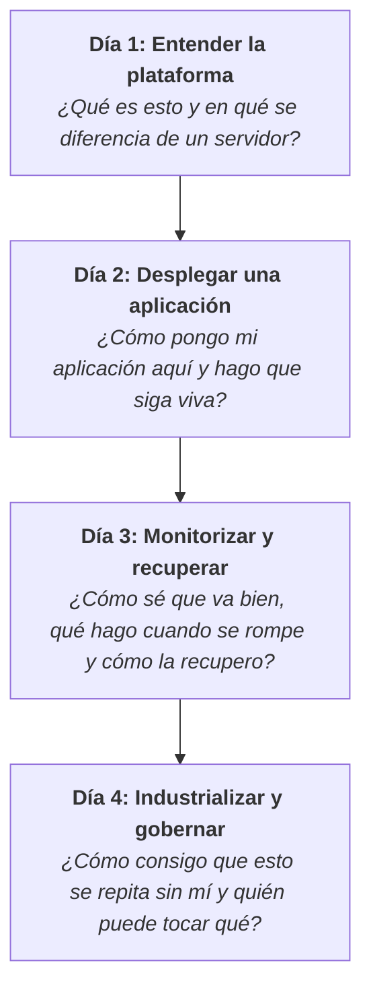

# 1.1 Encuadre: objetivo, mapa del curso y qué NO entra

## Objetivo de la formación

El objetivo de esta formación es proporcionar una visión práctica, estructurada y realista de Red Hat OpenShift como plataforma corporativa para la ejecución, operación y gestión del ciclo de vida de aplicaciones basadas en contenedores[cite: 2]. 

El curso está diseñado específicamente para profesionales con conocimientos y experiencia en administración o desarrollo sobre sistemas Linux, pero sin necesidad de experiencia previa en Kubernetes o plataformas de orquestación[cite: 1, 2]. 

El enfoque pedagógico se centra en comprender la mecánica interna y el "porqué" de las arquitecturas nativas de la nube, priorizando la asimilación de patrones de diseño corporativos sobre la memorización técnica de comandos o configuraciones[cite: 2].

Al finalizar el curso, el alumno será capaz de[cite: 2]:

* Comprender la relación arquitectónica entre contenedores Linux, Kubernetes como motor de orquestación y OpenShift como plataforma de aplicaciones de nivel empresarial[cite: 2].
* Navegar, operar e inspeccionar el estado de un clúster utilizando tanto la consola web (perspectivas de Administración y Desarrollo) como la herramienta de línea de comandos `oc`[cite: 1, 2].
* Desplegar, configurar y exponer aplicaciones web y microservicios garantizando su resiliencia, persistencia de datos y alta disponibilidad[cite: 1, 2].
* Diagnosticar y resolver fallos en cargas de trabajo mediante un método estructurado de observabilidad (`events` $\rightarrow$ `describe` $\rightarrow$ `logs`)[cite: 1].
* Aplicar las políticas de seguridad, gobernanza, límites de recursos y promoción inmutable de artefactos requeridas en entornos de producción[cite: 1].

!!! tip "Propósito central de la formación"
    Al completar el ciclo de 20 horas, el alumno dispondrá del criterio técnico necesario para desplegar, mantener y diagnosticar aplicaciones sobre OpenShift utilizando los estándares de la plataforma[cite: 1, 2].

---

## Mapa del curso y ruta de aprendizaje

El contenido se articula en cuatro sesiones de 5 horas (20 horas lectivas en total), estructuradas de forma progresiva[cite: 1, 2]:

### Día 1 — Entender la plataforma
*¿Qué es esto y en qué se diferencia de un servidor tradicional?*[cite: 1]

* **Fundamentos:** De servidor físico/virtual a contenedor. Estructura de capas de una imagen, concepto de contenedor efímero e inmutabilidad (por qué no se parchea en caliente, sino que se sustituye la imagen)[cite: 1].
* **Kubernetes básico:** Abstracción del orquestador, estado deseado frente a estado real y el bucle de reconciliación. Jerarquía *Deployment* $\rightarrow$ *ReplicaSet* $\rightarrow$ *Pod*. Desagregación mediante etiquetas (*labels*) y selectores. *Service* y descubrimiento mediante DNS interno[cite: 1].
* **Capas de valor de OpenShift:** Abstracciones añadidas sobre Kubernetes (*Projects*, *Routes*, *ImageStreams*, *BuildConfigs*, *SCC* y *OLM*). El paradigma del **Operador** como motor de extensión de la plataforma. Demostración práctica de instalación del operador *Web Terminal*[cite: 1].
* **Arquitectura de clúster OpenShift 4.x:** Roles de nodos (*Control Plane*, *Workers*, *Infra*), almacén *etcd*, el *Cluster Version Operator* (CVO) y la estrategia de actualización gestionada del clúster[cite: 1].
* **Herramientas de interacción:** Uso de la consola web (perspectivas *Administrator* y *Developer*)[cite: 1].
* **Herramientas de CLI:** Cliente `oc`, gestión de contexto mediante `kubeconfig`, ámbito de `oc project`, diferencias operativas con `kubectl`, inspección mediante `get`, `describe`, `logs` y autodocumentación con `oc explain`[cite: 1].
* **Práctica de reconciliación:** Creación local de imágenes con Podman, publicación y comprobación del comportamiento del orquestador ante la destrucción fortuita de Pods[cite: 1].

### Día 2 — Desplegar una aplicación
*¿Cómo pongo mi aplicación aquí y hago que siga viva?*[cite: 1]

* **Cargas de trabajo y despliegue:** Objetos *Deployment*, *StatefulSet* y *Job*/*CronJob*. Estrategias de actualización (*RollingUpdate* vs *Recreate*). Control de despliegues: ciclo de *rollout*, historial de revisiones y operaciones de *rollback*[cite: 1].
* **Exposición e ingress:** Conectividad mediante *Service* (*ClusterIP*, *NodePort*, *LoadBalancer*). *Route* frente a *Ingress* estándar. Modos de terminación TLS y gestión de Autoridades de Certificación (CA) corporativas[cite: 1].
* **Salud, recursos y escalado:** Sondas de comprobación (*startup*, *readiness* y *liveness*). Gestión de límites de computación (*requests* y *limits*) y Calidad de Servicio (QoS). Escalado manual y autoescalado horizontal (HPA)[cite: 1].
* **Inyección de configuración:** Desacoplamiento de código y configuración mediante *ConfigMaps* y *Secrets*, consumidos como variables de entorno o volúmenes[cite: 1].
* **Almacenamiento persistente:** Modelo de almacenamiento persistente (*PV*, *PVC*, *StorageClass*), modos de acceso (*RWO*, *RWX*, *ROX*), binding pospuesto (*WaitForFirstConsumer*) y el uso de *subPath*[cite: 1].
* **Seguridad de ejecución:** Control de privilegios mediante *Security Context Constraints* (SCC) (`restricted-v2`, `anyuid`) y asignación a cuentas de servicio dedicadas (*ServiceAccounts*)[cite: 1].

### Día 3 — Monitorizar y recuperar
*¿Cómo sé que va bien, qué hago cuando se rompe y cómo la recupero?*[cite: 1]

* **Observabilidad y métricas:** Cuadros de mando integrados y activación de *User-Workload Monitoring* para métricas de aplicación[cite: 1].
* **Autoescalado avanzado:** Escalado mediante métricas de negocio y rendimiento (Prometheus Adapter)[cite: 1].
* **Gestión de alertas:** Estados de alerta (*pending*, *firing*), silenciados (*silences*) y flujo de notificaciones externas corporativas[cite: 1].
* **Agregación de logs:** Extracción de registros mediante `oc logs` y `--previous`, interfaz gráfica de logs y arquitectura centralizada mediante el operador de *Logging* y almacenamiento de objetos[cite: 1].
* **Metodología de diagnóstico y resolución de incidencias:** Flujo sistemático de resolución de problemas (*events* $\rightarrow$ *describe* $\rightarrow$ *logs*). Identificación y corrección de estados anómalos (*Pending*, *CrashLoopBackOff*, *ImagePullBackOff*, *OOMKilled*, *PVC Pending*, *Route 503*). Uso de `oc debug`, `oc rsh`, `oc port-forward` y extracción de diagnósticos con `must-gather`[cite: 1].
* **Salud e infraestructura del clúster:** Inspección de operadores de plataforma (`oc get co`), estado de nodos y métricas de consumo (`oc adm top nodes`) para determinar el alcance de una incidencia (aplicación vs. plataforma)[cite: 1].
* **Ecosistema de Operadores y respaldos:** Ciclo de vida de operadores mediante OLM (Subscription, CSV, canales). Copias de seguridad de aplicaciones y estado del clúster mediante OADP/Velero y backup de `etcd`[cite: 1].

### Día 4 — Industrializar y gobernar
*¿Cómo consigo que todo esto se repita sin mí, y quién puede tocar qué?*[cite: 1]

* **Control de acceso y RBAC:** Roles predefinidos (`admin`, `edit`, `view`), objetos *Role* y *RoleBinding*. Identidades de usuario frente a *ServiceAccounts*. Integración con Proveedores de Identidad (IdP) corporativos y sincronización programada de grupos de directorio[cite: 1].
* **Gobernanza y asignación de nodos:** Cuotas de proyecto (*ResourceQuota*), rangos por defecto (*LimitRange*), gestión del *overcommit* y ubicación de cargas en nodos dedicados mediante `nodeSelector` y nodos de infraestructura[cite: 1].
* **Aislamiento de red:** Aislamiento intra-clúster mediante políticas de red (*NetworkPolicy*)[cite: 1].
* **Gestión corporativa de imágenes:** Registros de imágenes (interno vs. corporativo), convenciones de etiquetado por commit SHA frente al antipatrón `latest`, uso conceptual de *ImageStreams* y escaneo de vulnerabilidades (CVEs)[cite: 1].
* **Construcción en plataforma:** Estrategias de *BuildConfig* (Source/S2I, Docker, Binary). Diferenciación del Dockerfile de agente CI frente al Dockerfile de aplicación[cite: 1].
* **Promoción inmutable entre entornos:** Principio de "construir una vez, promover el artefacto". Modificación de imágenes mediante `oc set image` y gestión de configuración por entorno mediante Kustomize (estructuras *base* y *overlays*)[cite: 1].
* **Automatización y virtualización:** Opciones de CI/CD (construcción nativa, OpenShift Pipelines/Tekton y herramientas externas). Introducción a OpenShift Virtualization (coexistencia de máquinas virtuales y contenedores)[cite: 1].

---

## Patrones corporativos frente al entorno de laboratorio

!!! convenio "Convenio de diseño e implementación"
    Los contenidos, arquitecturas y patrones explicados durante el curso corresponden a **estándares de despliegue en entornos de producción altamente disponibles y seguros**. 

    Sin embargo, para garantizar la agilidad de los laboratorios y adaptarse a las cuotas del entorno de formación del IEF, ciertas configuraciones de los ejercicios prácticos simplificarán de forma deliberada el número de réplicas, los modos de almacenamiento o la complejidad de red[cite: 1]. 

A lo largo del manual se señalarán de forma explícita estas diferencias para evitar extrapolar configuraciones docentes a entornos de producción reales[cite: 1].

---

## Qué NO cubre este curso (Fuera de alcance)

Para optimizar el tiempo disponible (20 horas lectivas) y mantener el foco en la operación y despliegue de cargas de trabajo, los siguientes temas quedan **expresamente fuera del alcance** de este curso[cite: 1, 2]:

!!! warning "Alcance excluido del curso"
    * **Instalación y despliegue inicial del clúster (IPI/UPI):** No se abordará el aprovisionamiento de infraestructura física o virtual, la configuración del instalador ni la fase de *bootstrap* del clúster.
    * **Desarrollo de Operadores personalizados:** No se estudiará la creación de CRDs (*Custom Resource Definitions*) ni la programación de controladores en lenguaje Go o mediante Ansible/Helm Operator SDK.
    * **Administración avanzada de infraestructura de red/almacenamiento:** No se incluye la instalación o tuning avanzado de plugins CNI (OVN-Kubernetes) ni la gestión de cabeceras de almacenamiento persistente a nivel de infraestructura (ej. Red Hat OpenShift Data Foundation / Ceph).
    * **Implementación completa de GitOps/ArgoCD a nivel de plataforma:** Se presentará la gestión de manifiestos con Kustomize, pero no la instalación ni la configuración avanzada del operador OpenShift GitOps.
    * **Administración de sistemas operativos subyacentes (Red Hat Enterprise Linux CoreOS):** No se realizarán tareas de mantenimiento del sistema operativo base de los nodos (ostree, MachineConfigs)[cite: 1].

---

## Resumen

En este apartado hemos establecido el encuadre pedagógico, la hoja de ruta que guía las 4 jornadas del curso y los límites claros de la formación[cite: 1, 2].

A partir del siguiente apartado (**1.2 De servidor a contenedor**), comenzaremos la inmersión técnica analizando la transformación del modelo tradicional de servidores hacia las imágenes y los contenedores inmutables[cite: 1].