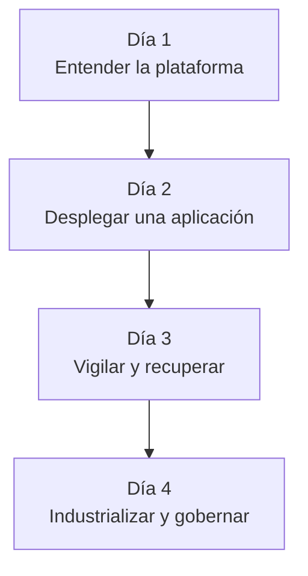

# 1.1 Encuadre: objetivo del curso, mapa de contenidos y alcance

## Objetivo de la formación

El objetivo de este curso es proporcionar una visión práctica y realista de OpenShift como plataforma de ejecución y operación de aplicaciones basadas en contenedores.

Durante las distintas sesiones aprenderemos los conceptos fundamentales sobre los que se construye la plataforma, entenderemos cómo se organiza un clúster OpenShift y adquiriremos los conocimientos necesarios para desplegar, operar y diagnosticar aplicaciones dentro de un entorno empresarial.

El enfoque del curso está orientado a comprender cómo funcionan las plataformas modernas basadas en Kubernetes y OpenShift, priorizando el entendimiento de los conceptos sobre la memorización de comandos o procedimientos.

Al finalizar la formación, el alumno deberá ser capaz de:

- Comprender la relación entre contenedores, Kubernetes y OpenShift.
- Identificar los principales componentes de una plataforma OpenShift.
- Interpretar el estado de una aplicación desplegada.
- Utilizar la consola web y la herramienta de línea de comandos (`oc`) para tareas habituales de consulta y operación.
- Entender los patrones de despliegue y operación utilizados en entornos corporativos.

!!! tip "Objetivo final"

    Al finalizar el curso, el alumno será capaz de comprender cómo se despliega, opera y diagnostica una aplicación sobre OpenShift utilizando tanto la consola web como la herramienta de línea de comandos `oc`.

## Mapa del curso

### Día 1. Entender la plataforma

- De servidor a contenedor (Dockerfile e imagen).
- Kubernetes (estado deseado, bucle de reconciliación, Deployment, ReplicaSet, Pod, Service y DNS interno).
- Qué añade OpenShift (Projects, Routes, ImageStreams, BuildConfigs, SCC y Operadores).
- Arquitectura OpenShift 4.x (Control Plane, Workers, Infra, etcd, CVO y actualización del clúster).
- Herramientas de acceso: Consola web (vista Administrator vs Developer) y cliente `oc` (`login`, kubeconfig, contexto, `project`, `get`, `describe`, `logs`, `explain`).
- Práctica: construcción local con Podman, publicación en registro, despliegue en OpenShift y comprobación de la reconciliación ante eliminación de Pods.

### Día 2. Desplegar una aplicación

- Cargas de trabajo: Deployment, StatefulSet, Job/CronJob, estrategias RollingUpdate y Recreate, rollouts y rollbacks.
- Exposición de aplicaciones: Service (ClusterIP, NodePort, LoadBalancer), Route frente a Ingress, terminaciones TLS y gestión de CAs.
- Salud y recursos: Sondas (`startupProbe`, `readinessProbe`, `livenessProbe`), `requests` y `limits`, y concepto de autoescalado.
- Configuración fuera de la imagen: ConfigMaps y Secrets consumidos como variables de entorno y volúmenes.
- Almacenamiento persistente: PV, PVC, StorageClass, modos de acceso (RWO, RWX, ROX), `WaitForFirstConsumer` y uso de `subPath`.
- Políticas de seguridad de la plataforma: SCC (`restricted-v2`, `anyuid`) y cuentas de servicio (`ServiceAccounts`).

### Día 3. Vigilar y recuperar

- Monitorización y métricas (plataforma y User-Workload Monitoring).
- Autoescalado avanzado (Horizontal Pod Autoscaler - HPA por CPU, memoria y métricas de aplicación).
- Alertas: estados `pending` y `firing`, silences, Alertmanager y gobierno de notificaciones.
- Centralización de logs (`oc logs`, vista de consola, operador de Logging y Object Storage).
- Método de diagnóstico de incidencias (`events` → `describe` → `logs`), herramientas de acceso (`oc debug`, `rsh`, `port-forward`) y `must-gather`.
- Salud del clúster (`oc get co`, `oc adm top nodes`), Operadores en la práctica (OperatorHub, Subscription, CSV) y copias de seguridad (OADP/Velero y backup de `etcd`).

### Día 4. Industrializar y gobernar

- Proyectos y permisos: RBAC, roles predefinidos (`admin`, `edit`, `view`), Roles vs ClusterRoles, ServiceAccounts para CI/CD, Proveedores de Identidad (IdP) y sincronización de grupos.
- Gobernanza de recursos: `ResourceQuota`, `LimitRange`, overcommit, Calidad de Servicio (QoS), `nodeSelector` y Nodos de Infraestructura.
- Aislamiento de red: `NetworkPolicy` y patrón Default Deny.
- Registro y seguridad de imágenes: nomenclatura estándar, tag de commit SHA vs `latest`, ImageStreams y escaneo de vulnerabilidades (CVEs).
- Construcción y automatización: BuildConfigs (S2I, Docker, Binary), promoción inmutable entre entornos, Pipelines (Tekton) y adopción ordenada en la organización.

## Enfoque de la formación

La formación está orientada a la comprensión de conceptos y al uso práctico de la plataforma.

El objetivo no es memorizar comandos, sino entender cómo se comportan los distintos componentes para poder trabajar con seguridad en entornos reales.

## Qué no cubre este curso

!!! warning "Fuera del alcance"

    Esta formación está orientada a usuarios y operadores de plataforma.

    Temas como la instalación avanzada de OpenShift, el desarrollo de operadores personalizados, GitOps avanzado o la administración completa de clústeres productivos quedan fuera del alcance de esta introducción.

## Una consideración importante

!!! note "Entorno de laboratorio"

    El entorno utilizado durante las prácticas tiene fines formativos.

    Algunas configuraciones pueden diferir de las utilizadas en entornos corporativos reales con el objetivo de simplificar el aprendizaje y facilitar los ejercicios.

## Resumen

En este capítulo hemos definido los objetivos de la formación, el alcance del curso y la hoja de ruta que seguiremos durante las distintas sesiones.

A partir del siguiente apartado comenzaremos el recorrido técnico analizando la evolución desde los servidores tradicionales hasta las plataformas basadas en contenedores.