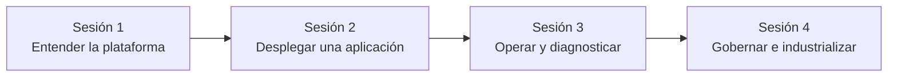

# 1.1 Encuadre: objetivo, mapa del curso y entorno de trabajo

## Objetivo de la formación

El objetivo de esta formación es proporcionar una visión práctica, estructurada y realista de Red Hat OpenShift como plataforma para desplegar, ejecutar y operar aplicaciones basadas en contenedores.

El curso está dirigido a profesionales con conocimientos de administración de sistemas o desarrollo sobre Linux, pero no requiere experiencia previa con Kubernetes u OpenShift.

El enfoque será progresivo y práctico. A lo largo de las cuatro sesiones iremos construyendo una visión completa del recorrido de una aplicación en la plataforma: desde los conceptos básicos de contenedores hasta su despliegue, configuración, operación e integración en procesos de construcción y entrega.

Al finalizar el curso, el alumno será capaz de:

* Comprender la relación entre contenedores, Kubernetes y OpenShift.
* Utilizar la consola web y la herramienta de línea de comandos `oc` para consultar y operar recursos básicos de la plataforma.
* Desplegar, configurar, actualizar y exponer aplicaciones en OpenShift.
* Aplicar mecanismos básicos de persistencia, seguridad, observabilidad, escalado y diagnóstico.
* Comprender cómo se integran la construcción de imágenes y la automatización de despliegues en el ciclo de vida de una aplicación.

!!! tip "Propósito de la formación"
    El objetivo no es memorizar comandos ni estudiar todos los componentes de OpenShift, sino comprender cómo se relacionan sus elementos principales y adquirir una base práctica para seguir trabajando con la plataforma.

---

## Mapa del curso y ruta de aprendizaje

El curso se organiza en cuatro sesiones de cinco horas. Cada sesión amplía lo aprendido en la anterior y añade una nueva perspectiva sobre el ciclo de vida de las aplicaciones.

### Sesión 1. Entender la plataforma

Partiremos de la evolución desde los servidores tradicionales hasta los contenedores. A continuación, veremos por qué es necesaria una plataforma de orquestación, qué papel desempeña Kubernetes y qué capacidades añade OpenShift.

Al terminar la sesión, el alumno podrá reconocer los principales elementos de la plataforma y comprender cómo se relacionan entre sí.

### Sesión 2. Desplegar una aplicación

Trabajaremos con los recursos necesarios para desplegar y publicar una aplicación, actualizarla, configurar su funcionamiento y proporcionarle almacenamiento persistente.

La sesión permitirá pasar de los conceptos generales a una aplicación real ejecutándose en OpenShift.

### Sesión 3. Operar y diagnosticar

Aprenderemos a observar el estado de las aplicaciones, interpretar métricas y alertas, consultar logs y seguir un método para analizar incidencias.

También veremos cómo distinguir los problemas propios de una aplicación de aquellos que afectan a la plataforma.

### Sesión 4. Gobernar e industrializar

Cerraremos el recorrido abordando primero cómo establecer permisos, límites y políticas para gobernar el uso de la plataforma y, a continuación, cómo avanzar hacia mecanismos más reproducibles y automatizados para construir, configurar y desplegar aplicaciones.

El objetivo será comprender cómo combinar gobierno e industrialización para trabajar con OpenShift de forma controlada, coherente y progresivamente automatizada.

---

## Entorno y recursos utilizados durante el curso

Las prácticas se realizarán utilizando tres recursos principales:

| Recurso | Uso durante el curso |
|---|---|
| **Red Hat Developer Sandbox** | Entorno OpenShift en el que realizaremos las prácticas. |
| **Repositorio de prácticas** | Código fuente, manifiestos y archivos necesarios para los ejercicios. |
| **Docker Hub** | Repositorio público que contiene imágenes de contenedor preparadas para algunas prácticas. |

Estos recursos se irán utilizando y explicando progresivamente. No es necesario tener experiencia previa con ellos para seguir el curso.

### Red Hat Developer Sandbox

Utilizaremos **Red Hat Developer Sandbox** como entorno de laboratorio. Este servicio proporciona acceso a un entorno OpenShift a través de Internet, por lo que no será necesario instalar ni administrar un clúster propio.

Cada alumno deberá disponer de una cuenta de Red Hat para acceder al entorno.

!!! warning "Registro previo necesario"
    Antes de comenzar las prácticas, crea tu cuenta desde el enlace [Registrarse en Red Hat](https://access.redhat.com/login).

Durante el curso accederemos tanto a la consola web de OpenShift como a la línea de comandos mediante `oc` a través de la URL [Sandbox](https://sandbox.redhat.com). Las instrucciones necesarias se introducirán cuando corresponda.

### Formas de trabajar con los recursos de OpenShift

A lo largo del curso veremos que una misma operación en OpenShift puede realizarse de distintas formas:

- **Mediante manifiestos YAML:** definiendo la configuración del recurso y aplicándola a la plataforma.
- **Mediante la línea de comandos `oc`:** ejecutando comandos para crear, consultar o modificar recursos.
- **Mediante la consola web:** utilizando las opciones gráficas que ofrece OpenShift para gestionar los recursos.

En las prácticas utilizaremos preferentemente la consola web para introducir y aplicar los manifiestos YAML, copiando directamente su contenido en el editor de la consola. También mostraremos los comandos `oc` equivalentes y otras operaciones que pueden realizarse desde la interfaz gráfica.

Esta forma de trabajar nos permitirá conocer distintos mecanismos de administración de OpenShift, aunque no todos se utilizarán necesariamente en cada ejercicio.

### Repositorio de prácticas

Los ejemplos y archivos utilizados durante las prácticas están disponibles en el repositorio público [ieftraining/demo-formacion](https://github.com/ieftraining/demo-formacion).

El repositorio contiene el código de la aplicación de ejemplo y los recursos necesarios para distintos ejercicios. A lo largo del curso iremos utilizando y modificando estos materiales de forma progresiva.

No se requieren conocimientos previos de Git. Las operaciones necesarias se explicarán en el momento en que se utilicen.

### Repositorio de imágenes

Algunas prácticas utilizarán imágenes publicadas previamente en el repositorio [ieftraining/demo-formacion en Docker Hub](https://hub.docker.com/r/ieftraining/demo-formacion).

Esto nos permitirá desplegar distintas versiones de la aplicación sin tener que construir siempre la imagen desde cero. Más adelante veremos qué papel desempeñan los registros de imágenes y cómo se integra la construcción de imágenes en OpenShift.

!!! note "Un único hilo conductor"
    Durante el curso utilizaremos una misma aplicación de ejemplo y la haremos evolucionar progresivamente. Sobre ella practicaremos el despliegue, la actualización, la configuración, la observabilidad y la automatización.

---

## Entorno de laboratorio y entornos corporativos

El entorno utilizado en el curso está preparado para facilitar el aprendizaje y permitir que cada alumno pueda realizar las prácticas de forma autónoma.

En una plataforma corporativa real, muchas decisiones estarán definidas previamente por los equipos responsables de la infraestructura y la seguridad. Por ejemplo, pueden existir catálogos de imágenes autorizadas, políticas de red, límites de recursos, clases de almacenamiento, mecanismos de autenticación o procesos de promoción entre entornos.

Por este motivo, distinguiremos entre:

* **La mecánica de OpenShift**, que aprenderemos mediante las prácticas.
* **Las decisiones de gobierno de la plataforma**, que dependerán de las políticas y características de cada organización.

A lo largo del manual se señalarán estas diferencias cuando sea necesario, evitando trasladar directamente una configuración de laboratorio a un entorno de producción.

---

## Resumen

En este apartado hemos presentado el objetivo del curso, el recorrido de aprendizaje de las cuatro sesiones y los recursos que utilizaremos durante las prácticas.

Trabajaremos en Red Hat Developer Sandbox con una aplicación de ejemplo cuyos archivos estarán disponibles en un repositorio Git público y cuyas imágenes se publicarán, cuando sea necesario, en Docker Hub.

A partir del siguiente apartado, **1.2 De servidor a contenedor**, comenzaremos el recorrido técnico analizando la evolución desde los servidores tradicionales hasta las imágenes y los contenedores.
