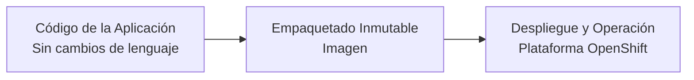
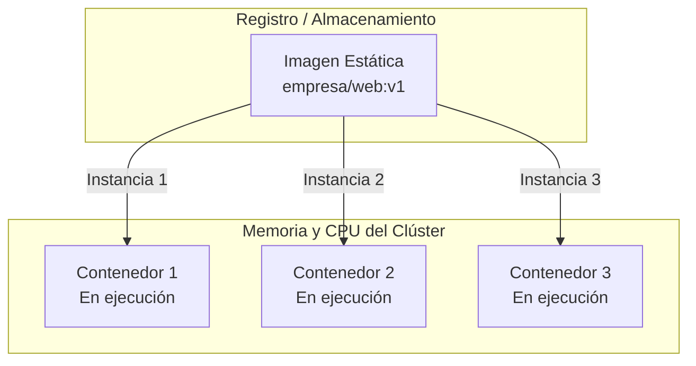
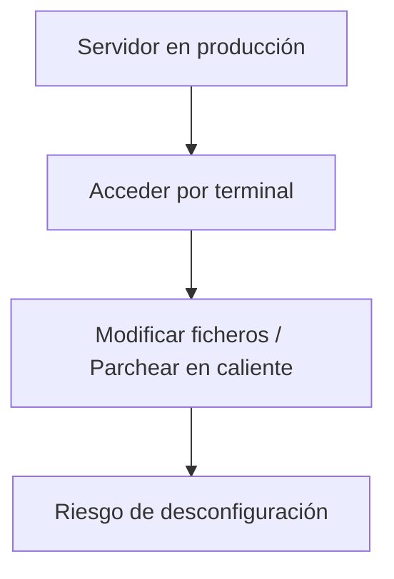

# 1.2 De servidor a contenedor: imagen, capas, contenedor efímero y lectura de un Dockerfile

## Objetivos de aprendizaje

Al finalizar este apartado serás capaz de:

- Comprender la transición desde la administración tradicional de servidores hacia el modelo basado en contenedores.
- Entender que los contenedores transforman la forma de empaquetar, distribuir y operar las aplicaciones, sin alterar la lógica de desarrollo o programación.
- Diferenciar con total claridad la secuencia fundamental: **`Dockerfile` (El guion) $\rightarrow$ Imagen (La plantilla estática / ISO) $\rightarrow$ Contenedor (La instancia viva)**.
- Interpretar de forma práctica las instrucciones clave de un `Dockerfile` básico.
- Asimilar la naturaleza efímera de los contenedores y el principio operativo de **sustituir en lugar de parchear**.

---

## Del servidor tradicional al contenedor: por qué cambia el modelo

Durante muchos años, la forma estándar de desplegar aplicaciones consistía en aprovisionar un servidor físico o una máquina virtual, instalar manualmente el sistema operativo, configurar las dependencias y desplegar la aplicación directamente sobre él.

### El problema de la "deriva de configuración"

En la administración clásica de sistemas, el proceso estándar seguía estos pasos:

- Se preparaba un servidor físico o una máquina virtual.
- Se instalaba el sistema operativo y se aplicaban parches.
- Se instalaban manualmente las librerías, dependencias y runtimes (Java, Node.js, Python, servidor web, etc.).
- Se desplegaba y configuraba la aplicación en carpetas locales.
- Se realizaban actualizaciones, retoques y parches directamente sobre ese servidor en marcha.

Este modelo provocaba un inconveniente crónico: los cambios manuales y las modificaciones aplicadas a lo largo del tiempo hacían que cada servidor terminase teniendo una configuración única. Esto daba pie al clásico problema:

!!! note "El problema habitual"

    *"En mi entorno de desarrollo/pruebas funciona perfectamente, pero en producción falla."*
    Pequeñas diferencias de versión, librerías o parches provocaban comportamientos impredecibles entre entornos.

Los contenedores surgen precisamente para solucionar este problema de raíz. La idea central es sencilla: **en lugar de transportar instrucciones para instalar una aplicación en un servidor, empaquetamos la aplicación junto con todo su entorno en una caja estanca e idéntica.**

---

## Un cambio en la forma de desplegar, no en la forma de programar

Cuando se empieza a trabajar con plataformas de contenedores como Red Hat OpenShift, suele surgir una duda frecuente:

**¿Tengo que aprender a programar para usar OpenShift?**

La respuesta es **no**.

OpenShift no define cómo se programa la lógica de una aplicación ni condiciona el lenguaje de desarrollo. Lo que cambia por completo es el método de empaquetamiento, transporte, despliegue y operación de esa aplicación.



---

## La base de todo: Guion, Plantilla e Instancia

Para comprender cómo funciona el mundo de los contenedores sin perderse en la jerga técnica, basta con distinguir con total precisión tres conceptos interconectados:

```mermaid
flowchart LR
    A["1. El Dockerfile\n(El guion / receta)"] -->|Proceso de construcción\n(Build)| B["2. La Imagen\n(La plantilla estática / ISO)"]
    B -->|Proceso de ejecución\n(Run)| C["3. El Contenedor\n(La instancia viva)"]
```

### 1. El `Dockerfile` (La Receta / El Script de Instalación)
Es simplemente un documento de texto plano, un guion o un paso a paso detallado de todo lo que harías a mano en un servidor limpio:
- *"Paso 1: Ponme un sistema operativo base ligero."*
- *"Paso 2: Instálame el entorno de Java 17."*
- *"Paso 3: Copia este archivo `.jar` dentro de la carpeta `/app`."*
- *"Paso 4: Configura que al arrancar se ejecute este comando."*

Por sí solo, el `Dockerfile` es solo un archivo de texto con instrucciones; no consume memoria ni procesa nada hasta que alguien lo ejecuta.

### 2. La Imagen Construida (La Plantilla / La ISO Máster)
Es el resultado de coger ese guion (`Dockerfile`) y ejecutarlo de principio a fin durante el proceso de construcción (*build*). El motor de contenedores lee el script, descarga las dependencias, empaqueta todo y **congela el resultado en un archivo estático y de sólo lectura**.
- Es exactamente el mismo concepto que una plantilla de máquina virtual (*VM Template*), un *snapshot* o una **imagen ISO máster**.
- Nadie entra a modificar una plantilla ISO en caliente mientras está guardada en el repositorio; es una maqueta estática e **inmutable** lista para ser clonada o instanciada las veces que haga falta.

### 3. El Contenedor (La Máquina Virtual Encendida / La Instancia Activa)
Es cuando coges esa plantilla estática (la imagen) y le dices a la plataforma: *"Quiero arrancar una instancia de esto ya"*.

En ese preciso instante, la plataforma coge la plantilla, le asigna memoria RAM, hilos de CPU, una dirección IP y un disco temporal de trabajo, y enciende el proceso.
- El contenedor es la **entidad viva, en ejecución**.
- Si la aplicación dentro del contenedor recibe peticiones web, el contenedor las procesa y responde.
- Si el contenedor se apaga o se destruye, muere con él todo lo que estuviera ocurriendo en su disco temporal, pero la **imagen original permanece intacta** en el registro, lista para volver a encenderse tantas veces como sea necesario.



Una única imagen estática sirve para arrancar múltiples contenedores idénticos simultáneamente.

---

## Lectura detallada de un Dockerfile

En esta fase del curso no es necesario redactar ficheros `Dockerfile` complejos, pero sí es fundamental **saber leer e interpretar** qué hace cada instrucción básica cuando analizamos una aplicación.

A continuación vemos un ejemplo representativo de un `Dockerfile`:

```dockerfile
# 1. Definimos la imagen base de partida
FROM [registry.access.redhat.com/ubi9/openjdk-17:latest](https://registry.access.redhat.com/ubi9/openjdk-17:latest)

# 2. Copiamos el archivo ejecutable de la aplicación dentro de la imagen
COPY target/app.jar /opt/app/app.jar

# 3. Declaramos el puerto de red en el que escuchará la aplicación
EXPOSE 8080

# 4. Establecemos el comando que se ejecutará al arrancar el contenedor
CMD ["java", "-jar", "/opt/app/app.jar"]
```

### Desglose de instrucciones:

- **`FROM`**: Especifica la **imagen base** de la que se parte. Ninguna imagen se construye desde cero absoluto; se suele reutilizar una plantilla limpia y homologada (por ejemplo, Red Hat Universal Base Image con Java 17).
- **`COPY`**: Toma un archivo o binario de nuestro equipo (como el ejecutable `.jar` de la aplicación) y lo introduce dentro del paquete de la imagen.
- **`EXPOSE`**: Indica de forma informativa qué puerto de red interna utiliza la aplicación para recibir peticiones (por ejemplo, el puerto 8080).
- **`CMD`**: Fija el comando principal que se ejecutará en primer plano en el momento en que la imagen se convierta en un contenedor activo.

---

## El contenedor es efímero

Uno de los cambios de mentalidad más importantes al trabajar con OpenShift es asimilar que **un contenedor es efímero por naturaleza**:

- Un contenedor no está pensado para durar indefinidamente. Puede crearse, detenerse, destruirse y volverse a crear en cuestión de segundos.
- Los contenedores **no deben almacenar datos permanentes en su disco interno**. Si un contenedor se elimina o falla, cualquier dato escrito directamente dentro de él se pierde.
- Toda la información persistente (bases de datos, archivos subidos por usuarios) se almacena siempre fuera del contenedor, en volúmenes de almacenamiento independientes.

!!! warning "Mentalidad Cloud-Native"

    Lo importante nunca es un contenedor concreto, sino la **imagen** desde la cual fue creado. Los contenedores son piezas reemplazables.

---

## Sustituir en lugar de parchear

Esta naturaleza efímera transforma radicalmente la forma de aplicar actualizaciones o corregir errores en producción:

### El modelo tradicional (Parchear)



En la administración clásica, ante una actualización o un error, se accedía directamente al servidor en marcha y se aplicaba el cambio sobre el sistema vivo.

### El modelo basado en contenedores (Sustituir)

```mermaid
flowchart TD
    A[Modificación de código o receta] --> B[Construcción de Nueva Imagen\n(v2.0)]
    B --> C[Despliegue de Nuevo Contenedor]
    C --> D[Retirada del Contenedor Antiguo\n(v1.0)]
```

En OpenShift **nunca se modifica un contenedor en marcha**. Ante un cambio de código, una actualización de seguridad o la corrección de un fallo:

1. Se actualiza el código o la receta (`Dockerfile`).
2. Se construye una **nueva versión de la imagen** (por ejemplo, `v2.0`).
3. Se despliega un **nuevo contenedor** a partir de la nueva imagen.
4. Se retira y elimina el contenedor antiguo.

### Ventajas principales:
- **Cambios controlados y trazables**: Se sabe exactamente qué versión de código está corriendo.
- **Mayor predictibilidad**: El entorno de pruebas ejecuto exactamente el mismo artefacto inmutable que se despliega en producción.
- **Rollback sencillo**: Si la nueva versión falla, volver a la versión anterior (`v1.0`) requiere solo segundos, arrancando un contenedor desde la imagen previa.

---

## Resumen del apartado

- **Evolución**: Pasamos de configurar servidores a mano (sometidos a la deriva de configuración) a empaquetar aplicaciones en contenedores estandarizados.
- **Roles claros**: No cambia la forma de programar; cambia la forma de empaquetar, desplegar y operar.
- **La Tríada Clave**:
  - **`Dockerfile`**: El guion o script con las instrucciones de montaje.
  - **Imagen**: La plantilla o ISO estática e inmutable generada al procesar el guion.
  - **Contenedor**: La instancia viva en ejecución que consume memoria, CPU y atiende peticiones.
- **Naturaleza Efímera**: Los contenedores no se parchean en caliente; ante cualquier actualización o corrección, **se genera una nueva imagen y se sustituye la instancia**.