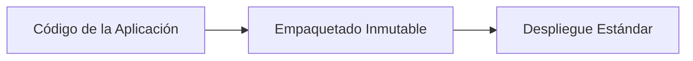
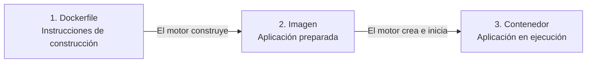
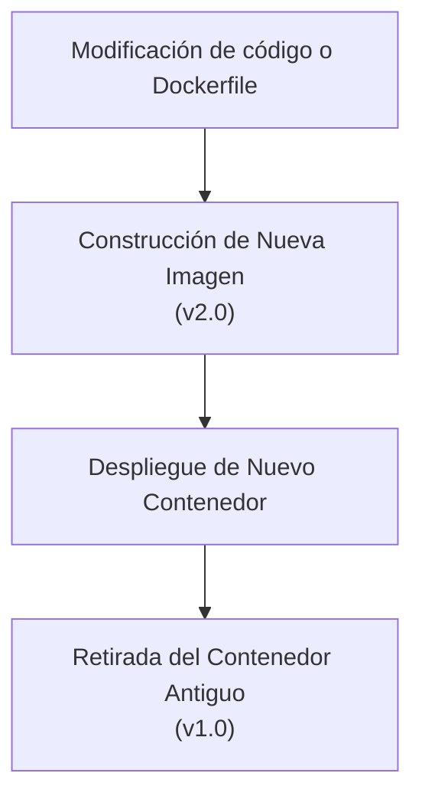

## 1.2 De servidor a contenedor: imagen, capas, contenedor efímero y lectura de un Dockerfile

### Objetivos de aprendizaje

Al finalizar este apartado serás capaz de:

- Comprender la transición desde la administración tradicional de servidores hacia el modelo basado en contenedores.
- Entender que los contenedores transforman la forma de empaquetar, distribuir y operar las aplicaciones, sin alterar la lógica de desarrollo o programación.
- Comprender la relación entre el **Dockerfile**, la **imagen**, el **motor de contenedores** y el **contenedor en ejecución**.
- Interpretar de forma práctica las instrucciones clave de un Dockerfile básico.
- Asimilar la naturaleza efímera de los contenedores y el principio operativo de **sustituir en lugar de parchear**.

### Del servidor tradicional al contenedor: por qué cambia el modelo

Durante muchos años, la forma estándar de desplegar aplicaciones consistía en aprovisionar un servidor físico o una máquina virtual, instalar manualmente el sistema operativo, configurar las dependencias y desplegar la aplicación directamente sobre él.

#### El problema de la "deriva de configuración"

En la administración clásica de sistemas, el proceso estándar seguía estos pasos:

- Se preparaba un servidor físico o una máquina virtual.
- Se instalaba el sistema operativo y se aplicaban parches.
- Se instalaban manualmente las librerías, dependencias y runtimes (Java, Node.js, Python, servidor web, etc.).
- Se desplegaba y configuraba la aplicación en carpetas locales.
- Se realizaban actualizaciones, retoques y parches directamente sobre ese servidor en marcha.

Este modelo provocaba un inconveniente crónico: los cambios manuales y las modificaciones aplicadas a lo largo del tiempo hacían que cada servidor terminase teniendo una configuración única. Esto daba pie al clásico problema:

!!! note "El problema habitual"

    Una aplicación podía funcionar correctamente en un servidor y fallar en otro porque, con el tiempo, ambos habían terminado teniendo configuraciones diferentes.

Los contenedores surgen precisamente para solucionar este problema de raíz. La idea central es sencilla: **en lugar de transportar instrucciones para instalar una aplicación en un servidor, empaquetamos la aplicación junto con todo su entorno en una caja estanca e idéntica.**

### Un cambio en la forma de desplegar, no en la forma de programar

Cuando se empieza a trabajar con tecnologías de contenedores, suele surgir una duda frecuente:
**¿Tengo que aprender a programar para usar contenedores?**
La respuesta es **no**.
El uso de contenedores no define cómo se programa la lógica de una aplicación ni condiciona el lenguaje de desarrollo. Lo que cambia por completo es el método de empaquetamiento, transporte, despliegue y operación de esa aplicación.



### La base de todo: Dockerfile, imagen, motor de contenedores y contenedor

Para comprender cómo funciona el modelo de contenedores, debemos distinguir cuatro elementos relacionados entre sí: el **Dockerfile**, la **imagen**, el **motor de contenedores** y el **contenedor**.



#### 1. El Dockerfile

Es un archivo de texto que contiene las instrucciones necesarias para construir una imagen: la imagen base de la que se parte, los archivos que deben incorporarse, las dependencias necesarias y el comando que deberá ejecutarse al iniciar el contenedor.

Por ejemplo, un Dockerfile puede indicar:

- _"Paso 1: Parte de una imagen base que incluya Java 17 y los componentes necesarios."_
- _"Paso 2: Copia el archivo .jar de la aplicación dentro de la carpeta /app."_
- _"Paso 3: Configura que al arrancar se ejecute este comando."_

El Dockerfile no se ejecuta como una aplicación. El motor de contenedores interpreta sus instrucciones durante el proceso de construcción de la imagen.

#### 2. El motor de contenedores

El **motor de contenedores** es el software que realiza las operaciones sobre las imágenes y los contenedores. Existen distintas herramientas para trabajar con ellos, como **Podman** o **Docker**. En nuestras prácticas utilizaremos **Podman**.

El motor interviene en dos momentos principales:

- **Construcción:** interpreta las instrucciones del Dockerfile y genera la imagen.
- **Ejecución:** utiliza la imagen para crear un contenedor e iniciar en su interior el proceso principal de la aplicación.

Por tanto, aunque habitualmente se hable de «ejecutar una imagen», la imagen no se ejecuta directamente: el motor crea e inicia un contenedor a partir de ella.

#### 3. La imagen construida

La imagen es el resultado del proceso de construcción (_build_). Contiene la aplicación y los elementos necesarios para ejecutarla, organizados en capas de solo lectura.

La imagen no es todavía una aplicación en funcionamiento. Es el contenido preparado para que pueda iniciarse siempre de la misma forma.


#### 4. El contenedor

El contenedor es la ejecución concreta creada por el motor a partir de una imagen. Mientras está en funcionamiento, ejecuta el proceso principal de la aplicación y consume los recursos que tenga asignados, como CPU y memoria.

- El contenedor es la **entidad en ejecución**.
- Si la aplicación recibe peticiones web, el proceso que se ejecuta dentro del contenedor las procesa y responde.
- Si el contenedor se apaga o se destruye, desaparece todo lo que estuviera ocurriendo en su almacenamiento temporal, pero la imagen original permanece intacta y puede volver a utilizarse.

En este apartado utilizaremos Podman para comprender cómo se construye una imagen y cómo se crea un contenedor. Más adelante veremos que Kubernetes y OpenShift permiten coordinar y gestionar los contenedores sin tener que iniciarlos y supervisarlos individualmente.

### Lectura detallada de un Dockerfile

En esta fase del curso no es necesario redactar ficheros Dockerfile complejos, pero sí es fundamental **saber leer e interpretar** qué hace cada instrucción básica cuando analizamos una aplicación.
A continuación vemos un ejemplo representativo de un Dockerfile:

```dockerfile
# 1. Definimos la imagen base de partida
FROM registry.access.redhat.com/ubi9/openjdk-17:latest
# 2. Copiamos el archivo ejecutable de la aplicación dentro de la imagen
COPY target/app.jar /opt/app/app.jar
# 3. Declaramos el puerto de red en el que escuchará la aplicación
EXPOSE 8080
# 4. Establecemos el comando que se ejecutará al arrancar el contenedor
CMD ["java", "-jar", "/opt/app/app.jar"]
```

#### Desglose de instrucciones:

- **FROM**: Indica la **imagen base** sobre la que se construirá la nueva imagen. Esta imagen proporciona un punto de partida con determinados componentes ya preparados. En este ejemplo, partimos de una Red Hat Universal Base Image que ya incluye Java 17 y añadimos sobre ella nuestra aplicación.
- **COPY**: Toma un archivo o binario desde el contexto de compilación (como el ejecutable .jar de la aplicación) y lo introduce dentro del paquete de la imagen.
- **EXPOSE**: Indica de forma informativa qué puerto de red interna utiliza la aplicación para recibir peticiones (por ejemplo, el puerto 8080).
- **CMD**: Fija el comando principal que se ejecutará en primer plano en el momento en que la imagen se convierta en un contenedor activo.

### El contenedor es efímero

Uno de los cambios de mentalidad más importantes al trabajar con contenedores es asimilar que **un contenedor es efímero por naturaleza**:

- Un contenedor no está pensado para durar indefinidamente. Puede crearse, detenerse, destruirse y volverse a crear en cuestión de segundos.
- Los contenedores **no deben almacenar datos permanentes en su disco interno**. Si un contenedor se elimina o falla, cualquier dato escrito directamente dentro de él se pierde.
- Toda la información persistente (bases de datos, archivos subidos por usuarios) se almacena siempre fuera del contenedor, en volúmenes de almacenamiento independientes.

!!! warning "Mentalidad Cloud-Native"

    Los contenedores se consideran reemplazables. La aplicación y su configuración deben poder reconstruirse y desplegarse de nuevo, mientras que los datos que deban conservarse se almacenan fuera del contenedor.

### Sustituir en lugar de parchear

Esta naturaleza efímera transforma radicalmente la forma de aplicar actualizaciones o corregir errores en producción:

#### El modelo tradicional (Parchear)

En la administración clásica, ante una actualización o un error, se accedía directamente al servidor en marcha y se aplicaba el cambio sobre el sistema vivo.

#### El modelo basado en contenedores (Sustituir)



En las plataformas de contenedores **nunca se modifica un contenedor en marcha**. Ante un cambio de código, una actualización de seguridad o la corrección de un fallo:

- Se actualiza el código o el Dockerfile.
- Se construye una **nueva versión de la imagen** (por ejemplo, v2.0).
- Se despliega un **nuevo contenedor** a partir de la nueva imagen.
- Se retira y elimina el contenedor antiguo.

#### Ventajas principales:

- **Cambios controlados y trazables**: Se sabe exactamente qué versión de código está corriendo.
- **Mayor predictibilidad**: El entorno de pruebas ejecuta exactamente el mismo artefacto inmutable que se despliega en producción.
- **Rollback sencillo**: Si la nueva versión falla, volver a la versión anterior (v1.0) requiere solo segundos, arrancando un contenedor desde la imagen previa.

### Ideas clave para recordar

!!! tip "Resumen"

    - El **Dockerfile** describe cómo construir la aplicación.
    - La **imagen** es el artefacto estático e inmutable generado durante la construcción.
    - El **contenedor** es una instancia en ejecución de esa imagen.
    - Los contenedores son efímeros: se sustituyen por nuevas instancias en lugar de modificarse en marcha.
