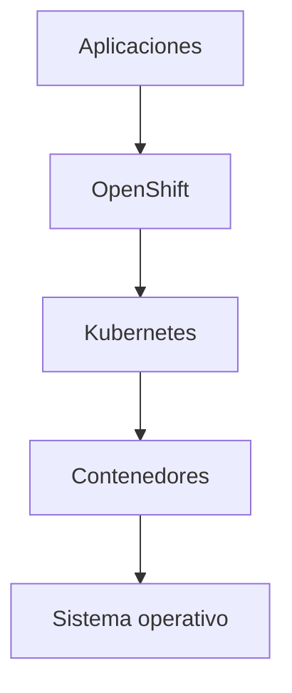
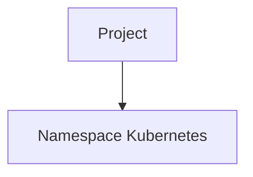
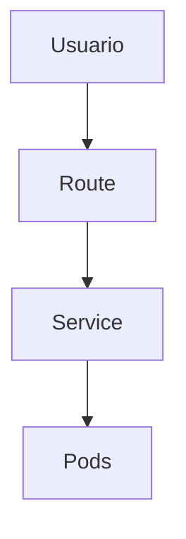
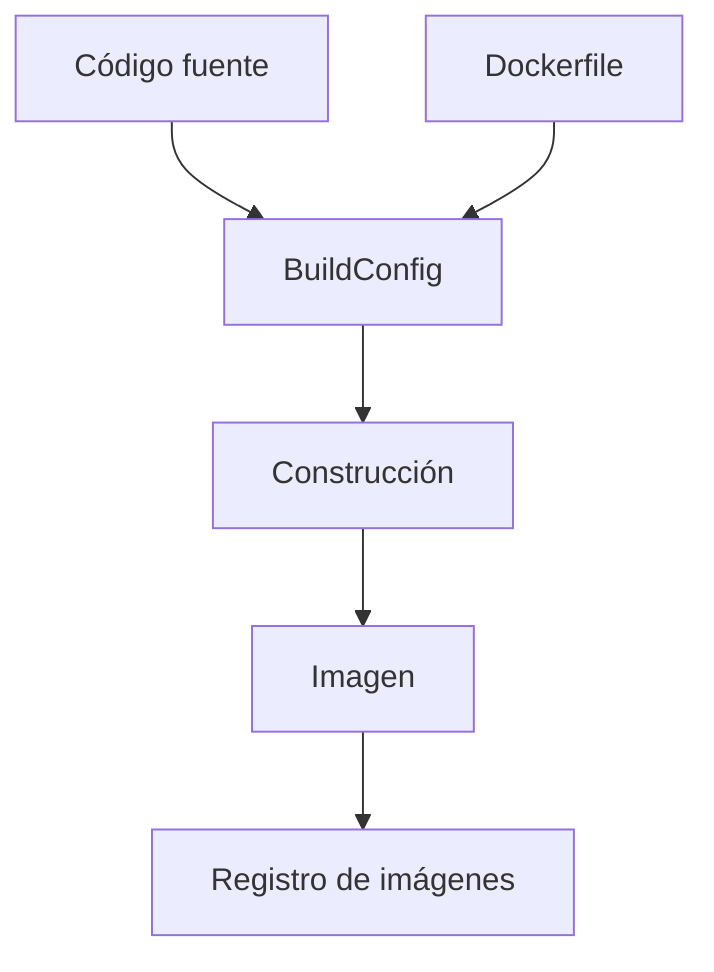
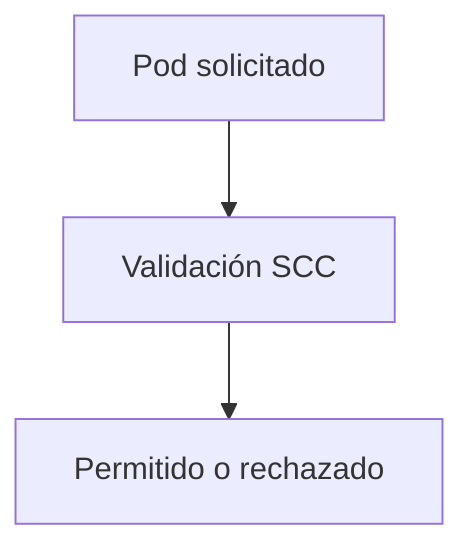
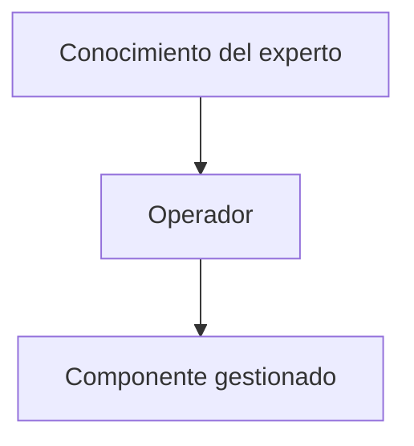
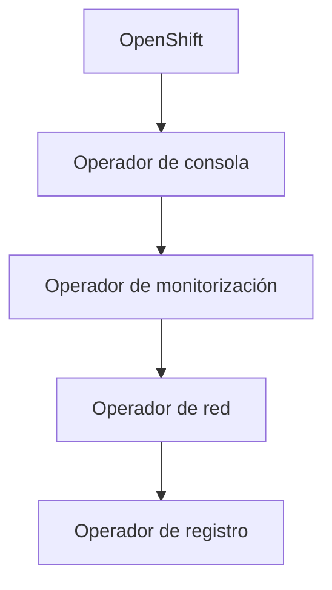
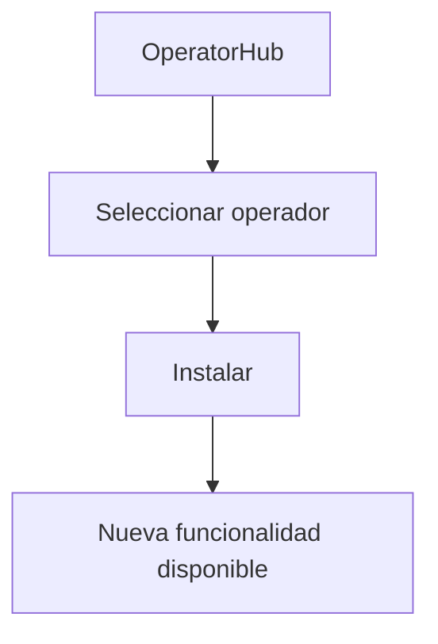

# 1.4 Qué añade OpenShift: Projects, Routes, ImageStreams, BuildConfigs, SCC, OLM y el concepto de operador

## Objetivos de aprendizaje

Al finalizar este apartado serás capaz de:

- Comprender que OpenShift se construye sobre Kubernetes y añade capacidades adicionales.
- Identificar algunos de los recursos más característicos de OpenShift.
- Comprender la diferencia entre Project y Namespace.
- Entender el propósito de las Routes y la integración nativa de la exposición exterior en OpenShift.
- Comprender el objetivo de las Security Context Constraints (SCC).
- Reconocer la existencia de BuildConfig como mecanismo de construcción de imágenes.
- Entender qué es un operador y por qué es un concepto fundamental en la plataforma.
- Comprender el papel de OperatorHub como mecanismo de extensión de la plataforma.

## Kubernetes y OpenShift: relación entre ambos

OpenShift no sustituye Kubernetes.

OpenShift utiliza Kubernetes como base y añade funcionalidades orientadas a facilitar la construcción, operación y administración de plataformas empresariales.



Todos los conceptos fundamentales siguen existiendo:

- Pods.
- Deployments.
- Services.
- Namespaces.
- ConfigMaps.
- Secrets.

!!! tip "Idea clave"

    OpenShift no reemplaza Kubernetes. OpenShift amplía Kubernetes con funcionalidades empresariales adicionales.

## Projects: el espacio de trabajo habitual

En Kubernetes existe el concepto de Namespace.

OpenShift introduce el concepto de Project, que se apoya sobre un Namespace pero añade capacidades relacionadas con usuarios, permisos y experiencia de uso.



### Ejemplos de proyectos

```text
equipo-a-dev
equipo-a-test
equipo-a-prod
```

Cada proyecto contiene sus propios recursos:

- Pods.
- Deployments.
- Services.
- Routes.
- ConfigMaps.
- Secrets.

!!! note "Durante el curso"

    Cada alumno trabajará normalmente dentro de su propio Project.

## Routes: publicar aplicaciones fuera del clúster

Un Service proporciona acceso estable dentro del clúster.

Cuando necesitamos acceso desde el exterior utilizamos una Route.



Ejemplo:

```text
[https://mi-aplicacion.apps.empresa.com](https://mi-aplicacion.apps.empresa.com)
```

Aunque Kubernetes dispone de mecanismos para exponer servicios al exterior (como los tipos de servicio `NodePort` o `LoadBalancer`, y el recurso `Ingress`), en Kubernetes nativo la exposición exterior requiere configurar por separado un controlador de entrada (*Ingress Controller*, como NGINX o Traefik), gestionar los certificados TLS y resolver de forma independiente la infraestructura de encaminamiento.

OpenShift resuelve esto de manera integrada mediante el recurso **Route**:

- Incorpora un enrutador inteligente de plataforma (basado en HAProxy) listo para usar.
- Permite gestionar nombres de host públicos y terminación TLS de forma nativa.
- Simplifica la publicación de aplicaciones estandarizando el acceso externo.

!!! tip "Para recordar"

    Service resuelve el acceso interno dentro del clúster.

    Route resuelve el acceso externo desde fuera del clúster de forma integrada.

## BuildConfig: construcción de imágenes en OpenShift

OpenShift incorpora mecanismos propios para construir imágenes dentro de la plataforma.



Un BuildConfig define cómo debe ejecutarse la construcción.

Habitualmente describe:

- Origen del código.
- Estrategia de construcción.
- Destino de la imagen.

!!! note "Importante"

    BuildConfig no sustituye al Dockerfile.
    Ambos colaboran en el proceso de construcción.

## SCC: una capa adicional de seguridad

OpenShift incorpora Security Context Constraints (SCC).

Las SCC definen qué puede hacer un contenedor cuando se ejecuta.



Ejemplos de controles:

- Usuario de ejecución.
- Privilegios permitidos.
- Capacidades del sistema.
- Configuraciones de seguridad.

!!! warning "Seguridad"

    Las SCC son una de las diferencias más importantes entre OpenShift y muchas instalaciones básicas de Kubernetes.

## El concepto de operador

Un operador es un componente software encargado de instalar, configurar, mantener y actualizar otro componente software dentro de Kubernetes. Puede verse como un **administrador software automatizado** o un "sysadmin robotizado".



En instalaciones tradicionales de Kubernetes o servidores convencionales, la gestión del ciclo de vida de aplicaciones complejas (como bases de datos, sistemas de mensajería o herramientas de monitorización) requiere tareas manuales constantes: scripts en Bash, tareas programadas en *Cron*, intervenciones manuales para copias de seguridad, renovación de certificados o actualización de versiones. 

Un operador sustituye esa gestión manual empaquetando el conocimiento de un administrador experto en un programa que ejecuta un **bucle de reconciliación continuo**:

1. Compara constantemente el estado deseado con el estado real del sistema.
2. Si detecta desviaciones o fallos, aplica las correcciones automáticamente.
3. Automatiza tareas avanzadas de "Día 2" (actualizaciones, escalado, recuperaciones) sin intervención humana.

## El clúster está hecho de operadores

Gran parte de los componentes internos de OpenShift están gestionados mediante operadores.

Ejemplos:

- Consola web.
- Registro interno.
- Monitorización.
- Red.
- Certificados.
- Autenticación.
- Almacenamiento.



!!! tip "Idea fundamental"

    OpenShift es, en gran medida, una plataforma construida sobre operadores.

## OperatorHub: ampliar la plataforma

OperatorHub proporciona un catálogo de operadores instalables directamente desde la plataforma.



Gracias a OperatorHub es posible ampliar las capacidades del clúster de forma sencilla.

!!! note "Nota pedagógica"

    El funcionamiento detallado de OperatorHub, la gestión de suscripciones (Subscription), los manifiestos CSV y el ciclo de vida de los operadores se trabajarán en detalle en la Sesión 3.

## Ideas clave para recordar

!!! tip "Resumen"

    - OpenShift utiliza Kubernetes como base.
    - Project es la forma habitual de trabajar con Namespaces.
    - Route proporciona acceso externo integrado sin necesidad de configurar controladores de entrada adicionales.
    - BuildConfig permite construir imágenes dentro de OpenShift.
    - SCC añade controles de seguridad adicionales.
    - Los operadores automatizan la gestión de componentes sustituyendo tareas y scripts manuales.
    - Gran parte de OpenShift está construida sobre operadores.
    - OperatorHub permite ampliar la plataforma mediante nuevos operadores.