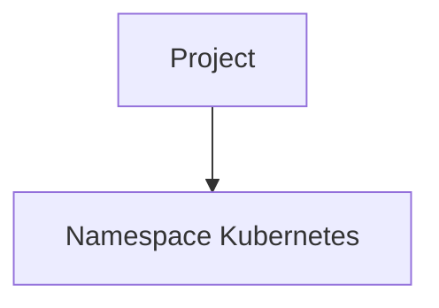
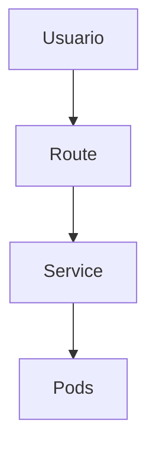
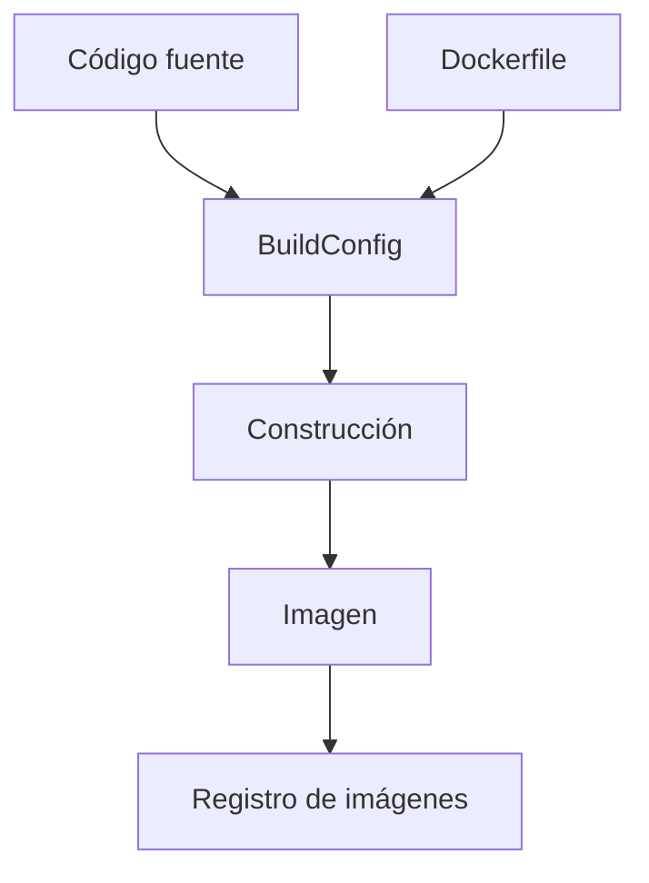
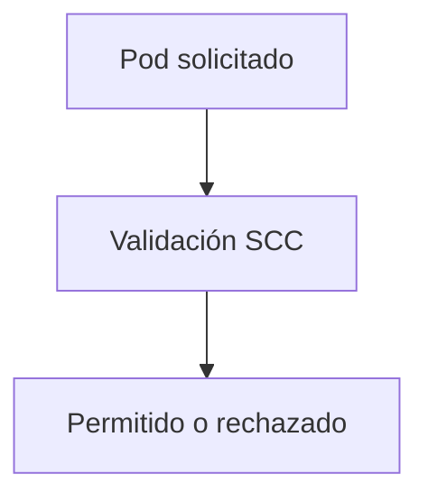
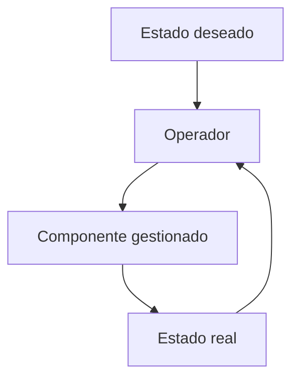
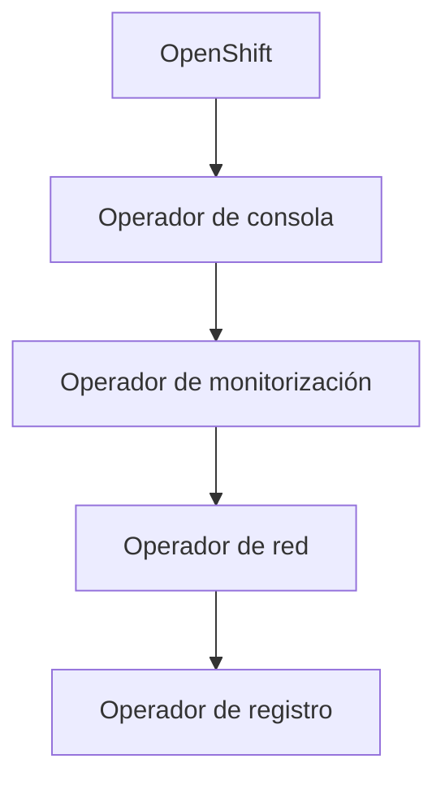
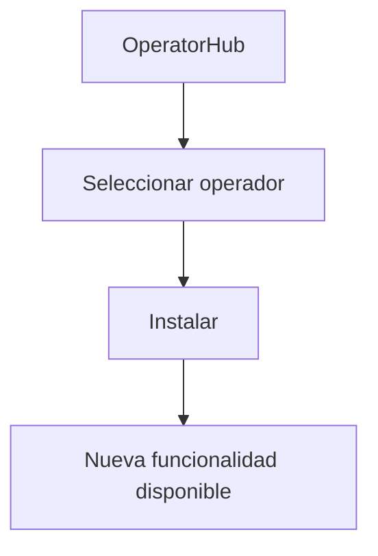

# 1.4 Qué añade OpenShift sobre Kubernetes

## Objetivos de aprendizaje

Al finalizar este apartado serás capaz de:

- Comprender que OpenShift se construye sobre Kubernetes y añade capacidades adicionales.
- Identificar algunos de los recursos más característicos de OpenShift.
- Comprender la diferencia entre Project y Namespace.
- Entender el propósito de las Routes y la integración nativa de la exposición exterior en OpenShift.
- Comprender el objetivo de las Security Context Constraints (SCC).
- Reconocer la existencia de BuildConfig como mecanismo de construcción de imágenes.
- Entender qué es un operador y por qué es un concepto fundamental en la plataforma.
- Comprender el papel de OperatorHub como mecanismo de extensión de la plataforma.

## Kubernetes y OpenShift: relación entre ambos

En el apartado anterior hemos visto cómo Kubernetes organiza y mantiene aplicaciones basadas en contenedores mediante recursos como Deployments, ReplicaSets, Pods y Services. También hemos visto que compara continuamente el estado deseado con el estado real y actúa cuando detecta diferencias.

Todo eso sigue existiendo en OpenShift.

OpenShift no sustituye Kubernetes. OpenShift utiliza Kubernetes como base y añade funcionalidades orientadas a facilitar la construcción, operación y administración de plataformas empresariales.


Los conceptos fundamentales de Kubernetes siguen existiendo. En OpenShift seguimos trabajando, entre otros, con:

- Pods.
- Deployments.
- Services.
- Namespaces.

OpenShift añade sobre esa base recursos y capacidades propios que facilitan el trabajo de desarrolladores y administradores.

!!! tip "Idea clave"

    OpenShift no reemplaza Kubernetes. OpenShift amplía Kubernetes con funcionalidades empresariales adicionales.

## Projects: el espacio de trabajo habitual

En un mismo clúster pueden trabajar distintos equipos o convivir varios entornos. Para organizar y separar sus recursos, Kubernetes utiliza el concepto de Namespace.

OpenShift presenta el concepto de Project, que se apoya sobre un Namespace pero añade capacidades relacionadas con usuarios, permisos y experiencia de uso.



### Ejemplos de proyectos

```text
equipo-a-dev
equipo-a-test
equipo-a-prod
```

Cada proyecto contiene sus propios recursos:

- Pods.
- Deployments.
- Services.
- Routes.
- ConfigMaps.
- Secrets.

!!! note "Durante el curso"

    Cada alumno trabajará en sus propios proyectos para desplegar y gestionar los recursos de las prácticas.

## Routes: publicar aplicaciones fuera del clúster

En el apartado anterior vimos que un Service proporciona un punto de acceso estable a un conjunto de Pods dentro del clúster.

Cuando necesitamos que un usuario acceda a la aplicación desde el exterior, OpenShift permite publicar ese Service mediante una Route.



Ejemplo:

[https://mi-aplicacion.apps.empresa.com](https://mi-aplicacion.apps.empresa.com)

Aunque Kubernetes dispone de mecanismos para exponer servicios al exterior, como los tipos de Service NodePort o LoadBalancer y el recurso Ingress, su utilización depende de la infraestructura y de los componentes instalados en el clúster.

OpenShift resuelve esta necesidad de manera integrada mediante el recurso **Route**:

- Incorpora un enrutador de plataforma listo para usar.
- Permite gestionar nombres de host públicos y terminación TLS.
- Simplifica la publicación de aplicaciones estandarizando el acceso externo.

!!! tip "Para recordar"

    El Service proporciona acceso estable a los Pods. La Route utiliza ese Service para publicar la aplicación fuera del clúster.

## BuildConfig: construcción de imágenes en OpenShift

En el apartado 1.2 vimos cómo una imagen puede construirse a partir del contenido de la aplicación y de las instrucciones definidas en un Dockerfile.

OpenShift incorpora mecanismos propios para gestionar esa construcción dentro de la plataforma.



Un BuildConfig define cómo debe ejecutarse la construcción.

Habitualmente describe:

- Origen del código.
- Estrategia de construcción.
- Destino de la imagen.

!!! note "Importante"

    En este apartado presentamos BuildConfig como una capacidad característica de OpenShift. Más adelante veremos con detalle cómo construir imágenes dentro de la plataforma.

## SCC: una capa adicional de seguridad

OpenShift aplica restricciones adicionales sobre cómo pueden ejecutarse los contenedores. Uno de los mecanismos utilizados para ello son las Security Context Constraints (SCC).

Las SCC definen qué puede hacer un contenedor cuando se ejecuta.



Ejemplos de controles:

- Usuario de ejecución.
- Privilegios permitidos.
- Capacidades del sistema.
- Configuraciones de seguridad.

!!! warning "Seguridad"

    El objetivo no es conceder más privilegios para que una aplicación funcione, sino ejecutarla con los permisos mínimos necesarios.

## El concepto de operador

En el apartado anterior vimos que Kubernetes compara continuamente el estado deseado con el estado real y corrige las diferencias mediante un bucle de reconciliación.

Los operadores aplican esa misma idea a la gestión de componentes más complejos.

Un operador es un componente software encargado de instalar, configurar, mantener y actualizar otro componente software dentro de Kubernetes.



En instalaciones tradicionales de Kubernetes o servidores convencionales, la gestión del ciclo de vida de aplicaciones complejas, como bases de datos, sistemas de mensajería o herramientas de monitorización, requiere distintas tareas manuales: scripts en Bash, tareas programadas en Cron, intervenciones para realizar copias de seguridad, renovación de certificados o actualización de versiones.

Un operador automatiza parte de esa gestión incorporando el conocimiento de un administrador experto en un programa que ejecuta un **bucle de reconciliación continuo**:

1. Compara constantemente el estado deseado con el estado real del sistema.
2. Si detecta desviaciones o fallos, aplica las correcciones automáticamente.
3. Automatiza tareas avanzadas de "Día 2", como actualizaciones, escalado o recuperaciones.

!!! tip "Relación con Kubernetes"

    Un operador extiende el mismo modelo de control y reconciliación que ya utiliza Kubernetes para aplicarlo a componentes con necesidades operativas más complejas.

## El clúster está hecho de operadores

Los operadores no sirven únicamente para instalar aplicaciones adicionales. Gran parte de los componentes internos de OpenShift están gestionados mediante operadores.

Ejemplos:

- Consola web.
- Registro interno.
- Monitorización.
- Red.
- Certificados.
- Autenticación.
- Almacenamiento.



!!! tip "Idea fundamental"

    OpenShift es, en gran medida, una plataforma construida sobre operadores.

## OperatorHub: ampliar la plataforma

OperatorHub proporciona un catálogo de operadores instalables directamente desde la plataforma.



Gracias a OperatorHub es posible ampliar las capacidades del clúster de forma sencilla.

Conviene distinguir ambos conceptos:

- Un **operador** automatiza la gestión de un componente.
- **OperatorHub** es el catálogo desde el que se pueden localizar e instalar operadores adicionales.

!!! note "Nota pedagógica"

    El funcionamiento detallado de OperatorHub y la gestión del ciclo de vida de los operadores se trabajarán más adelante en el curso.

## Ideas clave para recordar

!!! tip "Resumen"

    - OpenShift utiliza Kubernetes como base.
    - Project es la forma habitual de trabajar con Namespaces.
    - El Service proporciona acceso estable a los Pods y la Route permite publicar ese Service fuera del clúster.
    - BuildConfig permite construir imágenes dentro de OpenShift.
    - SCC añade controles de seguridad adicionales.
    - Los operadores aplican el principio de reconciliación a la gestión automatizada de componentes complejos.
    - Gran parte de OpenShift está construida sobre operadores.
    - OperatorHub permite ampliar la plataforma mediante nuevos operadores.

Ya sabemos qué añade OpenShift sobre Kubernetes. En el siguiente apartado veremos cómo se organiza el clúster que hace posible todas estas capacidades.
