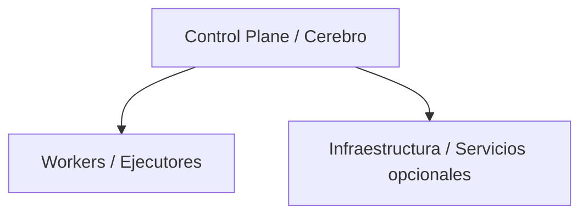
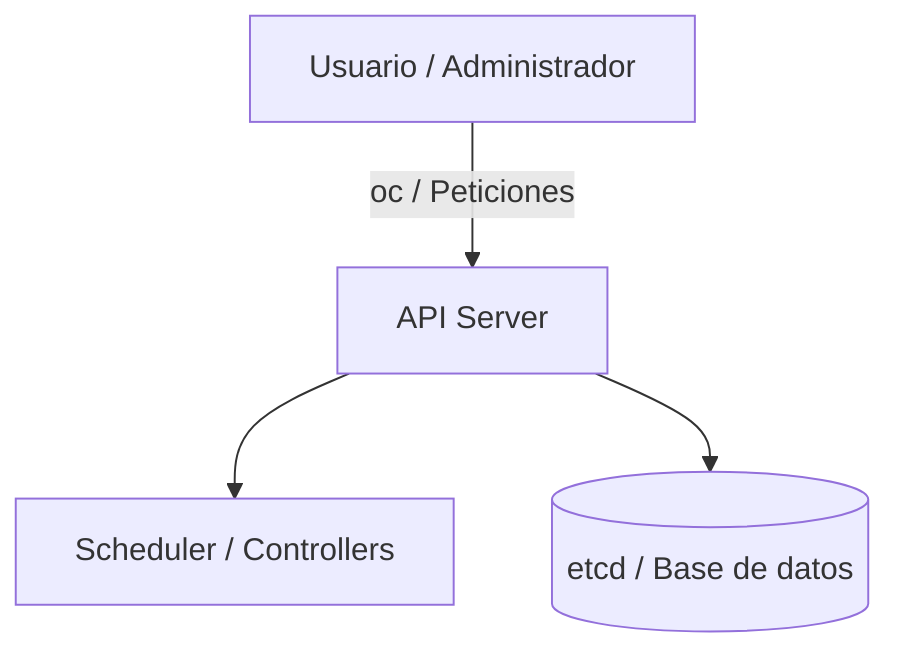
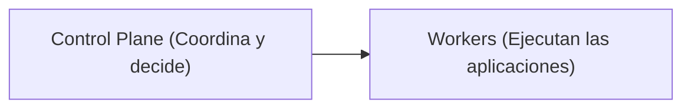
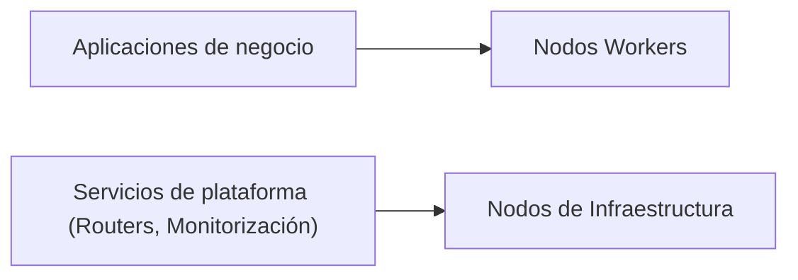
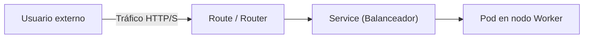

# 1.5 Arquitectura de un clúster OpenShift 4.x

## Objetivos de aprendizaje

Al finalizar este apartado serás capaz de:

- Entender cómo se organiza físicamente y lógicamente un clúster OpenShift.
- Diferenciar con precisión las funciones del **Control Plane** (el cerebro) frente a los **Workers** (los ejecutores) y la **Infraestructura**.
- Comprender el papel central del **API Server** como puerta de entrada universal y de **etcd** como la memoria persistente del clúster.
- Reconocer cómo OpenShift utiliza operadores y el **Cluster Version Operator (CVO)** para mantener la plataforma autogestionada.
- Trazar conceptualmente el recorrido de una petición desde el exterior hasta una aplicación.
- Comprender la lógica detrás del ciclo de vida y las actualizaciones del clúster.

---

## 1. De los bloques individuales a la arquitectura distribuida del clúster

A lo largo de las secciones anteriores hemos recorrido un camino lógico: hemos visto cómo empaquetar una aplicación en un contenedor inmutable (1.2), cómo orquestarla a escala mediante Kubernetes gestionando su estado deseado (1.3), y qué valor añadido empresarial aporta OpenShift sobre esa base (1.4).

La pregunta natural que surge ahora es: **¿Cómo está estructurado físicamente un clúster OpenShift para hacer todo esto posible?**

Un clúster OpenShift no es más que un conjunto coordinado de máquinas (servidores físicos, máquinas virtuales o instancias en la nube) que colaboran unificadas bajo una misma plataforma inteligente. Para comprender cómo opera este ecosistema, debemos descomponerlo en sus componentes fundamentales.

---

## 2. Tipos de nodos en el clúster

Un nodo es la unidad básica de cálculo en OpenShift. Dependiendo del rol que desempeñen dentro del clúster, los clasificamos en tres grandes grupos:

- **Control Plane (Master):** El núcleo de gestión y control.
- **Workers (Nodos de trabajo):** Las máquinas donde se ejecutan realmente las cargas de trabajo de los usuarios.
- **Infraestructura (Opcionales):** Nodos dedicados exclusivamente al alojamiento de los servicios transversales de la plataforma.

---

## 3. El Control Plane: El cerebro del clúster

El **Control Plane** es el encargado de mantener el estado del clúster, tomar decisiones globales y supervisar que todo funcione tal y como hemos definido en nuestros manifiestos. Si el clúster fuera una organización, el Control Plane sería la dirección y el equipo de operaciones coordinando los recursos.

Dentro del Control Plane conviven varios componentes esenciales:

### El API Server: La puerta de entrada universal

Todas las acciones que realizamos sobre OpenShift —ya sea mediante comandos de terminal (`oc`), despliegues automatizados o la propia consola web— pasan obligatoriamente por el **API Server**. 

- Funciona como el **recepcionista y validador único** del clúster.
- Recibe cada petición, comprueba la autenticación, verifica los permisos y procesa la orden para que el clúster actúe.

### El Scheduler (Programador)

Cuando solicitas desplegar una aplicación (por ejemplo, a través de un Deployment), el *Scheduler* evalúa los recursos disponibles en los nodos de trabajo y decide de forma inteligente **en qué nodo exacto debe ejecutarse** ese Pod.

### Los Controllers (Controladores)

Son los guardianes del sistema. Monitorizan continuamente el estado real del clúster y lo comparan con el estado deseado, ejecutando el bucle de reconciliación que estudiamos en Kubernetes.

### etcd: La memoria persistente del clúster

**etcd** es una base de datos clave-valor distribuida, altamente fiable y consistente. 

- Aquí se almacena absolutamente todo: la configuración del clúster, los objetos creados, los secretos, los usuarios y el estado actual de cada componente.
- Al ser el "disco duro" del sistema donde reside la verdad absoluta del clúster, su estabilidad y la realización de copias de seguridad periódicas son de vital importancia.

---

## 4. Los nodos Worker: Donde se ejecutan las aplicaciones

Mientras que el Control Plane piensa, coordina y almacena el estado, los **nodos Worker** son los músculos de la plataforma. 

- En estos nodos es donde se despliegan de manera efectiva los **Pods** que contienen nuestros contenedores.
- Soportan las cargas de trabajo de las aplicaciones, los procesos de compilación y los trabajos programados.

!!! note "Idea clave"

    Por regla general, las aplicaciones de negocio de los usuarios nunca se ejecutan en los nodos del Control Plane, garantizando así la estabilidad, rendimiento y seguridad del cerebro de la plataforma.

---

## 5. Los nodos de infraestructura

En entornos corporativos, es una buena práctica separar las aplicaciones de negocio de los servicios propios de la plataforma mediante los **nodos de infraestructura (Infra)**.

Estos nodos albergan componentes transversales esenciales:

- **El Router / Ingress Controller:** Gestiona las *Routes* y el tráfico de red externo que entra hacia las aplicaciones.
- **El Container Registry interno:** Almacena las imágenes de contenedores del clúster.
- **Herramientas de monitorización y logging:** Recogen métricas y registros de salud de toda la plataforma.

!!! tip "Ventaja de licenciamiento"

    Bajo las condiciones de suscripción de Red Hat OpenShift, los nodos dedicados exclusivamente a infraestructura (ejecutando componentes de plataforma como routers, registro o monitorización de red) **no computan para el licenciamiento de núcleos o cores** destinados a cargas de trabajo de usuario, lo que aporta una importante optimización de costes en grandes despliegues corporativos.

---

## 6. Una plataforma autogestionada mediante Operadores y el CVO

Como vimos en el apartado anterior (1.4), OpenShift descansa pesadamente sobre el concepto de operadores (esos "sysadmins robotizados" que automatizan tareas complejas).

- **Cluster Operators:** Gran parte de los subsistemas internos de OpenShift (red, almacenamiento, autenticación, monitorización) están gestionados por operadores propios. Su estado conjunto actúa como el termómetro principal de salud de la plataforma.
- **El Cluster Version Operator (CVO):** Es el componente superior responsable de coordinar el ciclo de vida y la evolución de todo el clúster, asegurando que las actualizaciones de versión se apliquen de forma sincronizada y segura.

---

## 7. Recorrido conceptual de una petición

Para hilar todo lo visto hasta ahora, veamos qué sucede a nivel de arquitectura cuando un usuario final accede a una aplicación en OpenShift:

1. El tráfico externo llega al clúster y es interceptado por el **Router** (ubicado en un nodo de infraestructura).
2. El recurso **Route** redirige esa petición hacia el **Service**, el balanceador de carga interno del clúster.
3. El Service distribuye la petición directamente hacia uno de los **Pods** activos ejecutándose en un nodo **Worker**.

---

## 8. El clúster se actualiza: Canales, cadencia y compatibilidad

OpenShift evoluciona continuamente mediante nuevas versiones que incorporan correcciones de seguridad, parches y mejoras operativas. El proceso de actualización está diseñado para ser seguro y transparente para las aplicaciones:

- **Canales de actualización:** Definen la estrategia de adopción de versiones (por ejemplo, canales `stable` o `candidate`).
- **Cadencia gestionada:** El proceso es coordinado automáticamente por el CVO, aplicando parches nodo a nodo sin interrumpir el servicio.
- **Compatibilidad de operadores:** Antes de aplicar una actualización, el clúster verifica la salud y compatibilidad de todos los operadores instalados para garantizar la estabilidad general de la plataforma.

---

## Ideas clave para recordar

!!! tip "En pocas palabras"

    - **Control Plane:** Es el cerebro del clúster; toma decisiones y mantiene el estado deseado.
    - **API Server:** La puerta de entrada universal por la que pasa cualquier operación sobre el clúster.
    - **etcd:** La base de datos distribuida que almacena la memoria y la configuración crítica.
    - **Workers:** Las máquinas dedicadas a ejecutar las cargas de trabajo y aplicaciones.
    - **Infraestructura:** Nodos dedicados a alojar servicios transversales (routers, monitorización) que además optimizan costes al no computar para licencias de usuario.
    - **Operadores y CVO:** Automatizan la gestión, el mantenimiento y la actualización coordinada de toda la plataforma.