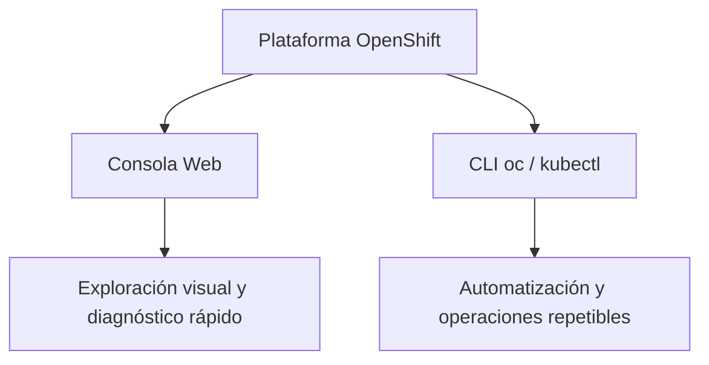
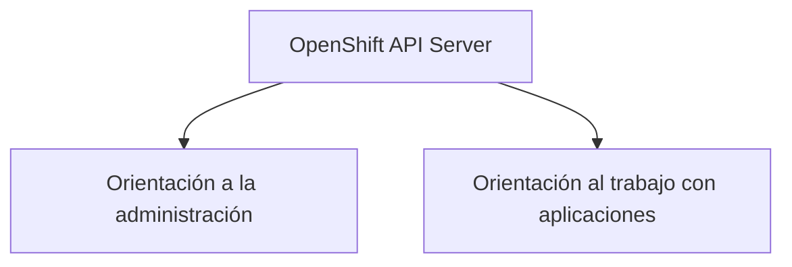
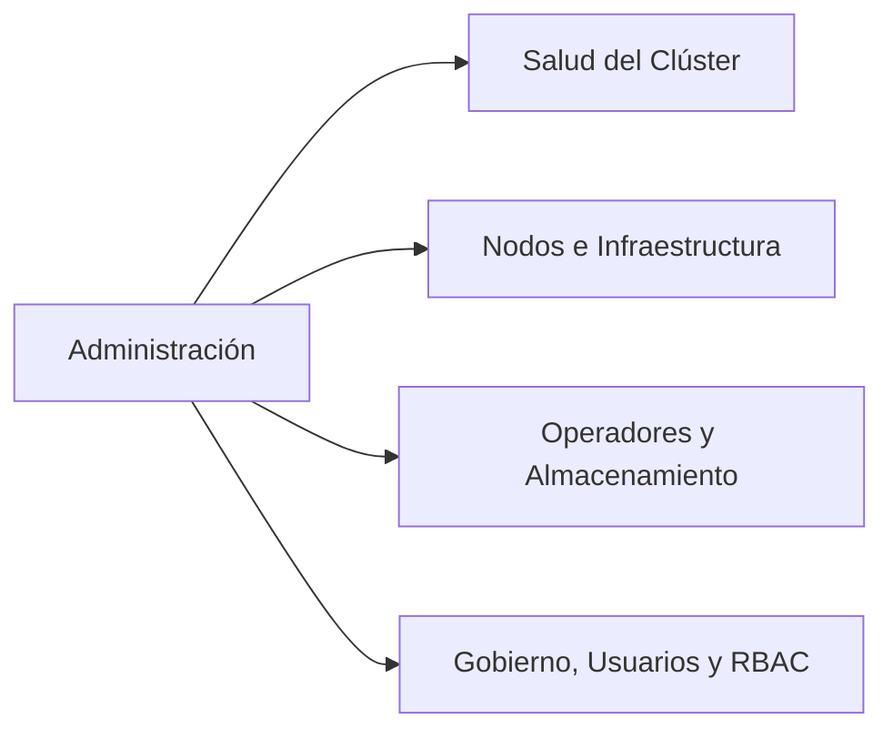
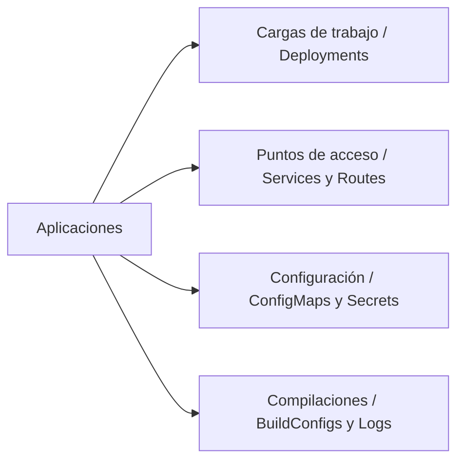
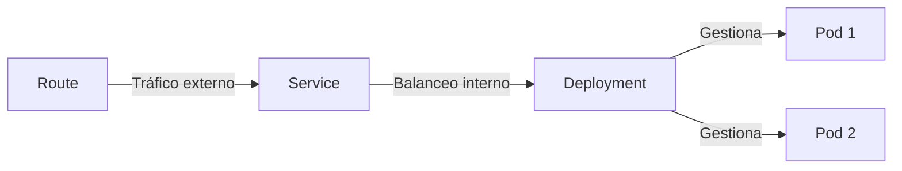
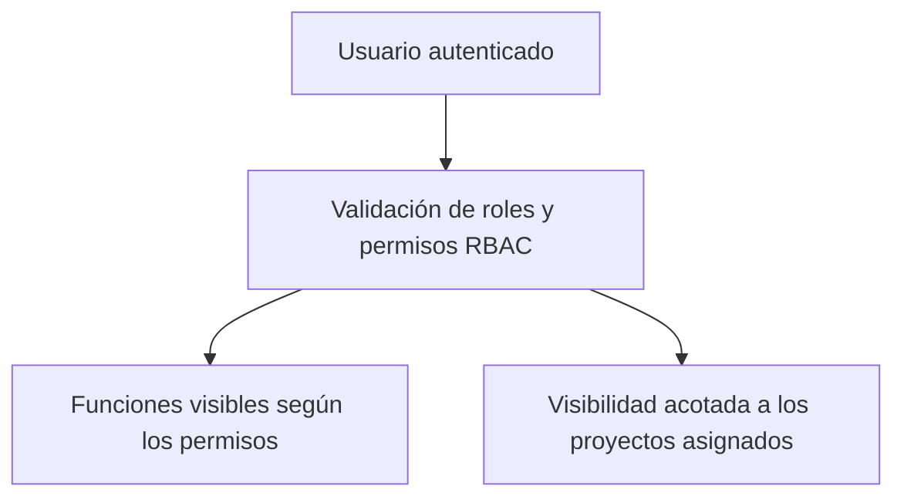
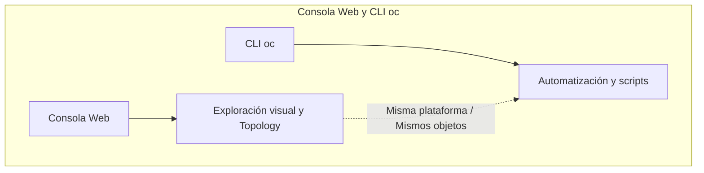

## 1.6 La consola web de OpenShift

### Objetivos de aprendizaje
  
Al finalizar este apartado serás capaz de: 

- Comprender el propósito y el valor de la interfaz gráfica de OpenShift frente a la herramienta de línea de comandos.
- Comprender la diferencia conceptual entre la **orientación a la administración** y la **orientación al desarrollo de aplicaciones** dentro de la consola.
- Identificar el tipo de información, recursos y tareas asociados habitualmente a cada orientación.
- Explotar la **vista Topology** para visualizar la arquitectura gráfica y dependencias de un proyecto.
- Comprender el impacto del modelo de permisos (RBAC) en la visibilidad y opciones disponibles dentro de la consola.

### La puerta de entrada visual a OpenShift
  
Una de las grandes ventajas operativas de OpenShift es su consola web unificada y altamente integrada.  
Aunque las tareas de automatización, gestión de manifiestos e integración continua se apoyan principalmente en la herramienta de línea de comandos `oc`, la consola gráfica proporciona un entorno intuitivo para comprender la estructura de las aplicaciones, explorar recursos y realizar diagnósticos visuales rápidos.

  
!!! tip "Primer contacto con la plataforma"
    La consola web facilita el primer acercamiento a OpenShift porque permite reconocer visualmente los recursos y sus relaciones. A medida que avance el curso, combinaremos esta visión con el uso de `oc` y de manifiestos YAML.

### Dos formas de ver la misma plataforma
  
Es fundamental entender que las distintas orientaciones de la consola **no significan que existan dos entornos ni dos plataformas separadas**.  
OpenShift opera sobre una única fuente de verdad, formada principalmente por el API Server y etcd. Lo que puede cambiar es la presentación de la información, la agrupación de los menús y las acciones disponibles para adaptarse al perfil que está trabajando.

En una instalación completa de OpenShift, estas orientaciones pueden aparecer identificadas como perspectivas **Administrator** y **Developer**. Sin embargo, su disponibilidad y presentación concreta dependen de la versión, la configuración de la consola y los permisos asignados al usuario.

  
Las dos orientaciones principales son:
- **Administración de la plataforma**: visión orientada a la infraestructura, el gobierno y la salud global del clúster.
- **Desarrollo y operación de aplicaciones**: visión orientada al ciclo de vida de las aplicaciones y sus componentes asociados.

!!! note "Distinción conceptual durante el curso"
    Esta distinción nos ayuda a comprender qué tareas corresponden a la plataforma y cuáles corresponden a las aplicaciones. No asumiremos que todos los alumnos pueden seleccionar o visualizar ambas perspectivas en la consola del laboratorio.

### Orientación a la administración de la plataforma
  
La orientación a la administración está pensada para los perfiles responsables del funcionamiento global, la capacidad, la seguridad y el mantenimiento de la plataforma.

#### Información y recursos habituales
- **Nodos del clúster**: consulta de estado, capacidad consumida y rendimiento de los nodos de control, de trabajo y de infraestructura.
- **Operadores (OperatorHub)**: instalación, actualización y mantenimiento de los operadores que extienden la plataforma.
- **Almacenamiento**: gestión de clases de almacenamiento (_StorageClasses_), volúmenes persistentes (_PV_) y solicitudes de volumen (_PVC_).
- **Redes globales**: configuración de controladores Ingress, políticas de red y proveedores CNI.
- **Seguridad y gobierno**: gestión de usuarios, grupos, roles (_RBAC_), cuotas de recursos (_ResourceQuotas_) y restricciones de seguridad (_SCC_).
- **Proyectos (Namespaces)**: visión global de todos los proyectos creados en el clúster.
  
!!! note "Pregunta principal de esta orientación"
    **¿Está la plataforma disponible, correctamente configurada y gobernada?**

#### ¿Qué perfiles realizan habitualmente estas tareas?
- Administradores de plataforma OpenShift o Kubernetes.
- Equipos de operaciones de infraestructura y sistemas.
- Perfiles de soporte avanzado y seguridad corporativa.

### Orientación al desarrollo y operación de aplicaciones
  
Esta orientación simplifica la interacción con las aplicaciones y agrupa los recursos según el proyecto o espacio de trabajo activo. El usuario se concentra en los componentes de su aplicación sin necesidad de gestionar la infraestructura subyacente.

#### Información y recursos habituales
- **Cargas de trabajo (Workloads)**: _Deployments_, _StatefulSets_, _DaemonSets_, _Jobs_ y _Pods_.
- **Conectividad y publicación**: _Services_ para acceso interno y _Routes_ para exposición hacia el exterior.
- **Configuración y secretos**: _ConfigMaps_ para variables no sensibles y _Secrets_ para credenciales o certificados.
- **Construcciones (Builds)**: estado de los procesos de compilación (_BuildConfigs_) y registro de imágenes (_ImageStreams_).
- **Observabilidad de la aplicación**: acceso a métricas de consumo del pod, eventos del proyecto y flujo de registros (_logs_).
  
!!! note "Pregunta principal de esta orientación"
    **¿Está mi aplicación desplegada, accesible y funcionando correctamente?**

#### ¿Qué perfiles realizan habitualmente estas tareas?
- Desarrolladores de software y arquitectos de aplicación.
- Equipos DevOps e ingenieros de integración continua (CI/CD).
- Operadores responsables de la puesta en producción y seguimiento de servicios específicos.

### Comparación directa de orientaciones

| Característica | Administración de la plataforma | Desarrollo y operación de aplicaciones |
|---|---|---|
| **Enfoque principal** | Infraestructura y plataforma global | Aplicaciones y proyectos acotados |
| **Alcance visual habitual** | Todo el clúster, sujeto a RBAC | Proyecto (_Project_) seleccionado |
| **Unidad de trabajo** | Nodos, operadores, _StorageClasses_ y SCC | Pods, Deployments, Services y Routes |
| **Vistas destacadas** | Dashboards de salud, listas de nodos y eventos | Topology y recursos de la aplicación |
| **Objetivo clave** | Garantizar la disponibilidad y el gobierno del clúster | Desplegar y mantener aplicaciones operativas |
  
!!! tip "Regla mnemotécnica"
    La administración se pregunta por la **salud y el gobierno de la plataforma**. El trabajo con aplicaciones se pregunta por el **despliegue y el funcionamiento de cada servicio**.

### La vista Topology: arquitectura gráfica en tiempo real
  
La vista **Topology** (Topología), cuando está disponible, representa una de las características visuales más potentes de la consola de OpenShift.  
En lugar de presentar largas listas de texto con objetos aislados, la vista Topology representa de forma gráfica e interactiva la relación entre los componentes de un proyecto.

#### Ventajas de la vista Topology:
- **Relación visual instantánea**: muestra con líneas de conexión cómo una _Route_ apunta a un _Service_, y cómo este distribuye el tráfico entre los _Pods_ gestionados por un _Deployment_.
- **Estado de escalado**: cada aplicación se representa con elementos visuales que permiten identificar el número de réplicas y su estado.
- **Acceso en un clic**: al seleccionar un componente se despliega un panel lateral con acceso a sus detalles y, según la configuración y los permisos, a registros, eventos, métricas o terminal.
- **Agrupación lógica**: permite agrupar visualmente varios componentes dentro de un mismo concepto de aplicación.
  
!!! tip "Utilidad práctica"
    Topology ayuda a interpretar rápidamente la arquitectura de una aplicación y a detectar qué componente requiere atención, pero no sustituye la consulta detallada de recursos mediante la consola o `oc`.

### La importancia de los permisos (RBAC) en la consola
  
Un aspecto crítico al trabajar con la consola gráfica es comprender que **lo que ves está condicionado por quién eres**.  
OpenShift aplica un modelo de control de acceso basado en roles (RBAC) que filtra dinámicamente los menús, botones y datos mostrados en la interfaz.

#### Implicaciones operativas:
- Un usuario con rol de **administrador del clúster** (_cluster-admin_) puede visualizar y gestionar recursos globales de la plataforma.
- Un usuario con permisos limitados a uno o varios proyectos solo verá los recursos y acciones para los que tenga autorización, con independencia de cómo esté organizada la interfaz.
- Si una opción de menú o un botón de acción, como editar un despliegue o borrar un objeto, no aparece en la consola, se debe habitualmente a que el usuario o la _ServiceAccount_ activa no dispone de los permisos necesarios.
  
!!! warning "Comportamiento esperado en el Developer Sandbox"
    En el **Developer Sandbox de Red Hat** utilizado durante el curso trabajaremos con una cuenta de usuario con permisos limitados. La organización de los menús y las opciones disponibles puede diferir de la consola de un clúster corporativo administrado por la organización, y es posible que no aparezca un selector entre las perspectivas Administrator y Developer. Esto no impide trabajar con los proyectos y recursos de aplicación asignados al alumno.

### Consola web y línea de comandos (`oc`): complementarias, no excluyentes
  
Existe una falsa dicotomía entre usar la interfaz gráfica o la línea de comandos. En un entorno profesional, ambas herramientas se utilizan de manera complementaria.

  
Ejemplos de complementariedad:
- Puedes desplegar un _Deployment_ aplicando un fichero YAML desde la línea de comandos con `oc apply -f` y observar inmediatamente en la consola web cómo aparecen sus recursos.
- Puedes identificar una anomalía en la consola web y ejecutar `oc describe pod` para analizar sus eventos y las posibles causas con mayor detalle.

### Ideas clave para recordar
  
!!! tip "Resumen"
    - OpenShift ofrece una consola web integrada para explorar recursos, comprender aplicaciones y realizar diagnósticos visuales.
    - La administración de la plataforma y el trabajo con aplicaciones son dos orientaciones sobre los mismos objetos y la misma API, no dos plataformas distintas.
    - Las perspectivas Administrator y Developer pueden existir en una instalación completa, pero su presentación depende de la versión, la configuración y los permisos.
    - En el Developer Sandbox trabajaremos con los recursos visibles para una cuenta limitada a sus proyectos.
    - La vista Topology ayuda a comprender las relaciones entre los componentes de una aplicación cuando está disponible.
    - La consola web y `oc` son herramientas complementarias.
