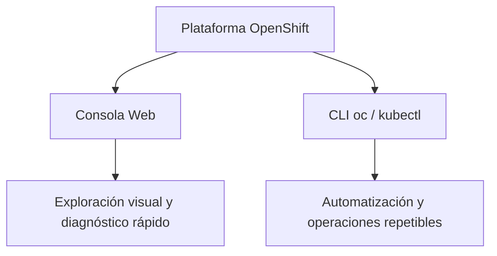
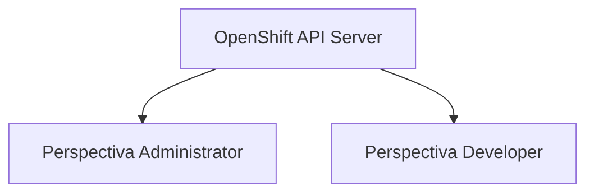
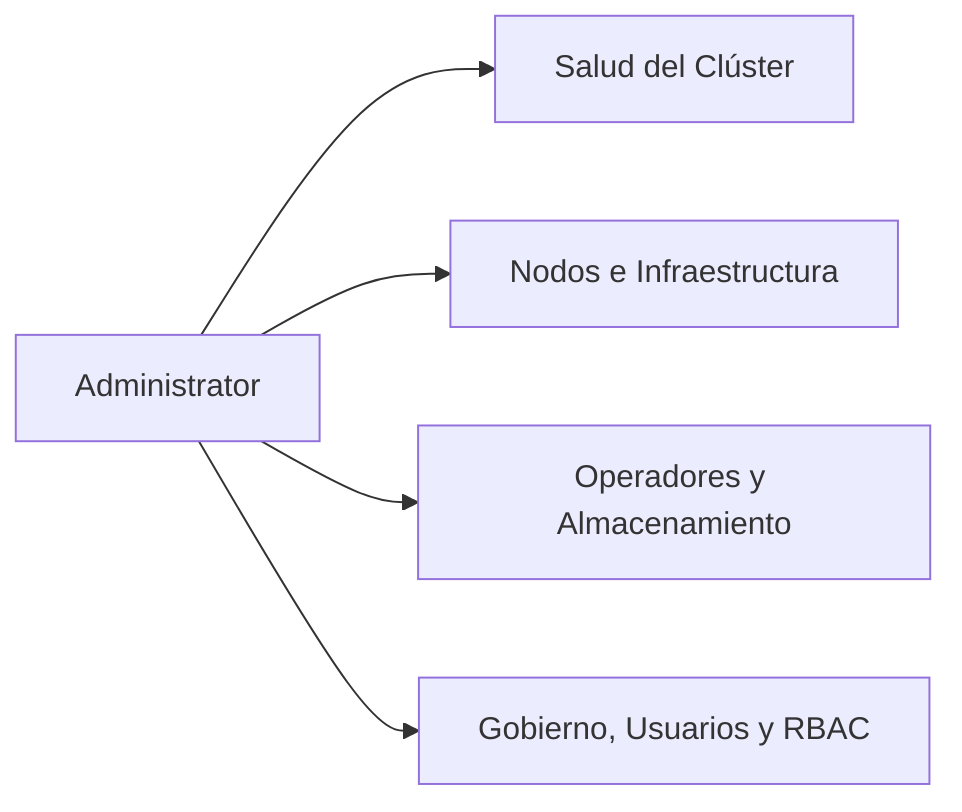
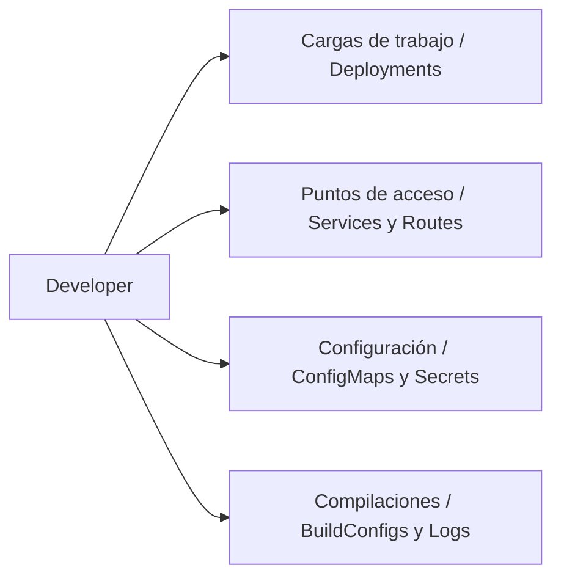
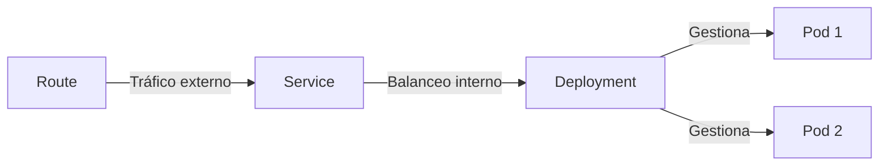
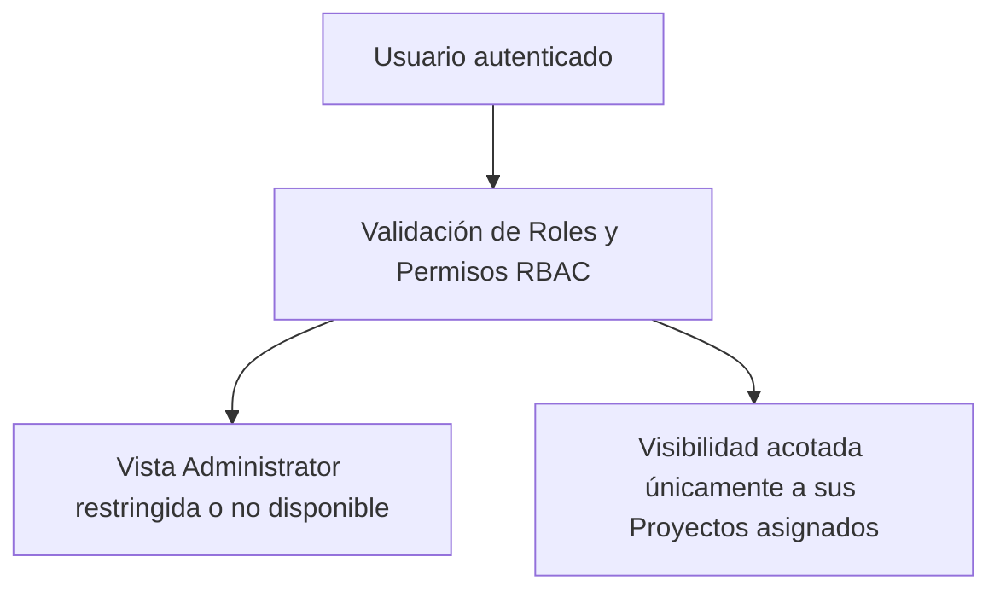

# 1.6 La consola web: perspectiva de administración y perspectiva de desarrollo

## Objetivos de aprendizaje

Al finalizar este apartado serás capaz de:

- Comprender el propósito y el valor de la interfaz gráfica de OpenShift frente a la herramienta de línea de comandos.
- Diferenciar con criterio la **perspectiva de administración** (*Administrator*) y la **perspectiva de desarrollo** (*Developer*).
- Identificar el tipo de información, recursos y tareas que se gestionan desde cada una de las perspectivas.
- Explotar la **vista Topology** para visualizar la arquitectura gráfica y dependencias de un proyecto.
- Comprender el impacto del modelo de permisos (RBAC) en la visibilidad y opciones disponibles dentro de la consola.

---

## La puerta de entrada visual a OpenShift

Una de las grandes ventajas operativas de OpenShift es su consola web unificada y altamente integrada.

Aunque las tareas de automatización, gestión de manifiestos e integración continua se apoyan principalmente en la herramienta de línea de comandos `oc`, la consola gráfica proporciona un entorno intuitivo para comprender la estructura de las aplicaciones, explorar recursos y realizar diagnósticos visuales rápidos.



!!! tip "Primer contacto con la plataforma"

    Para quienes se inician en la administración u operación en OpenShift, la consola web es la vía más rápida para asimilar la relación entre los objetos de Kubernetes (Pods, Services, Deployments) y los componentes propios de la plataforma (Routes, BuildConfigs, ImageStreams).

---

## Dos formas de ver la misma plataforma

Es fundamental entender que la existencia de dos perspectivas distintas **no significa que existan dos entornos ni dos plataformas separadas**.

OpenShift opera sobre una única fuente de verdad (el API Server y `etcd`). Lo que cambia entre una vista y otra es la presentación de la información y la agrupación de los menús para adaptarse a las necesidades del perfil que está trabajando.



Las dos perspectivas principales integradas en la consola son:

- **Administrator (Administración)**: Visión orientada a la infraestructura, el gobierno y la salud global del clúster.
- **Developer (Desarrollo)**: Visión orientada al ciclo de vida de las aplicaciones y sus componentes asociados.

---

## Perspectiva de administración (`Administrator`)

La perspectiva de administración está diseñada para los perfiles responsables del funcionamiento global, la capacidad, la seguridad y el mantenimiento de la plataforma.



### Información y recursos habituales

- **Nodos del clúster**: Consulta de estado, capacidad consumida y rendimiento de los nodos Master, Worker e Infraestructura.
- **Operadores (OperatorHub)**: Instalación, actualización y mantenimiento de los operadores que extienden la plataforma.
- **Almacenamiento**: Gestión de clases de almacenamiento (*StorageClasses*), volúmenes persistentes (*PV*) y solicitudes de volumen (*PVC*).
- **Redes globales**: Configuración de controladores Ingress, políticas de red y proveedores CNI.
- **Seguridad y gobierno**: Gestión de usuarios, grupos, roles (*RBAC*), cuotas de recursos (*ResourceQuotas*) y restricciones de seguridad (*SCC*).
- **Proyectos (Namespaces)**: Visión global de todos los proyectos creados en el clúster.

!!! note "Pregunta principal de esta perspectiva"

    ¿Cómo se encuentra la infraestructura del clúster, qué capacidad tenemos disponible y qué componentes globales requieren atención?

### ¿Quién utiliza esta perspectiva?

- Administradores de plataforma OpenShift / Kubernetes.
- Equipos de operaciones de infraestructura y sistemas.
- Perfiles de soporte avanzado y seguridad corporativa.

---

## Perspectiva de desarrollo (`Developer`)

La perspectiva de desarrollo está optimizada para simplificar la interacción con las aplicaciones. Oculta la complejidad de la infraestructura subyacente y agrupa los recursos según el proyecto o espacio de trabajo activo.



### Información y recursos habituales

- **Cargas de trabajo (Workloads)**: *Deployments*, *StatefulSets*, *DaemonSets*, *Jobs* y *Pods*.
- **Conectividad y publicación**: *Services* para acceso interno y *Routes* para exposición hacia el exterior.
- **Configuración y secretos**: *ConfigMaps* para variables no sensibles y *Secrets* para credenciales o certificados.
- **Construcciones (Builds)**: Estado de los procesos de compilación (*BuildConfigs*) y registro de imágenes (*ImageStreams*).
- **Observabilidad de la aplicación**: Acceso directo a métricas de consumo del pod, eventos del proyecto y flujo de registros (*logs*).

!!! note "Pregunta principal de esta perspectiva"

    ¿Está mi aplicación corriendo correctamente, cómo puedo acceder a sus logs y qué dependencias tiene configuradas?

### ¿Quién utiliza esta perspectiva?

- Desarrolladores de software y arquitectos de aplicación.
- Equipos DevOps e ingenieros de integración continua (CI/CD).
- Operadores responsables de la puesta en producción y seguimiento de servicios específicos.

---

## Comparación directa de perspectivas

| Característica | Perspectiva Administrator | Perspectiva Developer |
| :--- | :--- | :--- |
| **Enfoque principal** | Infraestructura y plataforma global | Aplicaciones y proyectos acotados |
| **Alcance visual** | Todo el clúster (sujeto a RBAC) | Proyecto (*Project*) seleccionado |
| **Unidad de trabajo** | Nodos, Operadores, StorageClasses, SCC | Pods, Deployments, Services, Routes |
| **Vista destacada** | Dashboards de salud, listas de nodos y eventos | Vista **Topology** y diagramas de interacción |
| **Objetivo clave** | Garantizar la disponibilidad del clúster | Desplegar y mantener aplicaciones operativas |

!!! tip "Regla mnemotécnica"

    **Administrator** mira *"hacia abajo"* (servidores, red, almacenamiento y plataforma).

    **Developer** mira *"hacia arriba"* (código, contenedores, rutas y logs de aplicación).

---

## La vista Topology: arquitectura gráfica en tiempo real

Dentro de la perspectiva **Developer**, la vista **Topology** (Topología) representa una de las características visuales más potentes de OpenShift.

En lugar de presentar largas listas de texto con objetos aislados, la vista Topology renderiza de forma gráfica e interactiva la relación exacta entre los componentes de un proyecto.



### Ventajas de la vista Topology:

- **Relación visual instantánea**: Muestra con líneas de conexión cómo una *Route* apunta a un *Service*, y cómo este distribuye el tráfico entre los *Pods* gestionados por un *Deployment*.
- **Estado de escalado**: Cada aplicación se representa con un círculo envolvente que indica visualmente el número de réplicas en ejecución y su estado de salud (verde = en ejecución, azul = en transición, rojo = error).
- **Acceso en un clic**: Al seleccionar cualquier nodo del gráfico se despliega un panel lateral con acceso directo a logs, terminal interactivo, eventos y métricas en tiempo real.
- **Agrupación lógica**: Permite agrupar visualmente múltiples microservicios dentro de un mismo concepto de "Aplicación".

!!! tip "Utilidad práctica"

    La vista Topology es la forma más rápida de diagnosticar la arquitectura de un proyecto desconocido o verificar que los selectores de red conectan correctamente los componentes.

---

## La importancia de los permisos (RBAC) en la consola

Un aspecto crítico al trabajar con la consola gráfica es comprender que **lo que ves está condicionado por quién eres**.

OpenShift aplica un modelo de control de acceso basado en roles (RBAC) que filtra dinámicamente los menús, botones y datos mostrados en la interfaz.



### Implicaciones operativas:

- Un usuario con rol de **administrador del clúster** (*cluster-admin*) tendrá acceso completo a ambas perspectivas y podrá visualizar todos los recursos del sistema.
- Un usuario con rol de **desarrollador** (*edit* o *view* en un proyecto) solo verá la perspectiva Developer acotada a sus proyectos asignados, o una perspectiva Administrator limitada donde solo aparecerán los recursos sobre los que tiene permiso de lectura.
- Si una opción de menú o un botón de acción (como editar un desplegable o borrar un objeto) no aparece en la consola, se debe habitualmente a la falta de permisos en la ServiceAccount o usuario activo.

!!! warning "Comportamiento esperado en entorno de laboratorio"

    En las prácticas del curso es completamente normal que no veas la lista completa de nodos del clúster si tu usuario está limitado al espacio de nombres de tu proyecto individual.

---

## Consola web y línea de comandos (`oc`): complementarias, no excluyentes

Existe una falsa dicotomía entre usar la interfaz gráfica o la línea de comandos. En un entorno profesional, ambas herramientas se utilizan de manera complementaria.

```mermaid
flowchart TD
    subgraph Consola Web ["Consola Web (Navegador)"]
        A1[Exploración e inspección visual]
        A2[Análisis de topología]
        A3[Lectura cómoda de logs y métricas]
    end

    subgraph CLI oc ["Línea de Comandos (oc)"]
        B1[Automatización y scripts Bash]
        B2[Aplicación masiva de manifiestos YAML]
        B3[Operaciones rápidas en teclado]
    end

    Consola Web <-->|Misma plataforma / Mismos objetos| CLI oc
```

Ejemplos de complementariedad:

- Puedes desplegar un *Deployment* aplicando un fichero YAML desde la línea de comandos con `oc apply -f` y observar inmediatamente en la consola web cómo la vista *Topology* dibuja los pods arrancando.
- Puedes inspeccionar una anomalía gráfica en la consola web (un Pod en círculo rojo) y abrir rápidamente la terminal integrada o ejecutar `oc describe pod` para analizar las causas detalladas.

---

## Ideas clave para recordar

!!! tip "Resumen"

    - La consola web de OpenShift es la interfaz gráfica unificada para explorar, gestionar y diagnosticar la plataforma.
    - La **perspectiva Administrator** se centra en la salud del clúster, los nodos, la infraestructura, la seguridad y los operadores globales.
    - La **perspectiva Developer** se enfoca en las cargas de trabajo, las construcciones, la conectividad y las métricas de aplicación dentro de un proyecto.
    - La **vista Topology** proporciona una representación gráfica interactiva de los componentes de la aplicación y sus relaciones de red.
    - La interfaz adapta su menú y visibilidad según los permisos asignados al usuario mediante el modelo de seguridad RBAC.
    - La consola web y la herramienta de línea de comandos `oc` trabajan en tiempo real sobre los mismos objetos del clúster.