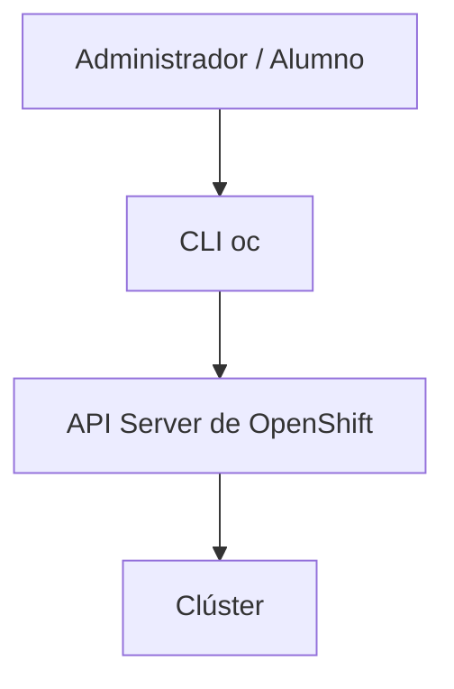
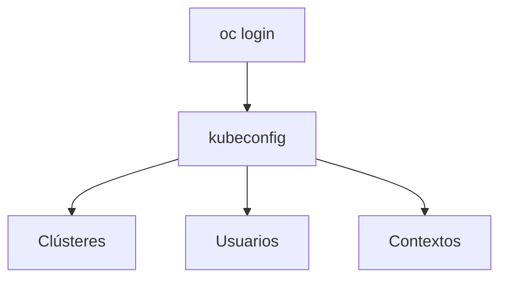
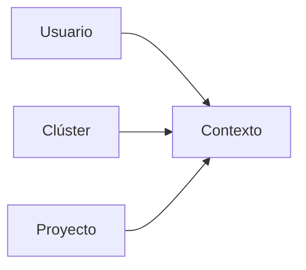
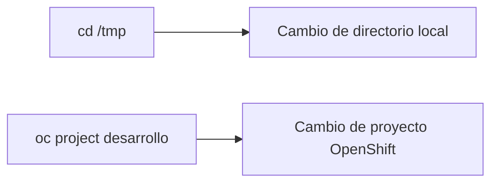
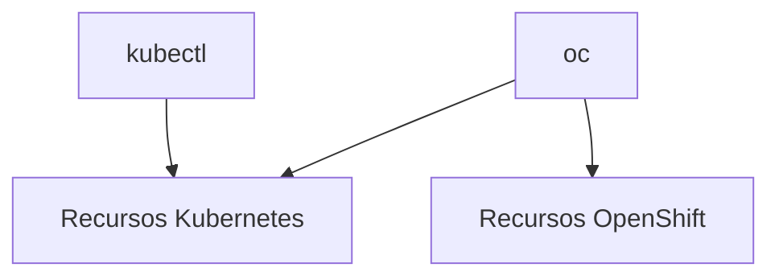
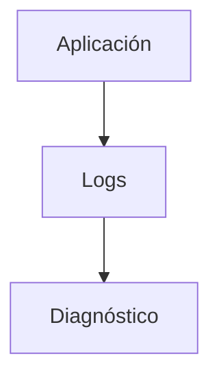
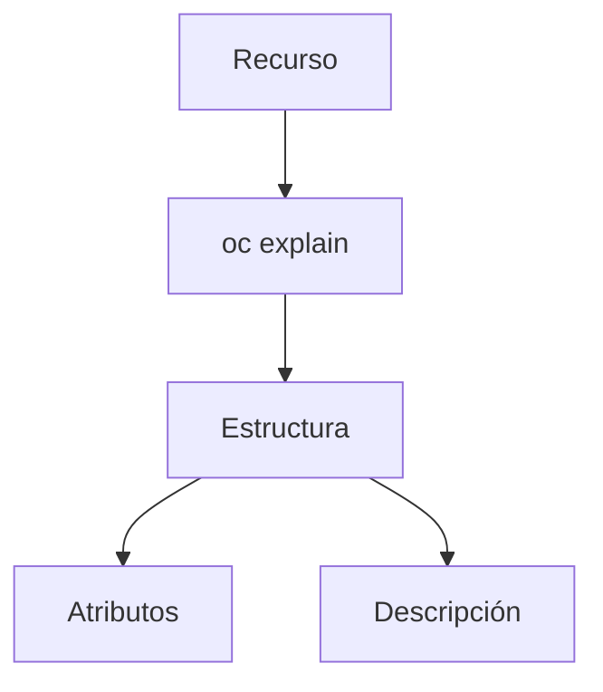
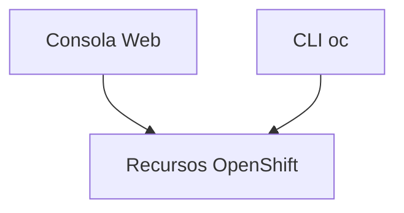

# 1.7 La línea de comandos de OpenShift: `oc`

## Objetivos de aprendizaje

Al finalizar este apartado serás capaz de:

- Comprender qué es y para qué sirve el comando `oc` frente a la consola gráfica.
- Conectarte a un clúster OpenShift mediante `oc login`.
- Identificar dónde se almacena la configuración de acceso (`kubeconfig`).
- Entender qué es un contexto y por qué resulta importante.
- Utilizar `oc project` para cambiar de proyecto de trabajo.
- Diferenciar OpenShift CLI (`oc`) de Kubernetes CLI (`kubectl`).
- Consultar información básica sobre recursos mediante `get`, `describe` y `logs`.
- Utilizar `oc explain` para descubrir recursos y atributos sin depender de documentación externa.

---

## De la consola web a la línea de comandos

En el apartado anterior hemos recorrido OpenShift desde su consola web y hemos visto que la interfaz gráfica y la línea de comandos son dos formas complementarias de trabajar sobre la misma plataforma.

Ahora vamos a dar el siguiente paso: utilizar **`oc`**, la herramienta de línea de comandos de OpenShift. Con ella podremos consultar y gestionar los mismos recursos de una forma rápida, repetible y especialmente útil para el diagnóstico y la automatización.



Con la línea de comandos conseguimos:
- **Agilidad:** Ejecutar acciones complejas con una sola instrucción sin navegar por múltiples menús.
- **Repetibilidad:** Poder copiar, pegar y automatizar operaciones mediante scripts.
- **Diagnóstico quirúrgico:** Extraer logs masivos, trazas de errores o descripciones profundas de un recurso cuando algo falla.

!!! tip "Idea clave"

    La consola web y el comando `oc` no son herramientas excluyentes ni mundos separados. Por debajo, cada clic que haces en la interfaz gráfica genera exactamente la misma llamada a la API que podrías lanzar tú mismo escribiendo un comando en la terminal.

---

## Conectarse al clúster: `oc login`

Antes de poder trabajar es necesario autenticarse ante la plataforma.

```bash
oc login [https://api.cluster.ejemplo.com:6443](https://api.cluster.ejemplo.com:6443)
```

También es posible utilizar un token de acceso:

```bash
oc login --token=<TOKEN> --server=[https://api.cluster.ejemplo.com:6443](https://api.cluster.ejemplo.com:6443)
```

!!! note "Acceso desde el Developer Sandbox"

    En una instalación de OpenShift, `oc` se conecta al API Server del clúster utilizando la dirección y el mecanismo de autenticación configurados en la plataforma. En el Developer Sandbox utilizado durante el curso, emplearemos el comando de inicio de sesión que proporciona la propia consola web, normalmente con un token temporal.

---

## El fichero `kubeconfig`

Cuando se realiza un `oc login`, `oc` necesita recordar a qué clúster nos hemos conectado, con qué usuario y sobre qué proyecto estamos trabajando. Esa información se guarda en un fichero denominado **kubeconfig**.

Para este curso no necesitamos administrar este fichero en detalle. Basta con entender que permite a `oc` conservar la información necesaria para volver a trabajar con el clúster y seleccionar el entorno adecuado.

### Ubicación habitual

**Linux / macOS**
```text
~/.kube/config
```

**Windows**
```text
%USERPROFILE%\.kube\config
```



---

## ¿Qué es un contexto?

Un contexto es la forma en que `oc` agrupa tres datos para saber dónde y con qué identidad debe ejecutar los comandos:

$$\text{Usuario} + \text{Clúster} + \text{Proyecto}$$



Consultar el contexto actual:
```bash
oc config current-context
```

Listar los contextos disponibles:
```bash
oc config get-contexts
```

!!! warning "Antes de modificar recursos"

    Comprueba siempre el contexto activo para evitar trabajar sobre el clúster o proyecto equivocado.

---

## Trabajar con proyectos: `oc project`

Consultar el proyecto activo:
```bash
oc project
```

Cambiar de proyecto:
```bash
oc project desarrollo
```

### Lo que suele confundirse al principio



!!! note "Importante"

    `oc project` no cambia una carpeta local. Cambia el espacio de trabajo sobre el que actuarán los siguientes comandos.

---

## `oc` y `kubectl`

De forma simplificada:

```text
kubectl = Kubernetes
oc      = Kubernetes + OpenShift
```



Entre los recursos específicos de OpenShift encontramos:
- Projects.
- Routes.
- ImageStreams.
- BuildConfigs.

---

## Consultar recursos con `oc get`

```bash
oc get pods
oc get deployments
oc get services
oc get routes
```

!!! tip "Para recordar"

    `get` responde a la pregunta: ¿Qué existe y cuál es su estado general?

---

## Obtener más detalle con `oc describe`

```bash
oc describe pod mi-aplicacion-1-abcde
```

`describe` proporciona información detallada:
- Etiquetas.
- Imágenes utilizadas.
- Eventos.
- Configuración.
- Estado de contenedores.

```text
get      -> resumen
describe -> detalle
```

---

## Consultar logs con `oc logs`

```bash
oc logs mi-aplicacion-1-abcde
```

Suele ser uno de los primeros comandos utilizados durante el diagnóstico.



---

## La herramienta más infravalorada: `oc explain`

```bash
oc explain deployment
```

Para profundizar en un atributo específico:

```bash
oc explain deployment.spec
oc explain deployment.spec.template
```



### Una analogía útil

```text
oc get      -> ¿Qué existe?
oc describe -> ¿Cómo está configurado?
oc explain  -> ¿Qué significa cada campo?
```

!!! tip "Autonomía"

    Aprender a utilizar `oc explain` reduce enormemente la dependencia de ejemplos externos y documentación adicional.

---

## Consola web y CLI: dos vistas del mismo mundo



La consola facilita la exploración visual. La CLI aporta rapidez, repetibilidad, automatización y diagnóstico avanzado.

---

## Ideas clave para recordar

!!! tip "Resumen"

    - `oc` es el cliente de línea de comandos de OpenShift.
    - `oc login` permite autenticarse contra un clúster.
    - La configuración se almacena en el fichero kubeconfig.
    - Un contexto define usuario, clúster y proyecto.
    - `oc project` cambia el proyecto activo.
    - `oc` incluye las capacidades de Kubernetes y extensiones específicas de OpenShift.
    - `oc get`, `oc describe` y `oc logs` son herramientas fundamentales del día a día.
    - `oc explain` es una de las mejores ayudas integradas para aprender OpenShift.