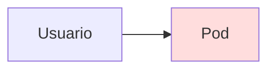
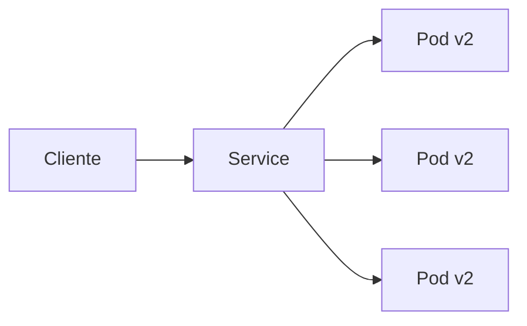
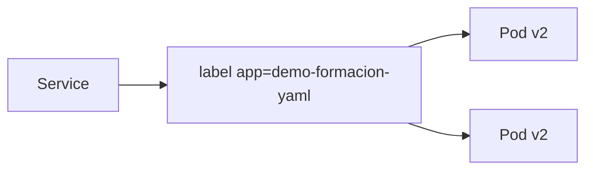
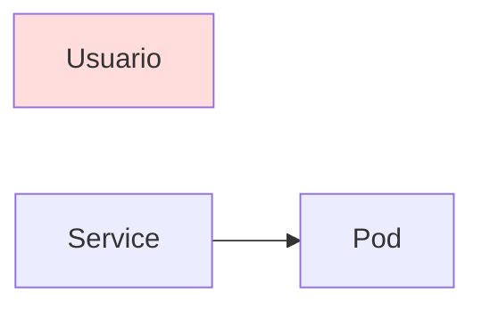
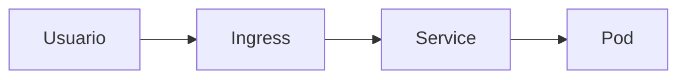
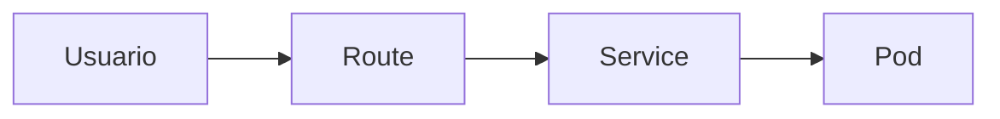
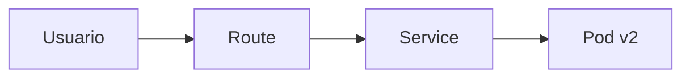
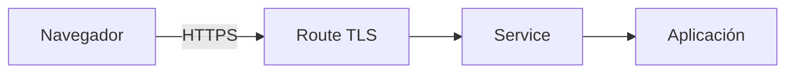
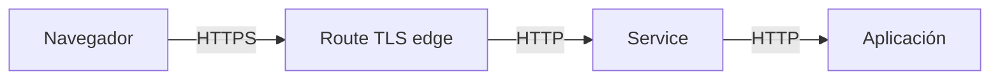
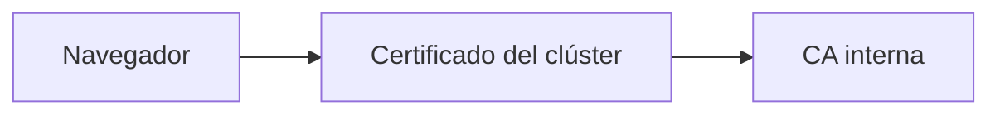

## 2.2 Exponer aplicaciones: Service y Route

### Objetivos de aprendizaje

Al finalizar este apartado serás capaz de:

- Comprender por qué un Pod no debe exponerse directamente a los usuarios.
- Entender la función de un Service dentro de Kubernetes.
- Comprender la diferencia entre Service y Route.
- Entender la diferencia entre Route e Ingress.
- Conocer las terminaciones TLS más habituales.
- Identificar por qué un navegador puede mostrar advertencias relacionadas con certificados.
- Publicar una aplicación mediante un Service y una Route.
- Acceder a una aplicación desde una URL externa.

### Del Pod al usuario

En el apartado anterior desplegamos nuestra aplicación y demostramos el flujo de actualización hacia la versión v2.

Podemos comprobar que la nueva revisión de la aplicación se encuentra en ejecución:

```bash
oc get pods
```

Ejemplo de resultado esperado:

```text
NAME                         READY   STATUS
demo-formacion-yaml-xxxxx    1/1     Running
```

Sin embargo, aunque la aplicación esté funcionando correctamente con la versión actualizada, todavía existe un problema importante:

**Los usuarios no tienen forma de acceder a ella desde fuera del clúster.**

Además, los Pods son recursos efímeros. Si un Pod falla o si actualizamos la imagen del Deployment a una nueva versión, Kubernetes eliminará los Pods antiguos y creará otros nuevos con direcciones IP internas totalmente diferentes.



Si el acceso dependiera directamente de la IP de un Pod concreto, cualquier actualización o sustitución rompería la conectividad de los usuarios.

Por este motivo, Kubernetes introduce una capa intermedia denominada **Service**.

### Service: un punto de acceso estable

Un Service proporciona un mecanismo estable para acceder a una aplicación independientemente de las actualizaciones de imagen o del número de Pods concretos que la estén ejecutando en cada momento.

En lugar de conectarse directamente a un Pod, los clientes se conectan al Service.



De esta forma:

- Los Pods pueden actualizarse de versión o recrearse automáticamente.
- Las direcciones IP internas de los Pods pueden cambiar.
- El Service mantiene un punto de acceso y un nombre DNS estables dentro del clúster.

!!! tip "Idea clave"
    El Service proporciona un punto de acceso estable, aunque los Pods que ejecutan la aplicación cambien.

#### ¿Cómo sabe el Service a qué Pods enviar el tráfico?

La asociación se realiza mediante etiquetas (*labels*) y selectores (*selectors*).

En el manifiesto del Deployment definimos la etiqueta:

```yaml
labels:
  app: demo-formacion-yaml
```

El Service utilizará un selector con el mismo valor:

```yaml
selector:
  app: demo-formacion-yaml
```

Gracias a esta coincidencia de etiquetas, aunque actualicemos la versión de la imagen en el Deployment, los nuevos Pods mantendrán la misma etiqueta y el Service continuará redirigiendo el tráfico hacia ellos automáticamente.



!!! note
    El Service no necesita conocer las direcciones IP concretas de los Pods. Utiliza las etiquetas para identificar dinámicamente los Pods que forman parte de la aplicación.

### Crear el Service para la aplicación

Nuestra aplicación de formación escucha internamente en el puerto `8080`.

Podemos definir y desplegar un Service que exponga la aplicación dentro del clúster mediante el siguiente manifiesto YAML completo:

```yaml
apiVersion: v1
kind: Service
metadata:
  name: demo-formacion-yaml
spec:
  selector:
    app: demo-formacion-yaml
  ports:
    - name: http
      protocol: TCP
      port: 80
      targetPort: 8080
```

Observa cuatro elementos importantes:

- `selector`: identifica los Pods asociados al Service mediante sus etiquetas (`app: demo-formacion-yaml`).
- `name`: asigna un nombre al puerto del Service para que otros recursos puedan hacer referencia a él.
- `port`: puerto expuesto internamente por el Service (`80`).
- `targetPort`: puerto real en el que escucha el contenedor dentro del Pod (`8080`).

El flujo es el siguiente:

```text
Service :80 --> Pod :8080
```

#### Desplegando el Service

##### Opción 1: mediante YAML (recomendado)

Guardar la definición anterior en `service.yaml` y aplicar:

```bash
oc apply -f service.yaml
```

##### Opción 2: desde línea de comandos

```bash
oc expose deployment/demo-formacion-yaml --port=80 --target-port=8080
```

##### Opción 3: desde la consola web

- Abrir el apartado **Networking → Services**.
- Seleccionar **Create Service**.
- Pegar o configurar el manifiesto YAML completo y guardar los cambios.

##### Comprobando el estado del Service

```bash
oc get svc
```

Resultado esperado:

```text
NAME                   TYPE        CLUSTER-IP    EXTERNAL-IP   PORT(S)   AGE
demo-formacion-yaml    ClusterIP   172.30.x.x    <none>        80/TCP    1m
```

La aplicación ya dispone de una IP virtual interna y un punto de acceso estable dentro del clúster.

!!! note
    Un Service de tipo `ClusterIP`, como el que acabamos de crear, solo proporciona acceso desde el interior del clúster. Todavía necesitamos un mecanismo para publicar la aplicación hacia el exterior.

### El problema del acceso externo

Aunque ya disponemos de un Service, la aplicación sigue siendo accesible únicamente dentro de la red interna del clúster de OpenShift.

Necesitamos un mecanismo que permita publicar la aplicación para que los usuarios puedan consumirla desde un navegador web externo.



Aquí es donde entra en juego la **Route**.

### Route frente a Ingress

En Kubernetes estándar existe un recurso denominado **Ingress** cuya función es publicar aplicaciones HTTP y HTTPS hacia el exterior.



OpenShift incorpora un recurso específico denominado **Route**.



Ambos recursos persiguen el mismo objetivo: **permitir que una aplicación sea accesible desde fuera del clúster**.

La principal diferencia es que:

- **Ingress** forma parte del API estándar de Kubernetes.
- **Route** es un recurso específico de OpenShift que ofrece una integración directa con el router de OpenShift y con la configuración TLS.

!!! tip "¿Qué utilizaremos en el curso?"
    Durante el curso trabajaremos principalmente con Routes, ya que estamos aprendiendo a desplegar y operar aplicaciones específicamente en OpenShift.

### Crear una Route

Una Route siempre apunta a un Service, que a su vez dirige el tráfico hacia los Pods. No se conecta directamente con los Pods.

Podemos definir inicialmente una Route HTTP mediante el siguiente manifiesto YAML:

```yaml
apiVersion: route.openshift.io/v1
kind: Route
metadata:
  name: demo-formacion-yaml
spec:
  to:
    kind: Service
    name: demo-formacion-yaml
  port:
    targetPort: http
```

El valor `http` corresponde al nombre asignado anteriormente al puerto del Service.

```text
Route --> Service :80 --> Pod :8080
```

#### Desplegando la Route

##### Opción 1: mediante YAML (recomendado)

```bash
oc apply -f route.yaml
```

##### Opción 2: desde línea de comandos

```bash
oc expose service/demo-formacion-yaml
```

##### Opción 3: desde la consola web

- Abrir el Service `demo-formacion-yaml`.
- Seleccionar **Actions → Create Route**.
- Revisar la configuración YAML generada y guardar.

##### Comprobando la URL generada

```bash
oc get route
```

Resultado esperado:

```text
NAME                   HOST/PORT                                  SERVICES              PORT   TERMINATION   WILDCARD
demo-formacion-yaml    demo-formacion-yaml.apps.cluster.domain    demo-formacion-yaml   http                 None
```



A partir de este momento, cualquier actualización sobre la aplicación en el Deployment será transparente para los usuarios que accedan a través de la URL de la Route.

### TLS y HTTPS

Hasta ahora hemos creado una **Route HTTP**.

En entornos reales, normalmente queremos que la comunicación entre el navegador del usuario y la aplicación viaje cifrada mediante **HTTPS**.

HTTPS utiliza **TLS** (*Transport Layer Security*) para proteger la comunicación. OpenShift permite configurar TLS directamente en la Route, de forma que el router de OpenShift pueda gestionar la conexión HTTPS sin necesidad de modificar el código de la aplicación.



La cuestión principal es determinar dónde finaliza la conexión TLS y, por tanto, dónde se descifra el tráfico.

OpenShift soporta tres modos principales de terminación TLS en las Routes:

- `edge`
- `passthrough`
- `reencrypt`

Para nuestro ejemplo utilizaremos la terminación **edge**, que permite publicar la aplicación mediante HTTPS sin añadir complejidad innecesaria a la propia aplicación.

#### Edge

En una terminación **edge**, la conexión HTTPS finaliza en el router de OpenShift. El tráfico se descifra en ese punto y continúa mediante HTTP hacia el Service y la aplicación.

```text
Navegador -- HTTPS --> Route -- HTTP --> Service --> Aplicación
```

Para convertir nuestra Route anterior en una Route TLS debemos añadir:

```yaml
tls:
  termination: edge
```

La Route completa queda así:

```yaml
apiVersion: route.openshift.io/v1
kind: Route
metadata:
  name: demo-formacion-yaml
spec:
  to:
    kind: Service
    name: demo-formacion-yaml
  port:
    targetPort: http
  tls:
    termination: edge
```

Podemos aplicar la modificación y comprobar el resultado:

```bash
oc apply -f route.yaml
oc get route
```

```text
NAME                   HOST/PORT                                  SERVICES              PORT   TERMINATION   WILDCARD
demo-formacion-yaml    demo-formacion-yaml.apps.cluster.domain    demo-formacion-yaml   http   edge          None
```



!!! tip "Idea clave"
    La aplicación continúa escuchando mediante HTTP en el puerto `8080`. Es el router de OpenShift quien recibe la conexión HTTPS y realiza la terminación TLS.

#### Passthrough

En una terminación **passthrough**, el router no descifra la conexión TLS. El tráfico cifrado se dirige hacia la aplicación:

```text
Navegador -- HTTPS --> Route -- HTTPS --> Aplicación
```

En este caso, la propia aplicación debe encargarse de TLS y disponer de los certificados necesarios.

#### Re-encrypt

En una terminación **reencrypt**, el router termina la conexión HTTPS del usuario y establece una nueva conexión HTTPS hacia la aplicación.

```text
Navegador -- HTTPS --> Route -- HTTPS --> Aplicación
```

De esta forma, el tráfico también permanece cifrado entre el router y la aplicación. Esta modalidad requiere configuración adicional para establecer la confianza entre el router y el servicio de destino.

!!! note
    En este curso no configuraremos en detalle las terminaciones `passthrough` y `reencrypt`. En la práctica utilizaremos una terminación `edge`.

### ¿Qué certificado utiliza la Route?

Para establecer una conexión HTTPS, la Route debe presentar un certificado digital al navegador.

En nuestro ejemplo hemos indicado:

```yaml
tls:
  termination: edge
```

Sin embargo, no hemos incluido un certificado específico en el manifiesto YAML.

Cuando una Route TLS no proporciona su propio certificado, el router puede utilizar el certificado predeterminado configurado para el Ingress del clúster.

Esto nos permite trabajar con HTTPS sin tener que gestionar todavía certificados individuales para nuestra aplicación.

!!! note
    En entornos reales también es posible configurar un certificado específico para una Route. La gestión detallada de certificados queda fuera del alcance de este apartado.

### Cuando el navegador no confía en el certificado

En entornos de formación, laboratorios o redes corporativas privadas es habitual observar advertencias en el navegador al acceder a la URL HTTPS:

```text
La conexión no es privada
```

O bien:

```text
El certificado no es de confianza
NET::ERR_CERT_AUTHORITY_INVALID
```

En la mayoría de los casos, esto no indica que la aplicación o el despliegue en OpenShift hayan fallado.

La causa habitual es que el certificado presentado por el clúster ha sido emitido por una Autoridad de Certificación (CA) interna que el navegador del usuario no tiene registrada en su almacén de confianza.



Esta situación es habitual en:

- Entornos de laboratorio y aprendizaje.
- Plataformas de desarrollo y *staging*.
- Infraestructuras corporativas que utilizan una PKI interna.

!!! warning "Aviso sobre certificados"
    Una advertencia de certificado puede ser esperable en un laboratorio, pero no debe ignorarse automáticamente en un entorno real. Antes de continuar, debemos asegurarnos de que estamos accediendo al servicio correcto y de que conocemos el origen del certificado.

### Ideas clave para recordar

!!! tip "Resumen"
    - Los Pods son efímeros y no constituyen un punto de acceso estable.
    - Un Service proporciona acceso estable a un conjunto de Pods mediante etiquetas y selectores.
    - Una Route permite publicar un Service hacia el exterior de OpenShift.
    - El flujo habitual es `Usuario → Route → Service → Pod`.
    - Una Route puede publicar la aplicación mediante HTTP o HTTPS.
    - TLS se configura en la propia Route.
    - En una terminación `edge`, HTTPS finaliza en el router y la aplicación puede seguir trabajando internamente mediante HTTP.
    - `passthrough` y `reencrypt` permiten otros modelos de terminación TLS.
    - Si no especificamos un certificado en una Route TLS, el router puede utilizar el certificado predeterminado configurado para el Ingress del clúster.
    - Una advertencia del navegador puede deberse a que el equipo no confía en la CA que ha emitido el certificado del entorno.
