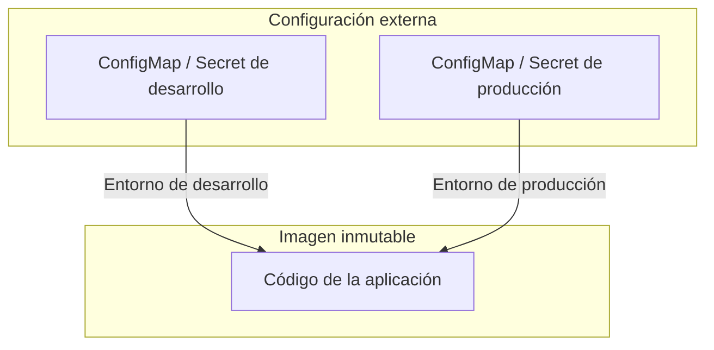
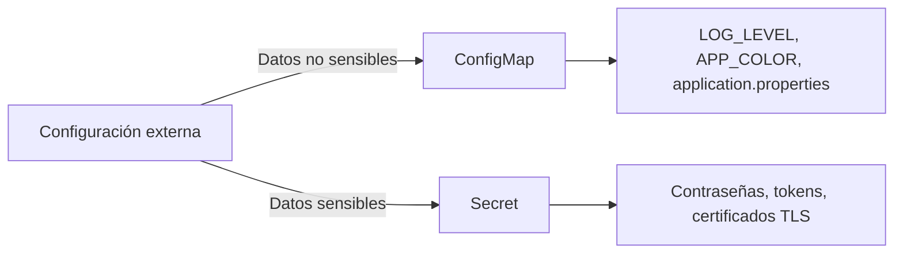
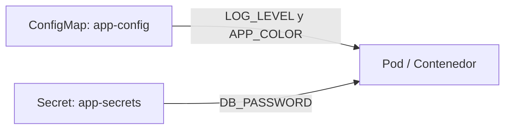
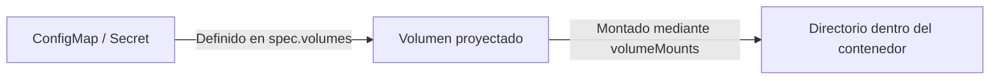

## 2.4 Configuración fuera de la imagen: ConfigMaps y Secrets

### Objetivos de aprendizaje

Al finalizar este apartado serás capaz de:

- Comprender la importancia de desacoplar la configuración del código y de las imágenes de contenedor.
- Identificar cuándo utilizar un **ConfigMap** y cuándo utilizar un **Secret**.
- Crear ConfigMaps y Secrets mediante CLI y manifiestos YAML.
- Entender qué protección aporta realmente un Secret y por qué Base64 no equivale a cifrado.
- Inyectar datos de configuración como variables de entorno y consumirlos desde la aplicación.
- Entender cómo montar ConfigMaps y Secrets como archivos dentro del contenedor.
- Diferenciar el comportamiento de la configuración inyectada como variable de entorno y como volumen.
- Comprobar la actualización de los archivos proyectados al modificar un ConfigMap.

### Desacoplar la configuración de la imagen

En los apartados anteriores hemos definido cómo se ejecuta nuestra aplicación, cómo se publica, cómo comprueba OpenShift su estado de salud y qué recursos necesita. Sin embargo, todavía queda una cuestión importante:

**¿Cómo proporcionamos a la misma imagen una configuración diferente según el entorno en el que se despliegue?**

Uno de los principios fundamentales en el desarrollo y despliegue de aplicaciones modernas en contenedores es la **separación entre el código y la configuración**.

Una imagen de contenedor debe ser un artefacto **inmutable y agnóstico del entorno**. La misma imagen debe poder ejecutarse en entornos de desarrollo, pruebas o producción sin necesidad de volver a compilarla o modificar sus capas internas.



Si guardamos parámetros como cadenas de conexión a bases de datos, claves API, URLs de servicios externos o niveles de registro (`LOG_LEVEL`) dentro de la imagen, aparecen varios inconvenientes:

- **Riesgo de seguridad:** las credenciales o contraseñas pueden quedar expuestas en registros de imágenes o repositorios de código.
- **Falta de flexibilidad:** es necesario reconstruir la imagen cada vez que cambia un parámetro.
- **Dificultad para reutilizar la imagen:** cada entorno acabaría necesitando una variante distinta del mismo artefacto.

La idea principal es sencilla:

> **No cambiamos la imagen. Cambiamos su configuración.**

Para conseguirlo, Kubernetes y OpenShift proporcionan dos recursos nativos: **ConfigMaps** y **Secrets**.

### ConfigMaps frente a Secrets

Ambos recursos permiten almacenar datos de configuración mediante pares clave-valor o archivos completos, pero están orientados a tipos de información distintos.



#### ConfigMap

Un **ConfigMap** está diseñado para almacenar datos de configuración no sensibles en texto plano.

Ejemplos habituales:

- Niveles de registro, como `LOG_LEVEL=info`.
- URLs de servicios auxiliares.
- Parámetros generales de la aplicación.
- Archivos como `nginx.conf` o `application.properties`.

#### Secret

Un **Secret** está diseñado para almacenar información sensible que una aplicación necesita utilizar.

Ejemplos habituales:

- Contraseñas y credenciales de acceso a bases de datos.
- Tokens de autenticación.
- Claves privadas y certificados TLS.
- Claves SSH o credenciales para acceder a un registro de imágenes.

| Característica | ConfigMap | Secret |
|---|---|---|
| Tipo de datos | Configuración no sensible | Datos sensibles |
| Formato habitual en el manifiesto | Texto plano en `data` | Base64 en `data` o texto plano en `stringData` |
| Uso principal | Ajustar el comportamiento de la aplicación | Separar y controlar el acceso a credenciales y otros datos sensibles |
| Consumo desde un Pod | Variable de entorno o volumen | Variable de entorno o volumen |

#### ¿Qué protege realmente un Secret?

Utilizar un Secret es mejor que incluir una contraseña directamente en la imagen, en el código o en el manifiesto del Deployment. Permite separar la credencial del artefacto de aplicación y aplicar controles de acceso específicos mediante RBAC.

Sin embargo, es importante entender sus límites:

- Los valores almacenados en el campo `data` se representan en **Base64**.
- **Base64 es una codificación, no un mecanismo de cifrado.** Cualquier usuario autorizado para leer el Secret puede recuperar su contenido.
- La protección efectiva depende también de los permisos RBAC y de la configuración de seguridad del clúster.
- Un Secret no debe mostrarse innecesariamente en terminales, registros, capturas o repositorios de código.

!!! warning "Base64 no es cifrado"
    Codificar una contraseña en Base64 no la vuelve ilegible para quien tenga acceso al objeto. El beneficio principal del Secret es separar el dato sensible de la imagen y permitir que la plataforma controle quién puede consultarlo y cómo se entrega a los Pods.

En entornos reales pueden utilizarse mecanismos adicionales de cifrado y gestores externos de secretos. Su configuración queda fuera del alcance de este apartado.

### Creación de ConfigMaps y Secrets

Los ConfigMaps y Secrets pueden crearse mediante la herramienta `oc` o aplicando manifiestos YAML.

#### Opción 1: mediante la CLI `oc`

Creamos un ConfigMap mediante varios pares `CLAVE=VALOR`:

```bash
oc create configmap app-config \
  --from-literal=LOG_LEVEL=info \
  --from-literal=APP_COLOR=blue \
  --from-literal=APP_TITLE="Entorno de Formacion OpenShift"
```

En este comando:

- `LOG_LEVEL` es una clave y `info` es su valor.
- `APP_COLOR` es una clave y `blue` es su valor.
- `APP_TITLE` es una clave y `Entorno de Formacion OpenShift` es su valor.

De forma similar, creamos un Secret con las credenciales de ejemplo:

```bash
oc create secret generic app-secrets \
  --from-literal=DB_USER=admin_user \
  --from-literal=DB_PASSWORD='PasswordSeguro2026'
```

!!! warning "Credenciales de laboratorio"
    Los valores utilizados en este apartado son exclusivamente didácticos. En un entorno real no debemos incluir contraseñas en scripts, historiales de terminal o repositorios de código.

#### Opción 2: mediante manifiestos YAML

También podemos definir los recursos en archivos YAML.

##### ConfigMap (`configmap.yaml`)

```yaml
apiVersion: v1
kind: ConfigMap
metadata:
  name: app-config
data:
  LOG_LEVEL: "info"
  APP_COLOR: "blue"
  APP_TITLE: "Entorno de Formacion OpenShift"
```

##### Secret (`secret.yaml`)

```yaml
apiVersion: v1
kind: Secret
metadata:
  name: app-secrets
type: Opaque
stringData:
  DB_USER: "admin_user"
  DB_PASSWORD: "PasswordSeguro2026"
```

El campo `stringData` permite escribir los valores en texto legible al crear el manifiesto. La API de Kubernetes los transforma y almacena en el campo `data` codificados en Base64.

!!! warning "Protege el archivo `secret.yaml`"
    `stringData` facilita la creación del Secret, pero el manifiesto contiene las credenciales en texto plano. No debe subirse a un repositorio ni compartirse como si fuera un archivo de configuración ordinario.

Aplicamos los manifiestos:

```bash
oc apply -f configmap.yaml
oc apply -f secret.yaml
```

#### Comprobación de los recursos

Verificamos que ambos objetos existen en el proyecto:

```bash
oc get configmap app-config
oc get secret app-secrets
```

Podemos consultar el ConfigMap porque no contiene información sensible:

```bash
oc describe configmap app-config
```

En el caso del Secret, evitamos mostrar su contenido. Podemos comprobar sus claves mediante:

```bash
oc describe secret app-secrets
```

La salida indica las claves y el tamaño de sus valores, pero no revela las credenciales.

### Inyección como variables de entorno

Una aplicación puede consumir valores concretos de un ConfigMap o Secret como **variables de entorno** dentro del contenedor.



#### ¿Cómo se conectan los objetos con el Deployment?

La sección `env` de la especificación del contenedor permite definir cada variable y obtener su valor desde otro objeto:

- `configMapKeyRef` referencia una clave de un ConfigMap.
- `secretKeyRef` referencia una clave de un Secret.
- `name` identifica el ConfigMap o Secret existente.
- `key` identifica el dato concreto contenido en ese objeto.

#### Actualización del Deployment (`deployment.yaml`)

Seguimos utilizando la aplicación `demo-formacion-yaml` y la imagen `v3` de los apartados anteriores. Para centrar el ejemplo en ConfigMaps y Secrets, el siguiente manifiesto muestra una versión simplificada del Deployment y omite temporalmente elementos ya estudiados, como las sondas de salud y los recursos.

Añadimos el bloque `env` asociando variables internas con claves de nuestros objetos:

```yaml
apiVersion: apps/v1
kind: Deployment
metadata:
  name: demo-formacion-yaml
  annotations:
    kubernetes.io/change-cause: "Inyeccion de ConfigMap y Secret como variables de entorno"
spec:
  replicas: 1
  selector:
    matchLabels:
      app: demo-formacion-yaml
  template:
    metadata:
      labels:
        app: demo-formacion-yaml
    spec:
      containers:
        - name: demo-formacion
          image: docker.io/ieftraining/demo-formacion:v3
          imagePullPolicy: Always
          ports:
            - containerPort: 8080
          env:
            - name: LOG_LEVEL
              valueFrom:
                configMapKeyRef:
                  name: app-config
                  key: LOG_LEVEL
            - name: APP_COLOR
              valueFrom:
                configMapKeyRef:
                  name: app-config
                  key: APP_COLOR
            - name: DB_PASSWORD
              valueFrom:
                secretKeyRef:
                  name: app-secrets
                  key: DB_PASSWORD
```

Aplicamos los cambios:

```bash
oc apply -f deployment.yaml
oc rollout status deployment/demo-formacion-yaml
```

#### Verificación de las variables

Comprobamos únicamente las variables no sensibles:

```bash
oc exec deployment/demo-formacion-yaml -- \
  sh -c 'printf "LOG_LEVEL=%s\nAPP_COLOR=%s\n" "$LOG_LEVEL" "$APP_COLOR"'
```

Resultado esperado:

```text
LOG_LEVEL=info
APP_COLOR=blue
```

Para verificar que la variable sensible existe sin revelar su contenido:

```bash
oc exec deployment/demo-formacion-yaml -- \
  sh -c 'test -n "$DB_PASSWORD" && echo "DB_PASSWORD esta definida"'
```

Resultado esperado:

```text
DB_PASSWORD esta definida
```

!!! warning "Comportamiento de las variables de entorno"
    Las variables de entorno se establecen cuando arranca el contenedor. Si modificamos posteriormente el ConfigMap o el Secret, los contenedores que ya están en ejecución no reciben automáticamente el nuevo valor. Para aplicarlo será necesario crear nuevos Pods, por ejemplo mediante un nuevo rollout.

### Montar ConfigMaps y Secrets como volúmenes

Cuando la configuración consiste en archivos completos, como `nginx.conf`, `application.properties` o certificados, podemos montar un ConfigMap o un Secret como archivos dentro del contenedor.

En este apartado utilizamos el volumen únicamente como mecanismo para presentar archivos de configuración. El almacenamiento persistente de datos se estudiará en el apartado 2.5.

Para realizar el montaje intervienen dos secciones del manifiesto:

- **`spec.volumes`**, a nivel de Pod, declara la fuente del volumen y le asigna un nombre.
- **`volumeMounts`**, dentro del contenedor, indica en qué ruta se presenta ese volumen.

El valor de `volumeMounts.name` debe coincidir con el nombre declarado en `volumes`.



#### Actualización del Deployment con volúmenes (`deployment.yaml`)

Para observar claramente el funcionamiento de los volúmenes, mantenemos el manifiesto simplificado y sustituimos el bloque `env` del ejemplo anterior por `volumeMounts` y `volumes`:

```yaml
apiVersion: apps/v1
kind: Deployment
metadata:
  name: demo-formacion-yaml
  annotations:
    kubernetes.io/change-cause: "Montaje de ConfigMap y Secret como volumenes de archivos"
spec:
  replicas: 1
  selector:
    matchLabels:
      app: demo-formacion-yaml
  template:
    metadata:
      labels:
        app: demo-formacion-yaml
    spec:
      containers:
        - name: demo-formacion
          image: docker.io/ieftraining/demo-formacion:v3
          imagePullPolicy: Always
          ports:
            - containerPort: 8080
          volumeMounts:
            - name: config-volume
              mountPath: /etc/config
              readOnly: true
            - name: secret-volume
              mountPath: /etc/secrets
              readOnly: true
      volumes:
        - name: config-volume
          configMap:
            name: app-config
        - name: secret-volume
          secret:
            secretName: app-secrets
```

Aplicamos la configuración:

```bash
oc apply -f deployment.yaml
oc rollout status deployment/demo-formacion-yaml
```

#### Verificación de los archivos en el contenedor

Cada clave del ConfigMap se convierte en un archivo dentro de la ruta de montaje:

```bash
oc exec deployment/demo-formacion-yaml -- ls -l /etc/config
```

Salida orientativa:

```text
APP_COLOR
APP_TITLE
LOG_LEVEL
```

Consultamos un valor no sensible:

```bash
oc exec deployment/demo-formacion-yaml -- cat /etc/config/APP_COLOR
```

Resultado esperado:

```text
blue
```

También podemos comprobar la existencia de las claves del Secret sin mostrar su contenido:

```bash
oc exec deployment/demo-formacion-yaml -- ls -l /etc/secrets
```

### Actualización de configuración montada como volumen

A diferencia de las variables de entorno, los ConfigMaps y Secrets montados directamente como volúmenes pueden actualizar los archivos proyectados dentro de un Pod que ya está en ejecución.

#### 1. Registrar el Pod actual

Antes de cambiar la configuración, anotamos el nombre y la fecha de creación del Pod:

```bash
oc get pods -l app=demo-formacion-yaml
```

#### 2. Modificar el ConfigMap

Cambiamos el valor de `APP_COLOR` directamente en el clúster:

```bash
oc patch configmap app-config \
  -p '{"data":{"APP_COLOR":"green"}}'
```

#### 3. Comprobar la actualización sin reiniciar el Pod

La actualización del archivo no es necesariamente inmediata. La plataforma sincroniza periódicamente el contenido proyectado.

Volvemos a consultar el archivo hasta observar el nuevo valor:

```bash
oc exec deployment/demo-formacion-yaml -- cat /etc/config/APP_COLOR
```

Resultado esperado:

```text
green
```

Comprobamos que continúa ejecutándose el mismo Pod:

```bash
oc get pods -l app=demo-formacion-yaml
```

El archivo se ha actualizado sin reconstruir la imagen ni crear deliberadamente un nuevo Pod.

!!! warning "Actualizar el archivo no implica que la aplicación lo relea"
    La plataforma puede actualizar el archivo montado, pero la aplicación debe estar preparada para volver a leerlo. Algunas aplicaciones detectan el cambio; otras solo cargan la configuración durante el arranque y necesitan reiniciarse para utilizar el nuevo valor.

### Variables de entorno frente a volúmenes

| Forma de consumo | Qué recibe el contenedor | Qué sucede si cambia el ConfigMap o Secret |
|---|---|---|
| Variable de entorno | Un valor establecido al arrancar | El contenedor existente conserva el valor inicial; se necesitan nuevos Pods para recibir el cambio |
| Volumen | Un archivo por cada clave | Los archivos proyectados pueden actualizarse en el Pod existente |
| Aplicación que lee un volumen | El contenido del archivo | Solo utiliza el cambio sin reinicio si está diseñada para releer la configuración |

La elección depende de cómo espere recibir la configuración la aplicación:

- Utilizamos **variables de entorno** para parámetros sencillos que la aplicación lee al arrancar.
- Utilizamos **volúmenes** cuando la aplicación necesita archivos completos o puede releer archivos de configuración.

### Ideas clave para recordar

!!! tip "Resumen"
    - Una imagen debe ser inmutable y reutilizable entre entornos.
    - Los **ConfigMaps** almacenan configuración no sensible.
    - Los **Secrets** separan los datos sensibles del código y permiten controlar su acceso.
    - **Base64 no es cifrado** y no impide que un usuario autorizado lea un Secret.
    - ConfigMaps y Secrets pueden consumirse como variables de entorno o como archivos montados.
    - Las variables de entorno no cambian dentro de un contenedor que ya está ejecutándose.
    - Los archivos proyectados desde un volumen pueden actualizarse sin recrear el Pod.
    - Que un archivo se actualice no significa que la aplicación vaya a releerlo automáticamente.
    - Un volumen de ConfigMap o Secret presenta configuración; el almacenamiento persistente se estudiará en el apartado siguiente.
