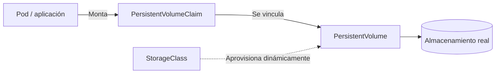
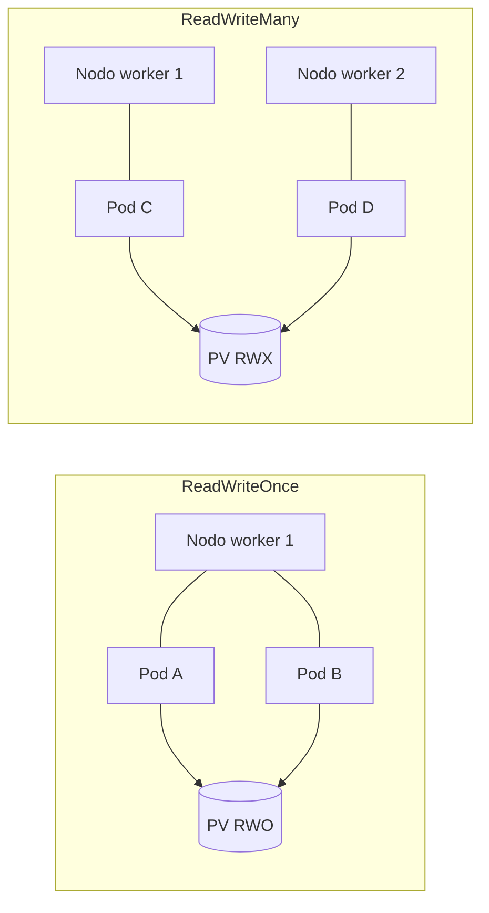
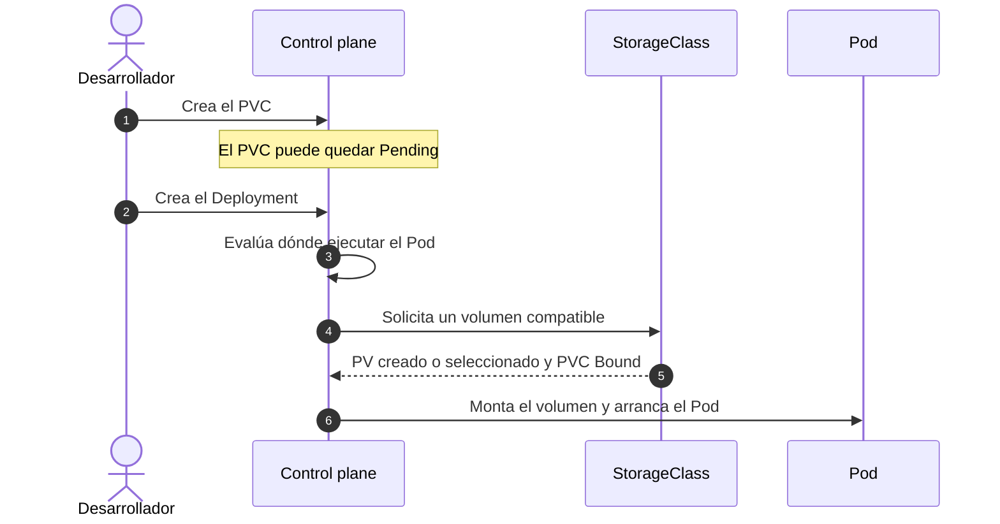

## 2.5 Almacenamiento persistente: PV, PVC y StorageClass

### Objetivos de aprendizaje

Al finalizar este apartado serás capaz de:

- Comprender por qué los datos que deben sobrevivir a un Pod necesitan almacenamiento persistente.
- Diferenciar las responsabilidades de **PersistentVolume (PV)**, **PersistentVolumeClaim (PVC)** y **StorageClass**.
- Reconocer los principales modos de acceso al almacenamiento: **ReadWriteOnce (RWO)**, **ReadWriteMany (RWX)** y **ReadOnlyMany (ROX)**.
- Comprender, a nivel básico, el comportamiento de `WaitForFirstConsumer`.
- Montar un PVC en la ruta donde la aplicación guarda realmente sus datos.
- Desplegar una base de datos con almacenamiento persistente, eliminar su Pod y comprobar que los datos permanecen.

### El problema: el Pod desaparece, pero el dato debe permanecer

Como vimos al estudiar los contenedores, un Pod puede ser eliminado y sustituido por otro en cualquier momento. Si una aplicación guarda información únicamente en el sistema de archivos escribible de su contenedor, esos datos no acompañan a la nueva instancia.

Esto no supone un problema para una aplicación que no conserva estado, pero sí para una base de datos, un gestor documental o cualquier sistema que deba mantener información entre reinicios y sustituciones de Pods.

La idea principal de este apartado es sencilla:

> **Los Pods pueden desaparecer; los datos que deban conservarse tienen que vivir fuera de ellos.**

Kubernetes y OpenShift resuelven esta necesidad separando tres elementos:

- La aplicación **solicita almacenamiento** mediante un PVC.
- La plataforma le asigna un **volumen persistente** representado por un PV.
- Una StorageClass describe cómo puede aprovisionarse ese almacenamiento en la infraestructura.



!!! tip "Mapa mental"
    Para seguir este apartado basta con recordar inicialmente esta cadena:

    **Pod → PVC → PV → almacenamiento real**

    La StorageClass interviene cuando la plataforma debe crear el almacenamiento solicitado.

### Primera demostración: una base de datos sin persistencia

Antes de estudiar los objetos de almacenamiento, comprobaremos el problema que necesitamos resolver. Desplegaremos una base de datos sin ningún volumen persistente, insertaremos un dato y eliminaremos el Pod.

Como vimos en el apartado 2.4, las credenciales no deberían incorporarse directamente al Deployment. Crearemos un Secret específico que reutilizaremos tanto en esta primera prueba como en el despliegue posterior con persistencia.

Guardamos el siguiente manifiesto como `db-secret.yaml`:

```yaml
apiVersion: v1
kind: Secret
metadata:
  name: db-mysql-secret
type: Opaque
stringData:
  username: user_curso
  password: password123
```

Aplicamos el Secret:

```bash
oc apply -f db-secret.yaml
```

Guardamos ahora el siguiente manifiesto como `db-sin-persistencia.yaml`:

```yaml
apiVersion: apps/v1
kind: Deployment
metadata:
  name: db-mysql-efimera
  labels:
    app: db-mysql-efimera
spec:
  replicas: 1
  strategy:
    type: Recreate
  selector:
    matchLabels:
      app: db-mysql-efimera
  template:
    metadata:
      labels:
        app: db-mysql-efimera
    spec:
      containers:
        - name: mysql
          image: registry.redhat.io/rhel9/mysql-80:latest
          env:
            - name: MYSQL_USER
              valueFrom:
                secretKeyRef:
                  name: db-mysql-secret
                  key: username
            - name: MYSQL_PASSWORD
              valueFrom:
                secretKeyRef:
                  name: db-mysql-secret
                  key: password
            - name: MYSQL_DATABASE
              value: mibase
          ports:
            - containerPort: 3306
              name: mysql
```

Observa que el Deployment no contiene `volumes` ni `volumeMounts`. MySQL escribirá por tanto sus datos en el sistema de archivos del contenedor.

Aplicamos el manifiesto y esperamos a que el Pod esté disponible:

```bash
oc apply -f db-sin-persistencia.yaml
oc rollout status deployment/db-mysql-efimera
```

Entramos en el contenedor:

```bash
oc rsh deployment/db-mysql-efimera
```

Nos conectamos a MySQL:

```bash
mysql -u user_curso -ppassword123 mibase
```

Creamos una tabla, insertamos un registro y comprobamos que existe:

```sql
CREATE TABLE notas (
  id INT AUTO_INCREMENT PRIMARY KEY,
  texto VARCHAR(255)
);

INSERT INTO notas (texto)
VALUES ('Dato creado sin almacenamiento persistente');

SELECT * FROM notas;
```

Salimos del cliente MySQL y del contenedor:

```text
exit
exit
```

Eliminamos el Pod para que el Deployment cree otro:

```bash
oc delete pod -l app=db-mysql-efimera
oc rollout status deployment/db-mysql-efimera
```

Volvemos a entrar en la nueva instancia y consultamos la tabla:

```bash
oc rsh deployment/db-mysql-efimera
mysql -u user_curso -ppassword123 mibase
```

```sql
SELECT * FROM notas;
```

MySQL responderá que la tabla no existe:

```text
ERROR 1146 (42S02): Table 'mibase.notas' doesn't exist
```

El Deployment ha recuperado la aplicación, pero no sus datos. El nuevo Pod ha arrancado con un sistema de archivos nuevo, sin la tabla creada en la instancia anterior.

Salimos del cliente y del contenedor:

```text
exit
exit
```

Eliminamos este Deployment antes de continuar. Conservamos el Secret, porque lo reutilizaremos en el despliegue con persistencia:

```bash
oc delete deployment db-mysql-efimera
```

!!! question "Pregunta para el grupo"
    OpenShift ha creado correctamente una nueva instancia de MySQL, pero ¿qué objeto debe permitir que el nuevo Pod recupere los datos de la instancia anterior?

A continuación estudiaremos los componentes que resuelven este problema y repetiremos el experimento utilizando almacenamiento persistente.

### Las tres piezas del almacenamiento persistente

#### PersistentVolumeClaim (PVC)

Un **PersistentVolumeClaim** es la solicitud de almacenamiento que realiza una aplicación dentro de un proyecto.

En el PVC se indican, entre otros datos:

- la capacidad solicitada, por ejemplo `1Gi`;
- el modo de acceso requerido, por ejemplo `ReadWriteOnce`;
- opcionalmente, la StorageClass que debe utilizarse.

El desarrollador trabaja principalmente con el PVC. No necesita conocer los detalles físicos de la cabina, del disco o del servicio de almacenamiento que existe detrás.

#### PersistentVolume (PV)

Un **PersistentVolume** representa el volumen de almacenamiento puesto a disposición del clúster. Puede corresponder a un disco de una nube pública, un volumen de una plataforma de virtualización o un sistema de almacenamiento en red.

A diferencia del PVC, el PV es un recurso de ámbito de clúster y no pertenece a un proyecto concreto.

Cuando un PVC encuentra un volumen compatible, ambos quedan vinculados. Esta relación aparece con el estado `Bound`.

#### StorageClass

Una **StorageClass** describe una clase de almacenamiento disponible en el clúster y el _provisioner_ encargado de interactuar con la infraestructura subyacente.

Cuando existe provisión dinámica, el desarrollador crea un PVC y la plataforma puede crear automáticamente un PV que satisfaga la solicitud. En provisión estática, los PV deben haber sido preparados previamente por el equipo administrador.

Qué opciones están disponibles depende de la infraestructura, de los controladores de almacenamiento instalados y de la configuración del clúster.

### Inspección de StorageClasses en el clúster

Antes de solicitar almacenamiento, consultamos las clases disponibles:

```bash
oc get storageclass
```

En el sandbox utilizado durante la preparación del curso se obtiene una salida similar a la siguiente:

```text
NAME              PROVISIONER             RECLAIMPOLICY   VOLUMEBINDINGMODE      ALLOWVOLUMEEXPANSION   AGE
efs-sc            efs.csi.aws.com         Delete          Immediate              false                  673d
gp2               kubernetes.io/aws-ebs   Delete          WaitForFirstConsumer   true                   674d
gp2-csi           ebs.csi.aws.com         Delete          WaitForFirstConsumer   true                   674d
gp3 (default)     ebs.csi.aws.com         Delete          WaitForFirstConsumer   true                   674d
gp3-csi           ebs.csi.aws.com         Delete          WaitForFirstConsumer   true                   674d
```

La marca `(default)` identifica la StorageClass predeterminada. Si un PVC no especifica `storageClassName`, el clúster utilizará normalmente esa clase.

!!! note "El resultado depende del entorno"
    Los nombres, los _provisioners_ y los modos disponibles cambian entre clústeres. Antes de ejecutar la práctica en el laboratorio definitivo habrá que comprobar sus StorageClasses y adaptar, si fuera necesario, los manifiestos.

### Modos de acceso al almacenamiento

Al crear un PVC debemos indicar cómo podrá montarse el volumen. Los tres modos principales son:

| Modo | Nombre en el manifiesto | Significado básico | Ejemplo habitual |
|---|---|---|---|
| **RWO** | `ReadWriteOnce` | Lectura y escritura desde un único nodo | Una instancia de MySQL o PostgreSQL |
| **RWX** | `ReadWriteMany` | Lectura y escritura desde varios nodos | Contenido compartido entre varias réplicas |
| **ROX** | `ReadOnlyMany` | Solo lectura desde varios nodos | Contenido estático compartido |



!!! warning "Solicitar un modo no garantiza que esté disponible"
    El modo de acceso está condicionado por la tecnología y la configuración del almacenamiento. Incluir `ReadWriteMany` en un PVC no obliga a la infraestructura a poder proporcionarlo.

#### Una precisión importante sobre RWO

`ReadWriteOnce` no significa necesariamente «un solo Pod». Significa que el volumen puede montarse en lectura y escritura desde un único nodo.

Aun así, no debemos ejecutar varias instancias de una base de datos escribiendo simultáneamente sobre los mismos archivos, aunque coincidan en el mismo nodo. La aplicación podría sufrir bloqueos o corrupción de datos.

Si dos Pods situados en nodos diferentes intentan utilizar el mismo volumen RWO, uno de ellos puede quedar en `Pending` y aparecer un error de tipo `Multi-Attach`.

!!! tip "Relación con StatefulSet"
    En el apartado 2.1 vimos que StatefulSet resulta apropiado para determinadas aplicaciones con estado. Un patrón habitual consiste en proporcionar un PVC independiente a cada réplica mediante `volumeClaimTemplates`, en lugar de hacer que todas compartan un único PVC RWO.

    En esta práctica utilizaremos una sola instancia de MySQL, por lo que no necesitamos desarrollar ahora ese patrón.

### Solicitud de almacenamiento mediante un PVC

Para la práctica solicitaremos `1Gi` de almacenamiento con modo `ReadWriteOnce`. No indicaremos `storageClassName`, por lo que el clúster utilizará su StorageClass predeterminada.

Guardamos el siguiente manifiesto como `db-pvc.yaml`:

```yaml
apiVersion: v1
kind: PersistentVolumeClaim
metadata:
  name: db-pvc
spec:
  accessModes:
    - ReadWriteOnce
  resources:
    requests:
      storage: 1Gi
```

Aplicamos el manifiesto:

```bash
oc apply -f db-pvc.yaml
```

Consultamos el PVC:

```bash
oc get pvc db-pvc
```

Dependiendo de la StorageClass, podemos encontrar dos situaciones:

```text
NAME     STATUS    VOLUME   CAPACITY   ACCESS MODES   STORAGECLASS   AGE
db-pvc   Pending                                      gp3            5s
```

O bien:

```text
NAME     STATUS   VOLUME      CAPACITY   ACCESS MODES   STORAGECLASS   AGE
db-pvc   Bound    pvc-xxxxx   1Gi        RWO            gp3            20s
```

El estado `Bound` confirma que el PVC se ha vinculado a un PV. Si aparece inicialmente como `Pending`, no significa necesariamente que exista un error: la StorageClass puede estar utilizando `WaitForFirstConsumer`.

### La política `WaitForFirstConsumer`

Algunas StorageClasses utilizan:

```yaml
volumeBindingMode: WaitForFirstConsumer
```

Con esta política, Kubernetes retrasa la vinculación y, cuando corresponde, el aprovisionamiento del volumen hasta que existe un Pod que necesita utilizar el PVC.

El flujo básico es el siguiente:

1. Creamos el PVC.
2. El PVC puede permanecer temporalmente en `Pending`.
3. Creamos el Pod o Deployment que utiliza el PVC.
4. El planificador analiza dónde puede ejecutarse el Pod.
5. La plataforma selecciona o aprovisiona un volumen compatible con la ubicación de la carga.
6. El PVC pasa a `Bound` y el Pod puede arrancar.



!!! note "Por qué es útil"
    `WaitForFirstConsumer` permite tener en cuenta restricciones de ubicación, como nodos o zonas de disponibilidad, antes de seleccionar o crear el volumen. No significa que el disco se cree dentro del propio nodo.

### Reutilización de las credenciales de MySQL

Conservamos el Secret `db-mysql-secret` creado en la primera demostración. De este modo repetiremos el experimento con las mismas credenciales y cambiaremos únicamente el aspecto que queremos comprobar: dónde se almacenan los datos.

### Despliegue de MySQL y montaje del volumen

Disponer de un PVC no basta por sí solo. El volumen debe montarse en la ruta en la que la aplicación escribe realmente sus datos.

Para la imagen `registry.redhat.io/rhel9/mysql-80:latest`, utilizaremos la ruta `/var/lib/mysql/data`.

Guardamos el siguiente manifiesto como `db-deployment.yaml`:

```yaml
apiVersion: apps/v1
kind: Deployment
metadata:
  name: db-mysql
  labels:
    app: db-mysql
spec:
  replicas: 1
  strategy:
    type: Recreate
  selector:
    matchLabels:
      app: db-mysql
  template:
    metadata:
      labels:
        app: db-mysql
    spec:
      containers:
        - name: mysql
          image: registry.redhat.io/rhel9/mysql-80:latest
          env:
            - name: MYSQL_USER
              valueFrom:
                secretKeyRef:
                  name: db-mysql-secret
                  key: username
            - name: MYSQL_PASSWORD
              valueFrom:
                secretKeyRef:
                  name: db-mysql-secret
                  key: password
            - name: MYSQL_DATABASE
              value: mibase
          ports:
            - containerPort: 3306
              name: mysql
          volumeMounts:
            - name: db-data
              mountPath: /var/lib/mysql/data
      volumes:
        - name: db-data
          persistentVolumeClaim:
            claimName: db-pvc
```

Los elementos principales son:

- `strategy.type: Recreate`: reutiliza la estrategia estudiada en el apartado 2.1. Antes de crear una nueva instancia se elimina la anterior, evitando el solapamiento de dos Pods sobre el mismo volumen RWO durante una actualización.
- `secretKeyRef`: obtiene el usuario y la contraseña del Secret creado anteriormente, sin incluirlos directamente en el Deployment.
- `volumeMounts.mountPath`: indica dónde aparece el volumen dentro del contenedor. Debe coincidir con la ruta en la que MySQL guarda sus datos.
- `persistentVolumeClaim.claimName`: conecta el volumen lógico `db-data` con el PVC `db-pvc`.

!!! warning "El PVC debe montarse en la ruta de datos"
    Si montásemos el volumen en `/datos`, pero MySQL continuase escribiendo en `/var/lib/mysql/data`, el PVC existiría y estaría correctamente vinculado, pero los datos de la base de datos seguirían dentro del contenedor y se perderían al sustituir el Pod.

Aplicamos el Deployment:

```bash
oc apply -f db-deployment.yaml
```

Esperamos a que el despliegue esté disponible:

```bash
oc rollout status deployment/db-mysql
```

Comprobamos el Pod:

```bash
oc get pods -l app=db-mysql
```

Resultado esperado:

```text
NAME                        READY   STATUS    RESTARTS   AGE
db-mysql-xxxxxxxxxx-xxxxx   1/1     Running   0          45s
```

Volvemos a consultar el PVC. Si estaba en `Pending` por `WaitForFirstConsumer`, ahora debería aparecer como `Bound`:

```bash
oc get pvc db-pvc
```

### Escritura de un dato en la base de datos

Accedemos al contenedor mediante `oc rsh`:

```bash
oc rsh deployment/db-mysql
```

Desde la terminal del contenedor nos conectamos a MySQL:

```bash
mysql -u user_curso -ppassword123 mibase
```

Creamos una tabla, insertamos un registro y lo consultamos:

```sql
CREATE TABLE notas (
  id INT AUTO_INCREMENT PRIMARY KEY,
  texto VARCHAR(255)
);

INSERT INTO notas (texto)
VALUES ('Dato creado con almacenamiento persistente');

SELECT * FROM notas;
```

Resultado esperado:

```text
+----+-------------------------------------------+
| id | texto                                     |
+----+-------------------------------------------+
|  1 | Dato creado con almacenamiento persistente |
+----+-------------------------------------------+
```

Salimos del cliente MySQL y de la sesión del contenedor:

```text
exit
exit
```

### Eliminación del Pod y comprobación de la persistencia

Ahora eliminaremos el Pod para obligar al Deployment a crear una nueva instancia:

```bash
oc delete pod -l app=db-mysql
```

!!! note "Qué estamos comprobando"
    No estamos comprobando únicamente que el Deployment recupere el número de réplicas, algo que ya vimos al estudiar la reconciliación. Queremos comprobar que el nuevo Pod vuelve a montar el mismo almacenamiento y encuentra el dato creado por el Pod anterior.

Observamos la sustitución:

```bash
oc get pods -l app=db-mysql -w
```

Cuando el nuevo Pod alcance el estado `Running`, interrumpimos la espera con ++ctrl+c++ y volvemos a entrar:

```bash
oc rsh deployment/db-mysql
```

Nos conectamos a MySQL y consultamos la tabla:

```bash
mysql -u user_curso -ppassword123 mibase
```

```sql
SELECT * FROM notas;
```

El resultado debe seguir mostrando el registro:

```text
+----+-------------------------------------------+
| id | texto                                     |
+----+-------------------------------------------+
|  1 | Dato creado con almacenamiento persistente |
+----+-------------------------------------------+
```

El Pod anterior ya no existe, pero el dato permanece porque se guardó en el volumen asociado al PVC y no en el sistema de archivos efímero del contenedor.

Salimos de MySQL y del contenedor:

```text
exit
exit
```

### Comparación de los dos resultados

| Prueba | Ubicación de los datos | Resultado al sustituir el Pod |
|---|---|---|
| MySQL sin PVC | Sistema de archivos del contenedor | La tabla desaparece |
| MySQL con PVC | Volumen persistente montado en `/var/lib/mysql/data` | La tabla y el registro permanecen |

La aplicación es la misma en ambas pruebas. La diferencia es que, en la segunda, el nuevo Pod vuelve a montar el volumen asociado al PVC.

### Ideas clave para recordar

!!! tip "Resumen"
    - Un Pod puede ser eliminado y sustituido. Los datos que deban conservarse tienen que almacenarse fuera de su sistema de archivos efímero.
    - El **PVC** es la solicitud de almacenamiento realizada desde un proyecto.
    - El **PV** representa el volumen persistente disponible para el clúster.
    - La **StorageClass** describe cómo puede aprovisionarse el almacenamiento.
    - El estado `Bound` indica que un PVC está vinculado a un PV.
    - Los modos `RWO`, `RWX` y `ROX` dependen de las capacidades de la infraestructura de almacenamiento.
    - `WaitForFirstConsumer` puede mantener el PVC en `Pending` hasta que exista un Pod que vaya a utilizarlo.
    - El PVC debe montarse en la ruta donde la aplicación guarda realmente sus datos.
    - El almacenamiento persistente permite que un Pod nuevo recupere los datos creados por una instancia anterior.
