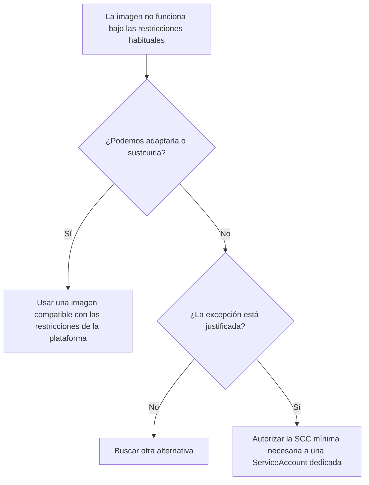
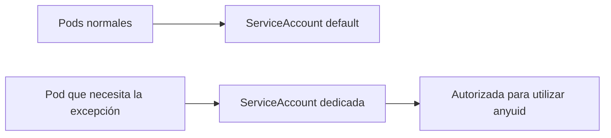

### 2.6 Políticas de seguridad de la plataforma (SCC)

#### Objetivos de aprendizaje

Al finalizar este apartado serás capaz de:

- Comprender por qué OpenShift aplica restricciones de seguridad a los contenedores.
- Explicar qué es una **Security Context Constraint (SCC)**.
- Reconocer el propósito de `restricted-v2` y `anyuid`.
- Entender por qué una imagen pública puede funcionar en otros entornos y no hacerlo directamente en OpenShift.
- Diagnosticar problemas básicos relacionados con las restricciones de ejecución de un contenedor.
- Diferenciar entre la solución preferida, adaptar o sustituir la imagen, y la concesión excepcional de permisos adicionales.
- Entender cómo una **ServiceAccount dedicada** permite limitar el alcance de una excepción de seguridad.

#### Seguridad de los contenedores en OpenShift

Hasta ahora hemos trabajado con las aplicaciones atendiendo principalmente a los recursos que necesitan para funcionar. OpenShift debe considerar además las condiciones de seguridad bajo las que se ejecutan.

Los contenedores proporcionan aislamiento para sus procesos, pero no son máquinas virtuales completas: comparten el kernel del nodo en el que se ejecutan. Por este motivo, una aplicación con privilegios innecesarios puede aumentar el impacto de una configuración incorrecta, una vulnerabilidad o una imagen de terceros comprometida.

OpenShift aplica el principio de **mínimo privilegio**: cada aplicación debe disponer únicamente de los permisos que necesita. Si requiere una excepción, esta debe estar justificada y limitarse a la carga correspondiente.

Este enfoque explica por qué algunas imágenes públicas que funcionan correctamente en otros entornos pueden presentar problemas al desplegarse en OpenShift. Muchas se han construido suponiendo condiciones de ejecución más permisivas, como:

- ejecutarse como `root` o con un usuario concreto;
- escribir en determinados directorios del contenedor;
- modificar archivos durante el arranque;
- realizar operaciones que requieren privilegios adicionales.

OpenShift no acepta automáticamente esas condiciones. Puede ejecutar el contenedor con una identidad diferente de la prevista por la imagen y restringir operaciones que no sean necesarias para una carga ordinaria.

Por tanto, una imagen puede funcionar en otro entorno de contenedores y no hacerlo directamente en OpenShift. Esto no significa necesariamente que la imagen esté dañada ni que OpenShift esté mal configurado. Puede indicar que la imagen **no está preparada para ejecutarse bajo el modelo de seguridad de la plataforma**.

#### Security Context Constraints (SCC)

Uno de los mecanismos utilizados por OpenShift para controlar estas condiciones son las **Security Context Constraints**, normalmente abreviadas como **SCC**.

Una SCC define las condiciones de seguridad bajo las que OpenShift puede admitir y ejecutar un Pod. Entre otros aspectos, puede controlar:

- con qué tipo de usuario se ejecuta el contenedor;
- si puede ejecutarse como `root`;
- si puede escalar privilegios;
- qué capacidades del sistema puede solicitar;
- si puede acceder a determinados recursos del nodo.

Antes de admitir un Pod, OpenShift comprueba qué SCC puede utilizar la identidad de la carga y si alguna de ellas es compatible con la configuración solicitada.

!!! note "SCC es un mecanismo propio de OpenShift"
    Kubernetes dispone de mecanismos como `securityContext` y los estándares de seguridad de Pods. OpenShift incorpora además las **Security Context Constraints** para controlar las condiciones bajo las que se admiten los Pods.

#### `restricted-v2` y las cargas de usuario

Las cargas de usuario estándar deben estar preparadas para trabajar bajo restricciones como las establecidas por `restricted-v2`.

Para este curso nos interesan principalmente estas ideas:

- el contenedor no debe depender de ejecutarse como `root`;
- la aplicación no debe necesitar escalar privilegios;
- la imagen debe poder funcionar aunque OpenShift ejecute su proceso con un UID distinto del esperado originalmente.

Las imágenes preparadas para OpenShift suelen ajustar sus permisos para admitir este modelo de ejecución. Una técnica habitual consiste en utilizar permisos de grupo para que diferentes UID puedan acceder a los directorios necesarios. No necesitamos profundizar ahora en su implementación; lo importante es comprender que **la imagen no debería depender de un UID fijo ni de privilegios elevados**.

!!! note "No necesitamos memorizar todas las SCC"
    En este apartado trabajaremos con `restricted-v2`, como referencia restrictiva para las cargas de usuario, y con `anyuid`, como posible excepción para aplicaciones que necesitan utilizar el UID definido por su imagen.

#### Demostración: una imagen que no funciona con las restricciones habituales

Vamos a desplegar una imagen convencional de NGINX para observar un problema relacionado con sus condiciones de ejecución.

Guardamos el siguiente manifiesto como `nginx-deployment.yaml`:

```yaml
apiVersion: apps/v1
kind: Deployment
metadata:
  name: nginx-oficial
  labels:
    app: nginx-oficial
spec:
  replicas: 1
  selector:
    matchLabels:
      app: nginx-oficial
  template:
    metadata:
      labels:
        app: nginx-oficial
    spec:
      containers:
        - name: nginx
          image: nginx:1.27
          ports:
            - name: http
              containerPort: 80
```

Aplicamos el manifiesto:

```bash
oc apply -f nginx-deployment.yaml
```

Comprobamos el estado del Pod:

```bash
oc get pods -l app=nginx-oficial
```

La aplicación no consigue permanecer en ejecución y el Pod puede aparecer en un estado similar al siguiente:

```text
NAME                             READY   STATUS             RESTARTS   AGE
nginx-oficial-6d5f74c77-x8z9q   0/1     CrashLoopBackOff   2          30s
```

#### Diagnóstico del problema

Ante un Pod que no arranca correctamente, no debemos ampliar sus privilegios sin investigar antes la causa.

Consultamos su descripción y los eventos asociados:

```bash
oc describe pod -l app=nginx-oficial
```

Después consultamos los logs del contenedor:

```bash
oc logs deployment/nginx-oficial
```

Podemos encontrar un mensaje similar al siguiente:

```text
mkdir() "/var/cache/nginx/client_temp" failed (13: Permission denied)
```

El proceso intenta escribir en un directorio para el que no dispone de permisos con su identidad efectiva. La imagen esperaba unas condiciones de ejecución diferentes de las que OpenShift proporciona a una carga ordinaria.

!!! tip "Primero diagnosticamos, después decidimos"
    Un error `Permission denied` no implica automáticamente que debamos conceder una SCC más permisiva. Primero debemos identificar qué operación falla y valorar si la imagen puede adaptarse o sustituirse.

#### Rechazo de admisión y fallo durante la ejecución

Una restricción de seguridad puede manifestarse de dos formas diferentes:

<table>
<tr>
<th>
Situación
</th>
<th>
Qué ocurre
</th>
<th>
Dónde investigamos primero
</th>
</tr>
<tr>
<td>
**Rechazo durante la admisión**
</td>
<td>
La configuración del Pod solicita una condición que ninguna SCC permitida puede aceptar.
</td>
<td>
Eventos mostrados mediante `oc describe`.
</td>
</tr>
<tr>
<td>
**Fallo durante la ejecución**
</td>
<td>
El Pod es admitido, pero la aplicación falla al realizar una operación para la que no dispone de permisos.
</td>
<td>
Estado del Pod, eventos y logs del contenedor.
</td>
</tr>
</table>

En nuestra demostración, el contenedor comienza a ejecutarse y posteriormente falla al intentar escribir. Por tanto, no estamos ante un rechazo directo durante la admisión, sino ante una imagen que no funciona correctamente con las condiciones de ejecución aplicadas.

#### Estrategias de solución

Disponemos de dos estrategias principales:



##### Opción preferida: adaptar o sustituir la imagen

Siempre que sea posible, debemos utilizar una imagen preparada para ejecutarse sin privilegios y sin depender de un UID concreto.

Según el caso, podemos:

- utilizar una variante preparada para ejecución no privilegiada;
- adaptar el Dockerfile y los permisos de las rutas utilizadas por la aplicación;
- evitar puertos privilegiados;
- eliminar operaciones de arranque que necesiten ejecutarse como `root`.

Esta opción mantiene las restricciones de seguridad de la plataforma y debe considerarse antes de conceder permisos adicionales.

!!! question "¿Cómo sabemos si una imagen puede ejecutarse en OpenShift?"
    Consultaremos la documentación de la imagen y las recomendaciones del proveedor o del proyecto que la mantiene. Que una imagen indique que se ejecuta como *non-root* es una buena señal, pero no garantiza por sí sola que esté preparada para el modelo de UID arbitrario de OpenShift. La comprobación definitiva consiste en probarla bajo las restricciones reales del clúster.

No necesitamos aprender ahora a auditar o adaptar internamente una imagen. Lo importante es comprender que, antes de relajar la seguridad, debemos buscar una imagen adecuada o valorar si la nuestra puede adaptarse.


##### Excepción: uso de una SCC menos restrictiva

Existen aplicaciones de terceros que no pueden modificarse ni adaptarse para funcionar bajo restricciones estrictas como `restricted-v2`. En esos escenarios excepcionales, la plataforma permite recurrir a otras SCC menos restrictivas que se ajusten mejor a las necesidades de la carga. Por tanto, debe tratarse siempre como una excepción justificada y no como la solución automática ante cualquier problema de permisos.


#### Práctica: sustituir la imagen manteniendo las restricciones

En nuestro entorno de prácticas no disponemos de permisos administrativos para autorizar el uso de `anyuid`. No obstante, esta limitación nos permite aplicar el criterio que debería seguirse también en un entorno real: **antes de ampliar los privilegios de la carga, comprobar si existe una imagen preparada para funcionar bajo las restricciones de la plataforma**.

La imagen `nginx:1.27` que acabamos de probar intenta escribir en rutas para las que no dispone de permisos cuando OpenShift ejecuta el contenedor con un UID arbitrario. En este punto podríamos pensar en conceder más permisos, pero antes debemos hacernos otra pregunta:

> **¿Existe una variante de NGINX preparada para ejecutarse sin necesitar esos privilegios?**

En este caso, sí. El proyecto NGINX proporciona una variante denominada **NGINX Unprivileged**, preparada para ejecutar NGINX sin privilegios. Entre otras adaptaciones, utiliza el puerto `8080` y rutas de trabajo que no requieren las mismas condiciones de escritura que la imagen convencional.

Esto no significa que cualquier imagen etiquetada como *non-root* o *unprivileged* vaya a funcionar automáticamente en OpenShift. Debemos consultar su documentación y comprobar su comportamiento bajo las restricciones reales del clúster. Para esta práctica utilizaremos una imagen ya seleccionada y validada para este escenario:

```text
nginxinc/nginx-unprivileged:stable-alpine
```

El objetivo no es aprender ahora a auditar o construir imágenes compatibles, sino observar una decisión importante: **si podemos ejecutar la aplicación respetando las restricciones existentes, esa opción es preferible a concederle privilegios adicionales**.

Modificamos `nginx-deployment.yaml` para utilizar la nueva imagen. Como esta variante escucha en el puerto `8080`, actualizamos también `containerPort`:

```yaml
apiVersion: apps/v1
kind: Deployment
metadata:
  name: nginx-oficial
  labels:
    app: nginx-oficial
spec:
  replicas: 1
  selector:
    matchLabels:
      app: nginx-oficial
  template:
    metadata:
      labels:
        app: nginx-oficial
    spec:
      containers:
        - name: nginx
          image: nginxinc/nginx-unprivileged:stable-alpine
          ports:
            - name: http
              containerPort: 8080
```

Aplicamos la actualización:

```bash
oc apply -f nginx-deployment.yaml
```

Esperamos a que finalice el nuevo despliegue:

```bash
oc rollout status deployment/nginx-oficial
```

Comprobamos el estado del Pod:

```bash
oc get pods -l app=nginx-oficial
```

La salida será similar a:

```text
NAME                             READY   STATUS    RESTARTS   AGE
nginx-oficial-84df8c99b-k9l2m   1/1     Running   0          10s
```

La aplicación funciona, pero todavía debemos comprobar que no lo hemos conseguido eliminando las restricciones de seguridad.

Consultamos la identidad con la que se ejecuta el proceso:

```bash
oc exec deployment/nginx-oficial -- id
```

La salida mostrará un UID elevado asignado por OpenShift, similar al siguiente:

```text
uid=1012930000(1012930000) gid=0(root) groups=0(root),1012930000
```

El valor exacto del UID puede variar según el proyecto. Lo importante es que el contenedor no depende de un UID fijo: OpenShift le ha asignado un UID arbitrario y la aplicación continúa funcionando.

Comprobamos también la SCC utilizada por el Pod:

```bash
oc get pod -l app=nginx-oficial \
  -o jsonpath='{.items[0].metadata.annotations.openshift\.io/scc}{"\n"}'
```

El resultado es:

```text
restricted-v2
```

Por tanto, no hemos concedido `anyuid` ni ampliado los privilegios del contenedor. Hemos sustituido la imagen por otra capaz de ejecutarse bajo las restricciones existentes.

!!! tip "Adaptar la aplicación a la política"
    En esta práctica hemos adaptado la aplicación a la política de seguridad, en lugar de adaptar la política de seguridad a la aplicación. Esta debe ser la opción preferida siempre que resulte viable.

!!! note "La imagen se proporciona ya seleccionada"
    En esta práctica no se pide al alumno que analice o certifique imágenes. El objetivo es observar que una imagen puede fallar por sus condiciones de ejecución y que sustituirla por una variante adecuada suele ser preferible a ampliar sus privilegios.

#### Limitar una posible excepción mediante una ServiceAccount

Los Pods también tienen una identidad dentro del clúster. Esa identidad se denomina **ServiceAccount**.

Si no indicamos otra, un Pod utiliza la ServiceAccount `default` de su proyecto. Esto no significa que la ServiceAccount `default` contenga una SCC concreta ni que exista una equivalencia fija entre ambas. Las ServiceAccounts pueden estar autorizadas, directa o indirectamente, para utilizar distintas SCC, y OpenShift determina cuál de las SCC disponibles es compatible con el Pod.

Si una carga necesitara excepcionalmente `anyuid`, no deberíamos autorizarla para la ServiceAccount `default`, porque otros Pods del proyecto también podrían utilizarla. En su lugar:

- crearíamos una ServiceAccount dedicada;
- autorizaríamos únicamente a esa identidad a utilizar `anyuid`;
- indicaríamos que el Deployment problemático utilizase esa ServiceAccount.



!!! note "Alcance de esta explicación"
    Más adelante estudiaremos con mayor detalle las ServiceAccounts y el modelo de permisos de OpenShift. En este apartado basta con comprender que proporcionan una identidad a los Pods y permiten limitar una excepción a una carga concreta.

#### Cómo se aplicaría `anyuid` en un entorno administrado

La autorización para utilizar una SCC requiere permisos administrativos y no puede ejecutarse en nuestro entorno de prácticas. Aun así, conviene conocer conceptualmente el mecanismo.

Primero se crearía una ServiceAccount dedicada:

```bash
oc create serviceaccount sa-nginx-anyuid
```

Un administrador podría autorizar a esa ServiceAccount a utilizar `anyuid`:

```bash
oc adm policy add-scc-to-user anyuid -z sa-nginx-anyuid
```

Aunque el subcomando contiene la expresión `add-scc-to-user`, la opción `-z` indica que la autorización se aplica a una **ServiceAccount** del proyecto actual.

Después, el Deployment indicaría la ServiceAccount dentro de `spec.template.spec`:

```yaml
spec:
  template:
    spec:
      serviceAccountName: sa-nginx-anyuid
```

El comando no establece que `anyuid` sea la única SCC de esa ServiceAccount. Añade la posibilidad de utilizarla cuando sea compatible con la configuración del Pod.

!!! warning "Es una explicación, no una práctica del laboratorio"
    En este curso no ejecutaremos esta autorización. Se muestra para comprender cómo se limitaría una excepción a una carga concreta en un clúster administrado.

#### Decisión final

<table>
<tr>
<th>
Situación
</th>
<th>
Decisión recomendada
</th>
</tr>
<tr>
<td>
La imagen funciona con las restricciones habituales
</td>
<td>
Mantener la configuración sin conceder permisos adicionales.
</td>
</tr>
<tr>
<td>
Podemos modificarla o existe una variante adecuada
</td>
<td>
**Adaptar o sustituir la imagen. Es la opción preferida.**
</td>
</tr>
<tr>
<td>
No podemos modificarla y necesita utilizar un UID concreto
</td>
<td>
Valorar `anyuid` únicamente si la excepción está justificada.
</td>
</tr>
<tr>
<td>
La aplicación necesita `anyuid`
</td>
<td>
Autorizarlo a una **ServiceAccount dedicada** y utilizarla solo en esa carga.
</td>
</tr>
<tr>
<td>
La aplicación no funciona y desconocemos la causa
</td>
<td>
Diagnosticar antes de ampliar los privilegios.
</td>
</tr>
<tr>
<td>
Se propone conceder permisos amplios a todas las cargas
</td>
<td>
Rechazar el enfoque y aplicar el principio de mínimo privilegio.
</td>
</tr>
</table>

#### Limpieza del entorno

Eliminamos el recurso creado:

```bash
oc delete deployment nginx-oficial
```

#### Ideas clave

!!! tip "Puntos principales a recordar"
    - OpenShift aplica restricciones porque múltiples aplicaciones comparten la plataforma y los contenedores utilizan el kernel de los nodos.
    - El principio general es conceder a cada carga únicamente los privilegios que necesita.
    - Muchas imágenes públicas no se construyeron pensando en este modelo de seguridad y pueden depender de `root`, de un UID concreto o de permisos de escritura que no tienen en OpenShift.
    - Las SCC definen condiciones de seguridad para la admisión y ejecución de los Pods.
    - `restricted-v2` representa el enfoque restrictivo habitual de las cargas de usuario.
    - La solución preferida es adaptar o sustituir una imagen incompatible, no relajar inmediatamente la seguridad.
    - La documentación del proveedor o del proyecto orienta sobre la compatibilidad de una imagen, pero su comportamiento debe comprobarse bajo las restricciones reales del clúster.
    - `anyuid` debe utilizarse únicamente como excepción justificada.
    - Las ServiceAccounts no tienen una correspondencia fija con una única SCC.
    - Una ServiceAccount dedicada permite limitar la excepción a los Pods que realmente la necesitan.
    - La pregunta correcta no es «¿qué permisos hacen que funcione?», sino «¿cuál es el mínimo privilegio que necesita para funcionar?».
