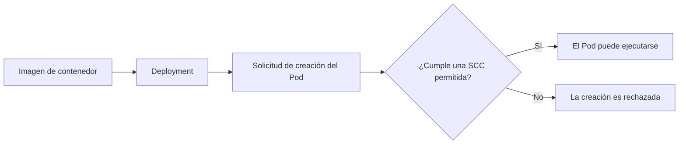
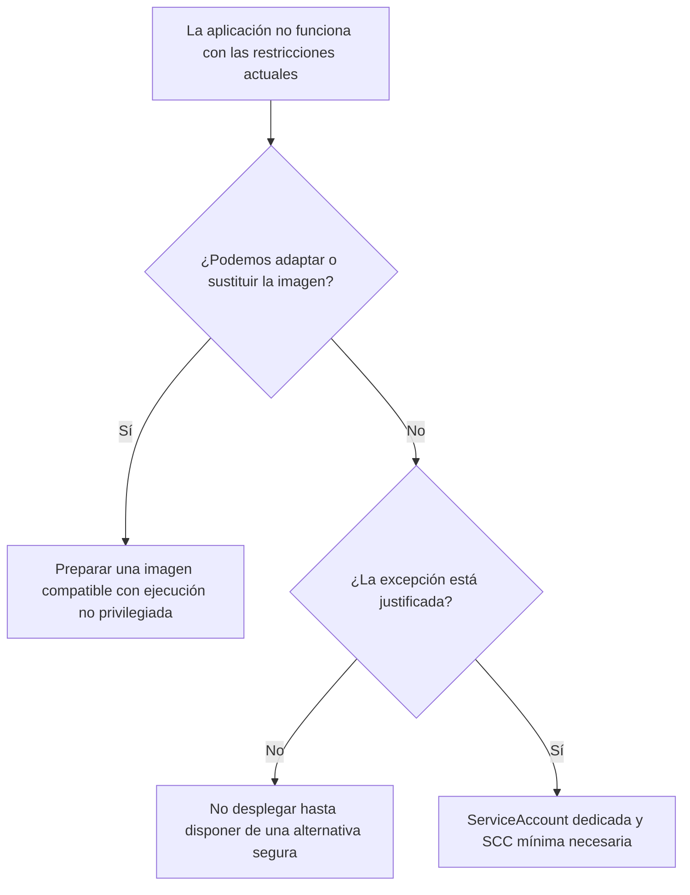
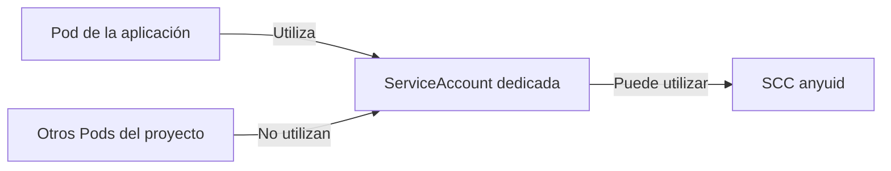

## 2.6 Políticas de seguridad de la plataforma (SCC)

### Objetivos de aprendizaje

Al finalizar este apartado serás capaz de:

- Comprender qué es una **Security Context Constraint (SCC)** y por qué OpenShift la utiliza para controlar las condiciones de seguridad con las que se ejecutan los Pods.
- Reconocer las restricciones habituales de `restricted-v2`, especialmente la ejecución sin privilegios, el uso de un UID asignado por la plataforma y la limitación de la escalada de privilegios.
- Comprender por qué una imagen puede funcionar en un motor de contenedores convencional y fallar al desplegarse en OpenShift.
- Diferenciar entre un rechazo durante la admisión del Pod y un fallo posterior de la aplicación por permisos del sistema de archivos.
- Diagnosticar un problema relacionado con los permisos de ejecución de un contenedor.
- Comparar las dos estrategias principales de solución: adaptar la imagen o autorizar, de forma excepcional, una SCC más permisiva.
- Aplicar el principio de mínimo privilegio mediante una **ServiceAccount dedicada**.

### El problema: ¿con qué permisos se ejecuta un contenedor?

En los apartados anteriores hemos desplegado aplicaciones, las hemos expuesto mediante Services y Routes, hemos separado su configuración y hemos añadido almacenamiento persistente. Hasta ahora nos hemos centrado principalmente en **qué necesita la aplicación para funcionar**.

Falta una pregunta importante:

> ¿Con qué usuario y con qué privilegios se ejecutan los procesos dentro del contenedor?

Una imagen puede haber sido construida suponiendo que su proceso se ejecutará como `root`, con un usuario fijo o con permisos de escritura sobre determinados directorios. Sin embargo, permitir que cualquier contenedor se ejecute con privilegios elevados aumentaría el riesgo para la plataforma.

OpenShift adopta por defecto un enfoque restrictivo: antes de admitir un Pod, comprueba si su configuración cumple alguna de las políticas de seguridad que puede utilizar su identidad.



### ¿Qué es una Security Context Constraint?

Una **Security Context Constraint (SCC)** es un recurso de OpenShift que define las condiciones de seguridad que debe cumplir un Pod para ser admitido en el clúster.

Entre otros aspectos, una SCC puede controlar:

- el usuario o rango de usuarios con el que se ejecuta el contenedor;
- si se permite ejecutar procesos como `root`;
- la posibilidad de escalar privilegios;
- las capacidades del kernel que puede solicitar el contenedor;
- el acceso a recursos del host;
- los grupos utilizados para acceder a volúmenes y sistemas de archivos.

La comprobación se realiza durante el proceso de admisión del Pod. OpenShift evalúa las SCC que puede utilizar la identidad de la carga y determina si alguna permite ejecutar el Pod con la configuración solicitada.

!!! note "SCC es una característica de OpenShift"
    Kubernetes dispone de mecanismos como `securityContext` y los estándares de seguridad de Pods. OpenShift añade las **Security Context Constraints** como mecanismo propio para controlar la admisión y configuración de los Pods.

### La política habitual para las cargas de usuario: `restricted-v2`

En una carga de usuario estándar esperamos trabajar bajo las restricciones de `restricted-v2`. Su objetivo es evitar que los contenedores obtengan privilegios innecesarios sobre el nodo o sobre otros componentes del clúster.

Para este curso nos interesan especialmente tres ideas:

- **Ejecución sin privilegios:** el contenedor no debe depender de ejecutarse como `root`.
- **UID controlado por la plataforma:** OpenShift puede ejecutar el proceso con un UID perteneciente al rango asignado al proyecto, en lugar de utilizar el usuario esperado por la imagen.
- **Escalada de privilegios limitada:** el proceso no puede elevar sus privilegios durante la ejecución.

Esto significa que una imagen preparada únicamente para ejecutarse con un usuario concreto puede no funcionar correctamente en OpenShift.

!!! note "No debemos memorizar todo el catálogo de SCC"
    OpenShift incluye varias SCC predefinidas. En este apartado trabajaremos principalmente con `restricted-v2`, como referencia restrictiva para las cargas de usuario, y con `anyuid`, como posible excepción cuando una aplicación necesita utilizar el UID definido por su imagen. También existe `privileged`, con permisos mucho más amplios, pero no es una alternativa apropiada para resolver un problema ordinario de permisos de una aplicación.

### Ejecución con un UID asignado por OpenShift

Una aplicación no debería depender de ejecutarse con un usuario concreto. OpenShift puede ejecutar el contenedor con un **UID diferente al previsto originalmente por la imagen**.

Por este motivo, las imágenes destinadas a OpenShift deben estar preparadas para funcionar sin privilegios y permitir que el proceso acceda a los directorios que necesita con el usuario asignado por la plataforma.

En imágenes preparadas específicamente para OpenShift es habitual utilizar permisos de grupo, incluido el grupo `0`, para facilitar este modelo de ejecución. No necesitamos entrar ahora en su implementación; lo importante es comprender que **la imagen debe estar preparada para ejecutarse sin depender de un UID fijo**.

### Demostración: una imagen que no funciona correctamente

Vamos a desplegar una imagen convencional de NGINX para observar un problema de permisos.

Guardamos el siguiente manifiesto como `nginx-deployment.yaml`:

```yaml
apiVersion: apps/v1
kind: Deployment
metadata:
  name: nginx-oficial
  labels:
    app: nginx-oficial
spec:
  replicas: 1
  selector:
    matchLabels:
      app: nginx-oficial
  template:
    metadata:
      labels:
        app: nginx-oficial
    spec:
      containers:
        - name: nginx
          image: nginx:1.27
          ports:
            - name: http
              containerPort: 80
```

Aplicamos el manifiesto:

```bash
oc apply -f nginx-deployment.yaml
```

Comprobamos el estado del Pod:

```bash
oc get pods
```

La salida puede mostrar que el contenedor no consigue permanecer en ejecución:

```text
NAME                             READY   STATUS             RESTARTS   AGE
nginx-oficial-6d5f74c77-x8z9q   0/1     CrashLoopBackOff   2          30s
```

### Diagnóstico del problema

Consultamos primero la descripción del Pod y sus eventos:

```bash
oc describe pod -l app=nginx-oficial
```

Después consultamos los logs del contenedor:

```bash
oc logs deployment/nginx-oficial
```

Podemos encontrar un mensaje parecido al siguiente:

```text
mkdir() "/var/cache/nginx/client_temp" failed (13: Permission denied)
```

El mensaje indica que el proceso de NGINX intenta escribir en un directorio para el que no dispone de permisos.

En este caso, el Pod ha sido admitido, el contenedor comienza a ejecutarse y la aplicación falla posteriormente al acceder al sistema de archivos. No estamos ante un rechazo directo de la SCC, sino ante una **imagen que no está preparada para funcionar correctamente con el UID efectivo asignado al proceso**.

### Dos situaciones distintas que no debemos confundir

Una política de seguridad puede provocar problemas en dos momentos diferentes:

| Situación | Qué ocurre | Dónde investigamos primero |
|---|---|---|
| **Rechazo durante la admisión** | La configuración solicita una condición que ninguna SCC permitida puede aceptar. El Pod no llega a crearse correctamente. | Eventos del Deployment, ReplicaSet o Pod mediante `oc describe`. |
| **Fallo durante la ejecución** | El Pod es admitido, pero la aplicación no puede leer, escribir o iniciar algún proceso con el UID efectivo. | Estado del Pod, eventos y logs del contenedor. |

!!! tip "Diagnosticar antes de cambiar permisos"
    No debemos asumir que cualquier `Permission denied` se resuelve concediendo una SCC más permisiva. Primero hay que identificar qué operación falla, con qué UID se ejecuta el proceso y qué permisos tienen los archivos o directorios afectados.

Podemos comprobar el UID efectivo de un contenedor que permanezca en ejecución mediante:

```bash
oc exec deployment/nginx-oficial -- id
```

Si el contenedor termina demasiado rápido, esta comprobación no será posible y tendremos que apoyarnos en los eventos, los logs y la inspección de la imagen.

### Estrategias de solución

Una vez identificado el problema, debemos decidir entre dos estrategias:



#### Opción A: adaptar o sustituir la imagen

Esta es la opción preferida porque mantiene las restricciones de seguridad de la plataforma.

Según el caso, podemos:

- modificar el Dockerfile para que los directorios de escritura admitan el UID utilizado por OpenShift;
- evitar puertos privilegiados y utilizar puertos superiores a `1024`;
- eliminar dependencias innecesarias de `root`;
- utilizar una variante de la imagen preparada para ejecutarse sin privilegios;
- comprobar que los scripts de arranque no intentan modificar rutas protegidas.

!!! tip "Una imagen compatible es mejor que una excepción permanente"
    Si el fabricante proporciona una variante `unprivileged` o documenta su ejecución en OpenShift, normalmente será preferible utilizarla antes que relajar la política de seguridad del clúster.

#### Opción B: autorizar una excepción mediante `anyuid`

Algunas aplicaciones de terceros no pueden modificarse y necesitan ejecutarse con el usuario definido en la imagen. En esos casos puede valorarse la SCC `anyuid`.

`anyuid` permite que el contenedor utilice el UID solicitado o definido por la imagen, incluido el UID `0` si la carga lo requiere. Por tanto, **no debe tratarse como la solución automática a cualquier problema de permisos**, sino como una excepción que debe estar justificada.

Para limitar su alcance utilizaremos una **ServiceAccount dedicada**.

Una ServiceAccount proporciona una identidad a los Pods. Por defecto, los Pods utilizan la ServiceAccount `default` del proyecto, salvo que indiquemos otra mediante `serviceAccountName`. Si una aplicación necesita un permiso excepcional, crear una ServiceAccount específica permite limitar ese permiso a los Pods que utilicen de forma explícita dicha identidad.

Más adelante, en el apartado dedicado a proyectos y permisos, estudiaremos las ServiceAccounts y RBAC con mayor detalle. Por ahora basta con entender esta relación:



!!! warning "Principio de mínimo privilegio"
    No debemos conceder `anyuid` de forma general a usuarios ni utilizar la ServiceAccount `default` para todas las cargas del proyecto. La excepción debe asociarse a una ServiceAccount dedicada y emplearse únicamente en el Deployment que realmente la necesita.

### Aplicación controlada de `anyuid`

!!! warning "Demostración del instructor"
    La asignación de una SCC requiere permisos administrativos. En entornos restringidos, como OpenShift Developer Sandbox, el alumno puede recibir un error `Forbidden`. Esta parte debe realizarla el instructor en un clúster de laboratorio donde disponga de los permisos necesarios.

#### 1. Crear una ServiceAccount dedicada

Creamos una ServiceAccount específica para la aplicación:

```bash
oc create serviceaccount sa-nginx-anyuid
```

También podemos utilizar la forma abreviada:

```bash
oc create sa sa-nginx-anyuid
```

#### 2. Autorizar el uso de `anyuid`

El administrador concede a la ServiceAccount la posibilidad de utilizar la SCC `anyuid`:

```bash
oc adm policy add-scc-to-user anyuid -z sa-nginx-anyuid
```

En el comando:

- `add-scc-to-user anyuid` indica la SCC que se autoriza;
- `-z sa-nginx-anyuid` identifica una ServiceAccount del proyecto actual;
- la autorización queda limitada a esa identidad, no a todos los Pods del proyecto.

!!! note "El nombre del comando puede resultar confuso"
    Aunque el subcomando se llama `add-scc-to-user`, la opción `-z` indica que el sujeto es una **ServiceAccount**.

#### 3. Asociar la ServiceAccount al Deployment

Actualizamos `nginx-deployment.yaml` para declarar `serviceAccountName` dentro de `spec.template.spec`:

```yaml
apiVersion: apps/v1
kind: Deployment
metadata:
  name: nginx-oficial
  labels:
    app: nginx-oficial
spec:
  replicas: 1
  selector:
    matchLabels:
      app: nginx-oficial
  template:
    metadata:
      labels:
        app: nginx-oficial
    spec:
      serviceAccountName: sa-nginx-anyuid
      containers:
        - name: nginx
          image: nginx:1.27
          ports:
            - name: http
              containerPort: 80
```

Aplicamos la actualización:

```bash
oc apply -f nginx-deployment.yaml
```

El cambio de la plantilla provoca la creación de un nuevo ReplicaSet y de un nuevo Pod con la ServiceAccount indicada.

### Verificación

Esperamos a que finalice el rollout:

```bash
oc rollout status deployment/nginx-oficial
```

Comprobamos el estado del Pod:

```bash
oc get pods -l app=nginx-oficial
```

La salida esperada será similar a:

```text
NAME                             READY   STATUS    RESTARTS   AGE
nginx-oficial-84df8c99b-k9l2m   1/1     Running   0          10s
```

Podemos comprobar la ServiceAccount utilizada por el Pod:

```bash
oc get pod -l app=nginx-oficial \
  -o jsonpath='{.items[0].spec.serviceAccountName}{"\n"}'
```

La salida debe ser:

```text
sa-nginx-anyuid
```

Si disponemos de permisos suficientes, también podemos comprobar la SCC efectiva aplicada al Pod:

```bash
oc get pod -l app=nginx-oficial \
  -o jsonpath='{.items[0].metadata.annotations.openshift\.io/scc}{"\n"}'
```

La salida esperada será:

```text
anyuid
```

!!! warning "Que el Pod funcione no convierte `anyuid` en la mejor solución"
    La verificación demuestra que la excepción permite ejecutar la imagen, pero no que sea la alternativa preferida. En un entorno real todavía habría que valorar el riesgo, documentar la necesidad y comprobar si existe una imagen compatible con ejecución no privilegiada.

### ¿Qué solución debemos elegir?

| Alternativa | Cuándo utilizarla | Valoración |
|---|---|---|
| Adaptar la imagen para admitir un UID asignado por la plataforma | Tenemos control sobre el Dockerfile o el proceso de construcción. | **Opción preferida.** Mantiene las restricciones de la plataforma. |
| Utilizar una variante `unprivileged` mantenida por el proveedor | Existe una imagen oficial o fiable preparada para ejecutarse sin privilegios. | **Opción preferida**, tras validar su procedencia y mantenimiento. |
| Conceder `anyuid` a una ServiceAccount dedicada | La imagen no puede modificarse, la necesidad está justificada y se acepta el riesgo. | **Excepción controlada.** Debe limitarse a la carga necesaria. |
| Conceder permisos amplios a usuarios, a la ServiceAccount `default` o a todas las cargas del proyecto | Se busca evitar el análisis y solucionar rápidamente el error. | **Debe evitarse.** Amplía innecesariamente el alcance del privilegio. |
| Utilizar `privileged` para resolver un error ordinario de permisos | La aplicación no arranca y se intenta eliminar cualquier restricción. | **No es una solución adecuada.** Concede capacidades muy superiores a las necesarias. |

### Limpieza del entorno

Al finalizar la demostración eliminamos los recursos creados:

```bash
oc delete deployment nginx-oficial
oc delete serviceaccount sa-nginx-anyuid
```

La retirada de la autorización sobre la SCC debe realizarla un administrador si la vinculación continúa existiendo en el clúster:

```bash
oc adm policy remove-scc-from-user anyuid -z sa-nginx-anyuid
```

### Ideas clave

!!! tip "Puntos principales a recordar"
    - OpenShift utiliza las **Security Context Constraints** para controlar las condiciones de seguridad con las que se admiten y ejecutan los Pods.
    - Las cargas de usuario deben estar preparadas para funcionar sin privilegios y sin depender de un UID fijo.
    - El uso del grupo `0` en determinados directorios puede permitir que una imagen funcione con el UID asignado por OpenShift, sin ejecutar el proceso como `root`.
    - Un rechazo durante la admisión y un `Permission denied` durante la ejecución son problemas relacionados, pero no equivalentes.
    - La opción preferida es adaptar la imagen o utilizar una variante preparada para ejecutarse sin privilegios.
    - `anyuid` es una excepción, no la solución predeterminada.
    - Cuando una excepción está justificada, debe limitarse mediante una **ServiceAccount dedicada** y aplicando el principio de mínimo privilegio.
