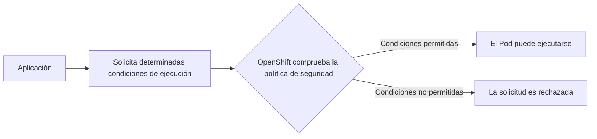
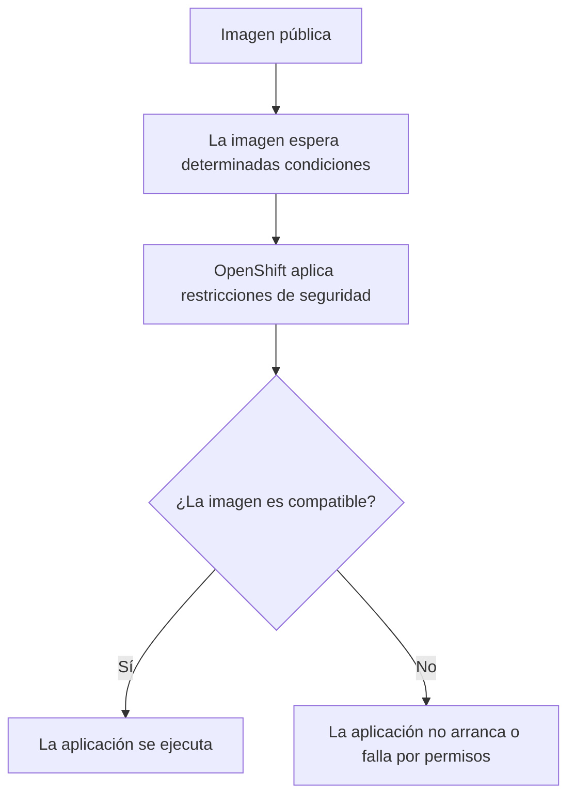
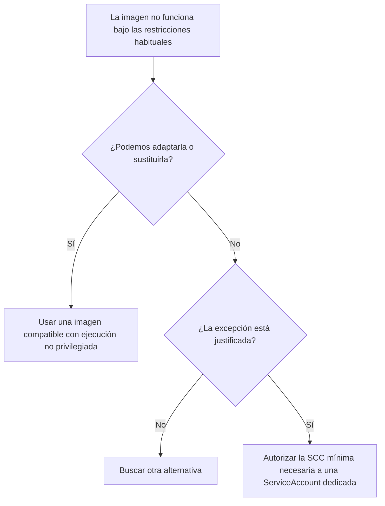
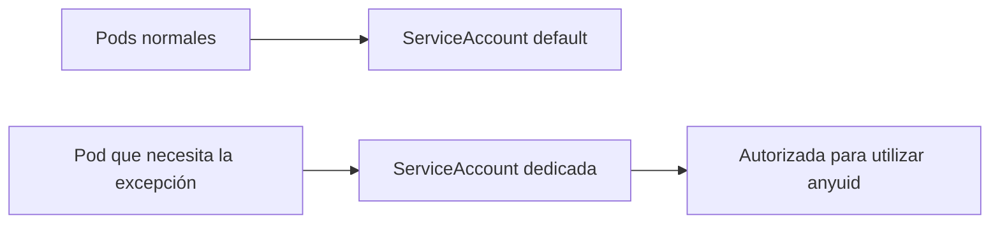

## 2.6 Políticas de seguridad de la plataforma (SCC)

### Objetivos de aprendizaje

Al finalizar este apartado serás capaz de:

- Comprender por qué OpenShift aplica restricciones de seguridad a los contenedores.
- Explicar qué es una **Security Context Constraint (SCC)**.
- Reconocer el propósito de `restricted-v2` y `anyuid`.
- Entender por qué una imagen pública puede funcionar en otros entornos y no hacerlo directamente en OpenShift.
- Diagnosticar problemas básicos relacionados con las restricciones de ejecución de un contenedor.
- Diferenciar entre la solución preferida, adaptar o sustituir la imagen, y la concesión excepcional de permisos adicionales.
- Utilizar una **ServiceAccount dedicada** para limitar el alcance de una excepción de seguridad.

### ¿Por qué OpenShift aplica tantas restricciones?

Hasta ahora hemos estudiado las aplicaciones principalmente desde su propio punto de vista:

> ¿Qué necesita esta aplicación para funcionar?

OpenShift también debe plantearse otra pregunta:

> ¿Qué debería permitirse hacer a esta aplicación sin aumentar innecesariamente el riesgo para la plataforma?

Un contenedor proporciona aislamiento para sus procesos, pero no es una máquina virtual completa. Los contenedores que se ejecutan en un nodo comparten el kernel del sistema operativo. Por ello, ejecutar una aplicación con privilegios innecesarios puede aumentar el impacto de:

- una imagen mal configurada;
- una vulnerabilidad en la aplicación;
- una imagen de terceros comprometida;
- un proceso que intente acceder a recursos que no necesita.

OpenShift aplica el principio de **mínimo privilegio**: una aplicación debe disponer únicamente de los permisos necesarios para funcionar. Si necesita una excepción, esta debe estar justificada y limitarse a la carga correspondiente.



### ¿Por qué algunas imágenes públicas no funcionan directamente en OpenShift?

Muchas imágenes públicas se construyeron pensando en entornos más permisivos o suponiendo determinadas condiciones de ejecución. Por ejemplo, una imagen puede esperar:

- ejecutarse como `root` o con un usuario concreto;
- escribir en determinados directorios del contenedor;
- modificar archivos durante el arranque;
- utilizar operaciones que requieren más privilegios de los necesarios para una aplicación ordinaria.

OpenShift no acepta automáticamente esas suposiciones. Puede ejecutar el contenedor con una identidad distinta de la prevista por la imagen y restringir las operaciones que considere inseguras.

Por tanto, una imagen puede funcionar en otro entorno de contenedores y no hacerlo directamente en OpenShift. Esto no significa necesariamente que la imagen esté dañada ni que OpenShift esté mal configurado. Puede significar que la imagen **no está preparada para ejecutarse bajo el modelo de seguridad de la plataforma**.



### ¿Cómo aplica OpenShift estas restricciones?

Uno de los mecanismos utilizados por OpenShift son las **Security Context Constraints**, normalmente abreviadas como **SCC**.

Una SCC define las condiciones de seguridad bajo las que OpenShift puede admitir y ejecutar un Pod. Entre otros aspectos, puede controlar:

- con qué tipo de usuario se ejecuta el contenedor;
- si puede ejecutarse como `root`;
- si puede escalar privilegios;
- qué capacidades del sistema puede solicitar;
- si puede acceder a determinados recursos del nodo.

Antes de admitir un Pod, OpenShift comprueba qué SCC puede utilizar la identidad de la carga y si alguna de ellas es compatible con la configuración solicitada.

!!! note "SCC es un mecanismo propio de OpenShift"
    Kubernetes dispone de mecanismos como `securityContext` y los estándares de seguridad de Pods. OpenShift incorpora además las **Security Context Constraints** para controlar las condiciones bajo las que se admiten los Pods.

### La situación habitual: `restricted-v2`

Las cargas de usuario estándar deben estar preparadas para trabajar bajo restricciones como las establecidas por `restricted-v2`.

Para este curso nos interesan principalmente estas ideas:

- el contenedor no debe depender de ejecutarse como `root`;
- la aplicación no debe necesitar escalar privilegios;
- la imagen debe poder funcionar aunque OpenShift ejecute su proceso con un UID distinto del esperado originalmente.

Las imágenes preparadas para OpenShift suelen ajustar sus permisos para admitir este modelo de ejecución. Una técnica habitual consiste en utilizar permisos de grupo para que diferentes UID puedan acceder a los directorios necesarios. No necesitamos profundizar ahora en su implementación; lo importante es comprender que **la imagen no debería depender de un UID fijo ni de privilegios elevados**.

!!! note "No necesitamos memorizar todas las SCC"
    En este apartado trabajaremos con `restricted-v2`, como referencia restrictiva para las cargas de usuario, y con `anyuid`, como posible excepción para aplicaciones que necesitan utilizar el UID definido por su imagen.

### Demostración: una imagen que no funciona con las restricciones habituales

Vamos a desplegar una imagen convencional de NGINX para observar un problema relacionado con sus condiciones de ejecución.

Guardamos el siguiente manifiesto como `nginx-deployment.yaml`:

```yaml
apiVersion: apps/v1
kind: Deployment
metadata:
  name: nginx-oficial
  labels:
    app: nginx-oficial
spec:
  replicas: 1
  selector:
    matchLabels:
      app: nginx-oficial
  template:
    metadata:
      labels:
        app: nginx-oficial
    spec:
      containers:
        - name: nginx
          image: nginx:1.27
          ports:
            - name: http
              containerPort: 80
```

Aplicamos el manifiesto:

```bash
oc apply -f nginx-deployment.yaml
```

Comprobamos el estado del Pod:

```bash
oc get pods -l app=nginx-oficial
```

La aplicación no consigue permanecer en ejecución y el Pod puede aparecer en un estado similar al siguiente:

```text
NAME                             READY   STATUS             RESTARTS   AGE
nginx-oficial-6d5f74c77-x8z9q   0/1     CrashLoopBackOff   2          30s
```

### Diagnóstico del problema

Ante un Pod que no arranca correctamente, no debemos ampliar sus privilegios sin investigar antes la causa.

Consultamos su descripción y los eventos asociados:

```bash
oc describe pod -l app=nginx-oficial
```

Después consultamos los logs del contenedor:

```bash
oc logs deployment/nginx-oficial
```

Podemos encontrar un mensaje similar al siguiente:

```text
mkdir() "/var/cache/nginx/client_temp" failed (13: Permission denied)
```

El proceso intenta escribir en un directorio para el que no dispone de permisos con su identidad efectiva. La imagen esperaba unas condiciones de ejecución diferentes de las que OpenShift proporciona a una carga ordinaria.

!!! tip "Primero diagnosticamos, después decidimos"
    Un error `Permission denied` no implica automáticamente que debamos conceder una SCC más permisiva. Primero debemos identificar qué operación falla y valorar si la imagen puede adaptarse o sustituirse.

### Rechazo de admisión y fallo durante la ejecución

Una restricción de seguridad puede manifestarse de dos formas diferentes:

| Situación | Qué ocurre | Dónde investigamos primero |
|---|---|---|
| **Rechazo durante la admisión** | La configuración del Pod solicita una condición que ninguna SCC permitida puede aceptar. | Eventos mostrados mediante `oc describe`. |
| **Fallo durante la ejecución** | El Pod es admitido, pero la aplicación falla al realizar una operación para la que no dispone de permisos. | Estado del Pod, eventos y logs del contenedor. |

En nuestra demostración, el contenedor comienza a ejecutarse y posteriormente falla al intentar escribir. Por tanto, no estamos ante un rechazo directo durante la admisión, sino ante una imagen que no funciona correctamente con las condiciones de ejecución aplicadas.

### ¿Cómo debemos resolverlo?

Disponemos de dos estrategias principales:



#### Opción preferida: adaptar o sustituir la imagen

Siempre que sea posible, debemos utilizar una imagen preparada para ejecutarse sin privilegios y sin depender de un UID concreto.

Según el caso, podemos:

- utilizar una variante `unprivileged` proporcionada por el fabricante;
- adaptar el Dockerfile y los permisos de las rutas utilizadas por la aplicación;
- evitar puertos privilegiados;
- eliminar operaciones de arranque que necesiten ejecutarse como `root`.

Esta opción mantiene las restricciones de seguridad de la plataforma y debe considerarse antes de conceder permisos adicionales.

#### Excepción: permitir el uso de `anyuid`

Algunas aplicaciones de terceros no pueden modificarse y necesitan ejecutarse con el usuario definido en la imagen. En esos casos puede valorarse la SCC `anyuid`.

`anyuid` permite que el contenedor utilice el UID solicitado por la imagen, incluido el UID `0` si así se ha configurado. Por tanto, debe tratarse como una **excepción justificada**, no como la solución automática a cualquier problema de permisos.

### ¿Por qué necesitamos una ServiceAccount específica?

Los Pods también tienen una identidad dentro del clúster. Esa identidad se denomina **ServiceAccount**.

Si no indicamos otra, un Pod utiliza la ServiceAccount `default` de su proyecto. Esto no significa que la ServiceAccount `default` contenga una SCC concreta ni que exista una equivalencia fija entre ambas. Las ServiceAccounts pueden estar autorizadas, directa o indirectamente, para utilizar distintas SCC, y OpenShift determina cuál de las SCC disponibles es compatible con el Pod.

No queremos autorizar `anyuid` a la ServiceAccount `default`, porque otros Pods del proyecto también podrían utilizarla. En su lugar:

1. crearemos una ServiceAccount dedicada;
2. autorizaremos únicamente a esa identidad a utilizar `anyuid`;
3. indicaremos que el Deployment problemático utilice esa ServiceAccount.



!!! note "Alcance de esta explicación"
    Más adelante estudiaremos con mayor detalle las ServiceAccounts y el modelo de permisos de OpenShift. En este apartado basta con comprender que proporcionan una identidad a los Pods y permiten limitar una excepción a una carga concreta.

### Aplicación controlada de `anyuid`

!!! warning "Demostración del instructor"
    La autorización para utilizar una SCC requiere permisos administrativos. Si los alumnos no disponen de esos permisos en el laboratorio, esta parte debe realizarla el instructor.

#### 1. Crear una ServiceAccount dedicada

```bash
oc create serviceaccount sa-nginx-anyuid
```

También puede utilizarse la forma abreviada:

```bash
oc create sa sa-nginx-anyuid
```

#### 2. Autorizar el uso de `anyuid`

El administrador autoriza a esa ServiceAccount a utilizar `anyuid`:

```bash
oc adm policy add-scc-to-user anyuid -z sa-nginx-anyuid
```

Aunque el subcomando contiene la expresión `add-scc-to-user`, la opción `-z` indica que estamos aplicando la autorización a una **ServiceAccount** del proyecto actual.

El comando no establece que `anyuid` sea la única SCC de esa ServiceAccount. Añade la posibilidad de utilizarla cuando sea compatible con la configuración del Pod.

#### 3. Asociar la ServiceAccount al Deployment

Actualizamos `nginx-deployment.yaml` para incluir `serviceAccountName` dentro de `spec.template.spec`:

```yaml
apiVersion: apps/v1
kind: Deployment
metadata:
  name: nginx-oficial
  labels:
    app: nginx-oficial
spec:
  replicas: 1
  selector:
    matchLabels:
      app: nginx-oficial
  template:
    metadata:
      labels:
        app: nginx-oficial
    spec:
      serviceAccountName: sa-nginx-anyuid
      containers:
        - name: nginx
          image: nginx:1.27
          ports:
            - name: http
              containerPort: 80
```

Aplicamos la actualización:

```bash
oc apply -f nginx-deployment.yaml
```

El cambio de la plantilla crea un nuevo Pod que utiliza la ServiceAccount dedicada.

### Verificación

Esperamos a que finalice la actualización:

```bash
oc rollout status deployment/nginx-oficial
```

Comprobamos el estado del Pod:

```bash
oc get pods -l app=nginx-oficial
```

La salida será similar a:

```text
NAME                             READY   STATUS    RESTARTS   AGE
nginx-oficial-84df8c99b-k9l2m   1/1     Running   0          10s
```

Comprobamos qué ServiceAccount utiliza:

```bash
oc get pod -l app=nginx-oficial \
  -o jsonpath='{.items[0].spec.serviceAccountName}{"\n"}'
```

La salida será:

```text
sa-nginx-anyuid
```

Si disponemos de permisos suficientes, también podemos consultar la SCC aplicada al Pod:

```bash
oc get pod -l app=nginx-oficial \
  -o jsonpath='{.items[0].metadata.annotations.openshift\.io/scc}{"\n"}'
```

La salida será:

```text
anyuid
```

!!! warning "Que funcione no significa que sea la mejor solución"
    Esta demostración confirma que la excepción permite ejecutar la imagen, pero en un entorno real seguiríamos prefiriendo una imagen compatible con ejecución no privilegiada siempre que estuviera disponible.

### Decisión final

| Situación | Decisión recomendada |
|---|---|
| La imagen funciona con las restricciones habituales | Mantener la configuración sin conceder permisos adicionales. |
| Podemos modificarla o existe una variante no privilegiada | **Adaptar o sustituir la imagen. Es la opción preferida.** |
| No podemos modificarla y necesita utilizar un UID concreto | Valorar `anyuid` únicamente si la excepción está justificada. |
| La aplicación necesita `anyuid` | Autorizarlo a una **ServiceAccount dedicada** y utilizarla solo en esa carga. |
| La aplicación no funciona y desconocemos la causa | Diagnosticar antes de ampliar los privilegios. |
| Se propone conceder permisos amplios a todas las cargas | Rechazar el enfoque y aplicar el principio de mínimo privilegio. |

### Limpieza del entorno

Eliminamos los recursos creados:

```bash
oc delete deployment nginx-oficial
oc delete serviceaccount sa-nginx-anyuid
```

Si fuera necesario retirar expresamente la autorización antes de eliminar la ServiceAccount, un administrador podría ejecutar:

```bash
oc adm policy remove-scc-from-user anyuid -z sa-nginx-anyuid
```

### Ideas clave

!!! tip "Puntos principales a recordar"
    - OpenShift aplica restricciones porque múltiples aplicaciones comparten la plataforma y los contenedores utilizan el kernel de los nodos.
    - El principio general es conceder a cada carga únicamente los privilegios que necesita.
    - Muchas imágenes públicas no se construyeron pensando en este modelo de seguridad y pueden depender de `root`, de un UID concreto o de permisos de escritura que no tienen en OpenShift.
    - Las SCC definen condiciones de seguridad para la admisión y ejecución de los Pods.
    - `restricted-v2` representa el enfoque restrictivo habitual de las cargas de usuario.
    - La solución preferida es adaptar o sustituir una imagen incompatible, no relajar inmediatamente la seguridad.
    - `anyuid` debe utilizarse únicamente como excepción justificada.
    - Las ServiceAccounts no tienen una correspondencia fija con una única SCC.
    - Una ServiceAccount dedicada permite limitar la excepción a los Pods que realmente la necesitan.
    - La pregunta correcta no es «¿qué permisos hacen que funcione?», sino «¿cuál es el mínimo privilegio que necesita para funcionar?».
