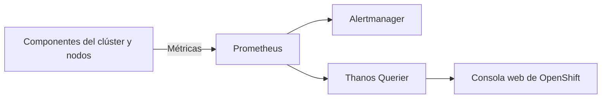
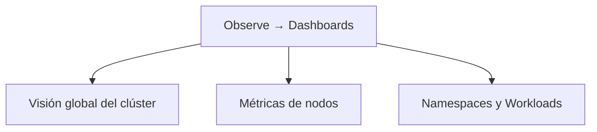
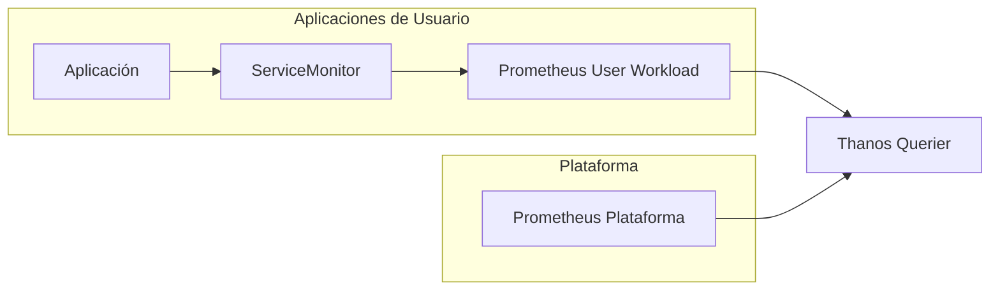

## 3.1 Qué vigila la plataforma por sí sola: métricas y cuadros de mando en la consola, y la monitorización de cargas de usuario

### Objetivos de aprendizaje

Al finalizar este apartado serás capaz de:

- Comprender cómo OpenShift monitoriza de manera nativa los componentes internos de la plataforma y la infraestructura del clúster.
- Identificar las métricas y cuadros de mando disponibles por defecto en la consola web de administración.
- Conocer los componentes del stack de monitorización integrado en OpenShift y la función de cada uno.
- Diferenciar entre la monitorización de infraestructura y la monitorización de cargas de trabajo de usuario.
- Evaluar qué aporta activar la monitorización de proyectos definidos por el usuario y qué coste operativo e informático conlleva.
- Consultar métricas de rendimiento y consumo de tus propios pods directamente desde la consola web e interpretar correctamente los resultados.

Hasta ahora hemos aprendido a desplegar y configurar aplicaciones en OpenShift. Pero una vez que una aplicación está en ejecución aparece una nueva necesidad: saber qué está ocurriendo en el clúster y cómo se están comportando nuestras cargas de trabajo.

La buena noticia es que OpenShift ya incorpora de serie gran parte de las herramientas necesarias para observar la plataforma.

### El stack de monitorización nativo en OpenShift

Cualquier plataforma moderna necesita conocer su estado de salud en todo momento.

Para ello, OpenShift incorpora de serie un stack de monitorización completo basado en proyectos de la CNCF (_Cloud Native Computing Foundation_), desplegado y mantenido automáticamente mediante el operador del clúster (_Cluster Monitoring Operator_).

Este ecosistema se apoya principalmente en:

- **Prometheus:** Es el motor central de almacenamiento y recolección de métricas. Funciona mediante un modelo _pull_ (raspado o _scraping_), consultando periódicamente los _endpoints_ `/metrics` expuestos por los componentes de la plataforma y los contenedores. Almacena estos datos como series temporales optimizadas.
- **Alertmanager:** Recibe las alertas generadas por Prometheus cuando las reglas definidas evalúan una condición anómala. Se encarga de gestionar el ciclo de vida de la alerta: agrupar, silenciar, deduplicar y enrutar las notificaciones hacia canales externos (correo electrónico, Slack, PagerDuty, Webhooks, etc.).
- **Thanos Querier:** Componente fundamental en entornos distribuidos o de alta disponibilidad. Agrega y desduplica las métricas procedentes de múltiples instancias de Prometheus (como las de plataforma y las de usuario), ofreciendo un punto de acceso unificado (una vista global) para realizar consultas PromQL desde la consola web o herramientas de terceros.
- **Consola web de OpenShift:** Actúa como la interfaz de visualización integrada. Consume los datos agregados por Thanos Querier para renderizar cuadros de mando (_dashboards_), gráficas temporales y alertas en tiempo real sin requerir una infraestructura externa como Grafana.



Gracias a esta arquitectura, OpenShift recopila información constantemente sobre el funcionamiento del clúster sin necesidad de instalar o configurar herramientas adicionales.

### ¿Qué vigila la plataforma por defecto?

Nada más instalar OpenShift, la monitorización integrada comienza a recopilar información sobre:

- Los nodos del clúster (capacidad, recursos consumidos, disco, red).
- El plano de control de Kubernetes (_API Server_, _Controller Manager_, _Scheduler_).
- etcd (latencia, tamaño de base de datos, estado del quórum).
- Los _routers_ de entrada e ingress controllers.
- Los operadores del clúster y su estado de salud.
- El consumo global e individual de CPU y memoria.
- La infraestructura de almacenamiento y la conectividad de red.

!!! note
    Uno de los objetivos principales de la monitorización integrada es detectar problemas de plataforma antes de que tengan impacto sobre las aplicaciones desplegadas.

### Cuadros de mando (_Dashboards_) en la consola web

La consola web incorpora múltiples _dashboards_ que permiten visualizar el estado de salud del clúster de forma intuitiva.

Accediendo a **Observe → Dashboards** encontraremos información estructurada desde diferentes perspectivas.



#### Métricas a nivel de clúster

Permiten conocer:

- Consumo global de CPU y memoria reservada vs. utilizada.
- Estado general y disponibilidad de los operadores del clúster.
- Capacidad disponible y salud de los componentes del plano de control.
- Rendimiento y tiempos de respuesta de etcd.

#### Métricas a nivel de nodo

Permiten analizar cada servidor físico o virtual individualmente:

- CPU utilizada por nodo y saturación.
- Memoria consumida y presión de memoria.
- Operaciones de entrada/salida de disco (I/O) y espacio en volúmenes.
- Tráfico de red (paquetes descartados, errores, ancho de banda).

#### Métricas a nivel de proyecto

También es posible consultar métricas asociadas a aplicaciones concretas:

- Consumo de CPU por pod o contenedor.
- Consumo de memoria real (_working set_).
- Número de reinicios de contenedores.
- Tráfico de red por servicio.
- Estado de los despliegues (_Deployments_, _ReplicaSets_).

### Consultar métricas de tus propios pods en la consola

Hasta ahora hemos visto qué monitoriza OpenShift. La mejor forma de comprenderlo es observar métricas reales de una aplicación desplegada en nuestro proyecto.

#### Acceso a las métricas desde la consola

- Cambia a la perspectiva **Developer**.
- Selecciona tu proyecto de trabajo.
- Accede a **Observe → Metrics**.
- Localiza el cuadro **Custom query**.

#### Consultar el consumo de memoria de una aplicación

Podemos visualizar el consumo real de memoria de nuestro contenedor mediante una consulta PromQL:

```promql
container_memory_working_set_bytes{container="demo-formacion"}
```

Alternativamente, para visualizar todos los contenedores activos del proyecto:

```promql
container_memory_working_set_bytes{container!="",container!="POD"}
```

#### Interpretar el resultado

Al ejecutar la consulta observaremos una serie temporal asociada al contenedor seleccionado.

El valor exacto dependerá del momento de ejecución, de la carga soportada por la aplicación y de su propio comportamiento interno.

Lo importante no es memorizar una cifra concreta, sino interpretar la información que proporciona la gráfica.

##### ¿Qué nos dice realmente una gráfica de memoria?

Al analizar una métrica como:

```promql
container_memory_working_set_bytes
```

debemos fijarnos en:

- Si el consumo es estable o creciente.
- Si aparecen picos inesperados.
- Si la memoria utilizada se aproxima al límite configurado.
- Si el comportamiento cambia cuando aumenta la carga.

Una línea estable suele indicar un comportamiento normal.

Por el contrario, un crecimiento continuo durante largos periodos podría justificar una investigación adicional.

#### Comparar la métrica con Requests y Limits

La aplicación `demo-formacion-yaml`, desplegada en la Sesión 2, ya incorpora una configuración de recursos.

Recordemos el manifiesto utilizado:

```yaml
resources:
  requests:
    cpu: "100m"
    memory: "128Mi"
  limits:
    cpu: "500m"
    memory: "512Mi"
```

Ahora podemos comparar los valores observados en las métricas con la configuración real de la aplicación.

##### Interpretando los datos obtenidos

El valor mostrado por la gráfica dependerá del momento de ejecución y de la carga de trabajo.

Podemos comprobar si el consumo real se sitúa holgadamente por debajo de los _requests_ reservados o si, por el contrario, muestra cercanía frente a los _limits_ configurados.

Lo importante es responder a preguntas como:

- ¿El consumo es estable?
- ¿La aplicación se aproxima al límite de memoria?
- ¿Los _requests_ parecen razonables?
- ¿Los _limits_ proporcionan margen suficiente?

#### Relación con la Sesión 2

En la Sesión 2 vimos tres conceptos claramente diferenciados:

| Concepto | Significado |
|---|---|
| **Request** | Recursos reservados por Kubernetes para planificar el Pod |
| **Limit** | Consumo máximo permitido al contenedor |
| **Consumo real** | Recursos utilizados por la aplicación en cada momento |

La gráfica que estamos observando muestra precisamente el tercer valor: el consumo real.

!!! tip "Idea clave"
    _Requests_ y _Limits_ son valores configurados en el Deployment. Las métricas muestran el consumo real de la aplicación en cada momento. Comparar los tres valores permite valorar si la configuración de recursos resulta razonable para el comportamiento observado.

##### Lo importante no es el valor exacto

Un error frecuente es pensar que una aplicación debería consumir siempre la misma memoria.

En realidad, las diferencias de consumo entre distintas ejecuciones pueden deberse a:

- Reinicios recientes del Pod.
- Menor carga de trabajo.
- Diferente número de peticiones.
- Cachés aún vacías.
- Cambios de configuración.
- Diferencias en el momento de observación.

Por este motivo debemos fijarnos más en la tendencia de la gráfica que en una cifra concreta.

!!! note
    Es habitual que una aplicación consuma bastante menos memoria que la reservada mediante _requests_.

### Monitorización de cargas de usuario (_User-Workload Monitoring_)

Hasta ahora hemos observado tanto el estado de la plataforma como las métricas de recursos que OpenShift conoce sobre nuestros Pods, por ejemplo, su consumo de CPU y memoria, su estado o el número de reinicios.

Sin embargo, OpenShift no conoce automáticamente las métricas internas o funcionales de cada aplicación. Muchas aplicaciones exponen métricas propias, por ejemplo:

- Número de peticiones HTTP.
- Tiempo de respuesta.
- Transacciones procesadas.
- Errores de aplicación.
- Mensajes en cola.

Por defecto, OpenShift no recopila estas métricas específicas de las aplicaciones de usuario.

Para ello existe la funcionalidad denominada **User-Workload Monitoring**.



#### Qué aporta activarla

Permite:

- Monitorizar métricas específicas de negocio.
- Obtener mayor visibilidad de las aplicaciones.
- Construir _dashboards_ personalizados.
- Crear alertas propias.
- Unificar métricas de plataforma y aplicación.

#### Un ejemplo práctico

Imaginemos una API corporativa.

- **Sin User-Workload Monitoring:** OpenShift sabe cuánta CPU consume y cuánta memoria utiliza, pero no sabe cuántas peticiones procesa.
- **Con User-Workload Monitoring:** OpenShift conoce también las métricas funcionales de la aplicación, permitiendo a los equipos construir cuadros de mando orientados al negocio.

#### ¿Qué cuesta activarla?

La monitorización avanzada aporta mucho valor, pero también tiene un coste.

##### 1. Componentes adicionales

Será necesario desplegar componentes encargados de:

- Recopilar métricas de usuario.
- Evaluar reglas personalizadas.
- Almacenar más información histórica.

##### 2. Consumo de CPU y memoria

Cuantas más métricas recopilemos:

- Más CPU utilizará Prometheus.
- Más memoria requerirá la plataforma.
- Más trabajo deberá realizar el sistema de monitorización.

##### 3. Necesidad de almacenamiento persistente

Las métricas deben guardarse durante un periodo determinado, lo que implica:

- Más almacenamiento.
- Más crecimiento de los volúmenes persistentes.
- Mayor planificación de capacidad.

!!! warning "Planificación de capacidad"
    _User-Workload Monitoring_ aporta mucho valor, pero conviene evaluar previamente el impacto que tendrá sobre CPU, memoria y almacenamiento del clúster.

#### ¿Cuándo merece la pena activarlo?

Como criterio general:

| Escenario | Recomendación |
|---|---|
| Clúster pequeño de aprendizaje | Normalmente no es necesario |
| Aplicaciones corporativas críticas | Muy recomendable |
| Observabilidad avanzada | Recomendable |
| Alertas funcionales de negocio | Imprescindible |
| Equipos que solo necesitan CPU y memoria | Puede no compensar |

### Ideas clave para recordar

!!! tip "Resumen"
    - OpenShift incorpora un stack completo de monitorización basado en Prometheus, Alertmanager y Thanos.
    - La plataforma monitoriza automáticamente nodos, operadores y componentes críticos del clúster.
    - La consola web proporciona _dashboards_ integrados para visualizar el estado de salud del entorno.
    - Observar métricas reales permite validar si _requests_ y _limits_ están correctamente dimensionados.
    - El valor exacto de una métrica puede variar significativamente según el momento y la carga de trabajo.
    - Lo importante es interpretar tendencias y relacionarlas con la configuración de recursos.
    - _User-Workload Monitoring_ permite monitorizar métricas específicas de las aplicaciones.
    - Esta funcionalidad aporta gran visibilidad, pero también consume CPU, memoria y almacenamiento.
    - Antes de activarla conviene evaluar el valor que aporta frente al coste operativo que introduce.

Hasta ahora hemos aprendido a observar cómo se comporta nuestra aplicación y cuánto consume. Pero OpenShift puede ir un paso más allá: puede utilizar determinadas métricas para adaptar automáticamente el número de réplicas a la carga.

En el siguiente apartado veremos cómo hacerlo mediante el autoescalado horizontal de Pods (_Horizontal Pod Autoscaler_ o HPA).
