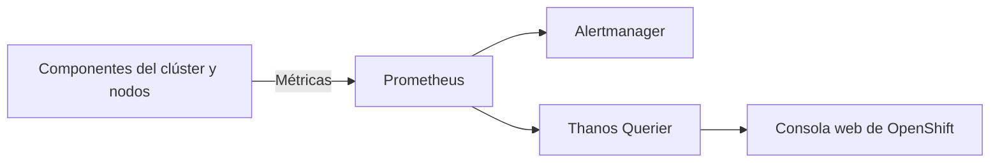
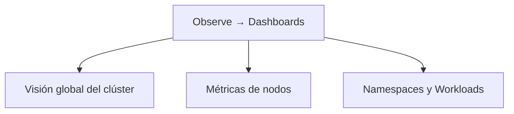
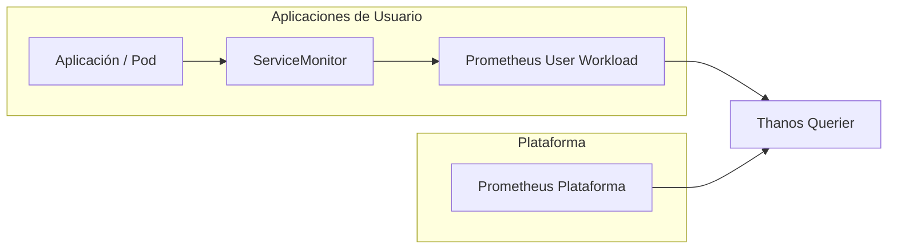

# 3.1 Qué vigila la plataforma por sí sola: métricas y cuadros de mando en la consola, y la monitorización de cargas de usuario

## Objetivos de aprendizaje

Al finalizar este apartado serás capaz de:

- Comprender cómo OpenShift monitoriza de manera nativa los componentes internos de la plataforma y la infraestructura del clúster.
- Identificar las métricas y cuadros de mando disponibles por defecto en la consola web de administración.
- Conocer los componentes del stack de monitorización integrado en OpenShift y la función de cada uno.
- Diferenciar entre la monitorización de infraestructura y la monitorización de cargas de trabajo de usuario.
- Evaluar la potencia del *User-Workload Monitoring* para el escalado dinámico de aplicaciones y la observabilidad de negocio.
- Evaluar el coste operativo e informático de activar la monitorización de usuario.
- Consultar métricas de rendimiento y consumo de tus propios pods directamente desde la consola web e interpretar correctamente los resultados.

---

## El stack de monitorización nativo en OpenShift

Cualquier plataforma moderna necesita conocer su estado de salud en todo momento.

Para ello, OpenShift incorpora de serie un stack de monitorización completo basado en proyectos de la CNCF (*Cloud Native Computing Foundation*), desplegado y mantenido automáticamente mediante el operador del clúster (*Cluster Monitoring Operator*).

Este ecosistema se apoya principalmente en:

- **Prometheus:** Es el motor central de almacenamiento y recolección de métricas. Funciona mediante un modelo *pull* (raspado o *scraping*), consultando periódicamente los *endpoints* `/metrics` expuestos por los componentes de la plataforma y los contenedores. Almacena estos datos como series temporales optimizadas.
- **Alertmanager:** Recibe las alertas generadas por Prometheus cuando las reglas definidas evalúan una condición anómala. Se encarga de gestionar el ciclo de vida de la alerta: agrupar, silenciar, deduplicar y enrutar las notificaciones hacia canales externos (correo electrónico, Slack, PagerDuty, Webhooks, etc.).
- **Thanos Querier:** Componente fundamental en entornos distribuidos o de alta disponibilidad. Agrega y desduplica las métricas procedentes de múltiples instancias de Prometheus (como las de plataforma y las de usuario), ofreciendo un punto de acceso unificado (una vista global) para realizar consultas PromQL desde la consola web o herramientas de terceros.
- **Consola web de OpenShift:** Actúa como la interfaz de visualización integrada. Consume los datos agregados por Thanos Querier para renderizar cuadros de mando (*dashboards*), gráficas temporales y alertas en tiempo real sin requerir una infraestructura externa como Grafana.



Gracias a esta arquitectura, OpenShift recopila información constantemente sobre el funcionamiento del clúster sin necesidad de instalar o configurar herramientas adicionales.

---

## ¿Qué vigila la plataforma por defecto?

Nada más instalar OpenShift, la monitorización integrada comienza a recopilar información sobre:

- Los nodos del clúster (capacidad, recursos consumidos, disco, red).
- El plano de control de Kubernetes (*API Server*, *Controller Manager*, *Scheduler*).
- `etcd` (latencia, tamaño de base de datos, estado del quórum).
- Los *routers* de entrada e ingress controllers.
- Los operadores del clúster y su estado de salud.
- El consumo global e individual de CPU y memoria.
- La infraestructura de almacenamiento y la conectividad de red.

!!! note
    Uno de los objetivos principales de la monitorización integrada es detectar problemas de plataforma antes de que tengan impacto sobre las aplicaciones desplegadas.

---

## Cuadros de mando (*Dashboards*) en la consola web

La consola web incorpora múltiples *dashboards* que permiten visualizar el estado de salud del clúster de forma intuitiva.

Accediendo a **Observe → Dashboards** encontraremos información estructurada desde diferentes perspectivas.



### Métricas a nivel de clúster
Permiten conocer:

- Consumo global de CPU y memoria reservada vs. utilizada.
- Estado general y disponibilidad de los operadores del clúster.
- Capacidad disponible y salud de los componentes del plano de control.
- Rendimiento y tiempos de respuesta de `etcd`.

### Métricas a nivel de nodo
Permiten analizar cada servidor físico o virtual individualmente:

- CPU utilizada por nodo y saturación.
- Memoria consumida y presión de memoria.
- Operaciones de entrada/salida de disco (I/O) y espacio en volumenes.
- Tráfico de red (paquetes descartados, errores, ancho de banda).

### Métricas a nivel de proyecto
También es posible consultar métricas asociadas a aplicaciones concretas:

- Consumo de CPU por pod o contenedor.
- Consumo de memoria real (*working set*).
- Número de reinicios de contenedores.
- Tráfico de red por servicio.
- Estado de los despliegues (*Deployments*, *ReplicaSets*).

---

## Consultar métricas de tus propios pods en la consola

Hasta ahora hemos visto qué monitoriza OpenShift. La mejor forma de comprenderlo es observar métricas reales de una aplicación desplegada en nuestro proyecto.

### Acceso a las métricas desde la consola
1. Cambia a la perspectiva **Developer**.
2. Selecciona tu proyecto de trabajo.
3. Accede a **Observe → Metrics**.
4. Localiza el cuadro **Custom query**.

### Consultar el consumo de memoria de una aplicación
Podemos visualizar el consumo real de memoria de nuestro contenedor mediante una consulta PromQL:

```promql
container_memory_working_set_bytes{container="demo-formacion"}
```

Alternativamente, para visualizar todos los contenedores activos del proyecto:

```promql
container_memory_working_set_bytes{container!="",container!="POD"}
```

Tras pulsar **Run queries**, OpenShift mostrará una gráfica temporal con el consumo de memoria observado.

---

### Comparar la métrica con Requests y Limits

La aplicación `demo-formacion-yaml`, desplegada en la Sesión 2, incorpora una configuración explícita de recursos en su manifiesto:

```yaml
resources:
  requests:
    cpu: "100m"
    memory: "128Mi"

  limits:
    cpu: "500m"
    memory: "512Mi"
```

Al analizar la gráfica de métricas frente a este manifiesto, el objetivo es validar si la asignación teórica de recursos se ajusta a la realidad del comportamiento en ejecución.

#### Interpretación de las métricas

Al observar la serie temporal mostrada en la consola, no debemos buscar una cifra estática. Lo relevante es analizar cómo varía la métrica en relación con las garantías asignadas:

- **Relación con el *Request*:** Si el consumo real se mantiene sistemáticamente por debajo de los 128 MiB reservados, sabemos que el Pod está operando con holgura dentro de la reserva que Kubernetes ha realizado en el nodo.
- **Relación con el *Limit*:** Mientras el valor observado no muestre picos pronunciados que se aproximen a los 512 MiB configurados como límite, la aplicación funcionará de manera estable sin riesgo de sufrir un cierre forzoso por consumo excesivo de memoria (*OOMKilled*).

---

### Relación con la Sesión 2

En la Sesión 2 vimos tres conceptos claramente diferenciados:

| Concepto | Significado |
| :--- | :--- |
| **Request** | Recursos reservados por Kubernetes para planificar el Pod en un nodo |
| **Limit** | Consumo máximo permitido al contenedor antes de ser limitado o eliminado |
| **Consumo real** | Recursos utilizados por la aplicación en cada instante de tiempo |

La gráfica que estamos observando en la consola muestra precisamente el tercer valor: el consumo real medido de forma continua.

!!! tip "Idea clave"
    *Requests* y *Limits* son decisiones de diseño configuradas en los manifiestos YAML.
    
    Las métricas permiten validar experimentalmente si dichas decisiones fueron acertadas o si requieren un ajuste dimensional.

#### La importancia de evaluar tendencias frente a valores puntuales

El consumo de recursos en un sistema informático es intrínsecamente dinámico. Variaciones puntuales en la gráfica son completamente habituales debido a diversos factores:

- Reinicios o arranque inicial del Pod (carga de clases, inicialización de frameworks).
- Fluctuaciones en el volumen de peticiones concurrentes.
- Llenado y vaciado de cachés internas o recolección de basura (*Garbage Collection*).
- Estado de carga de la propia infraestructura.

Por este motivo, las decisiones de optimización de infraestructura deben tomarse analizando la tendencia global de la línea temporal (comportamiento estable, crecimiento progresivo, picos periódicos) y no sobre el dato puntual de un instante concreto.

!!! note
    Es completamente normal que una aplicación consuma menos recursos de los solicitados en sus *requests*. El *request* asegura la reserva necesaria para los momentos de máxima demanda esperada, mientras que la métrica nos muestra el comportamiento dinámico en tiempo real.

---

## Monitorización de cargas de usuario (*User-Workload Monitoring*)

Hasta ahora nos hemos centrado en las métricas de recursos de plataforma (CPU, memoria, disco, red).

Sin embargo, las aplicaciones modernas generan métricas internas que reflejan su verdadero estado de funcionamiento y negocio, como por ejemplo:

- Número de peticiones HTTP procesadas por segundo.
- Tiempos de respuesta y latencia por endpoint.
- Errores de aplicación (respuestas 5xx/4xx).
- Transacciones activas o colas de mensajes pendientes.
- Métricas personalizadas del dominio de la aplicación.

Por defecto, el stack de monitorización de OpenShift recolecta únicamente métricas de la plataforma. Para extender esta capacidad a las aplicaciones desplegadas por los usuarios existe la funcionalidad **User-Workload Monitoring**.



---

### El potencial transformador: autoescalado dinámico de aplicaciones

La monitorización de cargas de usuario no es solo una herramienta de observación; es uno de los motores más potentes de OpenShift para la automatización operativa.

Su principal ventaja radica en la capacidad de **escalar las aplicaciones en función del comportamiento real del negocio**:

1. **Autoescalado avanzado con HPA (*Horizontal Pod Autoscaler*):** Mediante el uso de métricas personalizadas expuestas a Prometheus y consumidas a través del adaptador de métricas (*Prometheus Adapter*), OpenShift puede aumentar o reducir el número de réplicas de un Pod basándose en parámetros funcionales como el volumen de peticiones entrantes, la latencia de respuesta o la profundidad de una cola de trabajo, en lugar de depender únicamente de la CPU o la memoria.
2. **Alertas funcionales y de negocio:** Permite establecer avisos no solo cuando un servidor falla, sino cuando la tasa de errores de la aplicación supera un umbral tolerable o cuando el tiempo de respuesta degrada la experiencia del usuario.
3. **Dashboards de aplicación centralizados:** Permite a los equipos de desarrollo y operaciones construir cuadros de mando integrados dentro de la misma consola corporativa, unificando el estado de la infraestructura con las métricas funcionales de la aplicación.

---

### ¿Qué cuesta activarla?

A pesar de su gran potencia, la activación del *User-Workload Monitoring* introduce requerimientos que deben ser evaluados en la planificación de la infraestructura:

#### 1. Despliegue de componentes dedicados
Se instalan instancias independientes de Prometheus y Alertmanager dedicadas exclusivamente a procesar las métricas de usuario. Esto garantiza que una saturación en las métricas de una aplicación no ponga en riesgo la monitorización interna del clúster.

#### 2. Consumo adicional de recursos (CPU y Memoria)
La recolección continua (*scraping*) de múltiples aplicaciones de usuario exige un esfuerzo adicional de cómputo y memoria para la plataforma, directamente proporcional al volumen de métricas recolectadas y a su frecuencia de refresco.

#### 3. Necesidad de almacenamiento persistente
Para mantener el historial de métricas funcionales y evaluar tendencias a lo largo del tiempo, es indispensable contar con volúmenes persistentes (*Persistent Volumes*) bien dimensionados para el almacenamiento de series temporales.

!!! warning "Planificación de capacidad"
    *User-Workload Monitoring* es una funcionalidad de alto valor para aplicaciones críticas y arquitecturas orientadas a eventos, pero exige reservar previamente CPU, memoria y almacenamiento persistente en el clúster.

---

### ¿Cuándo merece la pena activarlo?

Como criterio de decisión en entornos corporativos:

| Escenario | Recomendación |
| :--- | :--- |
| Clústeres pequeños o entornos de laboratorio/desarrollo básico | No es prioritario |
| Aplicaciones corporativas críticas en producción | Muy recomendable |
| Arquitecturas que requieren autoescalado basado en demanda/tráfico | Imprescindible |
| Sistemas con alertas orientadas al nivel de servicio (SLO/SLA) | Imprescindible |
| Equipos que únicamente requieren supervisar CPU y memoria basales | Opcional / Puede no compensar |

---

## Ideas clave para recordar

!!! tip "Resumen"
    - OpenShift incorpora de serie un stack completo de monitorización basado en Prometheus, Alertmanager, Thanos Querier y la propia consola web.
    - La plataforma monitoriza automáticamente los nodos, el plano de control, `etcd` y todos los componentes críticos del clúster.
    - La consola web ofrece *dashboards* integrados que permiten supervisar la salud de la infraestructura sin herramientas externas.
    - Consultar métricas reales de memoria y CPU permite validar experimentalmente si la configuración de *requests* y *limits* en los manifiestos es adecuada.
    - Las decisiones de optimización deben basarse en el análisis de tendencias a lo largo del tiempo y no en valores puntuales o aislados.
    - *User-Workload Monitoring* extiende la capacidad de la plataforma para recolectar métricas internas y funcionales de las aplicaciones.
    - Esta funcionalidad es clave para implementar autoescalado dinámico (HPA) basado en métricas de negocio o demanda real.
    - Su activación debe planificarse adecuadamente, ya que requiere instancias adicionales de Prometheus, mayor CPU/memoria y almacenamiento persistente.