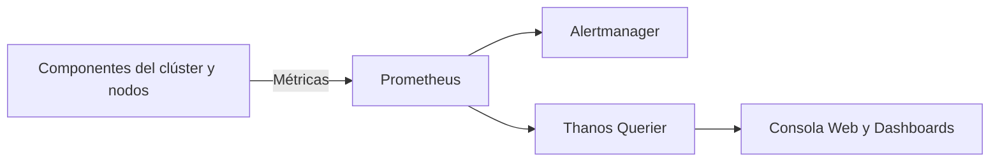
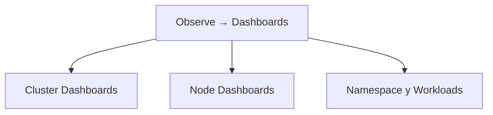
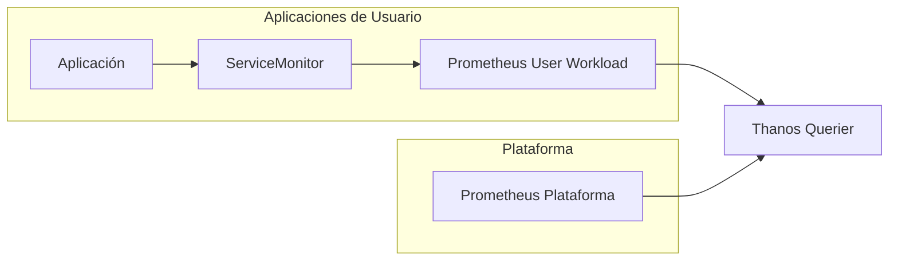

# 3.1 Qué vigila la plataforma por sí sola: métricas y cuadros de mando en la consola, y la monitorización de cargas de usuario

## Objetivos de aprendizaje

Al finalizar este apartado serás capaz de:

* Comprender cómo OpenShift monitoriza de manera nativa los componentes internos de la plataforma y la infraestructura del clúster.
* Identificar las métricas y cuadros de mando disponibles por defecto en la consola web de administración.
* Conocer en detalle los componentes del stack de monitorización (Prometheus, Alertmanager, Grafana y Thanos Querier).
* Diferenciar entre la monitorización de infraestructura y la monitorización de cargas de trabajo de usuario.
* Evaluar qué aporta activar la monitorización de proyectos definidos por el usuario y qué coste operativo e informático conlleva.
* Consultar métricas de rendimiento y consumo de tus propios pods directamente desde la consola web, interpretando los resultados frente a los límites y peticiones configurados.

---

## El stack de monitorización nativo en OpenShift

Cualquier arquitectura corporativa es susceptible de sufrir fallos o anomalías que pongan en riesgo la disponibilidad de los servicios. Para garantizar la estabilidad del sistema, OpenShift incluye de serie un stack de monitorización completo, preconfigurado y automatizado desplegado durante la propia instalación de la plataforma.

Este ecosistema se apoya en varias herramientas clave de código abierto:

* **Prometheus:** Es el núcleo del sistema. Actúa como base de datos de series temporales (Time-Series Database), recolectando mediante peticiones periódicas (*scraping*) las métricas expuestas por los servicios y nodos, y evaluando reglas de rendimiento.
* **Alertmanager:** El componente encargado de recibir las alertas generadas por Prometheus. Se encarga de procesarlas, agrupar alertas similares, aplicar silenciamientos y enviar notificaciones hacia canales externos.
* **Grafana y la consola web de OpenShift:** Capas visuales que transforman los datos numéricos de Prometheus en gráficos legibles y cuadros de mando interactivos.
* **Thanos Querier:** Un componente de agregación que permite consultar de forma transparente métricas procedentes tanto del núcleo de la plataforma como de los proyectos definidos por el usuario bajo una única interfaz.



## ¿Qué vigila la plataforma por defecto?

Sin necesidad de realizar ninguna configuración adicional, el clúster monitoriza de manera continua sus componentes esenciales:

* El plano de control (*Control Plane*) y los servicios de Kubernetes.
* La base de datos distribuida `etcd`.
* Los servicios DNS proporcionados por `CoreDNS`.
* Los *routers* de entrada y balanceadores de carga.
* Los nodos *worker* e infraestructura.
* El consumo de CPU, memoria, disco y red.
* Los operadores de OpenShift y su estado operativo.

> [!note]
> Uno de los objetivos principales de la monitorización integrada es detectar problemas de plataforma antes de que impacten directamente sobre las aplicaciones de usuario.

---

## Cuadros de mando (*Dashboards*) en la consola web

La consola web de OpenShift proporciona vistas gráficas integradas que permiten evaluar el estado de salud del clúster sin necesidad de desplegar herramientas externas.

Accediendo a **Observe → Dashboards** encontraremos diferentes perspectivas de monitorización.



### Métricas a nivel de clúster
Permiten conocer el estado global de la plataforma:
* Utilización total de CPU.
* Utilización total de memoria.
* Porcentaje de recursos comprometidos mediante *Requests* y *Limits*.
* Estado y rendimiento de `etcd`.
* Capacidad disponible del clúster.

### Métricas a nivel de nodo
Permiten analizar el comportamiento individual de cada servidor:
* Uso de CPU.
* Consumo de memoria.
* Operaciones de disco.
* Latencia de almacenamiento.
* Tráfico de red.
* Saturación de recursos.

### Métricas a nivel de proyecto y aplicaciones
También es posible consultar información relacionada con los *workloads* desplegados:
* Consumo de CPU por pod.
* Consumo de memoria por pod.
* Tráfico de red.
* Reinicios de contenedores.
* Estado de los despliegues.

---

## Consultar métricas de tus propios pods en la consola

Hasta ahora hemos visto qué monitoriza OpenShift. La mejor forma de comprenderlo es observando métricas reales de una aplicación desplegada en nuestro proyecto.

### Acceso a las métricas desde la consola
1. Cambia a la perspectiva **Developer**.
2. Selecciona tu proyecto de trabajo.
3. Accede a **Observe → Metrics**.
4. Localiza el cuadro **Custom query**.

### Consultar el consumo de memoria de una aplicación
Podemos visualizar el consumo real de memoria de nuestro contenedor mediante una consulta PromQL:

```promql
container_memory_working_set_bytes{container="demo-formacion"}
```

Alternativamente, para visualizar todos los contenedores activos del proyecto:

```promql
container_memory_working_set_bytes{container!="",container!="POD"}
```

Tras pulsar **Run queries**, OpenShift mostrará una gráfica temporal con el consumo de memoria observado.

### Interpretar el resultado

Supongamos que observamos una gráfica estable alrededor de:
`65M - 70M`

Esto indica que la aplicación consume aproximadamente entre 65 y 70 MB de memoria real.

Ahora comparemos ese dato con los recursos configurados en el Deployment:

```yaml
resources:
  requests:
    cpu: "100m"
    memory: "128Mi"

  limits:
    cpu: "500m"
    memory: "512Mi"
```

#### ¿Qué nos está diciendo la plataforma?

* **Respecto al Request:** La aplicación consume aproximadamente 70 MB y tiene reservados 128 Mi. Por tanto, existe margen suficiente, el pod está correctamente dimensionado y no existe presión de memoria.
* **Respecto al Limit:** El límite máximo permitido es 512 Mi. Como el consumo real es muy inferior, la aplicación está funcionando con normalidad, existe capacidad para absorber incrementos de carga y no hay riesgo inmediato de alcanzar el límite.

> [!tip] Qué estamos aprendiendo realmente
> Más allá de consultar una métrica, estamos validando si los valores de *requests* y *limits* definidos para nuestra aplicación son razonables o deben ajustarse.

### Error habitual relacionado con namespaces

En la perspectiva **Developer**, OpenShift añade automáticamente el namespace activo a las consultas. 

Si se incluye manualmente un filtro de namespace, puede aparecer un error similar a:
```text
conflicting label matcher:
label matcher "namespace=..."
conflicts with injected matcher "namespace=..."
```
En este caso basta con eliminar el filtro de namespace de la consulta.

---

## Monitorización de cargas de usuario (*User-Workload Monitoring*)

Hasta ahora hemos hablado de la monitorización que OpenShift realiza sobre sí mismo. Sin embargo, las aplicaciones modernas suelen exponer también sus propias métricas, por ejemplo:
* Número de peticiones HTTP.
* Tiempo de respuesta de una API.
* Errores de acceso a bases de datos.
* Transacciones procesadas.
* Mensajes en cola.

Por defecto OpenShift no recopila estas métricas de aplicación. Para ello existe la funcionalidad denominada **User-Workload Monitoring**.



### Qué aporta activarla
Activar esta capacidad permite:
* Monitorizar métricas específicas de negocio.
* Obtener visibilidad detallada de las aplicaciones.
* Crear *dashboards* personalizados.
* Definir alertas específicas para cada servicio.
* Unificar métricas de plataforma y aplicación bajo una única experiencia de consulta.

### Un ejemplo práctico

Imagina una API que expone una métrica indicando cuántas peticiones procesa por minuto.
* **Sin User-Workload Monitoring:** OpenShift sabe cuánta CPU consume el pod y cuánta memoria utiliza, pero no sabe cuántas peticiones está gestionando.
* **Con User-Workload Monitoring:** OpenShift conoce también las métricas funcionales de la aplicación, permitiendo a los equipos construir cuadros de mando orientados al negocio.

---

### ¿Qué cuesta activarla?

La monitorización de aplicaciones aporta mucho valor, pero tiene un coste real.

#### 1. Componentes adicionales
Al habilitar esta funcionalidad aparecen nuevos componentes dedicados a recopilar métricas de usuario, evaluar reglas personalizadas y almacenar series temporales adicionales.

#### 2. Consumo de CPU y memoria
Cuantas más aplicaciones exporten métricas, más trabajo realiza Prometheus, más CPU consume el clúster y más memoria requiere la plataforma.

#### 3. Necesidad de almacenamiento persistente
Las métricas deben conservarse durante un periodo determinado, lo que implica el uso de almacenamiento persistente. Cuantas más métricas se recojan y más tiempo se almacenen, mayor será el crecimiento de los volúmenes persistentes.

> [!warning] Planificación de capacidad
> Activar *User-Workload Monitoring* en un clúster compartido sin dimensionamiento previo puede provocar consumos significativos de CPU, memoria y almacenamiento.
> 
> Antes de habilitarlo de forma general conviene validar qué equipos realmente necesitan esta funcionalidad y qué volumen de métricas van a generar.

---

### ¿Cuándo merece la pena activarlo?

Como criterio general:

| Escenario | Recomendación |
| :--- | :--- |
| Clúster pequeño de aprendizaje | Normalmente no es necesario |
| Aplicaciones corporativas críticas | Muy recomendable |
| Observabilidad avanzada | Recomendable |
| Necesidad de alertas funcionales de negocio | Imprescindible |
| Equipos que solo necesitan CPU y memoria | Puede no compensar |

---

## Ideas clave para recordar

> [!tip] Resumen
> - OpenShift incorpora de serie un stack completo de monitorización basado en Prometheus, Alertmanager y Thanos.
> - La plataforma monitoriza automáticamente el plano de control, los nodos y los componentes críticos del clúster.
> - La consola web proporciona *dashboards* que permiten visualizar el estado de salud del entorno.
> - Observar las métricas de nuestros propios pods ayuda a validar si *requests* y *limits* están correctamente dimensionados.
> - La monitorización de aplicaciones de usuario no está activada por defecto.
> - *User-Workload Monitoring* permite recopilar métricas funcionales y de negocio de las aplicaciones.
> - Esta funcionalidad aporta gran visibilidad, pero también consume CPU, memoria y almacenamiento.
> - Antes de habilitarla es importante evaluar el valor que aporta frente al coste operativo que introduce.