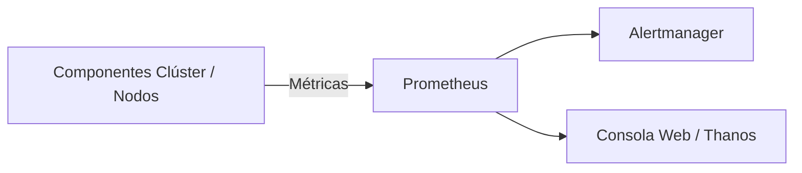
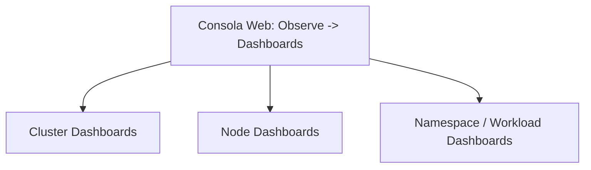
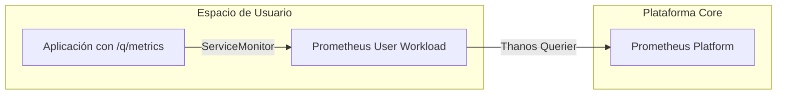

# 3.1 Qué vigila la plataforma por sí sola: métricas y cuadros de mando en la consola, y la monitorización de cargas de usuario

## Objetivos de aprendizaje

Al finalizar este apartado serás capaz de:

- Comprender cómo OpenShift monitoriza de manera nativa los componentes internos de la plataforma y la infraestructura del clúster.
- Identificar las métricas y cuadros de mando disponibles por defecto en la consola web de administración.
- Entender el propósito y la arquitectura del stack de monitorización basado en Prometheus, Grafana y Alertmanager.
- Diferenciar entre la monitorización de infraestructura y la monitorización de cargas de trabajo de usuario.
- Evaluar qué aporta activar la monitorización de proyectos definidos por el usuario y qué coste operativo e informático conlleva.
- Consultar métricas de rendimiento y consumo de tus propios pods directamente desde la consola web .

---

## La monitorización nativa en OpenShift

Cualquier arquitectura corporativa es susceptible de sufrir fallos o anomalías que pongan en riesgo la disponibilidad de los servicios. Para garantizar la estabilidad del sistema, OpenShift incluye de serie un **stack de monitorización completo, preconfigurado y automatizado** que se despliega durante la instalación de la plataforma.

Este stack se apoya principalmente en tres componentes de código abierto:

- **Prometheus:** Base de datos de series temporales y motor de evaluación de reglas y métricas.
- **Alertmanager:** Sistema gestor encargado de recibir, agrupar, silenciar y enviar alertas a canales externos.
- **Grafana / Consola Web:** Plataformas de visualización y análisis de métricas.



### ¿Qué vigila la plataforma por defecto?

Sin necesidad de realizar ninguna configuración adicional, el clúster monitoriza de manera continua todos sus componentes internos esenciales, incluyendo:

- El plano de control (*Control Plane*) y el servidor de API de Kubernetes (`kube-apiserver`, `kube-scheduler`, `kube-controller-manager`).
- La base de datos distribuida del clúster (**etcd**).
- La resolución de nombres mediante **CoreDNS**.
- Los servicios de red, balanceo de carga (**HAProxy**) y enrutadores de rutas (*Ingress Routers*).
- El estado físico y lógico de los nodos worker e infraestructura (*Node Exporter*).

---

## Cuadros de mando (Dashboards) en la consola web

La consola web de OpenShift proporciona vistas gráficas integradas que permiten evaluar el estado de salud del clúster y de los recursos en ejecución sin requerir herramientas externas.

Accediendo desde el menú principal a **Observe → Dashboards**, los administradores y desarrolladores pueden consultar métricas clave agrupadas en diferentes ámbitos:

### 1. Métricas a nivel de Clúster

Muestran la salud general y la capacidad global de la plataforma:

- **CPU y Memoria Utilisation:** Porcentaje de uso real de los recursos globales del clúster.
- **CPU y Memory Requests/Limits Commitment:** Relación entre los recursos solicitados/limitados por los Pods y la capacidad total disponible.
- **Estado de etcd:** Tamaño de la base de datos, latencia de sincronización de disco (*fsync*) y tasa de operaciones RPC.

### 2. Métricas a nivel de Nodo

Permiten auditar el rendimiento de cada nodo worker o de infraestructura de forma individual:

- Carga de CPU y saturación (*Load Average*).
- Paginación y presión de memoria RAM.
- Operaciones de entrada/salida de disco (*Disk IO Utilisation & Saturation*).
- Tráfico de red y paquetes descartados o encolados (*Net Utilisation & Saturation*).



---

## Consultar métricas de tus propios pods en la consola

Consultar el consumo de recursos de nuestros propios despliegues.

### Pasos en la consola web:

1. Cambia a la perspectiva **Developer** (Desarrollador) o mantente en **Administrator** seleccionando tu proyecto/namespace de trabajo (por ejemplo, `demo-formacion`).
2. Dirígete al menú lateral izquierdo y selecciona **Observe → Metrics**.
3. En el cuadro de texto superior (**Custom query**), introduce una consulta de PromQL para visualizar el consumo de CPU o memoria de tus contenedores. Por ejemplo, para consultar la memoria residente (*Working Set Size*) de los pods de tu namespace:
   ```promql
   container_memory_working_set_bytes{namespace="<tu-namespace>", container!=""}
   ```
4. Haz clic en **Run queries** para ejecutar la consulta.
5. Compara la gráfica obtenida con los límites (*limits*) y solicitudes (*requests*) definidos en el manifiesto de tu Deployment.

!!! tip "Exploración de consultas"
    También puedes navegar por la pestaña **Metrics** seleccionando métricas predefinidas del desplegable (como `container_cpu_usage_seconds_total`) para analizar el comportamiento dinámico de tu aplicación ante peticiones HTTP.

---

## Monitorización de cargas de usuario (User-Workload Monitoring)

Por defecto, el stack de monitorización nativo de OpenShift vigila los componentes del sistema, pero **no recopila métricas personalizadas expuestas por las aplicaciones de los desarrolladores** en sus propios namespaces.

Para cubrir esta necesidad, OpenShift permite habilitar la **monitorización de proyectos definidos por el usuario** (*User-Workload Monitoring*).



### ¿Qué aporta activar esta monitorización?
- **Métricas de negocio y de aplicación:** Permite que Prometheus extraiga métricas específicas de tus servicios (por ejemplo, número total de peticiones HTTP, latencia de endpoints, transacciones completadas o errores de conexión a bases de datos).
- **Unificación visual:** Agrega y unifica las métricas de la plataforma y de las aplicaciones de usuario bajo una única interfaz a través de *Thanos Querier*.
- **Alertas personalizadas:** Permite definir reglas de alerta específicas para las cargas de negocio de los equipos de desarrollo.

---

### ¿Qué cuesta activarla? (Implicaciones y costes operativos)

Activar la monitorización de cargas de usuario no es un proceso gratuito en términos de recursos de infraestructura. Su activación implica:

1. **Despliegue de componentes adicionales:** Pone en marcha instancias dedicadas adicionales en el clúster, como el operador de Prometheus para usuarios, servidores Prometheus dedicados y componentes de evaluación de reglas (*Thanos Ruler*).
2. **Consumo de recursos de cómputo y memoria:** Los pods encargados de recolectar y almacenar las métricas de usuario consumen CPU y memoria RAM permanente del clúster (frecuentemente reservados sobre nodos de infraestructura).
3. **Requisitos de almacenamiento persistente:** Prometheus requiere aprovisionar volúmenes persistentes (`PVC`) para retener las series temporales de métricas durante los días configurados (por ejemplo, retención de 5 días con discos dedicados), lo que genera ocupación en las cabinas de almacenamiento del clúster.

!!! warning "Planificación de capacidad"
    En clústeres compartidos o con alta densidad de proyectos de usuario, habilitar la monitorización de cargas de trabajo sin un dimensionamiento previo de almacenamiento y cómputo puede generar saturación en los nodos de infraestructura. Debe evaluarse si el equipo realmente requiere métricas avanzadas antes de activar esta característica de manera global.

---

## Ideas clave para recordar

!!! tip "Resumen"
    - OpenShift incluye de serie un stack de monitorización robusto basado en Prometheus, Alertmanager y Grafana.
    - La monitorización por defecto cubre la salud del plano de control, nodos, red y componentes clave de Kubernetes.
    - La consola web ofrece cuadros de mando (*Dashboards*) para auditar el consumo global del clúster y el rendimiento de nodos individuales.
    - Mediante la práctica N1 es posible consultar métricas de rendimiento y consumo de memoria/CPU de nuestros propios pods utilizando consultas PromQL.
    - La monitorización de cargas de usuario (*User-Workload Monitoring*) extiende la capacidad de Prometheus para extraer métricas de negocio directamente desde las aplicaciones.
    - Activar la monitorización de usuario aporta visibilidad avanzada, pero **cuesta recursos de cómputo, memoria y almacenamiento persistente** en la plataforma.