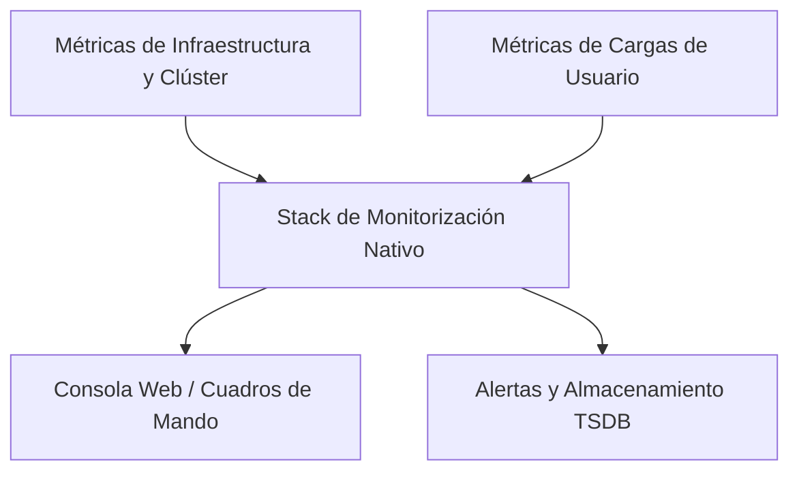

# 3.1 Qué vigila la plataforma por sí sola: métricas y cuadros de mando en la consola, y la monitorización de cargas de usuario

#### Objetivos de aprendizaje
Al finalizar este apartado serás capaz de:
* Comprender qué métricas recopila OpenShift de forma nativa sin necesidad de configuración adicional por parte del desarrollo.
* Diferenciar los cuadros de mando generales del clúster de las métricas específicas de una aplicación en la consola web.
* Entender qué aporta activar la monitorización avanzada de cargas de usuario y qué coste computacional y operativo conlleva.
* Consultar métricas básicas de consumo de CPU y memoria de tus propios pods utilizando tanto la interfaz gráfica como la línea de comandos.

## La monitorización nativa en OpenShift

Cuando desplegamos una aplicación en OpenShift, no partimos de cero en lo relativo a la observabilidad. La plataforma incluye un stack de monitorización integrado (basado en componentes estándar de la industria como Prometheus y Grafana) que se despliega y configura de manera automática durante la instalación del clúster.

Este sistema nativo se encarga de vigilar de forma continua la salud de la infraestructura física o virtual, los componentes del sistema operativo y los recursos propios del clúster (nodos, redes, almacenamiento y servicios del sistema).



Sin embargo, es importante distinguir qué viene habilitado por defecto para garantizar la estabilidad del clúster y qué requiere una activación específica para cubrir las aplicaciones de los desarrolladores.

## Métricas y cuadros de mando en la consola

La consola web de OpenShift ofrece vistas preconfiguradas que permiten evaluar rápidamente el comportamiento de los recursos. Dependiendo de la perspectiva en la que nos encontremos (**Administrator** o **Developer**), el alcance de la información variará considerablemente.

### Perspectiva de administración: la salud global
Los administradores del clúster tienen acceso a cuadros de mando orientados al rendimiento general de la plataforma:
* **Consumo global de nodos**: Porcentaje de uso de CPU, memoria y almacenamiento en todo el conjunto de máquinas que forman el clúster.
* **Estado de los operadores y componentes principales**: Monitorización mediante `ClusterOperators` para asegurar que las piezas core de OpenShift operan correctamente.
* **Presión de recursos**: Identificación temprana de nodos saturados que puedan comprometer la estabilidad general.

### Perspectiva de desarrollo: el enfoque en el proyecto
Como desarrolladores, nuestro foco se sitúa en los recursos de nuestro propio namespace o proyecto. Desde la vista **Developer**, la sección de *Monitoring* o el apartado de detalles de un *Deployment* o *Pod* nos permite consultar:
* **Uso de CPU instantáneo**: Cuántos milicores (`m`) está consumiendo nuestra aplicación en tiempo real frente a los límites y peticiones configurados.
* **Uso de memoria**: Cuántos megabytes (`Mi`) u octetos consume el contenedor y si nos acercamos peligrosamente al límite (`OOMKilled`).
* **Ancho de banda de red**: Volumen de tráfico entrante y saliente gestionado por los servicios de la aplicación.

##### Consultar métricas de tus propios pods en la consola
Para verificar el consumo de nuestros pods de manera directa, podemos combinar la consola web o acudir a la línea de comandos si disponemos de acceso al servidor de métricas (*metrics-server*). 

Si accedemos a la consola web en la perspectiva **Developer**, seleccionamos nuestro proyecto, entramos en la sección **Topology**, hacemos clic sobre nuestra aplicación y navegamos a la pestaña **Metrics**, veremos gráficas temporales de uso de recursos.

Desde la línea de comandos, si el clúster cuenta con el servidor de métricas activo, podemos consultar el consumo actual ejecutando:

```bash
oc adm top pods
```

Ejemplo de salida esperada:

```text
NAME                                   CPU(cores)   MEMORY(bytes)
demo-formacion-yaml-6d4b65b98b-x8z2p   3m           45Mi
```

!!! note "Disponibilidad del servidor de métricas"
    En entornos restringidos de prácticas o sandboxes educativos, algunos comandos globales o de administración pueden requerir permisos especiales. Si el comando `oc adm top pods` devuelve un error de permisos o indica que el servidor no está disponible, la alternativa recomendada es consultar la pestaña de métricas integrada en la consola web para los pods de tu propio espacio de nombres.

## Monitorización de cargas de usuario (User Workload Monitoring)

Por defecto, el stack de monitorización de OpenShift vigila los componentes del sistema. No obstante, las métricas de las aplicaciones desplegadas por los equipos de desarrollo (lo que denominamos *User Workload*) pueden requerir una activación adicional si se desea un seguimiento exhaustivo, la creación de alertas personalizadas por equipo o la integración con cuadros de mando avanzados.

### Qué aporta activar la monitorización de cargas de usuario
Activar esta capacidad sobre los proyectos de desarrollo aporta ventajas operativas muy relevantes:
* **Métricas de negocio y aplicación personalizadas**: Permite que las aplicaciones expongan métricas propias (por ejemplo, número de peticiones HTTP procesadas, tiempos de respuesta, errores de pasarela) para ser scrapeadas por la plataforma.
* **Alertas a medida**: Capacidad de definir alertas específicas basadas en el comportamiento de los microservicios del equipo.
* **Retención y paneles específicos**: Integración de métricas de usuario en los cuadros de mando de Grafana de la plataforma si los administradores lo habilitan.

### Qué cuesta activarla: impacto y consideraciones
Habilitar la monitorización de cargas de usuario no es gratuito en términos de recursos. Conlleva un coste que debe ser evaluado:
* **Consumo de almacenamiento**: Las métricas se almacenan en bases de datos de series temporales (TSDB). A mayor número de pods monitorizados y mayor granularidad, mayor espacio de almacenamiento persistente se consumirá.
* **Carga de CPU y memoria**: El motor de recolección (*scraper*) debe consultar frecuentemente los endpoints de métricas de todos los pods activos, incrementando el consumo interno del clúster.
* **Complejidad de gobierno**: Requiere que los desarrolladores comprendan cómo etiquetar y exponer correctamente sus métricas (por ejemplo, mediante ServiceMonitors).

!!! warning "Evaluación de costes"
    En clústeres compartidos o entornos con recursos limitados, activar la monitorización indiscriminada de todas las cargas de usuario puede saturar el subsistema de métricas. Es recomendable activarla de forma selectiva en los proyectos de producción o preproducción que realmente lo requieran.

## Ideas clave para recordar
!!! tip "Resumen"
    - OpenShift incluye un sistema de monitorización nativo basado en Prometheus que vigila el estado general de la infraestructura y del clúster.
    - La consola web ofrece vistas diferenciadas para administradores (salud global del clúster) y desarrolladores (consumo de recursos por proyecto y pod).
    - Comandos como `oc adm top pods` permiten auditar rápidamente el consumo de CPU y memoria en tiempo real.
    - La monitorización de cargas de usuario (*User Workload Monitoring*) amplía la visibilidad hacia las métricas de las aplicaciones, pero conlleva un coste en almacenamiento y capacidad de cómputo que debe dimensionarse adecuadamente.
