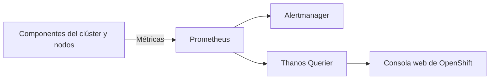
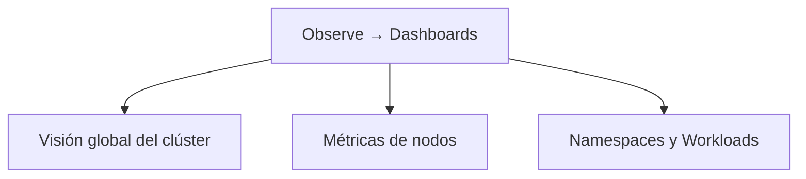
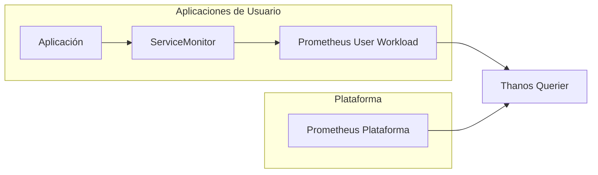

## 3.1 Qué vigila la plataforma por sí sola: métricas y cuadros de mando en la consola, y la monitorización de cargas de usuario

### Objetivos de aprendizaje

Al finalizar este apartado serás capaz de:

- Comprender cómo OpenShift monitoriza de manera nativa los componentes internos de la plataforma y la infraestructura del clúster.
- Identificar las métricas y cuadros de mando disponibles por defecto en la consola web de administración.
- Conocer los componentes del stack de monitorización integrado en OpenShift y la función de cada uno.
- Diferenciar entre la monitorización de infraestructura y la monitorización de cargas de trabajo de usuario.
- Evaluar qué aporta activar la monitorización de proyectos definidos por el usuario y qué coste operativo e informático conlleva.
- Consultar métricas de rendimiento y consumo de tus propios pods directamente desde la consola web e interpretar correctamente los resultados.

### El stack de monitorización nativo en OpenShift

Cualquier plataforma moderna necesita conocer su estado de salud en todo momento.  
Para ello, OpenShift incorpora de serie un stack de monitorización completo basado en proyectos de la CNCF (_Cloud Native Computing Foundation_), desplegado y mantenido automáticamente mediante el operador del clúster (_Cluster Monitoring Operator_).  
Este ecosistema se apoya principalmente en:

- **Prometheus:** Es el motor central de almacenamiento y recolección de métricas. Funciona mediante un modelo _pull_ (raspado o _scraping_), consultando periódicamente los _endpoints_ /metrics expuestos por los componentes de la plataforma y los contenedores. Almacena estos datos como series temporales optimizadas.
- **Alertmanager:** Recibe las alertas generadas por Prometheus cuando las reglas definidas evalúan una condición anómala. Se encarga de gestionar el ciclo de vida de la alerta: agrupar, silenciar, deduplicar y enrutar las notificaciones hacia canales externos (correo electrónico, Slack, PagerDuty, Webhooks, etc.).
- **Thanos Querier:** Componente fundamental en entornos distribuidos o de alta disponibilidad. Agrega y desduplica las métricas procedentes de múltiples instancias de Prometheus (como las de plataforma y las de usuario), ofreciendo un punto de acceso unificado (una vista global) para realizar consultas PromQL desde la consola web o herramientas de terceros.
- **Consola web de OpenShift:** Actúa como la interfaz de visualización integrada. Consume los datos agregados por Thanos Querier para renderizar cuadros de mando (_dashboards_), gráficas temporales y alertas en tiempo real sin requerir una infraestructura externa como Grafana.



Gracias a esta arquitectura, OpenShift recopila información constantemente sobre el funcionamiento del clúster sin necesidad de instalar o configurar herramientas adicionales.

### ¿Qué vigila la plataforma por defecto?

Nada más instalar OpenShift, la monitorización integrada comienza a recopilar información sobre:

- Los nodos del clúster (capacidad, recursos consumidos, disco, red).
- El plano de control de Kubernetes (_API Server_, _Controller Manager_, _Scheduler_).
- etcd (latencia, tamaño de base de datos, estado del quórum).
- Los _routers_ de entrada e ingress controllers.
- Los operadores del clúster y su estado de salud.
- El consumo global e individual de CPU y memoria.
- La infraestructura de almacenamiento y la conectividad de red.

!!! note
    Uno de los objetivos principales de la monitorización integrada es detectar problemas de plataforma antes de que tengan impacto sobre las aplicaciones desplegadas.

### Cuadros de mando (_Dashboards_) en la consola web

La consola web incorpora múltiples _dashboards_ que permiten visualizar el estado de salud del clúster de forma intuitiva.  
Accediendo a **Observe → Dashboards** encontraremos información estructurada desde diferentes perspectivas.



#### Métricas a nivel de clúster

Permiten conocer:

- Consumo global de CPU y memoria reservada vs. utilizada.
- Estado general y disponibilidad de los operadores del clúster.
- Capacidad disponible y salud de los componentes del plano de control.
- Rendimiento y tiempos de respuesta de etcd.

#### Métricas a nivel de nodo

Permiten analizar cada servidor físico o virtual individualmente:

- CPU utilizada por nodo y saturación.
- Memoria consumida y presión de memoria.
- Operaciones de entrada/salida de disco (I/O) y espacio en volúmenes.
- Tráfico de red (paquetes descartados, errores, ancho de banda).

#### Métricas a nivel de proyecto

También es posible consultar métricas asociadas a aplicaciones concretas:

- Consumo de CPU por pod o contenedor.
- Consumo de memoria real (_working set_).
- Número de reinicios de contenedores.
- Tráfico de red por servicio.
- Estado de los despliegues (_Deployments_, _ReplicaSets_).

### Consultar métricas de tus propios pods en la consola

Hasta ahora hemos visto qué monitoriza OpenShift. La mejor forma de comprenderlo es observar métricas reales de una aplicación desplegada en nuestro proyecto.

#### Acceso a las métricas desde la consola

- Accede a **Observe → Metrics**.
- En el entorno de prácticas, la consola muestra directamente las métricas del proyecto al que tienes acceso.
- En la sección **Queries**, utiliza el campo **Expression** para introducir la consulta PromQL.
- Pulsa **Run queries** para ejecutarla.

#### Consultar el consumo de memoria de una aplicación

Podemos consultar la memoria utilizada por el contenedor `demo-formacion` mediante la siguiente consulta PromQL:

```promql
container_memory_working_set_bytes{container="demo-formacion"}
```

La métrica `container_memory_working_set_bytes` muestra, en bytes, la memoria de trabajo (_working set_) utilizada por el contenedor. Para el propósito de este curso, podemos interpretarla como **la memoria que el contenedor está utilizando activamente en cada momento**.

Al ejecutar la consulta, OpenShift representa el valor como una serie temporal. La gráfica permite observar cómo evoluciona el uso de memoria, en lugar de limitarse a una única cifra tomada en un instante concreto.

### Relacionar la métrica con Requests y Limits

En la Sesión 2 configuramos los recursos de la aplicación de la siguiente forma:

```yaml
resources:
  requests:
    cpu: "100m"
    memory: "128Mi"
  limits:
    cpu: "500m"
    memory: "512Mi"
```

Ahora podemos poner en contexto el valor mostrado por la gráfica. Debemos distinguir tres valores diferentes:

| Valor | Qué representa |
|---|---|
| **Uso observado** | Memoria que está utilizando el contenedor, mostrada por la métrica. |
| **Request: 128 MiB** | Memoria solicitada por el Pod y que Kubernetes tiene en cuenta para planificarlo. |
| **Limit: 512 MiB** | Cantidad máxima de memoria que puede utilizar el contenedor. |

La métrica no muestra el `request` ni el `limit`: muestra el uso de memoria observado. Además, el consumo no tiene que coincidir con el `request`. Puede situarse por debajo o por encima de ese valor sin que ello implique por sí mismo un problema, siempre que el contenedor disponga de memoria suficiente y no alcance el `limit` configurado.

La comparación nos permite interpretar mejor el comportamiento de la aplicación y responder a preguntas como:

- ¿El consumo de memoria se mantiene estable?
- ¿Aumenta progresivamente con el tiempo?
- ¿Presenta picos inesperados?
- ¿Se aproxima al límite de 512 MiB?

Lo importante no es memorizar una cifra concreta, sino observar la tendencia y el margen existente respecto al límite de memoria.

!!! tip "Idea clave"
    La métrica muestra el uso de memoria observado. El `request` se utiliza para planificar el Pod y el `limit` establece la cantidad máxima que puede consumir el contenedor.

## Monitorización de cargas de usuario (_User-Workload Monitoring_)

Hasta ahora hemos hablado exclusivamente de la monitorización de la propia plataforma.  
Sin embargo, muchas aplicaciones también exponen métricas de negocio y funcionamiento, por ejemplo:

- Número de peticiones HTTP.
- Tiempo de respuesta.
- Transacciones procesadas.
- Errores de aplicación.
- Mensajes en cola.

Por defecto, OpenShift no recopila estas métricas de usuario.  
Para ello existe la funcionalidad denominada **User-Workload Monitoring**.



#### Qué aporta activarla

Permite:

- Monitorizar métricas específicas de negocio.
- Obtener mayor visibilidad de las aplicaciones.
- Construir _dashboards_ personalizados.
- Crear alertas propias.
- Unificar métricas de plataforma y aplicación.

#### Un ejemplo práctico

Imaginemos una API corporativa.

- **Sin User-Workload Monitoring:** OpenShift sabe cuánta CPU consume y cuánta memoria utiliza, pero no sabe cuántas peticiones procesa.
- **Con User-Workload Monitoring:** OpenShift conoce también las métricas funcionales de la aplicación, permitiendo a los equipos construir cuadros de mando orientados al negocio.

#### ¿Qué cuesta activarla?

La monitorización avanzada aporta mucho valor, pero también tiene un coste.

##### 1. Componentes adicionales

Será necesario desplegar componentes encargados de:

- Recopilar métricas de usuario.
- Evaluar reglas personalizadas.
- Almacenar más información histórica.

##### 2. Consumo de CPU y memoria

Cuantas más métricas recopilemos:

- Más CPU utilizará Prometheus.
- Más memoria requerirá la plataforma.
- Más trabajo deberá realizar el sistema de monitorización.

##### 3. Necesidad de almacenamiento persistente

Las métricas deben guardarse durante un periodo determinado, lo que implica:

- Más almacenamiento.
- Más crecimiento de los volúmenes persistentes.
- Mayor planificación de capacidad.

!!! warning "Planificación de capacidad"
    _User-Workload Monitoring_ aporta mucho valor, pero conviene evaluar previamente el impacto que tendrá sobre CPU, memoria y almacenamiento del clúster.

#### ¿Cuándo merece la pena activarlo?

Como criterio general:

<table>
<tr>
<th>
Escenario
</th>
<th>
Recomendación
</th>
</tr>
<tr>
<td>
Clúster pequeño de aprendizaje
</td>
<td>
Normalmente no es necesario
</td>
</tr>
<tr>
<td>
Aplicaciones corporativas críticas
</td>
<td>
Muy recomendable
</td>
</tr>
<tr>
<td>
Observabilidad avanzada
</td>
<td>
Recomendable
</td>
</tr>
<tr>
<td>
Alertas funcionales de negocio
</td>
<td>
Imprescindible
</td>
</tr>
<tr>
<td>
Equipos que solo necesitan CPU y memoria
</td>
<td>
Puede no compensar
</td>
</tr>
</table>

### Ideas clave para recordar

!!! tip "Resumen"
    - OpenShift incorpora un stack completo de monitorización basado en Prometheus, Alertmanager y Thanos.
    - La plataforma monitoriza automáticamente nodos, operadores y componentes críticos del clúster.
    - La consola web proporciona _dashboards_ integrados para visualizar el estado de salud del entorno.
    - Observar métricas reales permite validar si _requests_ y _limits_ están correctamente dimensionados.
    - El valor exacto de una métrica puede variar significativamente según el momento y la carga de trabajo.
    - Lo importante es interpretar tendencias y relacionarlas con la configuración de recursos.
    - _User-Workload Monitoring_ permite monitorizar métricas específicas de las aplicaciones.
    - Esta funcionalidad aporta gran visibilidad, pero también consume CPU, memoria y almacenamiento.
    - Antes de activarla conviene evaluar el valor que aporta frente al coste operativo que introduce.
