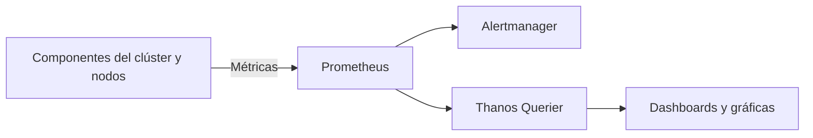
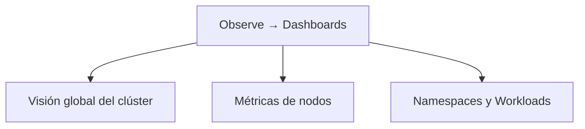
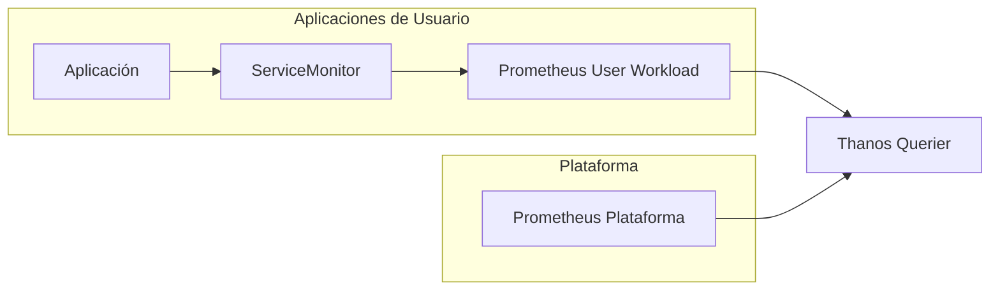

# 3.1 Qué vigila la plataforma por sí sola: métricas y cuadros de mando en la consola, y la monitorización de cargas de usuario

## Objetivos de aprendizaje

Al finalizar este apartado serás capaz de:

- Comprender cómo OpenShift monitoriza de manera nativa los componentes internos de la plataforma y la infraestructura del clúster.
- Identificar las métricas y cuadros de mando disponibles por defecto en la consola web de administración.
- Conocer los componentes del stack de monitorización integrado en OpenShift.
- Diferenciar entre la monitorización de infraestructura y la monitorización de cargas de trabajo de usuario.
- Evaluar qué aporta activar la monitorización de proyectos definidos por el usuario y qué coste operativo e informático conlleva.
- Consultar métricas de rendimiento y consumo de tus propios pods directamente desde la consola web e interpretar correctamente los resultados.

---

## El stack de monitorización nativo en OpenShift

Cualquier plataforma moderna necesita conocer su estado de salud en todo momento.

Para ello, OpenShift incorpora de serie un stack de monitorización completo desplegado y mantenido automáticamente por la propia plataforma.

Este ecosistema se apoya principalmente en:
- **Prometheus**, encargado de recopilar y almacenar métricas.
- **Alertmanager**, responsable de gestionar alertas y notificaciones.
- **Thanos Querier**, que unifica el acceso a diferentes orígenes de métricas.
- **Consola web de OpenShift**, que proporciona visualización mediante dashboards y gráficas.



Gracias a esta arquitectura, OpenShift recopila información constantemente sobre el funcionamiento del clúster sin necesidad de instalar herramientas adicionales.

---

## ¿Qué vigila la plataforma por defecto?

Nada más instalar OpenShift, la monitorización integrada comienza a recopilar información sobre:
- Los nodos del clúster.
- El plano de control de Kubernetes.
- `etcd`.
- Los *routers* de entrada.
- Los operadores de OpenShift.
- El consumo de CPU y memoria.
- El almacenamiento.
- La conectividad de red.

!!! note
    Uno de los objetivos principales de la monitorización integrada es detectar problemas de plataforma antes de que tengan impacto sobre las aplicaciones desplegadas.

---

## Cuadros de mando (*Dashboards*) en la consola web

La consola web incorpora múltiples *dashboards* que permiten visualizar el estado de salud del clúster.

Accediendo a **Observe → Dashboards** encontraremos información desde diferentes perspectivas.



### Métricas a nivel de clúster
Permiten conocer:
- Consumo global de CPU.
- Consumo global de memoria.
- Estado de los operadores.
- Capacidad disponible.
- Rendimiento de `etcd`.

### Métricas a nivel de nodo
Permiten analizar cada servidor individual:
- CPU utilizada.
- Memoria consumida.
- Operaciones de disco.
- Tráfico de red.
- Saturación de recursos.

### Métricas a nivel de proyecto
También es posible consultar métricas asociadas a aplicaciones concretas:
- Consumo de CPU por pod.
- Consumo de memoria por pod.
- Reinicios de contenedores.
- Tráfico de red.
- Estado de los despliegues.

---

## Consultar métricas de tus propios pods en la consola

Hasta ahora hemos visto qué monitoriza OpenShift. La mejor forma de comprenderlo es observar métricas reales de una aplicación desplegada en nuestro proyecto.

### Acceso a las métricas desde la consola
1. Cambia a la perspectiva **Developer**.
2. Selecciona tu proyecto de trabajo.
3. Accede a **Observe → Metrics**.
4. Localiza el cuadro **Custom query**.

### Consultar el consumo de memoria de una aplicación
Podemos visualizar el consumo real de memoria de nuestro contenedor mediante una consulta PromQL:

```promql
container_memory_working_set_bytes{container="demo-formacion"}
```

Alternativamente, para visualizar todos los contenedores activos del proyecto:

```promql
container_memory_working_set_bytes{container!="",container!="POD"}
```

Tras pulsar **Run queries**, OpenShift mostrará una gráfica temporal con el consumo de memoria observado.

### Interpretar el resultado

Al ejecutar la consulta observaremos una serie temporal asociada al contenedor seleccionado.

El valor exacto dependerá del momento de ejecución, de la carga soportada por la aplicación y de su propio comportamiento interno.

Por ejemplo, es perfectamente posible que:
- En una ejecución observemos consumos cercanos a 10 MiB.
- En otro momento observemos valores alrededor de 70 MiB.
- Ambas situaciones sean completamente normales.

Lo importante no es memorizar una cifra concreta, sino interpretar la información que proporciona la gráfica.

#### ¿Qué nos dice realmente una gráfica de memoria?

Al analizar una métrica como:
```promql
container_memory_working_set_bytes
```
debemos fijarnos en:
- Si el consumo es estable o creciente.
- Si aparecen picos inesperados.
- Si la memoria utilizada se aproxima al límite configurado.
- Si el comportamiento cambia cuando aumenta la carga.

Una línea estable suele indicar un comportamiento normal.

Por el contrario, un crecimiento continuo durante largos periodos podría justificar una investigación adicional.

---

### Comparar la métrica con Requests y Limits

La aplicación `demo-formacion-yaml`, desplegada en la Sesión 2, ya incorpora una configuración de recursos.

Recordemos el manifiesto utilizado:

```yaml
resources:
  requests:
    cpu: "100m"
    memory: "128Mi"

  limits:
    cpu: "500m"
    memory: "512Mi"
```

Ahora podemos comparar los valores observados en las métricas con la configuración real de la aplicación.

#### Interpretando los datos obtenidos

El valor mostrado por la gráfica dependerá del momento de ejecución y de la carga de trabajo.

Por ejemplo:
- Si observamos un consumo de 10 MiB, estaremos muy por debajo del *request* configurado.
- Si observamos un consumo de 70 MiB, seguiremos situándonos por debajo de los 128 MiB reservados.
- Incluso valores próximos a 100 MiB seguirían siendo compatibles con la configuración actual.

Lo importante es responder a preguntas como:
- ¿El consumo es estable?
- ¿La aplicación se aproxima al límite de memoria?
- ¿Los *requests* parecen razonables?
- ¿Los *limits* proporcionan margen suficiente?

---

### Relación con la Sesión 2

En la Sesión 2 vimos tres conceptos claramente diferenciados:

| Concepto | Significado |
| :--- | :--- |
| **Request** | Recursos reservados por Kubernetes para planificar el Pod |
| **Limit** | Consumo máximo permitido al contenedor |
| **Consumo real** | Recursos utilizados por la aplicación en cada momento |

La gráfica que estamos observando muestra precisamente el tercer valor: el consumo real.

!!! tip "Idea clave"
    *Requests* y *Limits* son valores configurados en el Deployment.
    
    Las métricas permiten validar si dichos valores son adecuados observando el comportamiento real de la aplicación.

#### Lo importante no es el valor exacto

Un error frecuente es pensar que una aplicación debería consumir siempre la misma memoria.

En realidad:
- Ayer podría estar consumiendo 70 MiB.
- Hoy podría estar consumiendo 10 MiB.
- Ambas situaciones pueden ser perfectamente normales.

Las diferencias pueden deberse a:
- Reinicios recientes del Pod.
- Menor carga de trabajo.
- Diferente número de peticiones.
- Cachés aún vacías.
- Cambios de configuración.
- Diferencias en el momento de observación.

Por este motivo debemos fijarnos más en la tendencia de la gráfica que en una cifra concreta.

!!! note
    Es habitual que una aplicación consuma bastante menos memoria que la reservada mediante *requests*.
    
    Los *requests* no representan el consumo real observado, sino la cantidad de recursos que Kubernetes reserva para garantizar que el Pod pueda ejecutarse correctamente.

---

### Error habitual relacionado con namespaces

En la perspectiva **Developer**, OpenShift añade automáticamente el namespace activo a las consultas. 

Si se incluye manualmente un filtro de namespace, puede aparecer un error como:
```text
conflicting label matcher:
label matcher "namespace=..."
conflicts with injected matcher "namespace=..."
```
En ese caso basta con eliminar el filtro de namespace de la consulta.

---

## Monitorización de cargas de usuario (*User-Workload Monitoring*)

Hasta ahora hemos hablado exclusivamente de la monitorización de la propia plataforma.

Sin embargo, muchas aplicaciones también exponen métricas de negocio y funcionamiento, por ejemplo:
- Número de peticiones HTTP.
- Tiempo de respuesta.
- Transacciones procesadas.
- Errores de aplicación.
- Mensajes en cola.

Por defecto, OpenShift no recopila estas métricas de usuario.

Para ello existe la funcionalidad denominada **User-Workload Monitoring**.



### Qué aporta activarla

Permite:
- Monitorizar métricas específicas de negocio.
- Obtener mayor visibilidad de las aplicaciones.
- Construir *dashboards* personalizados.
- Crear alertas propias.
- Unificar métricas de plataforma y aplicación.

### Un ejemplo práctico

Imaginemos una API corporativa.
- **Sin User-Workload Monitoring:** OpenShift sabe cuánta CPU consume y cuánta memoria utiliza, pero no sabe cuántas peticiones procesa.
- **Con User-Workload Monitoring:** OpenShift conoce también las métricas funcionales de la aplicación, permitiendo a los equipos construir cuadros de mando orientados al negocio.

---

### ¿Qué cuesta activarla?

La monitorización avanzada aporta mucho valor, pero también tiene un coste.

#### 1. Componentes adicionales
Será necesario desplegar componentes encargados de:
- Recopilar métricas de usuario.
- Evaluar reglas personalizadas.
- Almacenar más información histórica.

#### 2. Consumo de CPU y memoria
Cuantas más métricas recopilemos:
- Más CPU utilizará Prometheus.
- Más memoria requerirá la plataforma.
- Más trabajo deberá realizar el sistema de monitorización.

#### 3. Necesidad de almacenamiento persistente
Las métricas deben guardarse durante un periodo determinado, lo que implica:
- Más almacenamiento.
- Más crecimiento de los volúmenes persistentes.
- Mayor planificación de capacidad.

!!! warning "Planificación de capacidad"
    *User-Workload Monitoring* aporta mucho valor, pero conviene evaluar previamente el impacto que tendrá sobre CPU, memoria y almacenamiento del clúster.

---

### ¿Cuándo merece la pena activarlo?

Como criterio general:

| Escenario | Recomendación |
| :--- | :--- |
| Clúster pequeño de aprendizaje | Normalmente no es necesario |
| Aplicaciones corporativas críticas | Muy recomendable |
| Observabilidad avanzada | Recomendable |
| Alertas funcionales de negocio | Imprescindible |
| Equipos que solo necesitan CPU y memoria | Puede no compensar |

---

## Ideas clave para recordar

!!! tip "Resumen"
    - OpenShift incorpora un stack completo de monitorización basado en Prometheus, Alertmanager y Thanos.
    - La plataforma monitoriza automáticamente nodos, operadores y componentes críticos del clúster.
    - La consola web proporciona *dashboards* integrados para visualizar el estado de salud del entorno.
    - Observar métricas reales permite validar si *requests* y *limits* están correctamente dimensionados.
    - El valor exacto de una métrica puede variar significativamente según el momento y la carga de trabajo.
    - Lo importante es interpretar tendencias y relacionarlas con la configuración de recursos.
    - *User-Workload Monitoring* permite monitorizar métricas específicas de las aplicaciones.
    - Esta funcionalidad aporta gran visibilidad, pero también consume CPU, memoria y almacenamiento.
    - Antes de activarla conviene evaluar el valor que aporta frente al coste operativo que introduce.