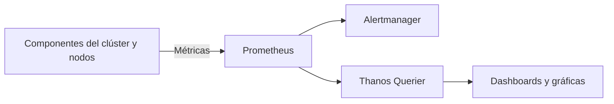
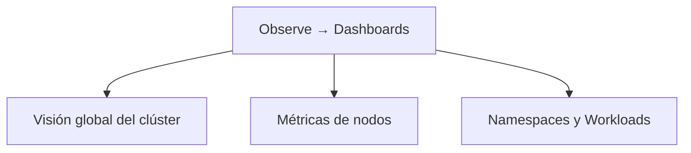
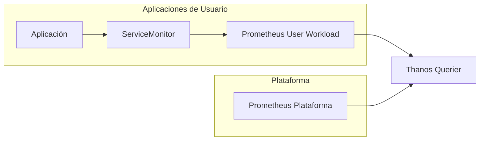

# 3.1 Qué vigila la plataforma por sí sola: métricas y cuadros de mando en la consola, y la monitorización de cargas de usuario[cite: 1]

## Objetivos de aprendizaje[cite: 1]

Al finalizar este apartado serás capaz de:[cite: 1]

- Comprender cómo OpenShift monitoriza de manera nativa los componentes internos de la plataforma y la infraestructura del clúster[cite: 1].
- Identificar las métricas y cuadros de mando disponibles por defecto en la consola web de administración[cite: 1].
- Conocer los componentes del stack de monitorización integrado en OpenShift[cite: 1].
- Diferenciar entre la monitorización de infraestructura y la monitorización de cargas de trabajo de usuario[cite: 1].
- Evaluar qué aporta activar la monitorización de proyectos definidos por el usuario y qué coste operativo e informático conlleva[cite: 1].
- Consultar métricas de rendimiento y consumo de tus propios pods directamente desde la consola web e interpretar correctamente los resultados[cite: 1].

---

## El stack de monitorización nativo en OpenShift[cite: 1]

Cualquier plataforma moderna necesita conocer su estado de salud en todo momento[cite: 1].

Para ello, OpenShift incorpora de serie un stack de monitorización completo desplegado y mantenido automáticamente por la propia plataforma[cite: 1].

Este ecosistema se apoya principalmente en:[cite: 1]
- **Prometheus**, encargado de recopilar y almacenar métricas[cite: 1].
- **Alertmanager**, responsable de gestionar alertas y notificaciones[cite: 1].
- **Thanos Querier**, que unifica el acceso a diferentes orígenes de métricas[cite: 1].
- **Consola web de OpenShift**, que proporciona visualización mediante dashboards y gráficas[cite: 1].



Gracias a esta arquitectura, OpenShift recopila información constantemente sobre el funcionamiento del clúster sin necesidad de instalar herramientas adicionales[cite: 1].

---

## ¿Qué vigila la plataforma por defecto?[cite: 1]

Nada más instalar OpenShift, la monitorización integrada comienza a recopilar información sobre:[cite: 1]
- Los nodos del clúster[cite: 1].
- El plano de control de Kubernetes[cite: 1].
- `etcd`[cite: 1].
- Los *routers* de entrada[cite: 1].
- Los operadores de OpenShift[cite: 1].
- El consumo de CPU y memoria[cite: 1].
- El almacenamiento[cite: 1].
- La conectividad de red[cite: 1].

> [!NOTE]
> Uno de los objetivos principales de la monitorización integrada es detectar problemas de plataforma antes de que tengan impacto sobre las aplicaciones desplegadas[cite: 1].

---

## Cuadros de mando (*Dashboards*) en la consola web[cite: 1]

La consola web incorpora múltiples *dashboards* que permiten visualizar el estado de salud del clúster[cite: 1].

Accediendo a **Observe → Dashboards** encontraremos información desde diferentes perspectivas[cite: 1].



### Métricas a nivel de clúster[cite: 1]
Permiten conocer:[cite: 1]
- Consumo global de CPU[cite: 1].
- Consumo global de memoria[cite: 1].
- Estado de los operadores[cite: 1].
- Capacidad disponible[cite: 1].
- Rendimiento de `etcd`[cite: 1].

### Métricas a nivel de nodo[cite: 1]
Permiten analizar cada servidor individual:[cite: 1]
- CPU utilizada[cite: 1].
- Memoria consumida[cite: 1].
- Operaciones de disco[cite: 1].
- Tráfico de red[cite: 1].
- Saturación de recursos[cite: 1].

### Métricas a nivel de proyecto[cite: 1]
También es posible consultar métricas asociadas a aplicaciones concretas:[cite: 1]
- Consumo de CPU por pod[cite: 1].
- Consumo de memoria por pod[cite: 1].
- Reinicios de contenedores[cite: 1].
- Tráfico de red[cite: 1].
- Estado de los despliegues[cite: 1].

---

## Consultar métricas de tus propios pods en la consola[cite: 1]

Hasta ahora hemos visto qué monitoriza OpenShift[cite: 1]. La mejor forma de comprenderlo es observar métricas reales de una aplicación desplegada en nuestro proyecto[cite: 1].

### Acceso a las métricas desde la consola[cite: 1]
1. Cambia a la perspectiva **Developer**[cite: 1].
2. Selecciona tu proyecto de trabajo[cite: 1].
3. Accede a **Observe → Metrics**[cite: 1].
4. Localiza el cuadro **Custom query**[cite: 1].

### Consultar el consumo de memoria de una aplicación[cite: 1]
Podemos visualizar el consumo real de memoria de nuestro contenedor mediante una consulta PromQL:[cite: 1]

```promql
container_memory_working_set_bytes{container="demo-formacion"}
```

Alternativamente, para visualizar todos los contenedores activos del proyecto:[cite: 1]

```promql
container_memory_working_set_bytes{container!="",container!="POD"}
```

Tras pulsar **Run queries**, OpenShift mostrará una gráfica temporal con el consumo de memoria observado[cite: 1].

### Interpretar el resultado[cite: 1]

Al ejecutar la consulta observaremos una serie temporal asociada al contenedor seleccionado[cite: 1].

El valor exacto dependerá del momento de ejecución, de la carga soportada por la aplicación y de su propio comportamiento interno[cite: 1].

Por ejemplo, es perfectamente posible que:[cite: 1]
- En una ejecución observemos consumos cercanos a 10 MiB[cite: 1].
- En otro momento observemos valores alrededor de 70 MiB[cite: 1].
- Ambas situaciones sean completamente normales[cite: 1].

Lo importante no es memorizar una cifra concreta, sino interpretar la información que proporciona la gráfica[cite: 1].

#### ¿Qué nos dice realmente una gráfica de memoria?[cite: 1]

Al analizar una métrica como:[cite: 1]
```promql
container_memory_working_set_bytes
```
debemos fijarnos en:[cite: 1]
- Si el consumo es estable o creciente[cite: 1].
- Si aparecen picos inesperados[cite: 1].
- Si la memoria utilizada se aproxima al límite configurado[cite: 1].
- Si el comportamiento cambia cuando aumenta la carga[cite: 1].

Una línea estable suele indicar un comportamiento normal[cite: 1].

Por el contrario, un crecimiento continuo durante largos periodos podría justificar una investigación adicional[cite: 1].

---

### Comparar la métrica con Requests y Limits[cite: 1]

La aplicación `demo-formacion-yaml`, desplegada en la Sesión 2, ya incorpora una configuración de recursos[cite: 1].

Recordemos el manifiesto utilizado:[cite: 1]

```yaml
resources:
  requests:
    cpu: "100m"
    memory: "128Mi"

  limits:
    cpu: "500m"
    memory: "512Mi"
```

Ahora podemos comparar los valores observados en las métricas con la configuración real de la aplicación[cite: 1].

#### Interpretando los datos obtenidos[cite: 1]

El valor mostrado por la gráfica dependerá del momento de ejecución y de la carga de trabajo[cite: 1].

Por ejemplo:[cite: 1]
- Si observamos un consumo de 10 MiB, estaremos muy por debajo del *request* configurado[cite: 1].
- Si observamos un consumo de 70 MiB, seguiremos situándonos por debajo de los 128 MiB reservados[cite: 1].
- Incluso valores próximos a 100 MiB seguirían siendo compatibles con la configuración actual[cite: 1].

Lo importante es responder a preguntas como:[cite: 1]
- ¿El consumo es estable?[cite: 1]
- ¿La aplicación se aproxima al límite de memoria?[cite: 1]
- ¿Los *requests* parecen razonables?[cite: 1]
- ¿Los *limits* proporcionan margen suficiente?[cite: 1]

---

### Relación con la Sesión 2[cite: 1]

En la Sesión 2 vimos tres conceptos claramente diferenciados:[cite: 1]

| Concepto | Significado |
| :--- | :--- |
| **Request** | Recursos reservados por Kubernetes para planificar el Pod[cite: 1] |
| **Limit** | Consumo máximo permitido al contenedor[cite: 1] |
| **Consumo real** | Recursos utilizados por la aplicación en cada momento[cite: 1] |

La gráfica que estamos observando muestra precisamente el tercer valor: el consumo real[cite: 1].

> [!TIP] Idea clave
> *Requests* y *Limits* son valores configurados en el Deployment[cite: 1].
> 
> Las métricas permiten validar si dichos valores son adecuados observando el comportamiento real de la aplicación[cite: 1].

#### Lo importante no es el valor exacto[cite: 1]

Un error frecuente es pensar que una aplicación debería consumir siempre la misma memoria[cite: 1].

En realidad:[cite: 1]
- Ayer podría estar consumiendo 70 MiB[cite: 1].
- Hoy podría estar consumiendo 10 MiB[cite: 1].
- Ambas situaciones pueden ser perfectamente normales[cite: 1].

Las diferencias pueden deberse a:[cite: 1]
- Reinicios recientes del Pod[cite: 1].
- Menor carga de trabajo[cite: 1].
- Diferente número de peticiones[cite: 1].
- Cachés aún vacías[cite: 1].
- Cambios de configuración[cite: 1].
- Diferencias en el momento de observación[cite: 1].

Por este motivo debemos fijarnos más en la tendencia de la gráfica que en una cifra concreta[cite: 1].

> [!NOTE] Requests y consumo real
> Es habitual que una aplicación consuma bastante menos memoria que la reservada mediante *requests*[cite: 1].
> 
> Los *requests* no representan el consumo real observado, sino la cantidad de recursos que Kubernetes reserva para garantizar que el Pod pueda ejecutarse correctamente[cite: 1].

---

### Error habitual relacionado con namespaces[cite: 1]

En la perspectiva **Developer**, OpenShift añade automáticamente el namespace activo a las consultas[cite: 1]. 

Si se incluye manualmente un filtro de namespace, puede aparecer un error como:[cite: 1]
```text
conflicting label matcher:
label matcher "namespace=..."
conflicts with injected matcher "namespace=..."
```
En ese caso basta con eliminar el filtro de namespace de la consulta[cite: 1].

---

## Monitorización de cargas de usuario (*User-Workload Monitoring*)[cite: 1]

Hasta ahora hemos hablado exclusivamente de la monitorización de la propia plataforma[cite: 1].

Sin embargo, muchas aplicaciones también exponen métricas de negocio y funcionamiento, por ejemplo:[cite: 1]
- Número de peticiones HTTP[cite: 1].
- Tiempo de respuesta[cite: 1].
- Transacciones procesadas[cite: 1].
- Errores de aplicación[cite: 1].
- Mensajes en cola[cite: 1].

Por defecto, OpenShift no recopila estas métricas de usuario[cite: 1].

Para ello existe la funcionalidad denominada **User-Workload Monitoring**[cite: 1].



### Qué aporta activarla[cite: 1]

Permite:[cite: 1]
- Monitorizar métricas específicas de negocio[cite: 1].
- Obtener mayor visibilidad de las aplicaciones[cite: 1].
- Construir *dashboards* personalizados[cite: 1].
- Crear alertas propias[cite: 1].
- Unificar métricas de plataforma y aplicación[cite: 1].

### Un ejemplo práctico[cite: 1]

Imaginemos una API corporativa[cite: 1].
- **Sin User-Workload Monitoring:** OpenShift sabe cuánta CPU consume y cuánta memoria utiliza, pero no sabe cuántas peticiones procesa[cite: 1].
- **Con User-Workload Monitoring:** OpenShift conoce también las métricas funcionales de la aplicación, permitiendo a los equipos construir cuadros de mando orientados al negocio[cite: 1].

---

### ¿Qué cuesta activarla?[cite: 1]

La monitorización avanzada aporta mucho valor, pero también tiene un coste[cite: 1].

#### 1. Componentes adicionales[cite: 1]
Será necesario desplegar componentes encargados de:[cite: 1]
- Recopilar métricas de usuario[cite: 1].
- Evaluar reglas personalizadas[cite: 1].
- Almacenar más información histórica[cite: 1].

#### 2. Consumo de CPU y memoria[cite: 1]
Cuantas más métricas recopilemos:[cite: 1]
- Más CPU utilizará Prometheus[cite: 1].
- Más memoria requerirá la plataforma[cite: 1].
- Más trabajo deberá realizar el sistema de monitorización[cite: 1].

#### 3. Necesidad de almacenamiento persistente[cite: 1]
Las métricas deben guardarse durante un periodo determinado, lo que implica:[cite: 1]
- Más almacenamiento[cite: 1].
- Más crecimiento de los volúmenes persistentes[cite: 1].
- Mayor planificación de capacidad[cite: 1].

> [!WARNING] Planificación de capacidad
> *User-Workload Monitoring* aporta mucho valor, pero conviene evaluar previamente el impacto que tendrá sobre CPU, memoria y almacenamiento del clúster[cite: 1].

---

### ¿Cuándo merece la pena activarlo?[cite: 1]

Como criterio general:[cite: 1]

| Escenario | Recomendación |
| :--- | :--- |
| Clúster pequeño de aprendizaje | Normalmente no es necesario[cite: 1] |
| Aplicaciones corporativas críticas | Muy recomendable[cite: 1] |
| Observabilidad avanzada | Recomendable[cite: 1] |
| Alertas funcionales de negocio | Imprescindible[cite: 1] |
| Equipos que solo necesitan CPU y memoria | Puede no compensar[cite: 1] |

---

## Ideas clave para recordar[cite: 1]

> [!TIP] Resumen
> - OpenShift incorpora un stack completo de monitorización basado en Prometheus, Alertmanager y Thanos[cite: 1].
> - La plataforma monitoriza automáticamente nodos, operadores y componentes críticos del clúster[cite: 1].
> - La consola web proporciona *dashboards* integrados para visualizar el estado de salud del entorno[cite: 1].
> - Observar métricas reales permite validar si *requests* y *limits* están correctamente dimensionados[cite: 1].
> - El valor exacto de una métrica puede variar significativamente según el momento y la carga de trabajo[cite: 1].
> - Lo importante es interpretar tendencias y relacionarlas con la configuración de recursos[cite: 1].
> - *User-Workload Monitoring* permite monitorizar métricas específicas de las aplicaciones[cite: 1].
> - Esta funcionalidad aporta gran visibilidad, pero también consume CPU, memoria y almacenamiento[cite: 1].
> - Antes de activarla conviene evaluar el valor que aporta frente al coste operativo que introduce[cite: 1].