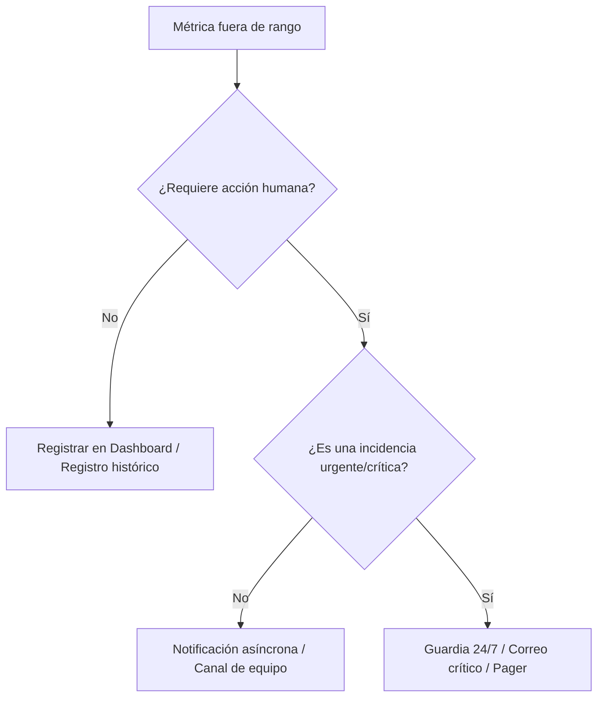
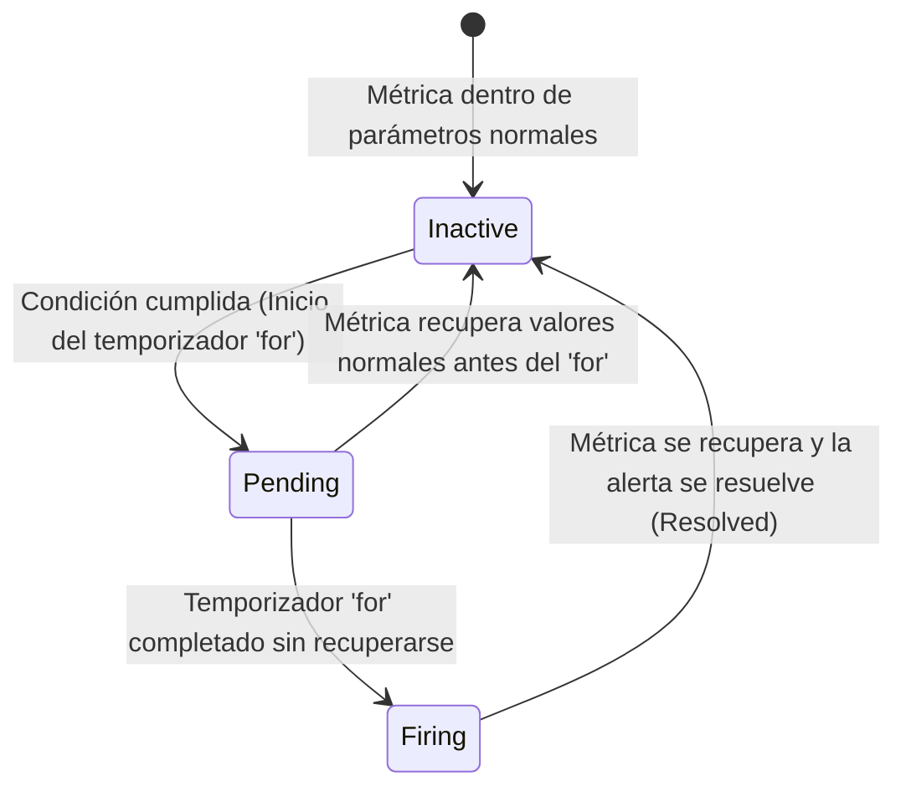
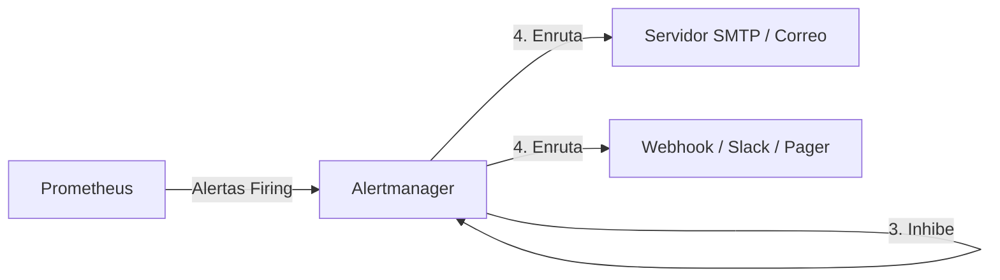
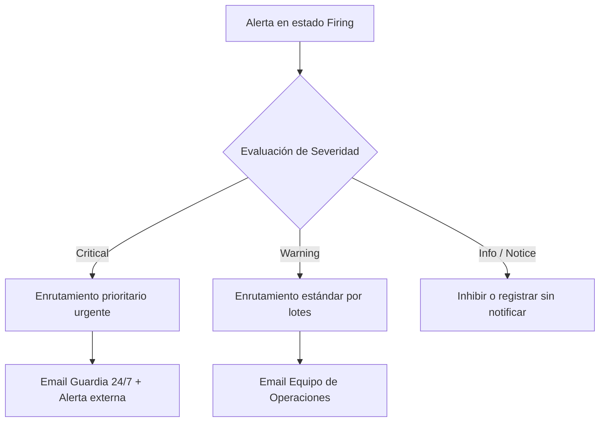

# 3.2 Alertas: `pending` frente a `firing`, silences, y la alerta que sale del clúster por correo. El gobierno de quién recibe qué: una alerta que no le llega a nadie no existe, y el exceso de avisos equivale a no tener ninguno

## Objetivos de aprendizaje

Al finalizar este apartado serás capaz de:

- Comprender la diferencia conceptual y operativa entre los estados `pending` (pendiente) y `firing` (disparada) en las reglas de alerta de Prometheus.
- Entender el papel central de **Alertmanager** en la deduplicación, agrupación, inhibición y enrutamiento de eventos en OpenShift.
- Configurar y gestionar silenciamientos (*silences*) temporales para ventanas de mantenimiento programado sin apagar las reglas globales.
- Diseñar la integración con servidores de correo electrónico (SMTP) para enviar notificaciones fuera del clúster.
- Aplicar un gobierno de notificaciones riguroso que evite tanto el abandono de avisos como la fatiga de alertas (*alert fatigue*).

---

## 1. La filosofía del alertado corporativo

En la gestión de plataformas de contenedores corporativas como OpenShift, existe una máxima operativa fundamental: **una alerta que no le llega a nadie no existe, y el exceso de avisos equivale a no tener ninguno**.

Si un sistema envía correos electrónicos constantes por incidencias menores que no requieren intervención humana directa, los operadores terminarán creando filtros en sus bandejas de entrada para ignorar los avisos. Por el contrario, si una alerta crítica falla en su enrutamiento y nadie recibe la notificación, la caída del servicio se descubrirá tarde, únicamente cuando los usuarios finales reporten la incidencia.

El propósito de un sistema de monitorización no es notificar cada variación menor del clúster, sino **avisar a la persona adecuada, en el momento preciso, con la información necesaria para tomar una acción**.



---

## 2. El ciclo de vida de una alerta: `pending` frente a `firing`

Las alertas en OpenShift son evaluadas de forma continua por Prometheus mediante expresiones PromQL. Para evitar falsos positivos provocados por picos puntuales de carga, micro-cortes de red o fluctuaciones transitorias, las alertas pasan por un ciclo de vida con estados claramente definidos.



### Los estados del ciclo de vida

1. **`Inactive` (Inactiva):** La condición de la regla de alerta no se cumple. El clúster y las aplicaciones operan dentro de los márgenes previstos.
2. **`Pending` (Pendiente):** La condición de anomalía se ha detectado, pero **todavía no ha transcurrido el período de gracia** configurado en el parámetro `for` de la regla.
   - *Ejemplo práctico:* Si una regla especifica `for: 5m` y el uso de CPU supera el 90%, la alerta entra en estado `pending`. Si el consumo desciende al 70% a los 3 minutos, la alerta regresa a `inactive` de forma silenciosa sin generar ninguna interrupción a los equipos.
3. **`Firing` (Disparada):** La condición anómala se ha mantenido ininterrumpidamente durante todo el tiempo establecido en `for`. En este punto, Prometheus confirma el problema y transmite el evento a **Alertmanager** para proceder con su agrupación y enrutamiento.

---

## 3. Alertmanager: Agrupación, inhibición y deduplicación

Cuando Prometheus emite una alerta en estado `firing`, esta es recibida por **Alertmanager**. Este componente actúa como un intermediario inteligente encargado de procesar el flujo de notificaciones para proteger a los operadores de una avalancha de avisos inconexos:

- **Deduplicación:** Si múltiples instancias de Prometheus o evaluaciones concurrentes generan el mismo aviso, Alertmanager consolida los eventos idénticos en uno solo.
- **Agrupación (*Grouping*):** Agrupa alertas que comparten características comunes (como el mismo espacio de nombres o tipo de servicio) en una única notificación consolidada. Si un nodo físico falla y provoca la caída simultánea de 40 pods, Alertmanager envía un único mensaje informando del fallo principal en lugar de 40 correos separados.
- **Inhibición (*Inhibition*):** Permite reprimir de forma automática alertas secundarias cuando un problema principal de mayor gravedad ya se encuentra activo. Si un clúster pierde conectividad global con el almacenamiento compartido, se inhiben las alertas de fallo de I/O de los pods individuales para no saturar las comunicaciones.



---

## 4. Gestión de Silencios (`Silences`)

Durante operaciones de mantenimiento planificado, actualizaciones de la plataforma o intervenciones guiadas en los despliegues, es habitual que se generen alertas conocidas que no aportan valor operativo en ese preciso instante. Para evitar apagar o alterar las reglas globales de monitorización, Alertmanager permite la creación de **silenciamientos** (*Silences*).

Un silencio es un mecanismo temporal que instruye a Alertmanager para descartar la emisión de notificaciones cuando las etiquetas de una alerta coinciden con un patrón definido.

### Parámetros de un silencio

- **Coincidencias (*Matchers*):** Pares clave-valor estrictos o basados en expresiones regulares (por ejemplo, `alertname="KubeNodeNotReady"` y `node="worker-02.internal"`).
- **Ventana temporal:** Marca exacta de inicio y fin de la vigencia del silencio.
- **Auditoría:** Autor responsable y motivo documentado de la intervención.

!!! warning "Uso responsable de los silencios"
    Un silencio es una herramienta quirúrgica y temporal. Olvidar un silencio activo de larga duración puede enmascarar caídas reales de los servicios en producción, dejando al equipo de operaciones sin visibilidad ante incidencias críticas.

---

## 5. La alerta que sale del clúster por correo electrónico

Para que una alerta crítica abandone el perímetro del clúster y llegue al personal de guardia, Alertmanager debe configurarse con un mecanismo de transporte externo mediante un servidor SMTP corporativo (*SMTP relay*).

En OpenShift, esta configuración se administra a través del recurso personalizado de Alertmanager o el objeto de configuración global correspondiente en el espacio de nombres de monitorización.

### Manifiesto YAML de ejemplo para Alertmanager

```yaml
global:
  resolve_timeout: 5m
  smtp_smarthost: 'smtp.corporativo.local:25'
  smtp_from: 'alertmanager@openshift.corporativo.local'
  smtp_require_tls: false

route:
  group_by: ['alertname', 'namespace', 'severity']
  group_wait: 30s
  group_interval: 5m
  repeat_interval: 4h
  receiver: 'default-operations-receiver'
  routes:
    - match:
        severity: critical
      receiver: 'critical-oncall-email'
    - match:
        severity: warning
      receiver: 'standard-ops-email'

receivers:
  - name: 'default-operations-receiver'

  - name: 'critical-oncall-email'
    email_configs:
      - to: 'guardia-sistemas@corporativo.local'
        send_resolved: true

  - name: 'standard-ops-email'
    email_configs:
      - to: 'operaciones-paas@corporativo.local'
        send_resolved: true
```

### Parámetros clave de la ruta

- **`group_wait`:** Tiempo inicial de espera tras recibir la primera alerta de un grupo para recopilar posibles eventos afines antes de disparar el primer aviso (ej. `30s`).
- **`group_interval`:** Intervalo de tiempo entre notificaciones sucesivas de un grupo de alertas que continúa activo (ej. `5m`).
- **`repeat_interval`:** Tiempo que debe transcurrir para volver a enviar un aviso si la alerta persiste sin cambios en estado `firing` (ej. `4h`).
- **`send_resolved`:** Habilita el envío de un correo de confirmación cuando el problema se soluciona y la alerta regresa a estado `inactive`.

---

## 6. El gobierno de quién recibe qué

Una matriz de distribución de alertas mal diseñada provoca fallos de coordinación graves. Para garantizar un gobierno de notificaciones eficaz, se establece una clasificación estricta basada en el impacto:

| Nivel de Severidad | Criterio de Impacto Operativo | Canal de Destino | Destinatario Asignado |
| :--- | :--- | :--- | :--- |
| **Critical** | Interrupción total del servicio, pérdida potencial de datos, fallo crítico de nodo. | Correo prioritario, pasarela de llamadas, PagerDuty. | Equipo de guardia 24/7. |
| **Warning** | Degradación parcial, consumo elevado de recursos (ej. almacenamiento al 85%). | Correo electrónico estándar, canal de incidencias. | Equipo de operaciones en horario laboral. |
| **Info / Notice** | Eventos informativos, despliegues finalizados, cambios rutinarios de estado. | Sin alerta activa (consulta en consola). | Visibilidad pasiva en Dashboards. |



!!! tip "Prevención de la fatiga de alertas"
    Si una alerta de nivel `Warning` se dispara de forma continuada sin requerir ninguna intervención humana real, el umbral está mal calibrado o el aviso carece de utilidad. Toda alerta enviada debe exigir una acción o una investigación directa para evitar la insensibilización de los equipos.

---

## 7. Verificación y gestión práctica en OpenShift

### Consultar alertas activas desde la consola web

1. Accede a la consola web de OpenShift con permisos adecuados.
2. Dirígete a **Observe → Alerting** en el menú de administración.
3. Filtra por los estados **Pending** o **Firing** para revisar el inventario actual de incidencias.
4. Selecciona cualquier alerta para inspeccionar sus etiquetas, la expresión PromQL evaluada y las descripciones asociadas.

También es posible listar las alertas activas desde la terminal mediante el cliente CLI de OpenShift:

```bash
# Consultar las alertas activas en el espacio de nombres de monitorización
oc get alerts -n openshift-monitoring
```

### Creación de un silencio temporal

1. En la consola web, dentro de **Observe → Alerting**, accede a la pestaña **Silences**.
2. Haz clic en **Create Silence**.
3. Define los campos requeridos:
   - **Start time / End time:** Margen horario de la ventana de mantenimiento.
   - **Matchers:** Clave y valor que identifican la alerta (ejemplo: `alertname="KubeNodeNotReady"`).
   - **Creator y Comment:** Identificación del operador y descripción del motivo del mantenimiento.
4. Confirma la creación para aplicar el filtro de manera inmediata en Alertmanager.

---

## Ideas clave para recordar

!!! tip "Resumen"
    - Las alertas transitan desde **`Inactive`** hacia **`Pending`** (durante el período de gracia `for`) antes de alcanzar el estado definitivo **`Firing`**.
    - **Alertmanager** procesa las alertas aplicando deduplicación, agrupación e inhibición para evitar la saturación de los operadores.
    - Los **Silencios** permiten enmascarar avisos conocidos durante ventanas de mantenimiento programadas sin desactivar las reglas generales del clúster.
    - La integración con servidores **SMTP** permite direccionar correos electrónicos estructurados según la severidad y el ámbito del recurso afectado.
    - **Una alerta que no llega a nadie no existe, y el exceso de avisos equivale a no tener ninguno**: el diseño de notificaciones debe ser riguroso y estar orientado estrictamente a la acción humana.