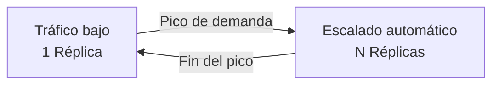
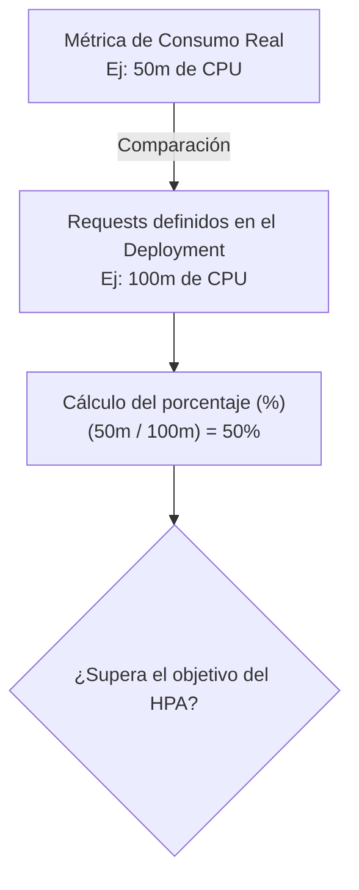
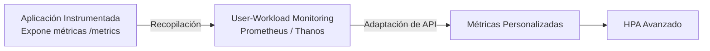

# 3.2 Autoescalado basado en métricas: del HPA estándar por CPU/Memoria al escalado por métricas de aplicación

## Objetivos de aprendizaje

Al finalizar este apartado serás capaz de:

- Comprender el concepto de autoescalado horizontal (*Horizontal Pod Autoscaler* o HPA) en OpenShift y su propósito operativo.
- Relacionar la monitorización de plataforma vista en el apartado 3.1 con la capacidad de respuesta automática del clúster.
- Entender cómo el controlador HPA consulta las métricas de recursos disponibles en la plataforma para evaluar el consumo de las cargas de trabajo.
- Comprender la relación directa entre una correcta definición de *requests* (estudiada en la Sesión 2) y el funcionamiento del autoescalado basado en porcentajes de utilización.
- Conocer los tiempos de reacción, las ventanas de estabilización y el comportamiento del clúster tanto en el proceso de escalado hacia afuera (*scale-out*) como en el de reducción (*scale-in*).
- Configurar, desplegar y probar un HPA estándar mediante la línea de comandos sobre la aplicación de demostración de la Sesión 2 (`demo-formacion-yaml`).
- Interpretar paso a paso qué ocurre en el sistema durante cada fase de la prueba de carga.

---

## ¿Qué es el autoescalado horizontal (HPA)?

En el apartado anterior (3.1) analizamos cómo la plataforma vigila de manera constante el estado de salud de los nodos, componentes y cargas de trabajo a través del stack de monitorización integrado. Sin embargo, saber que un componente está consumiendo más recursos o que la demanda aumenta es solo la mitad del camino; el siguiente paso lógico es reaccionar de forma automática.

Hasta ahora hemos aprendido a escalar aplicaciones de forma manual modificando el número de réplicas en nuestro Deployment o ejecutando órdenes como `oc scale`. Sin embargo, en entornos corporativos reales, la demanda de los usuarios fluctúa de manera imprevisible a lo largo del día:



Para evitar que los administradores tengan que intervenir manualmente ante cada fluctuación de tráfico, Kubernetes y OpenShift proporcionan el recurso **Horizontal Pod Autoscaler (HPA)**.

El HPA supervisa de forma continua el rendimiento de las cargas de trabajo y ajusta automáticamente el número de réplicas (*pods*) dentro de un rango predefinido:

- **Mínimo de réplicas:** Garantiza la disponibilidad base del servicio (por ejemplo, 1 o 2 réplicas).
- **Máximo de réplicas:** Establece un límite superior para evitar consumos descontrolados de infraestructura durante picos extremos de tráfico.

---

## El requisito indispensable: la importancia de los *requests*

En la Sesión 2 estudiamos en detalle la diferencia entre *requests* y *limits*. En el HPA que vamos a utilizar, basado en el porcentaje de utilización de CPU, **es fundamental que la aplicación tenga definido correctamente su *request* de CPU**.



### ¿Por qué ocurre esto?

En esta modalidad, el HPA no calcula el uso de CPU únicamente en términos absolutos, como milicores consumidos, sino como **porcentaje respecto a los recursos solicitados mediante los *requests***.

- Si un contenedor consume `50m` (milicores) de CPU y su *request* está configurado en `100m`, el HPA interpretará que está al **50% de utilización**.
- Si el contenedor consume exactamente los mismos `50m`, pero no tiene definido un *request* de CPU, el HPA no podrá calcular ese porcentaje de utilización para el contenedor y no podrá aplicar correctamente el criterio configurado en esta práctica.

!!! tip "Idea clave"
    El autoescalado por porcentaje de utilización de CPU se apoya en los *requests* configurados en el Deployment. Unos *requests* mal dimensionados pueden provocar que el HPA escale antes de tiempo, demasiado tarde o que no pueda calcular correctamente la utilización.

---

## Desplegar y probar el HPA estándar: Ciclo de vida y tiempos de reacción

Partiendo de nuestra aplicación de la Sesión 2 (`demo-formacion-yaml`), vamos a poner en marcha el autoescalado y a analizar paso a paso **qué ocurre exactamente en cada momento** para entender los tiempos de respuesta del clúster.

### 1. Creación del HPA con `oc autoscale`

Ejecutamos el siguiente comando para vincular el recurso de autoescalado al Deployment, fijando temporalmente un objetivo del **10%** de consumo de CPU para facilitar la prueba didáctica:

```bash
oc autoscale deployment/demo-formacion-yaml --min=1 --max=3 --cpu-percent=10
```

### 2. Monitorización en tiempo real

Para observar el comportamiento del autoescalador segundo a segundo, abrimos una terminal conectada al clúster y ejecutamos:

```bash
oc get hpa demo-formacion-yaml -w
```

### 3. Simulación de carga local mediante PowerShell

Dado que trabajamos en entornos de tipo Sandbox con una única terminal web, generaremos el tráfico concurrente necesario desde un script de PowerShell en nuestra máquina local utilizando trabajos en segundo plano (`Start-Job`).

Copia y pega este bloque en tu PowerShell local:

```powershell
$url = "[http://demo-formacion-yaml-angel-cuaresma-alons-dev.apps.rm3.7wse.p1.openshiftapps.com](http://demo-formacion-yaml-angel-cuaresma-alons-dev.apps.rm3.7wse.p1.openshiftapps.com)"

Write-Host "Lanzando peticiones en paralelo... Pulsa ENTER para detener la carga."

$jobs = for ($j=1; $j -le 25; $j++) {
    Start-Job -ScriptBlock {
        param($u)
        while ($true) {
            try {
                Invoke-WebRequest -Uri $u -UseBasicParsing -TimeoutSec 1 -ErrorAction Stop | Out-Null
            } catch {}
        }
    } -ArgumentList $url
}

Read-Host

Write-Host "Deteniendo la carga..."
Stop-Job *
Remove-Job *
```

---

## Análisis detallado: ¿Qué está pasando en cada fase?

Para comprender a fondo la operación de OpenShift, es fundamental desglosar la línea temporal de lo que ocurre desde que lanzamos el tráfico hasta que la aplicación vuelve a su estado inicial:

### Fase 1: Reposo (0 réplicas adicionales)

- **Estado inicial:** El HPA muestra un consumo bajo (por ejemplo, `1% / 10%`) y el número de réplicas se mantiene en el mínimo (`1`). La aplicación está inactiva o con tráfico mínimo de fondo.

### Fase 2: Inicio del bombardeo de peticiones (*Scale-Out*)

- **Acción:** Al ejecutar el bucle en PowerShell, 25 trabajos en segundo plano generan peticiones concurrentes contra la URL del servicio.
- **Reacción del clúster:** El HPA consulta las métricas de recursos disponibles en la plataforma y detecta el aumento del consumo de CPU del contenedor. Vemos en el monitor (`oc get hpa -w`) cómo los valores ascienden rápidamente (por ejemplo, pasando del 2% al **13% / 10%**).
- **El factor tiempo en el escalado:** OpenShift no reacciona de forma instantánea al primer pico para evitar decisiones precipitadas ante fluctuaciones muy breves. El controlador HPA evalúa periódicamente las métricas y ajusta el número de réplicas cuando detecta que la utilización se aleja del objetivo configurado.
- **Resultado:** Las réplicas aumentan de `1` a `2` (o directamente a `3` si la saturación es máxima). Al aumentar las réplicas, la carga de trabajo se reparte entre los nuevos pods, haciendo que el porcentaje de CPU por pod vuelva a descender hacia el umbral configurado.

### Fase 3: Detención de la carga y período de estabilización (*Scale-In*)

- **Acción:** Pulsamos **ENTER** en nuestra consola de PowerShell. El script se detiene, los trabajos en segundo plano finalizan y cesa por completo el tráfico hacia la aplicación.
- **¿Qué ocurre en el HPA?** Si observamos inmediatamente la terminal con `oc get hpa -w`, notaremos algo sorprendente: **el número de réplicas no baja de inmediato**. Permanece en 2 o 3 réplicas a pesar de que la CPU ha bajado al 1% o 2%.
- **¿Por qué sucede esto? (Ventana de estabilización o *Scale-In Stabilization Window*):**
    - Kubernetes incorpora por defecto un mecanismo de protección contra el "efecto parpadeo" (*thrashing*): una ventana de estabilización para el *scale-in*, habitualmente de 5 minutos, que evita reducir réplicas demasiado pronto ante fluctuaciones breves.
    - Si el clúster redujera las réplicas al instante en cuanto el tráfico cae durante unos segundos y volviera a subirlas en el siguiente pico, se generaría un consumo inútil de recursos e inestabilidad en la infraestructura.
    - Durante este período, OpenShift comprueba que la reducción de la demanda se mantiene antes de disminuir el número de réplicas.
- **Resultado final:** Una vez transcurrida la ventana de estabilización sin carga suficiente para justificar las réplicas adicionales, el controlador procede de forma segura a reducirlas hasta regresar al valor mínimo (`1`), completando el ciclo de vida del autoescalado.

---

## Más allá de la CPU: el concepto de métricas de aplicación y negocio

Aunque el HPA por CPU y memoria resuelve la gran mayoría de escenarios estándar, existen casos donde las métricas de infraestructura no reflejan fielmente la necesidad real de escalar:

- **Aplicaciones limitadas por E/S (I/O):** Un microservicio que espera respuestas de una base de datos externa o un sistema de ficheros puede saturarse atendiendo peticiones concurrentes sin apenas consumir CPU. Para el HPA estándar, el Pod parecerá inactivo.
- **Métricas de negocio específicas:** En entornos avanzados, los equipos necesitan escalar en función de la demanda real del servicio (por ejemplo, número de peticiones HTTP por segundo, transacciones procesadas o mensajes pendientes en una cola de mensajería).

### ¿Cómo se logra esto?

Para escalar basándose en este tipo de métricas, es necesario que **la aplicación esté debidamente instrumentada** (es decir, que exponga métricas operativas de rendimiento o negocio a través de un endpoint compatible, como `/metrics` o `/q/metrics`).



En plataformas corporativas, la combinación de herramientas como *User-Workload Monitoring* y adaptadores de métricas permite transformar esas señales de la aplicación en valores comprensibles para el HPA. Aunque su configuración técnica requiere componentes adicionales (como adaptadores de métricas y reglas personalizadas), el principio conceptual sigue siendo exactamente el mismo: **observar una magnitud representativa de la carga y adaptar automáticamente el número de réplicas en consecuencia**.

---

## Ideas clave para recordar

!!! tip "Resumen"
    - El **Horizontal Pod Autoscaler (HPA)** ajusta automáticamente el número de réplicas de un Deployment en función de la demanda observada.
    - El HPA consulta las métricas de recursos disponibles a través de las API de métricas de Kubernetes/OpenShift para tomar sus decisiones de escalado.
    - En el autoescalado basado en porcentaje de utilización de CPU, **es fundamental definir correctamente los *requests* de CPU** para que el HPA pueda calcular la utilización.
    - El proceso de **escalado hacia afuera (*scale-out*)** se produce al detectar una utilización que justifica aumentar el número de réplicas.
    - El proceso de **reducción (*scale-in*)** incorpora una ventana de estabilización para evitar cambios bruscos e inestabilidad en la plataforma.
    - Las aplicaciones pueden instrumentarse para exponer métricas de negocio o rendimiento adicionales, permitiendo un autoescalado avanzado adaptado a necesidades específicas de tráfico.
