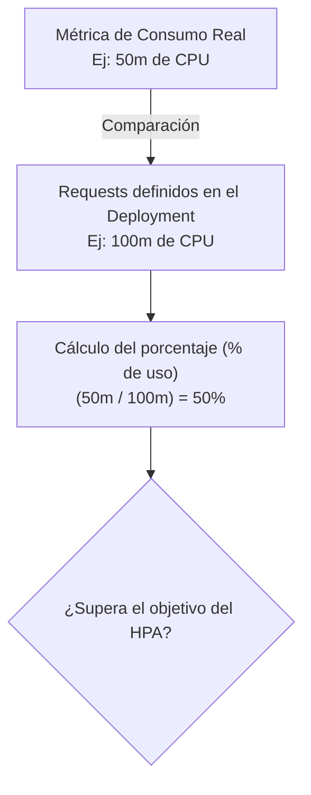
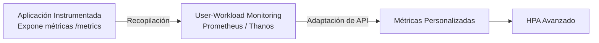

# 3.2 Autoescalado basado en métricas: del HPA estándar por CPU/Memoria al escalado por métricas de aplicación

## Objetivos de aprendizaje

Al finalizar este apartado serás capaz de:

- Comprender el concepto de autoescalado horizontal (*Horizontal Pod Autoscaler* o HPA) en OpenShift y su propósito operativo.
- Relacionar la monitorización de plataforma vista en el apartado 3.1 con la capacidad de respuesta automática del clúster.
- Entender cómo interactúa el controlador HPA con el *Metrics Server* de la plataforma para evaluar el consumo de recursos.
- Comprender la relación directa entre una correcta definición de *requests* (estudiada en la Sesión 2) y el correcto funcionamiento del autoescalado.
- Conocer la diferencia conceptual entre escalar por métricas estándar de infraestructura (CPU y Memoria) frente a métricas de negocio o rendimiento de la aplicación.
- Configurar, desplegar y probar un HPA estándar mediante la línea de comandos sobre la aplicación de demostración de la Sesión 2 (`demo-formacion-yaml`).
- Interpretar el estado del HPA, los objetivos configurados y el comportamiento de escala (*scale-out* y *scale-in*) ante variaciones de carga.

---

## ¿Qué es el autoescalado horizontal (HPA)?

En el apartado anterior (3.1) analizamos cómo la plataforma vigila de manera constante el estado de salud de los nodos, componentes y cargas de trabajo a través del stack de monitorización integrado. Sin embargo, saber que un componente está consumiendo más recursos o que la demanda aumenta es solo la mitad del camino; el siguiente paso lógico es reaccionar de forma automática.

Hasta ahora hemos aprendido a escalar aplicaciones de forma manual modificando el número de réplicas en nuestro Deployment o ejecutando órdenes como `oc scale`.

Sin embargo, en entornos corporativos reales, la demanda de los usuarios fluctúa de manera imprevisible a lo largo del día:


Para evitar que los administradores tengan que intervenir manualmente ante cada fluctuación de tráfico, Kubernetes y OpenShift proporcionan el recurso **Horizontal Pod Autoscaler (HPA)**.

El HPA supervisa de forma continua el rendimiento de las cargas de trabajo y ajusta automáticamente el número de réplicas (*pods*) dentro de un rango predefinido:

- **Mínimo de réplicas:** Garantiza la disponibilidad base del servicio (por ejemplo, 1 o 2 réplicas).
- **Máximo de réplicas:** Establece un límite superior para evitar consumos descontrolados de infraestructura durante picos extremos de tráfico.

---

## El requisito indispensable: la importancia de los *requests*

En la Sesión 2 estudiamos en detalle la diferencia entre *requests* y *limits*. 

Para que el autoescalado funcione correctamente mediante métricas de CPU o memoria, **es un requisito absolutamente indispensable que la aplicación tenga definidos sus *requests* de forma adecuada**.



### ¿Por qué ocurre esto?

El HPA no calcula el uso de CPU en términos absolutos (como milicores puros), sino en **porcentaje respecto a los recursos reservados (*requests*)**.

- Si un contenedor consume `50m` (milicores) de CPU y su *request* está configurado en `100m`, el HPA interpretará que está al **50% de su capacidad**.
- Si el contenedor consume exactamente los mismos `50m`, pero olvidamos definir el *request* (o lo dejamos mal dimensionado), el HPA no podrá calcular ningún porcentaje y el autoescalado dejará de funcionar.

!!! tip "Idea clave"
    El autoescalado por CPU y memoria descansa sobre los cimientos de los *requests* configurados en el Deployment. Unos *requests* mal dimensionados provocan que el HPA escale antes de tiempo o que directamente nunca llegue a reaccionar.

---

## Escalado estándar basado en métricas de infraestructura (CPU y Memoria)

De serie, OpenShift incorpora un componente denominado **Metrics Server**, encargado de recolectar el consumo real de CPU y memoria de todos los contenedores en ejecución.

El HPA estándar utiliza esta información para evaluar la carga de trabajo de forma nativa, sin necesidad de instalar componentes adicionales en el clúster.

---

## Desplegar y probar el HPA estándar

Partiendo de que nuestra aplicación de la Sesión 2 (`demo-formacion-yaml`) ya tiene configurados sus *requests* y *limits* correspondientes, podemos poner en marcha el autoescalado de forma rápida y directa mediante la línea de comandos.

### 1. Creación del HPA con `oc autoscale`

Ejecutamos el siguiente comando para generar y vincular automáticamente el recurso de autoescalado al Deployment:

```bash
oc autoscale deployment/demo-formacion-yaml --min=1 --max=3 --cpu-percent=50
```

### Explicación del comando:

Este comando le indica a OpenShift que genere y vincule un recurso de tipo *Horizontal Pod Autoscaler* (HPA) a partir del Deployment existente. Cada parámetro cumple una función muy concreta:

- **`oc autoscale deployment/demo-formacion-yaml`**: Selecciona la carga de trabajo sobre la que va a actuar el controlador de autoescalado, en este caso nuestro Deployment de la Sesión 2.
- **`--min=1`**: Define el número mínimo de réplicas (*pods*) que garantizan la disponibilidad base del servicio cuando la aplicación apenas tiene carga.
- **`--max=3`**: Establece el límite máximo de réplicas que el clúster puede desplegar simultáneamente para absorber picos de tráfico y evitar consumos descontrolados de infraestructura.
- **`--cpu-percent=50`**: Fija el objetivo de utilización en el **50% de la CPU**. Si la media de consumo de las réplicas activas supera ese porcentaje respecto a los *requests* definidos en el Deployment, el HPA reaccionará automáticamente incrementando el número de Pods.

### 2. Comprobando el estado inicial

Para verificar el estado actual del autoescalador ejecutamos:

```bash
oc get hpa demo-formacion-yaml
```

Resultado esperado:

```text
NAME                  REFERENCE                        TARGETS   MINPODS   MAXPODS   REPLICAS   AGE
demo-formacion-yaml   Deployment/demo-formacion-yaml   0%/50%    1         3         1          30s
```

- **`TARGETS`**: Muestra el consumo actual frente al objetivo (`0%/50%`).
- **`REPLICAS`**: Indica que actualmente hay 1 Pod en ejecución.

### 3. Simulando carga para provocar el autoescalado

Para comprobar que el HPA responde de forma automática, podemos generar tráfico contra la URL pública de nuestra aplicación (`demo-formacion-yaml`) utilizando un bucle de peticiones:

```bash
URL=$(oc get route demo-formacion-yaml -o jsonpath='{.spec.host}')
for i in {1..2000}; do curl -s http://$URL/ >/dev/null; done
```

Mientras se ejecuta la prueba de carga, volvemos a consultar el estado del HPA en otra terminal:

```bash
oc get hpa demo-formacion-yaml -w
```

Observaremos cómo el valor de `TARGETS` aumenta superando el objetivo del 50%. En pocos segundos, el controlador del HPA reaccionará incrementando el número de réplicas:

```text
NAME                  REFERENCE                        TARGETS    MINPODS   MAXPODS   REPLICAS   AGE
demo-formacion-yaml   Deployment/demo-formacion-yaml   0%/50%     1         3         1          2m
demo-formacion-yaml   Deployment/demo-formacion-yaml   85%/50%    1         3         1          3m
demo-formacion-yaml   Deployment/demo-formacion-yaml   85%/50%    1         3         3          3m
```

Si verificamos los Pods en ejecución:

```bash
oc get pods
```

Comprobaremos que el clúster ha desplegado automáticamente nuevas instancias para absorber el incremento de tráfico. Una vez finalizada la carga y tras unos minutos de estabilización, el HPA reducirá de nuevo las réplicas al valor mínimo configurado (*scale-in*).

---

## Más allá de la CPU: el concepto de métricas de aplicación y negocio

Aunque el HPA por CPU y memoria resuelve la gran mayoría de escenarios estándar, existen casos donde las métricas de infraestructura no reflejan fielmente la necesidad real de escalar:

- **Aplicaciones limitadas por E/S (I/O):** Un microservicio que espera respuestas de una base de datos externa o un sistema de ficheros puede saturarse atendiendo peticiones concurrentes sin apenas consumir CPU. Para el HPA estándar, el Pod parecerá inactivo.
- **Métricas de negocio específicas:** En entornos avanzados, los equipos necesitan escalar en función de la demanda real del servicio (por ejemplo, número de peticiones HTTP por segundo, transacciones procesadas o mensajes pendientes en una cola de mensajería).

### ¿Cómo se logra esto?

Para escalar basándose en este tipo de métricas, es necesario que **la aplicación esté debidamente instrumentada** (es decir, que exponga métricas operativas de rendimiento o negocio a través de un endpoint compatible, como `/metrics` o `/q/metrics`).



En plataformas corporativas, la combinación de herramientas como *User-Workload Monitoring* y adaptadores de métricas permite transformar esas señales de la aplicación en valores comprensibles para el HPA. 

Aunque su configuración técnica requiere componentes adicionales (como adaptadores de métricas y reglas personalizadas), el principio conceptual sigue siendo exactamente el mismo: **observar una magnitud representativa de la carga y adaptar automáticamente el número de réplicas en consecuencia**.

---

## Ideas clave para recordar

!!! tip "Resumen"
    - El **Horizontal Pod Autoscaler (HPA)** ajusta automáticamente el número de réplicas de un Deployment en función de la demanda.
    - El HPA por CPU y memoria se apoya en el **Metrics Server** nativo de OpenShift sin requerir instalaciones adicionales.
    - **Una correcta definición de *requests* es obligatoria** para que el HPA pueda calcular los porcentajes de utilización de recursos.
    - El HPA evalúa la carga en porcentajes relativos respecto a los *requests* reservados, no en valores absolutos.
    - Las aplicaciones pueden instrumentarse para exponer métricas de negocio o rendimiento adicionales, permitiendo un autoescalado avanzado adaptado a necesidades específicas de tráfico.
>>>>>>