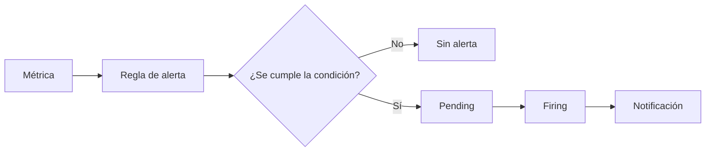
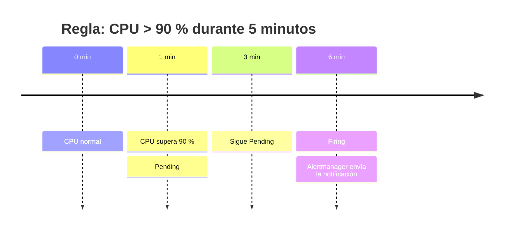
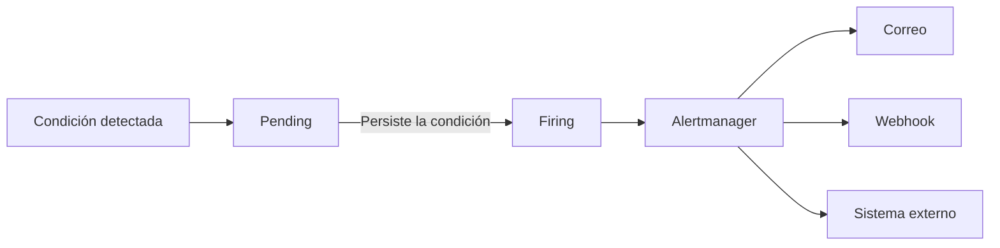
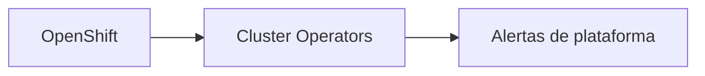
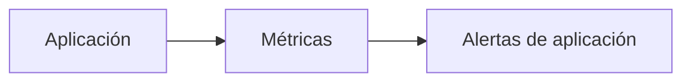
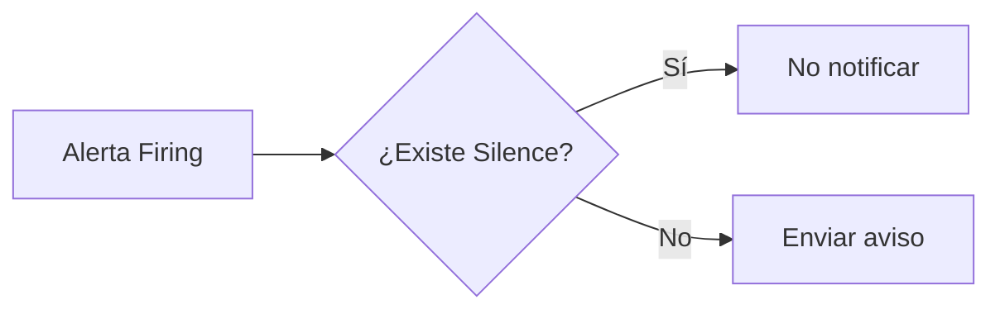
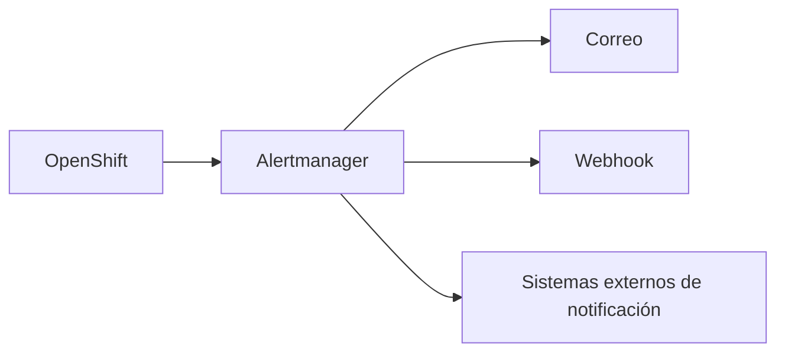
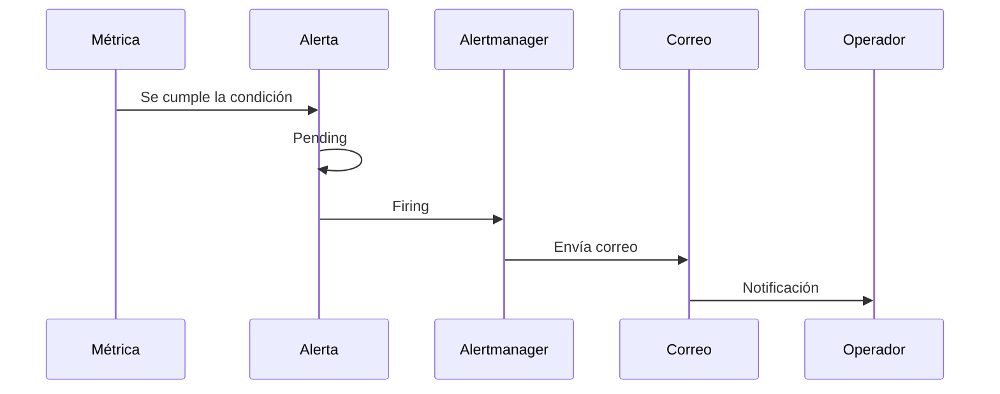
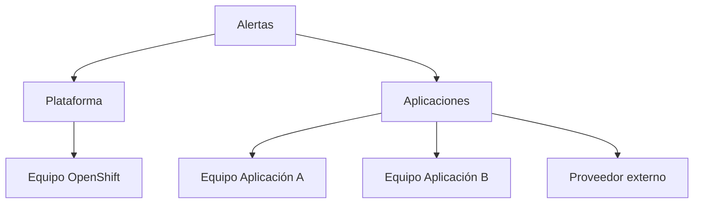

## 3.3 Alertas

### Objetivos de aprendizaje

Al finalizar este apartado serás capaz de:

- Comprender qué papel desempeñan las alertas dentro de la operación de OpenShift.
- Diferenciar los estados `Pending` y `Firing`.
- Entender por qué no toda anomalía genera inmediatamente una alerta activa.
- Conocer qué es un *Silence* y cuándo utilizarlo.
- Comprender cómo salen las alertas del clúster hacia correo electrónico u otros sistemas externos.
- Identificar los riesgos del exceso de alertas (*alert fatigue*).
- Entender la importancia de definir quién recibe cada notificación.
- Diferenciar una plataforma con alertas útiles de una plataforma que genera ruido constante.

### De las métricas a las alertas

En el apartado anterior vimos que OpenShift recopila métricas de manera continua sobre la plataforma y, opcionalmente, sobre las aplicaciones de usuario.

Sin embargo, revisar paneles y gráficas constantemente no es una estrategia viable para operar una plataforma real. Nadie permanece observando un *dashboard* las 24 horas del día.

Por este motivo existe el sistema de alertas. Su objetivo es sencillo: cuando ocurre una situación importante, la plataforma debe avisar automáticamente a las personas adecuadas.

El proceso completo suele ser:

- Se recopilan métricas.
- Una regla evalúa dichas métricas.
- Si la condición se cumple y la regla incorpora un tiempo de espera, la alerta entra en estado `Pending`.
- Si la condición persiste durante el tiempo configurado, pasa a `Firing`.
- Se envía una notificación hacia los destinatarios definidos.

Esta es la diferencia fundamental entre consultar una métrica y definir una alerta:

- Cuando queremos conocer el valor o la evolución de un dato, consultamos la métrica y observamos su gráfica.
- Cuando queremos que la plataforma nos avise si se cumple una determinada condición, una regla evalúa esa métrica y puede generar una alerta.

Como vimos en el apartado 3.1, Alertmanager recibe las alertas activas y se encarga de agruparlas, silenciarlas y dirigir las notificaciones hacia los destinatarios configurados.

!!! tip "Idea clave"
    Una alerta no detecta un problema por sí misma. Una regla evalúa métricas y determina si se cumple la condición definida.

### ¿Qué significa Pending?

Una de las dudas más habituales al empezar a trabajar con monitorización es entender por qué una alerta aparece en estado `Pending` y todavía no genera avisos.

`Pending` significa:

> La condición de alerta se está cumpliendo, pero todavía no durante el tiempo suficiente para considerar la alerta activa.

Supongamos una regla como esta:

> Generar una alerta cuando un nodo tenga la CPU por encima del 90 % durante 5 minutos.

Si un pico de carga dura únicamente 30 segundos:

- La condición se cumple.
- La alerta entra en `Pending`.
- No se envía ninguna notificación.

Si la carga vuelve a la normalidad antes de esos 5 minutos:

- La alerta deja de estar activa.
- Nunca llega a `Firing`.

Este mecanismo evita generar avisos por eventos breves o fluctuaciones momentáneas.

El estado `Pending` aparece cuando la regla incorpora un tiempo de espera, normalmente definido mediante el parámetro `for`. Si una regla no establece ese periodo, puede pasar directamente a `Firing` cuando se cumple la condición.

#### ¿Por qué es importante Pending?

Porque no todos los problemas son realmente problemas.

En cualquier sistema existen:

- Picos temporales de CPU.
- Incrementos puntuales de memoria.
- Retrasos breves de red.
- Reinicios planificados.

Sin un periodo `Pending` previo, las reglas más sensibles podrían terminar generando avisos continuamente ante fluctuaciones breves.

!!! note
    Cuanto más sensible es una alerta, más importante suele ser definir correctamente cuánto tiempo debe mantenerse la condición antes de considerar la alerta activa.

### ¿Qué significa Firing?

Cuando la condición configurada continúa cumpliéndose durante el tiempo establecido, la alerta pasa a estado `Firing`.

`Firing` significa:

> La condición definida por la regla se mantiene y la alerta está activa.

Dependiendo de su severidad y configuración, la alerta puede requerir intervención y generar notificaciones.

Ejemplos habituales:

- Un nodo permanece sin responder.
- etcd pierde redundancia.
- El almacenamiento comienza a agotarse.
- Un operador crítico deja de estar disponible.
- Una aplicación importante acumula errores durante varios minutos.

Desde la consola de OpenShift es habitual encontrar alertas activas clasificadas por severidad. Por ejemplo:

- `Warning`
- `Critical`

La severidad ayuda a priorizar la respuesta, pero una alerta crítica que nadie recibe tiene exactamente el mismo valor operativo que una alerta inexistente.

### ¿Quién genera las alertas?

En OpenShift encontramos dos grandes categorías.

#### Alertas de plataforma

Son proporcionadas por OpenShift y sus operadores.

Por ejemplo:

- Nodos no disponibles.
- Problemas en etcd.
- Falta de capacidad.
- Operadores degradados.
- Errores de red.

Son responsabilidad habitual del equipo que opera la plataforma.

#### Alertas de aplicaciones

Son definidas por los equipos propietarios de cada servicio.

Algunos ejemplos:

- API que devuelve demasiados errores.
- Tiempo de respuesta excesivo.
- Cola de trabajo acumulada.
- Número elevado de peticiones fallidas.

La responsabilidad suele corresponder al equipo de desarrollo o mantenimiento de esa aplicación.

!!! note
    Una misma instalación de OpenShift puede contener alertas de plataforma y alertas de decenas o cientos de aplicaciones diferentes.

### Silences: cuándo una alerta debe callarse temporalmente

No todos los problemas requieren una reacción inmediata.

Existen situaciones planificadas donde sabemos de antemano que van a producirse alertas.

Por ejemplo:

- Actualizaciones.
- Ventanas de mantenimiento.
- Migraciones.
- Paradas controladas.
- Pruebas técnicas.

Para evitar inundar a los equipos con avisos innecesarios existe el concepto de *Silence*.

Un *Silence* indica:

> Aunque la alerta se produzca, no envíes las notificaciones coincidentes durante un periodo determinado.

#### Ejemplo práctico

Supongamos que vamos a reiniciar varios nodos del clúster como parte de un mantenimiento programado.

Sabemos que durante ese proceso aparecerán alertas como:

- Nodo no disponible.
- Réplicas reducidas.
- Operador degradado.

Si no configuramos un *Silence*:

- Se enviarán numerosos correos.
- Los operadores recibirán avisos esperados.
- Se generará ruido innecesario.

Si configuramos un *Silence*:

- Las alertas pueden seguir activas y visibles.
- Las notificaciones coincidentes quedan silenciadas temporalmente.
- No se generarán avisos durante la ventana autorizada.

!!! warning "No utilizar Silences para ocultar problemas"
    Un *Silence* es una medida temporal.

### La alerta sale del clúster

Detectar un problema no sirve de nada si la información permanece dentro del clúster.

Por este motivo OpenShift puede integrarse con sistemas externos de notificación.

La integración más sencilla y habitual es el envío de correo electrónico. Mediante receptores como el correo o los *webhooks*, Alertmanager también puede integrarse con herramientas corporativas de mensajería, gestión de incidencias o guardias.

Flujo típico:

Desde el punto de vista operativo, este suele ser el momento más importante del proceso:

> La información llega finalmente a una persona que puede actuar.

### Gobierno de alertas: quién recibe qué

Una de las lecciones más repetidas en entornos de operación es la siguiente:

> Una alerta que no le llega a nadie no existe.

Técnicamente la alerta puede estar perfectamente configurada. Puede aparecer en la consola. Puede existir desde hace meses. Pero si nadie la recibe ni la revisa, es equivalente a no tenerla.

#### El problema contrario: demasiadas alertas

El extremo opuesto también es peligroso.

Muchas organizaciones empiezan generando alertas para todo:

- Uso elevado de CPU.
- Uso elevado de memoria.
- Reinicios.
- Lentitud temporal.
- Eventos informativos.
- Cambios menores.

El resultado suele ser el mismo:

- Pocas alertas relevantes se atienden.
- Muchas alertas poco útiles se terminan filtrando.
- El ruido constante acaba ignorándose.

Este fenómeno se conoce habitualmente como fatiga de alertas (*alert fatigue*).

Cuando los operadores reciben demasiados avisos:

- Dejan de prestar atención.
- Retrasan el análisis.
- Ignoran notificaciones importantes.
- Pierden confianza en el sistema.

!!! warning "Principio fundamental"
    El exceso de alertas equivale a no tener alertas.

### Un ejemplo de reparto de responsabilidades

No todas las alertas deben enviarse al mismo lugar.

Ejemplos razonables:

| Tipo de alerta | Destinatario |
|---|---|
| Nodo caído | Equipo de plataforma |
| Operador degradado | Equipo de plataforma |
| Error en una aplicación de negocio | Equipo responsable de dicha aplicación |
| Fallo de una integración externa | Equipo del proveedor correspondiente |
| Capacidad de almacenamiento próxima al límite | Equipo de plataforma |

La clave no es únicamente detectar problemas.

> La clave es que cada problema llegue a la persona capaz de resolverlo.

### Verificación y gestión práctica en OpenShift

#### Consultar alertas activas desde la consola web

- Accede a la consola web de OpenShift.
- Navega a **Observe → Alerting → Alerts**.
- Filtra por los estados `Pending` o `Firing`.
- Revisa las alertas activas del clúster.
- Selecciona una alerta para inspeccionar:
    - Descripción.
    - Severidad.
    - Expresión PromQL asociada.
    - Etiquetas.
    - Anotaciones.
    - Estado actual.

#### Crear un Silence temporal

Desde la propia vista de una alerta es posible crear un *Silence* para evitar notificaciones durante una ventana de mantenimiento programada.

Al crear el *Silence* se suele definir:

- Qué alertas quedan afectadas.
- Fecha y hora de inicio.
- Fecha y hora de finalización.
- Motivo del silencio.

!!! tip
    Utiliza *Silences* únicamente durante tareas controladas y planificadas.

#### Relación con los componentes de monitorización

Los componentes de monitorización de la plataforma se ejecutan en espacios de nombres gestionados por OpenShift. Su administración corresponde normalmente al equipo responsable del clúster.

Un operador degradado, un nodo no disponible o un problema en alguno de estos componentes puede ser la causa de alertas visibles en la consola.

#### Qué debe revisar un operador

Ante una alerta en estado `Firing` conviene comprobar:

- Qué recurso está afectado.
- Cuánto tiempo lleva activa.
- Su severidad.
- Qué impacto tiene sobre usuarios o aplicaciones.
- Quién es el responsable de resolverla.

### Buenas prácticas

#### Diseñar menos alertas, pero mejores

Es preferible:

- Pocas alertas.
- Claramente accionables.
- Con destinatarios definidos.
- Revisadas periódicamente.

Que:

- Cientos de alertas.
- Sin responsables claros.
- Ignoradas por todos.

#### Revisar periódicamente el catálogo de alertas

Con el tiempo siempre aparecen:

- Alertas obsoletas.
- Destinatarios que ya no existen.
- Aplicaciones retiradas.
- Umbrales mal ajustados.

La revisión periódica forma parte de la operación normal de la plataforma.

#### Definir responsables desde el principio

Antes de crear una alerta conviene responder dos preguntas:

- ¿Quién debe recibirla?
- ¿Qué acción esperamos que realice?

Si no existe una respuesta clara para ambas preguntas, probablemente la alerta no debería existir todavía.

### Ideas clave para recordar

!!! tip "Resumen"
    - Una alerta se genera a partir de reglas que evalúan métricas.
    - Cuando una regla incorpora un periodo de espera, `Pending` indica que la condición se cumple, pero todavía no durante el tiempo suficiente.
    - `Firing` indica que la condición definida por la regla se mantiene y la alerta está activa.
    - Alertmanager es el componente encargado de gestionar y distribuir las notificaciones.
    - Un *Silence* permite suprimir temporalmente las notificaciones durante tareas planificadas.
    - OpenShift puede enviar alertas hacia correo electrónico y otros sistemas corporativos.
    - Las alertas de plataforma y las de aplicación suelen tener destinatarios distintos.
    - Una alerta que no recibe nadie carece de valor operativo.
    - El exceso de avisos provoca fatiga de alertas y termina reduciendo la eficacia de la monitorización.
    - El objetivo no es tener muchas alertas, sino hacer llegar las alertas correctas a las personas adecuadas.
