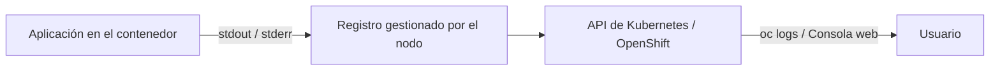
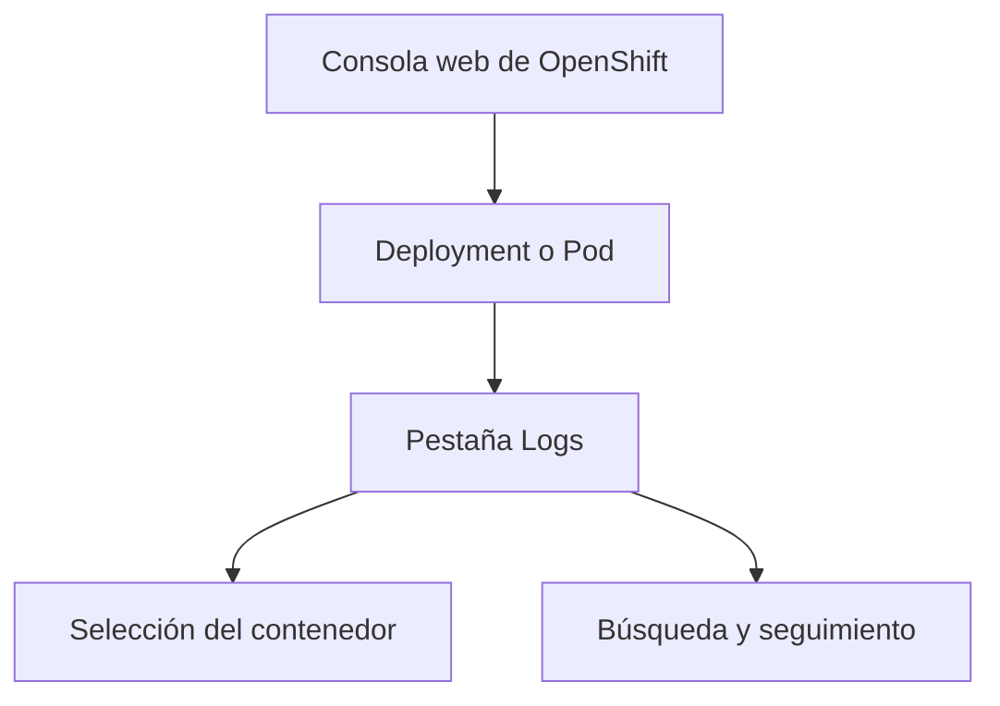
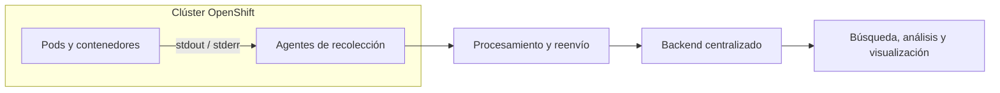
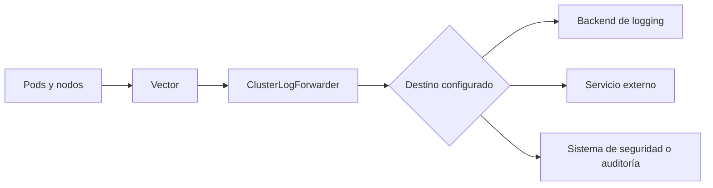

### 3.4 Logs: `oc logs`, la vista de logs de la consola y qué aporta la agregación centralizada — operador de Logging y su dependencia del almacenamiento ★

#### Objetivos de aprendizaje

Al finalizar este apartado serás capaz de:

- Consultar los registros (_logs_) de un contenedor mediante la línea de comandos de OpenShift (`oc logs`).
- Seguir los logs en tiempo real y consultar los de la ejecución anterior de un contenedor reiniciado.
- Localizar y examinar los logs desde la consola web de OpenShift.
- Comprender las limitaciones de la consulta local de logs en contenedores efímeros.
- Entender el concepto de agregación centralizada de logs (_Centralized Logging_) y su arquitectura general.
- Conocer el papel del **OpenShift Logging Operator** y de **ClusterLogForwarder** en la recolección, el procesamiento y el reenvío de registros.
- Comprender por qué una solución de logging centralizado necesita un backend de almacenamiento correctamente diseñado y dimensionado.

#### La importancia de los registros (_logs_)

Cuando una aplicación no se comporta como esperamos, sus registros son una de las principales fuentes de información para comprender qué está ocurriendo. Normalmente, las aplicaciones en contenedores escriben sus mensajes en las salidas estándar del proceso:

- **stdout**: salida estándar.
- **stderr**: salida de error.

A diferencia de los entornos virtuales tradicionales, donde es habitual escribir los logs de forma persistente en rutas fijas del servidor, como `/var/log`, en Kubernetes y OpenShift los contenedores son efímeros: se crean, se reinician, se sustituyen y pueden ejecutarse en nodos diferentes.

Por este motivo, una aplicación preparada para ejecutarse en contenedores debería escribir sus logs en `stdout` y `stderr`. OpenShift permite consultar esas salidas tanto mediante la línea de comandos como desde la consola web.



#### Consultar logs con la línea de comandos: `oc logs`

La herramienta CLI de OpenShift ofrece el comando `oc logs` como mecanismo principal para inspeccionar la salida de los contenedores de nuestras cargas de trabajo.

##### Localizar el Pod

En primer lugar, consultamos los Pods del proyecto:

```bash
oc get pods
```

El resultado mostrará el nombre de cada Pod, su estado y el número de reinicios de sus contenedores:

```text
NAME                                      READY   STATUS    RESTARTS   AGE
demo-formacion-yaml-xxxxxxxxxx-xxxxx      1/1     Running   0          8m
```

El nombre exacto incorpora identificadores generados por OpenShift, por lo que debemos utilizar el que aparezca en nuestro entorno.

##### Consultar los logs actuales

Para mostrar los logs del contenedor en ejecución:

```bash
oc logs demo-formacion-yaml-xxxxxxxxxx-xxxxx
```

También podemos consultar los logs mediante el recurso que gestiona los Pods, sin tener que copiar su nombre completo:

```bash
oc logs deployment/demo-formacion-yaml
```

Esta forma resulta especialmente cómoda cuando el Deployment dispone de una única réplica.

##### Seguir los logs en tiempo real

La opción `-f` mantiene el comando abierto y va mostrando las nuevas líneas conforme las genera la aplicación:

```bash
oc logs -f deployment/demo-formacion-yaml
```

Podemos detener el seguimiento con `Ctrl+C`. Esto no detiene la aplicación; únicamente finaliza el comando local.

##### Mostrar únicamente las últimas líneas

Si la aplicación ha generado muchos mensajes, podemos limitar la salida. Por ejemplo, para consultar las últimas 50 líneas:

```bash
oc logs deployment/demo-formacion-yaml --tail=50
```

##### Consultar los logs de la ejecución anterior: `--previous`

Si un contenedor termina y OpenShift lo reinicia dentro del mismo Pod, `oc logs` muestra por defecto los logs de la instancia que se está ejecutando en ese momento. Para investigar qué ocurrió justo antes del último reinicio, utilizamos `--previous`:

```bash
oc logs demo-formacion-yaml-xxxxxxxxxx-xxxxx --previous
```

La opción `--previous` consulta la instancia anterior del contenedor dentro del mismo Pod. No recupera los logs de un Pod distinto ni constituye un histórico permanente.

Podemos identificar que se ha producido un reinicio mediante la columna `RESTARTS`:

```bash
oc get pods
```

```text
NAME                                      READY   STATUS    RESTARTS   AGE
demo-formacion-yaml-xxxxxxxxxx-xxxxx      1/1     Running   1          12m
```

En ese caso, la comparación es especialmente útil:

```bash
# Logs de la instancia actual del contenedor
oc logs demo-formacion-yaml-xxxxxxxxxx-xxxxx

# Logs de la instancia anterior, antes del último reinicio
oc logs demo-formacion-yaml-xxxxxxxxxx-xxxxx --previous
```

!!! note "Prueba opcional en el entorno de laboratorio"
    Si la imagen utilizada incluye el comando `kill` y los permisos del contenedor lo permiten, se puede intentar finalizar el proceso principal para que OpenShift reinicie el contenedor:

    ```bash
    oc exec demo-formacion-yaml-xxxxxxxxxx-xxxxx -- kill 1
    ```

    A continuación, espera a que el Pod vuelva a aparecer como `Running`, comprueba que la columna `RESTARTS` ha aumentado y ejecuta `oc logs <pod> --previous`.

    Esta prueba depende de la imagen y de los permisos disponibles. Si `kill` no existe, no está permitido finalizar el proceso o el comportamiento de la imagen no provoca un reinicio observable, bastará con explicar el uso de `--previous` a partir de un Pod que ya se haya reiniciado.

!!! warning "Cuándo no funciona `--previous`"
    Si el contenedor todavía no se ha reiniciado, OpenShift no tendrá una instancia anterior que consultar. Del mismo modo, si el Pod ha sido eliminado y sustituido por otro, `--previous` no permite consultar el contenedor del Pod desaparecido.

En Pods que contienen más de un contenedor debemos indicar cuál queremos consultar mediante `-c`:

```bash
oc logs demo-formacion-yaml-xxxxxxxxxx-xxxxx -c nombre-contenedor
```

La misma opción se puede combinar con `--previous`:

```bash
oc logs demo-formacion-yaml-xxxxxxxxxx-xxxxx -c nombre-contenedor --previous
```

| Necesidad | Comando |
|---|---|
| Consultar los logs actuales | `oc logs <pod>` |
| Seguir los logs en tiempo real | `oc logs -f <pod>` |
| Ver las últimas 50 líneas | `oc logs <pod> --tail=50` |
| Consultar la ejecución anterior | `oc logs <pod> --previous` |
| Seleccionar un contenedor concreto | `oc logs <pod> -c <contenedor>` |

#### La vista de logs en la consola web

La consola web de OpenShift permite realizar la misma primera inspección de forma visual, seleccionando el Pod y el contenedor que queremos consultar.

##### Pasos para acceder a los logs desde la consola

- Cambia a la perspectiva **Developer** o **Administrator**.
- Dirígete a **Workloads → Deployments** o **Pods**.
- Selecciona la aplicación `demo-formacion-yaml`.
- Accede al Pod correspondiente.
- Haz clic en la pestaña **Logs**.

##### Características principales de la vista web

- **Selector de contenedores:** si el Pod está compuesto por varios contenedores, permite alternar entre ellos.
- **Seguimiento en directo:** muestra las nuevas líneas conforme la aplicación las genera.
- **Búsqueda de texto:** facilita la localización de términos como `ERROR`, `Exception`, `WARNING` o `Connection refused`.
- **Consulta visual:** permite revisar los registros recientes sin necesidad de recordar las opciones del comando.



#### La limitación fundamental de los logs locales

Aunque `oc logs` y la consola web resuelven muchas tareas cotidianas de desarrollo y diagnóstico, no constituyen un sistema de conservación histórica de registros.

- **Retención limitada:** los registros se conservan temporalmente en el nodo donde se ejecuta el contenedor. La rotación configurada en el nodo elimina los registros antiguos cuando se alcanzan determinados límites.
- **Dependencia del ciclo de vida:** `oc logs --previous` permite consultar la ejecución inmediatamente anterior de un contenedor reiniciado, pero no ofrece un histórico indefinido.
- **Pods sustituidos:** si un Pod es eliminado y el Deployment crea otro, la consulta normal se dirige al nuevo Pod. Los logs del Pod anterior no deben considerarse disponibles como parte de un histórico duradero.
- **Visibilidad fragmentada:** una aplicación puede tener varias réplicas, reiniciarse o ejecutarse en nodos diferentes. Consultar individualmente cada Pod resulta insuficiente cuando necesitamos analizar el comportamiento del conjunto durante un periodo prolongado.

Por tanto, los logs obtenidos directamente desde los Pods son muy útiles para el diagnóstico inmediato, pero una organización que necesite retención, búsqueda global, auditoría o correlación debe plantear una estrategia de **agregación centralizada**.

#### Qué aporta la agregación centralizada (_Centralized Logging_)

La agregación centralizada consiste en recolectar los logs generados por las aplicaciones y por la plataforma, enriquecerlos con información de contexto y enviarlos a uno o varios sistemas donde puedan conservarse, buscarse y analizarse de forma conjunta.



##### Ventajas principales

- **Retención:** los registros pueden conservarse durante el periodo definido por la organización, con independencia del ciclo de vida de los Pods.
- **Búsqueda global:** permite consultar desde una única interfaz los logs de múltiples Pods, aplicaciones y proyectos.
- **Correlación:** facilita relacionar registros de diferentes componentes para reconstruir qué ocurrió durante una incidencia.
- **Auditoría y cumplimiento:** permite aplicar políticas de acceso, conservación y protección adaptadas a los requisitos de la organización.

La agregación centralizada no implica conservar todos los logs indefinidamente. Deben definirse políticas de retención, filtrado y eliminación acordes con su valor operativo, su volumen y los requisitos normativos aplicables.

#### El operador de Logging y la arquitectura de almacenamiento

En OpenShift, el **OpenShift Logging Operator** proporciona componentes para desplegar y gestionar la recolección y el reenvío de logs. En las arquitecturas actuales, **Vector** realiza habitualmente la recolección en los nodos y el recurso **ClusterLogForwarder** define cómo se procesan y a qué destinos se envían los registros.

##### El papel del operador

El operador permite gestionar de forma declarativa:

- Los agentes de recolección desplegados en los nodos del clúster.
- La selección de los tipos de logs que se quieren recoger.
- Las entradas, filtros, salidas y canalizaciones configuradas mediante `ClusterLogForwarder`.
- El reenvío hacia uno o varios backends compatibles.

Es importante separar dos responsabilidades:

- **Recolección y reenvío:** OpenShift captura los registros, puede enriquecerlos con metadatos y los dirige al destino configurado.
- **Almacenamiento, indexación y consulta:** el backend recibe los logs y proporciona las capacidades de conservación, búsqueda, análisis o visualización.



La implementación concreta puede variar según la versión de OpenShift, los operadores instalados y la arquitectura elegida. Por ello, no debemos asociar el logging centralizado a un único producto ni asumir que el operador proporciona por sí mismo todos los motores de almacenamiento, indexación y consulta.

##### La importancia del almacenamiento

Un sistema de logging puede recibir un volumen elevado y continuo de información. Su diseño debe contemplar, entre otros aspectos:

- El volumen diario de logs.
- El periodo de retención.
- La capacidad de búsqueda e indexación necesaria.
- La alta disponibilidad y la recuperación ante fallos.
- La compresión, rotación y eliminación de datos antiguos.
- La separación entre los recursos del clúster y los del backend de logging.

El almacenamiento de objetos compatible con S3 puede formar parte de determinadas arquitecturas de logging, especialmente cuando el backend elegido lo utiliza para conservar grandes volúmenes de información. Sin embargo, no es un requisito universal de toda solución de logging centralizado: la necesidad concreta depende del backend, de su configuración y de la arquitectura adoptada.

Ejemplos como **NooBaa**, **Ceph Object Gateway**, **AWS S3** o **MinIO** representan posibles servicios de almacenamiento de objetos, pero no sustituyen por sí solos a las funciones de recolección, indexación, búsqueda y visualización de una plataforma de logs.

!!! warning "Planificación de capacidad"
    La agregación centralizada aporta un gran valor operativo, pero debe dimensionarse cuidadosamente. Una retención excesiva, una generación descontrolada de logs o un backend insuficiente pueden consumir almacenamiento y recursos de procesamiento rápidamente, degradar las búsquedas e incluso afectar a la disponibilidad del servicio de logging.

#### Ideas clave para recordar

!!! tip "Resumen"
    - `oc logs` permite consultar la salida estándar de los contenedores de una carga de trabajo.
    - `oc logs -f` sigue los logs en tiempo real y `--tail` limita la cantidad de líneas mostradas.
    - `oc logs --previous` consulta la ejecución anterior de un contenedor que se ha reiniciado dentro del mismo Pod.
    - La consola web proporciona una vía visual para seleccionar el Pod y revisar sus registros.
    - Los logs accesibles directamente desde los Pods son útiles para el diagnóstico inmediato, pero no deben considerarse un histórico duradero.
    - La agregación centralizada permite retener, buscar y correlacionar registros de múltiples componentes.
    - El OpenShift Logging Operator y `ClusterLogForwarder` se ocupan de la recolección, el procesamiento y el reenvío, mientras que el backend proporciona el almacenamiento y las capacidades de consulta.
    - El almacenamiento de objetos puede ser necesario en determinadas arquitecturas, pero no constituye un requisito universal para cualquier solución de logging.

Los logs nos cuentan qué está diciendo la aplicación, pero no siempre explican por qué OpenShift no puede ejecutarla correctamente. En el siguiente apartado combinaremos eventos, `describe`, logs y otras herramientas para aplicar un método sistemático de diagnóstico.
