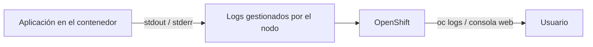
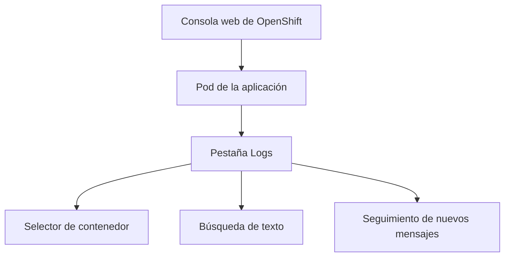
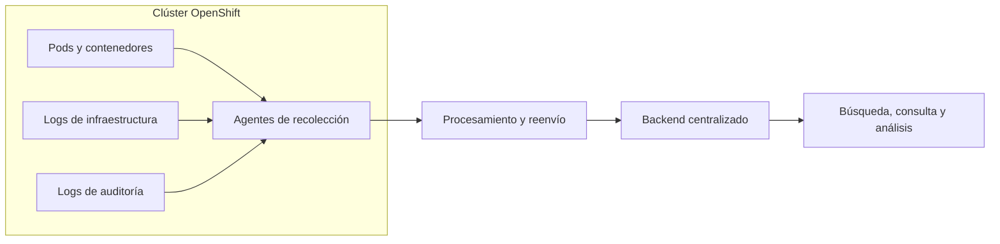
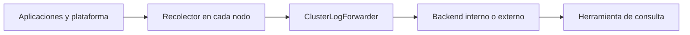

## 3.4 Logs: `oc logs`, la vista de logs de la consola y qué aporta la agregación centralizada — operador de Logging y almacenamiento ★

### Objetivos de aprendizaje

Al finalizar este apartado serás capaz de:

- Consultar los registros (_logs_) de un contenedor utilizando la línea de comandos de OpenShift (`oc logs`).
- Seguir los logs en tiempo real y consultar los correspondientes a la ejecución anterior de un contenedor reiniciado.
- Localizar y examinar los logs desde la consola web de OpenShift.
- Comprender las limitaciones de los logs almacenados localmente en los nodos.
- Entender el concepto de agregación centralizada de logs (_Centralized Logging_) y su arquitectura general.
- Conocer el papel del **OpenShift Logging Operator** y de **ClusterLogForwarder** en la recolección, enriquecimiento y reenvío de registros.
- Comprender por qué una plataforma de logging centralizado necesita un backend de almacenamiento adecuado y correctamente dimensionado.

### La importancia de los registros (_logs_)

Cuando una aplicación no se comporta como esperamos, sus logs son una de las principales fuentes de información para comprender qué está ocurriendo.

Las aplicaciones que siguen las prácticas habituales para contenedores escriben sus mensajes en los flujos de salida estándar:

- `stdout`: salida normal de la aplicación.
- `stderr`: mensajes de error.

OpenShift permite consultar esas salidas tanto mediante la línea de comandos como desde la consola web. De esta forma, no es necesario acceder al interior del contenedor para buscar ficheros de log.



!!! note "Logs de la aplicación"
    Para aprovechar correctamente este mecanismo, la aplicación debe escribir sus logs en `stdout` y `stderr`. Si los guarda únicamente en ficheros internos del contenedor, `oc logs` no podrá mostrarlos.

### Consultar logs con la línea de comandos: `oc logs`

La herramienta CLI de OpenShift ofrece el comando `oc logs` como mecanismo principal para inspeccionar la salida de nuestros contenedores.

#### Localizar el Pod

Comenzamos identificando el Pod de la aplicación:

```bash
oc get pods
```

Obtendremos una salida similar a la siguiente:

```text
NAME                                   READY   STATUS    RESTARTS   AGE
demo-formacion-yaml-7d8c9b6f5-x2k9m   1/1     Running   0          5m
```

El nombre concreto del Pod será diferente, porque OpenShift lo genera a partir del `Deployment` y de la réplica creada.

#### Consultar los logs actuales

Una vez identificado el Pod, podemos consultar sus logs:

```bash
oc logs demo-formacion-yaml-7d8c9b6f5-x2k9m
```

El comando muestra los mensajes que la instancia actual del contenedor ha escrito en `stdout` y `stderr`.

#### Seguir los logs en tiempo real

Para mantener la consulta abierta y mostrar las nuevas líneas a medida que se generan, utilizamos la opción `-f` (_follow_):

```bash
oc logs -f demo-formacion-yaml-7d8c9b6f5-x2k9m
```

Podemos finalizar el seguimiento pulsando ++ctrl+c++.

#### Mostrar únicamente las últimas líneas

Cuando un contenedor ha generado muchos mensajes, puede ser útil limitar la salida inicial:

```bash
oc logs demo-formacion-yaml-7d8c9b6f5-x2k9m --tail=50
```

Este comando muestra las 50 últimas líneas disponibles.

#### Consultar los logs anteriores a un reinicio

Si un contenedor falla, OpenShift puede reiniciarlo dentro del mismo Pod. En ese caso, `oc logs` muestra los logs de la instancia actual, pero puede que la información que explica el fallo se encuentre en la ejecución anterior.

Para consultarla utilizamos:

```bash
oc logs demo-formacion-yaml-7d8c9b6f5-x2k9m --previous
```

La opción `--previous` no recupera los logs de un Pod eliminado. Recupera los logs de la **instancia anterior de un contenedor que se ha reiniciado dentro del mismo Pod**.

Podemos comprobar si se han producido reinicios observando la columna `RESTARTS`:

```bash
oc get pods
```

```text
NAME                                   READY   STATUS    RESTARTS   AGE
demo-formacion-yaml-7d8c9b6f5-x2k9m   1/1     Running   1          8m
```

En este ejemplo, el valor `1` indica que el contenedor se ha reiniciado una vez. `--previous` permite consultar los mensajes de la ejecución inmediatamente anterior, siempre que esos logs continúen disponibles en el nodo.

!!! tip "Un comando especialmente útil"
    `oc logs --previous` resulta muy útil al investigar reinicios y situaciones como `CrashLoopBackOff`, porque el contenedor actual puede llevar muy poco tiempo ejecutándose y no mostrar todavía la causa del fallo anterior.

!!! note "Prueba en el laboratorio"
    No es necesario provocar un fallo artificial para comprender el comando. Si durante las prácticas aparece un Pod cuyo contador `RESTARTS` sea mayor que cero, podremos comparar `oc logs <pod>` con `oc logs <pod> --previous`. La disponibilidad del resultado dependerá de que exista una instancia anterior del contenedor y de que sus logs sigan retenidos en el nodo.

#### Pods con más de un contenedor

Si un Pod contiene varios contenedores, debemos indicar cuál queremos consultar mediante `-c`:

```bash
oc logs demo-formacion-yaml-7d8c9b6f5-x2k9m -c nombre-contenedor
```

Podemos consultar los nombres de los contenedores definidos en el Pod con:

```bash
oc get pod demo-formacion-yaml-7d8c9b6f5-x2k9m \
  -o jsonpath='{.spec.containers[*].name}'
```

Para nuestra aplicación, que utiliza un único contenedor, no será necesario indicar esta opción.

### La vista de logs en la consola web

La consola web de OpenShift permite realizar la misma primera inspección de forma visual, seleccionando el Pod y el contenedor correspondiente.

#### Pasos para acceder a los logs desde la consola

1. Cambia a la perspectiva **Developer** o **Administrator**.
2. Dirígete a **Workloads → Pods** o accede al `Deployment` de la aplicación.
3. Selecciona el Pod de `demo-formacion-yaml`.
4. Abre la pestaña **Logs**.

Desde esta vista podemos:

- seleccionar el contenedor cuando el Pod contiene más de uno;
- seguir los nuevos mensajes a medida que aparecen;
- buscar o filtrar visualmente términos como `ERROR`, `WARNING`, `Exception` o `Connection refused`;
- realizar una inspección rápida sin recordar las opciones de la línea de comandos.



La consola web y `oc logs` consultan la misma fuente básica. La elección entre ambas depende de la forma de trabajo y del tipo de análisis que queramos realizar.

### La limitación fundamental de los logs locales

`oc logs` y la consola web resuelven muchas tareas cotidianas de desarrollo y diagnóstico, pero no constituyen por sí solos una solución de conservación histórica.

Los logs que consultamos directamente están ligados al ciclo de vida de los contenedores y a la retención local configurada en los nodos. Por ello presentan varias limitaciones:

- **Retención limitada:** los registros se conservan temporalmente en el nodo donde se ejecuta el Pod. Los mecanismos de rotación eliminan los mensajes más antiguos para controlar el uso de disco.
- **Dependencia del ciclo de vida:** `--previous` permite consultar la instancia anterior de un contenedor reiniciado, pero no ofrece un histórico indefinido. Si el Pod desaparece, se reprograma o los logs rotan, esa información puede dejar de estar disponible mediante `oc logs`.
- **Visibilidad fragmentada:** una aplicación puede tener varias réplicas, cambiar de Pod o ejecutarse en distintos nodos. Consultar cada Pod por separado dificulta el análisis global.
- **Búsqueda y correlación limitadas:** `oc logs` permite inspeccionar una salida concreta, pero no está pensado para buscar y relacionar grandes volúmenes de registros de múltiples aplicaciones durante periodos prolongados.

Por estas razones, los entornos corporativos suelen incorporar una estrategia de **agregación centralizada de logs**.

### Qué aporta la agregación centralizada (_Centralized Logging_)

La agregación centralizada recolecta los logs generados por las aplicaciones y, según la configuración, por componentes de la plataforma y auditoría. Después los reenvía a uno o varios backends donde pueden almacenarse, buscarse y analizarse de forma conjunta.



#### Ventajas principales

- **Retención independiente de los Pods:** los registros pueden conservarse aunque una réplica sea sustituida o un Pod deje de existir.
- **Búsqueda global y cruzada:** es posible consultar desde una única herramienta los logs de múltiples Pods, aplicaciones y namespaces, de acuerdo con los permisos definidos.
- **Correlación:** facilita relacionar mensajes de distintos componentes que participan en una misma operación.
- **Operación y diagnóstico:** permite detectar patrones, investigar incidentes y analizar errores que se producen de manera intermitente.
- **Auditoría y cumplimiento:** puede contribuir a aplicar políticas de conservación y acceso a los registros, siempre que la arquitectura y la configuración se hayan diseñado para esos requisitos.

!!! note "Centralizar no significa conservar indefinidamente"
    La duración de la retención depende de la capacidad disponible, del volumen generado y de las políticas configuradas. Centralizar los logs no elimina la necesidad de definir periodos de conservación y mecanismos de purgado.

### El operador de Logging y la arquitectura de recolección

En OpenShift, el **OpenShift Logging Operator** proporciona recursos y componentes para configurar la recolección y el reenvío de logs del clúster.

La arquitectura puede entenderse separando tres responsabilidades:

1. **Generación:** las aplicaciones y los componentes de la plataforma producen logs.
2. **Recolección y reenvío:** agentes desplegados en los nodos recopilan los registros. Mediante `ClusterLogForwarder` se define qué flujos se recogen, cómo se procesan y a qué destinos se envían.
3. **Almacenamiento, indexación y consulta:** uno o varios backends reciben los logs y proporcionan las capacidades de retención, búsqueda y análisis.



Esta separación es importante: el operador y `ClusterLogForwarder` se encargan principalmente de la **recolección, procesamiento y entrega**, mientras que la persistencia y la consulta dependen del backend elegido y de la arquitectura desplegada.

!!! note "Una arquitectura configurable"
    El destino no tiene por qué ser único. Según las necesidades de la organización, pueden definirse diferentes salidas para los logs de aplicaciones, infraestructura o auditoría, y enviarlos a servicios internos o externos compatibles.

### La importancia del almacenamiento

Un sistema centralizado puede recibir una gran cantidad de información. El volumen depende, entre otros factores, de:

- el número de nodos, namespaces, Pods y contenedores;
- la cantidad de logs generada por cada aplicación;
- los tipos de logs que se decida recolectar;
- el periodo de retención;
- las réplicas y mecanismos de alta disponibilidad del backend;
- las necesidades de búsqueda, indexación y consulta.

Por tanto, el backend debe contar con almacenamiento persistente y capacidad suficientes. La tecnología concreta depende de la solución adoptada: algunas arquitecturas utilizan volúmenes persistentes, otras almacenamiento de objetos compatible con S3 y otras reenvían los logs a plataformas externas ya existentes.

El almacenamiento de objetos puede ser una pieza importante en determinados backends y arquitecturas, mediante soluciones como **Ceph Object Gateway**, **NooBaa**, **MinIO** o servicios compatibles con **Amazon S3**. Sin embargo, no constituye un requisito universal de cualquier despliegue de OpenShift Logging: debe analizarse en función del backend seleccionado y de su diseño.

Además de la capacidad bruta, una solución de logging debe contemplar:

- políticas de retención y purgado;
- compresión;
- replicación y alta disponibilidad;
- rendimiento de escritura y consulta;
- control de acceso;
- crecimiento previsto y picos de generación.

!!! warning "Planificación de capacidad"
    La agregación centralizada aporta un gran valor operativo, pero también consume recursos. Una retención demasiado amplia o una generación descontrolada de logs puede saturar el backend y afectar al servicio. Por ello deben definirse límites, políticas de conservación y alertas de capacidad.

### Ideas clave para recordar

!!! tip "Resumen"
    - `oc logs` permite consultar la salida estándar de los contenedores.
    - `oc logs -f` sigue los nuevos mensajes en tiempo real.
    - `oc logs --previous` consulta la ejecución anterior de un contenedor reiniciado dentro del mismo Pod.
    - La consola web ofrece una forma visual de acceder a los mismos logs básicos.
    - Los logs locales tienen una retención limitada y no deben considerarse un histórico corporativo.
    - La agregación centralizada permite conservar, buscar y correlacionar logs de múltiples componentes.
    - El OpenShift Logging Operator y `ClusterLogForwarder` gestionan la recolección, el procesamiento y el reenvío hacia los destinos configurados.
    - El almacenamiento debe dimensionarse de acuerdo con el backend, el volumen generado y la política de retención. El almacenamiento de objetos es una posibilidad relevante, pero no una obligación universal.

Los logs nos cuentan qué está diciendo la aplicación, pero no siempre explican por sí solos por qué OpenShift no puede ejecutarla correctamente. En el siguiente apartado combinaremos los logs con los eventos, `oc describe` y otras comprobaciones para construir un método sistemático de diagnóstico.
