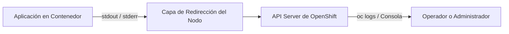
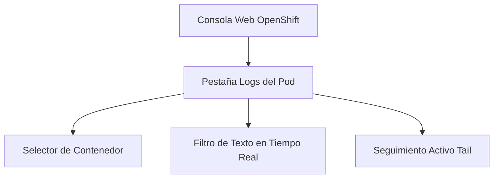
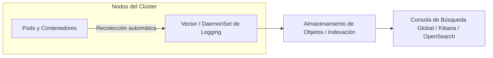

# 3.4 Logs: `oc logs` y `--previous`, la vista de logs de la consola, y qué aporta la agregación centralizada — operador de Logging y su dependencia de almacenamiento de objetos ★

## Objetivos de aprendizaje

Al finalizar este apartado serás capaz de:

- Consultar los registros (*logs*) de un contenedor en ejecución utilizando la línea de comandos de OpenShift (`oc logs`).
- Recuperar los registros de un contenedor que ha fallado o se ha reiniciado recientemente utilizando el modificador `--previous`.
- Localizar y examinar los flujos de logs directamente desde la consola web de administración y desarrollo.
- Comprender las limitaciones inherentes al almacenamiento local de logs en contenedores efímeros.
- Entender el concepto de agregación centralizada de logs (*Centralized Logging*) y su arquitectura general.
- Conocer el rol del operador de Logging (*OpenShift Logging Operator* y *Cluster Log Forwarder*) en la captura, enriquecimiento y reenvío de registros.
- Evaluar la dependencia crítica del subsistema de logging respecto al almacenamiento de objetos de alta disponibilidad (*Object Storage*).

---

## La importancia vital de los registros (*Logs*)

Cuando una aplicación en contenedor falla, se congela o experimenta un comportamiento anómalo, la primera y más valiosa fuente de información suelen ser sus propios registros de salida (*stdout* y *stderr*).

A diferencia de los entornos virtuales tradicionales donde los ficheros de log se escriben de forma persistente en rutas fijas del disco local del servidor (como `/var/log`), en Kubernetes y OpenShift la realidad arquitectónica es radicalmente distinta:

- Los contenedores son **efímeros**: se crean, se destruyen y se mueven de un nodo a otro de manera transparente.
- Si un Pod se elimina o su contenedor interno se reinicia, el sistema de ficheros efímero asociado se pierde.

Por este motivo, OpenShift intercepta de forma nativa las salidas estándar de los procesos que corren dentro de los contenedores, permitiendo su consulta en tiempo real tanto mediante la interfaz de comandos como a través de la consola web.



---

## Consultar logs con la línea de comandos: `oc logs`

La herramienta CLI de OpenShift ofrece el comando `oc logs` como mecanismo principal para inspeccionar el comportamiento de nuestras cargas de trabajo.

### Consultar los logs de un Pod específico
Si conocemos el nombre exacto de nuestro Pod, podemos volcar sus registros directamente en la terminal:

```bash
oc logs demo-formacion-yaml-789d8b7654-abcde
```

### El parámetro clave para contenedores caídos: `--previous`
Uno de los escenarios más frustrantes en la resolución de incidencias ocurre cuando un contenedor sufre un error crítico de inicialización (un *CrashLoopBackOff*), provocando que se reinicie constantemente de forma automática.

Si intentamos ejecutar `oc logs` sobre el Pod en curso, es probable que la consola nos devuelva un error indicando que el contenedor acaba de arrancar y todavía no ha escrito nada, o bien que visualicemos únicamente los registros del nuevo intento, perdiendo la traza exacta del fallo anterior.

Para solucionar este problema disponemos del modificador `--previous`:

```bash
oc logs demo-formacion-yaml-789d8b7654-abcde --previous
```

Este comando le indica a OpenShift que recupere y muestre los registros **del ciclo de vida inmediatamente anterior** del contenedor que acaba de fallar.

!!! tip "Idea clave"
    Ante un contenedor en bucle de reinicios (*CrashLoopBackOff*), utilizar `--previous` es el paso obligado para ver la traza exacta de la excepción o error de código que provocó la caída.

---

## La vista de logs en la consola web

Para aquellos momentos en los que preferimos una aproximación visual o necesitamos analizar secuencias temporales largas sin la rigidez de la línea de comandos, la consola web de OpenShift incorpora una vista dedicada de registros.

### Pasos para acceder a los logs desde la consola:
1. Cambia a la perspectiva **Developer** o **Administrator**.
2. Dirígete a **Workloads → Deployments** o **Pods**.
3. Selecciona tu aplicación (`demo-formacion-yaml`).
4. Haz clic en la pestaña **Logs**.

### Características principales de la vista web:
- **Selector de contenedores:** Si el Pod está compuesto por múltiples contenedores (por ejemplo, contenedores auxiliares o *sidecars*), permite alternar entre ellos fácilmente.
- **Seguimiento en directo (*Tail*):** Botón para activar el desplazamiento automático conforme la aplicación emite nuevas líneas de texto.
- **Filtros por texto:** Cuadro de búsqueda para acotar y resaltar palabras clave específicas (como `ERROR`, `Exception`, `WARNING` o `Connection refused`).
- **Control temporal:** Permite consultar registros recientes de forma ágil sin necesidad de teclear parámetros complejos.



---

## La limitación fundamental del almacenamiento local de logs

Aunque `oc logs` y la consola web resuelven la inmensa mayoría de las tareas cotidianas de desarrollo y depuración, esta aproximación nativa presenta limitaciones estructurales importantes en entornos corporativos avanzados:

1. **Retención limitada:** Los registros se almacenan temporalmente en el disco local del nodo donde corre el Pod. Cuando el volumen de logs es muy elevado o el espacio en disco del nodo se reduce, los registros antiguos son eliminados (*rotated*).
2. **Pérdida histórica ante la destrucción del Pod:** Si un Pod es eliminado definitivamente, sus registros locales desaparecen del nodo.
3. **Visibilidad fragmentada:** Para consultar los registros de una aplicación que ha rotado por varios nodos a lo largo de los días, el operador tendría que conectarse nodo por nodo, lo cual resulta inviable a escala.

Por estas razones, los entornos de producción requieren una estrategia de **agregación centralizada**.

---

## Qué aporta la agregación centralizada (*Centralized Logging*)

La agregación centralizada consiste en recolectar de forma automática todos los logs generados por la infraestructura del clúster y por todas las aplicaciones de los usuarios, enviándolos a un sistema de almacenamiento y análisis externo y unificado.



### Ventajas principales:
- **Persistencia a largo plazo:** Los registros sobreviven a la destrucción de los pods, de los nodos e incluso a la actualización del propio clúster.
- **Búsqueda global y cruzada:** Permite consultar en una única interfaz los registros de múltiples namespaces, correlacionando eventos de red, plataforma y aplicación.
- **Auditoría y cumplimiento normativo (*Compliance*):** Garantiza que los registros de seguridad y acceso queden guardados de forma inalterable ante requerimientos legales o auditorías internas.

---

## El operador de Logging y su dependencia de almacenamiento de objetos

En OpenShift, la implementación de la agregación centralizada se gestiona a través del **OpenShift Logging Operator** (basado habitualmente en tecnologías como *Vector* para la recolección y *OpenSearch* para el almacenamiento e indexación).

### El rol del operador
El operador se encarga de desplegar y mantener de forma automatizada:
- Los agentes de recolección en cada nodo del clúster (*DaemonSet*).
- Los componentes de procesamiento y enrutamiento (*ClusterLogForwarder*).
- Los motores de indexación y persistencia.

### La dependencia crítica: Almacenamiento de objetos (*Object Storage*)
Un error muy común al planificar la agregación centralizada es asumir que los logs pueden guardarse indefinidamente en discos locales o en volúmenes persistentes tradicionales de bloque (*RWO Storage*).

En una plataforma con cientos de pods generando gigabytes de registros diarios, el almacenamiento de logs requiere obligatoriamente:

- **Un backend de Almacenamiento de Objetos compatible con S3** (como *NooBaa*, *Ceph Object Gateway* o proveedores externos tipo AWS S3, MinIO, etc.).
- Capacidad para aplicar políticas de compresión, indexación eficiente y purgado automático (*Rollover* e *Index Lifecycle Management*).

Sin una infraestructura de almacenamiento de objetos dimensionada correctamente, el clúster sufrirá saturación de disco en los nodos de indexación, degradando el rendimiento general de la plataforma.

!!! warning "Planificación de capacidad"
    La agregación centralizada de logs es una herramienta de gran valor operativo, pero requiere dimensionar cuidadosamente el almacenamiento de objetos subyacente para evitar cortes de servicio por saturación.

---

## Ideas clave para recordar

!!! tip "Resumen"
    - `oc logs` es el comando esencial para consultar la salida estándar de cualquier contenedor en OpenShift.
    - El modificador `--previous` permite recuperar los registros de un contenedor que acaba de fallar o reiniciarse.
    - La consola web ofrece una interfaz visual intuitiva para filtrar, buscar y seguir logs en tiempo real.
    - El almacenamiento nativo de logs en los nodos es efímero y limitado, lo que dificulta la auditoría histórica.
    - La **agregación centralizada** unifica los registros de todo el clúster en un sistema persistente independiente de los pods.
    - El **Operador de Logging** automatiza el despliegue de los agentes de recolección y motores de análisis.
    - La arquitectura de logging a escala depende críticamente de un backend robusto de **almacenamiento de objetos**.