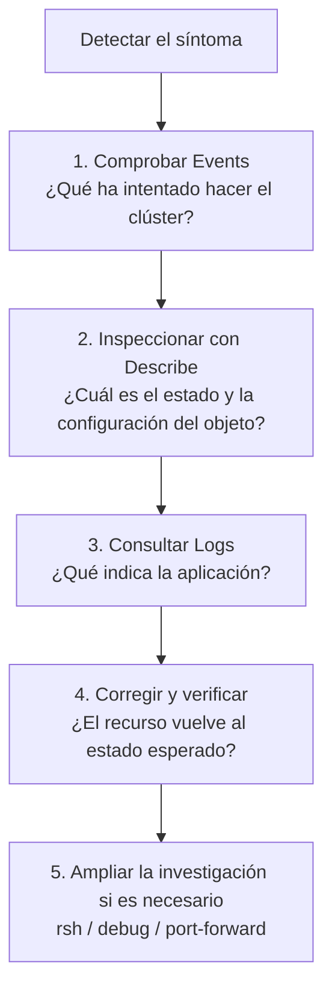
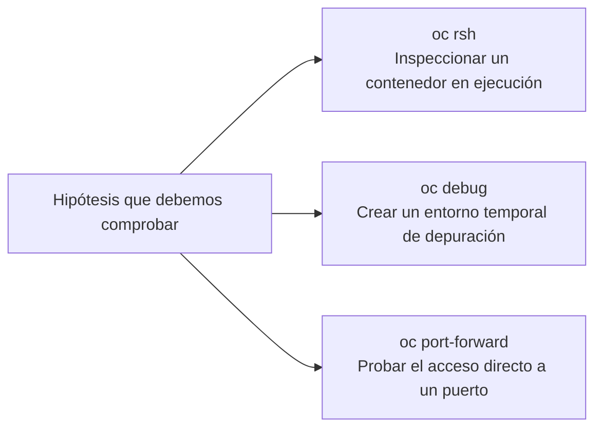

# 3.5 Diagnóstico de incidencias: el método `events` → `describe` → `logs` y herramientas de resolución

## Objetivos de aprendizaje

Al finalizar este apartado serás capaz de:

- Aplicar un recorrido estructurado de resolución de problemas (*troubleshooting*) basado en `events` → `describe` → `logs`, adaptándolo a las evidencias disponibles.
- Interpretar los síntomas más frecuentes en OpenShift (`Pending`, `CrashLoopBackOff`, `ImagePullBackOff`, `OOMKilled` y PVC en `Pending`).
- Relacionar cada síntoma con las evidencias que deben comprobarse y con las primeras actuaciones posibles.
- Utilizar herramientas complementarias de inspección y depuración como `oc rsh`, `oc debug` y `oc port-forward`.
- Comprender para qué sirve `must-gather` y por qué suele asociarse a tareas de administración y soporte.
- Verificar que una incidencia ha quedado realmente resuelta después de aplicar una corrección.

---

## Un recorrido recomendado para diagnosticar incidencias

Cuando una aplicación desplegada en OpenShift no arranca, se reinicia o deja de responder, es frecuente comenzar a ejecutar comandos sin un criterio claro. Esto puede hacer que pasemos por alto la evidencia más útil o que dediquemos tiempo a revisar información que no está relacionada con el problema.

Como punto de partida utilizaremos el siguiente recorrido:



Este orden es una **guía**, no una regla inflexible. Si el síntoma apunta claramente a una causa concreta, puede ser razonable comenzar por otra evidencia. Por ejemplo, ante un `ImagePullBackOff`, los eventos y `describe` suelen ser más útiles que los logs, porque el contenedor todavía no ha llegado a iniciarse. Ante un error funcional de una aplicación que permanece en estado `Running`, puede tener sentido consultar directamente sus logs.

La idea importante no es memorizar una secuencia rígida, sino investigar de forma ordenada y basar cada decisión en evidencias.

---

### Paso 1: `events` — ¿Qué ha intentado hacer el clúster?

Los eventos de Kubernetes registran actividades y errores recientes relacionados con los objetos del proyecto: planificación de Pods, descarga de imágenes, montaje de volúmenes, fallos de sondas o reinicios, entre otros.

```bash
oc get events --sort-by='.metadata.creationTimestamp'
```

La salida incluye normalmente columnas como `LAST SEEN`, `TYPE`, `REASON`, `OBJECT` y `MESSAGE`:

- **`Normal`**: acciones habituales del clúster, como la asignación de un Pod a un nodo o la descarga correcta de una imagen.
- **`Warning`**: situaciones que requieren atención, como fallos al descargar una imagen, montar un volumen o ejecutar una sonda.

!!! warning "Los eventos no son un historial completo"
    Los eventos son registros temporales y pueden agregarse, repetirse o desaparecer conforme avanza el tiempo. Resultan muy útiles para conocer la actividad reciente, pero no deben interpretarse como un historial permanente de todo lo ocurrido desde la creación del objeto.

Cuando se conoce el objeto afectado, también puede resultar más práctico consultar sus eventos a través de `oc describe`.

---

### Paso 2: `describe` — ¿Cuál es el estado y la configuración del objeto?

El comando `oc describe` muestra información detallada del objeto en un formato orientado al diagnóstico. No se limita a los Pods: puede aplicarse a Deployments, ReplicaSets, Services, Routes, PVC y otros recursos.

```bash
oc describe <tipo-de-recurso> <nombre>
```

Por ejemplo:

```bash
oc describe pod <nombre-del-pod>
oc describe deployment demo-formacion-yaml
oc describe pvc <nombre-del-pvc>
```

En un Pod, la salida permite revisar el nodo, la ServiceAccount, el estado actual y anterior de los contenedores, la imagen, los reinicios, los códigos de salida, los recursos, las sondas, los volúmenes y los eventos recientes.

En otros objetos, la información cambia según su naturaleza. Por ejemplo, en un PVC interesa comprobar su estado, la `StorageClass` solicitada y los eventos de aprovisionamiento.

`describe` no proporciona por sí solo la causa de todas las incidencias, pero ayuda a relacionar el estado actual, la configuración aplicada y los eventos registrados.

---

### Paso 3: `logs` — ¿Qué indica la aplicación?

En el apartado 3.4 vimos cómo consultar los logs mediante `oc logs`, seguirlos en tiempo real y recuperar los de la ejecución anterior con `--previous`.

```bash
oc logs <nombre-del-pod>
```

Si el contenedor se ha reiniciado:

```bash
oc logs <nombre-del-pod> --previous
```

Los logs pueden mostrar excepciones, errores de configuración, fallos de conexión o mensajes emitidos antes de que el proceso termine. Sin embargo, no siempre contienen la causa del problema. Si el contenedor no ha arrancado, no ha podido descargar la imagen o no ha montado un volumen, la evidencia principal estará normalmente en los eventos y en `describe`.

---

### Paso 4: corregir y verificar

El diagnóstico no termina al modificar un manifiesto o ejecutar un comando. Después de aplicar una corrección debemos comprobar que el estado real vuelve a coincidir con el esperado.

```bash
oc rollout status deployment/demo-formacion-yaml
oc get pods
oc get events --sort-by='.metadata.creationTimestamp'
```

También debemos repetir la comprobación funcional correspondiente: acceder a la aplicación, realizar una petición a su Route, comprobar que el Pod deja de reiniciarse, confirmar que el PVC pasa a `Bound` o verificar que la nueva réplica alcanza el estado `Ready`.

!!! tip "Corregir no es lo mismo que verificar"
    Una modificación puede aplicarse correctamente y, aun así, no resolver la causa real. La incidencia solo puede considerarse cerrada cuando el recurso recupera el estado esperado y la aplicación vuelve a funcionar.

---

## Síntomas, evidencias y primeras actuaciones

Los estados de Kubernetes no siempre identifican una causa única. Debemos tratarlos como síntomas que orientan la investigación.

### 1. Pod en `Pending`

- **Síntoma:** el Pod permanece en estado `Pending` y no comienza a ejecutarse.
- **Evidencias:** eventos de planificación, recursos solicitados, selectores de nodos, afinidades y PVC asociados.

```bash
oc describe pod <nombre-del-pod>
```

- **Posibles indicios:** `FailedScheduling`, falta de CPU o memoria, restricciones de ubicación o un volumen que todavía no puede montarse.
- **Primeras actuaciones:** revisar el mensaje exacto, comprobar los `requests`, verificar los PVC y confirmar que las restricciones de ubicación son compatibles con los nodos disponibles.

No debemos asumir automáticamente que un Pod en `Pending` indica falta de recursos: el evento asociado debe orientar el siguiente paso.

---

### 2. Pod en `CrashLoopBackOff`

- **Síntoma:** el contenedor arranca, termina y OpenShift intenta iniciarlo de nuevo, aumentando progresivamente el tiempo entre reintentos.
- **Evidencias:** estado anterior, motivo de terminación, código de salida, eventos y logs de la ejecución anterior.

```bash
oc describe pod <nombre-del-pod>
oc logs <nombre-del-pod> --previous
```

- **Posibles indicios:** error en el comando de arranque, variable obligatoria ausente, fallo durante la inicialización, dependencia inaccesible o terminación provocada por una sonda.
- **Primeras actuaciones:** interpretar el código de salida y el mensaje de los logs antes de modificar el Deployment.

---

### 3. Pod en `ImagePullBackOff`

- **Síntoma:** OpenShift no puede descargar la imagen y el contenedor no llega a iniciarse.
- **Evidencias:** nombre y etiqueta de la imagen, registro de origen, eventos de descarga y credenciales.

```bash
oc describe pod <nombre-del-pod>
```

- **Posibles indicios:** `ErrImagePull`, imagen o etiqueta inexistente, registro inaccesible o falta de un `imagePullSecret` válido.
- **Primeras actuaciones:** comprobar la referencia exacta de la imagen y, si el registro es privado, verificar las credenciales vinculadas a la ServiceAccount.

Como el contenedor no ha llegado a ejecutarse, normalmente no existirán logs de aplicación que consultar.

---

### 4. Contenedor terminado por `OOMKilled`

- **Síntoma:** el contenedor termina y se reinicia; en el estado anterior aparece `OOMKilled`.
- **Evidencias:** último estado, código de salida y límite de memoria.

```bash
oc describe pod <nombre-del-pod>
```

- **Posibles indicios:** `Reason: OOMKilled` y, habitualmente, código de salida `137`.
- **Primeras actuaciones:** comparar el límite con el consumo esperado, revisar las métricas y determinar si existe un dimensionamiento insuficiente, un pico de carga o un consumo anómalo.

Aumentar el `limit` puede aliviar el síntoma, pero no sustituye el análisis del consumo real.

---

### 5. PVC en estado `Pending`

- **Síntoma:** el PVC no pasa a `Bound` y la aplicación que depende del volumen puede no llegar a arrancar.
- **Evidencias:** `StorageClass`, modo de acceso, capacidad, modo de vinculación y eventos de aprovisionamiento.

```bash
oc get pvc
oc describe pvc <nombre-del-pvc>
oc get storageclass
```

- **Posibles indicios:** `StorageClass` inexistente, aprovisionador no disponible, modo de acceso no soportado o vinculación pendiente hasta que exista un Pod consumidor.
- **Primeras actuaciones:** interpretar los eventos y comprobar que la solicitud es compatible con el almacenamiento disponible.

!!! note "Recordatorio sobre `WaitForFirstConsumer`"
    Si la `StorageClass` utiliza `volumeBindingMode: WaitForFirstConsumer`, el PVC puede permanecer en `Pending` hasta que exista un Pod que lo utilice. En ese caso, el estado no implica necesariamente un error.

---

## Práctica N3: diagnosticar un `CrashLoopBackOff`

En esta práctica trabajaremos sobre el Deployment `demo-formacion-yaml` consolidado en el apartado 2.3. Conservaremos la imagen v3, las tres sondas y la configuración de recursos. Únicamente añadiremos un comando de arranque que escribe un error y termina con código `1`.

### 1. Provocar la incidencia de forma controlada

Guardamos el siguiente manifiesto como `deployment-error.yaml`:

```yaml
apiVersion: apps/v1
kind: Deployment
metadata:
  name: demo-formacion-yaml
  annotations:
    kubernetes.io/change-cause: "Practica de diagnostico: CrashLoopBackOff provocado mediante exit 1"
spec:
  replicas: 1
  selector:
    matchLabels:
      app: demo-formacion-yaml
  template:
    metadata:
      labels:
        app: demo-formacion-yaml
    spec:
      containers:
        - name: demo-formacion
          image: docker.io/ieftraining/demo-formacion:v3
          imagePullPolicy: Always
          command:
            - /bin/sh
            - -c
          args:
            - |
              echo "Iniciando contenedor..."
              echo "ERROR: no se ha podido completar la inicialización"
              exit 1
          ports:
            - containerPort: 8080
          startupProbe:
            httpGet:
              path: /live
              port: 8080
            failureThreshold: 30
            periodSeconds: 1
          readinessProbe:
            httpGet:
              path: /ready
              port: 8080
            periodSeconds: 5
          livenessProbe:
            httpGet:
              path: /live
              port: 8080
            periodSeconds: 10
          resources:
            requests:
              cpu: "100m"
              memory: "128Mi"
            limits:
              cpu: "500m"
              memory: "512Mi"
```

Aplicamos el manifiesto:

```bash
oc apply -f deployment-error.yaml
```

!!! note "Qué se ha modificado"
    Respecto al Deployment consolidado del apartado 2.3, se mantienen la imagen, las sondas y los recursos. Solo se añaden `command` y `args` para sustituir temporalmente el proceso normal de la imagen por un script que termina con código `1`.

### 2. Detectar el síntoma

```bash
oc get pods -l app=demo-formacion-yaml
```

La salida terminará mostrando un estado similar a este:

```text
NAME                                      READY   STATUS             RESTARTS   AGE
demo-formacion-yaml-7c85b9f7f-xxxxx      0/1     CrashLoopBackOff   3          45s
```

El estado es el primer indicio, pero todavía no explica la causa.

### 3. Revisar los eventos

```bash
oc get events --sort-by='.metadata.creationTimestamp'
```

Los eventos permiten comprobar que el contenedor se inicia, termina y vuelve a arrancarse. Dependiendo del momento de la consulta, también pueden aparecer fallos de sondas.

### 4. Inspeccionar el Pod

```bash
oc get pods -l app=demo-formacion-yaml
oc describe pod <nombre-del-pod>
```

Prestamos especial atención a:

- `State` y `Last State`;
- `Reason`;
- `Exit Code`;
- contador de reinicios;
- eventos situados al final de la salida.

### 5. Consultar los logs de la ejecución anterior

```bash
oc logs <nombre-del-pod> --previous
```

La salida esperada será:

```text
Iniciando contenedor...
ERROR: no se ha podido completar la inicialización
```

Los logs indican que el proceso falla durante la inicialización. Para localizar la causa concreta debemos revisar la configuración del Deployment.

### 6. Localizar la causa

```bash
oc get deployment demo-formacion-yaml -o yaml
```

En la especificación del contenedor encontraremos los campos añadidos:

```yaml
command:
  - /bin/sh
  - -c
args:
  - |
    echo "Iniciando contenedor..."
    echo "ERROR: no se ha podido completar la inicialización"
    exit 1
```

El proceso principal termina deliberadamente con código `1`. Para recuperar la aplicación debemos restaurar el Deployment consolidado, sin `command` ni `args`.

### 7. Restaurar el Deployment correcto

Guardamos el siguiente manifiesto como `deployment-correcto.yaml`. Es el Deployment consolidado del apartado 2.3, con la imagen v3, las tres sondas y los recursos configurados:

```yaml
apiVersion: apps/v1
kind: Deployment
metadata:
  name: demo-formacion-yaml
  annotations:
    kubernetes.io/change-cause: "Configuradas probes y recursos para la aplicacion v3"
spec:
  replicas: 1
  selector:
    matchLabels:
      app: demo-formacion-yaml
  template:
    metadata:
      labels:
        app: demo-formacion-yaml
    spec:
      containers:
        - name: demo-formacion
          image: docker.io/ieftraining/demo-formacion:v3
          imagePullPolicy: Always
          ports:
            - containerPort: 8080
          startupProbe:
            httpGet:
              path: /live
              port: 8080
            failureThreshold: 30
            periodSeconds: 1
          readinessProbe:
            httpGet:
              path: /ready
              port: 8080
            periodSeconds: 5
          livenessProbe:
            httpGet:
              path: /live
              port: 8080
            periodSeconds: 10
          resources:
            requests:
              cpu: "100m"
              memory: "128Mi"
            limits:
              cpu: "500m"
              memory: "512Mi"
```

Aplicamos el manifiesto correcto:

```bash
oc apply -f deployment-correcto.yaml
```

### 8. Verificar la recuperación

```bash
oc rollout status deployment/demo-formacion-yaml
oc get pods -l app=demo-formacion-yaml
```

La salida esperada será similar a:

```text
NAME                                      READY   STATUS    RESTARTS   AGE
demo-formacion-yaml-xxxxxxxxxx-xxxxx      1/1     Running   0          35s
```

Finalmente, comprobamos que la aplicación vuelve a responder mediante la Route utilizada en los apartados anteriores.

!!! success "Criterio de finalización"
    La práctica no termina al aplicar el YAML correcto. Debemos confirmar que el rollout finaliza, el nuevo Pod alcanza `Ready` y la aplicación vuelve a responder.

---

## Herramientas complementarias de inspección

Cuando `events`, `describe` y `logs` no proporcionan suficiente información, podemos recurrir a herramientas adicionales. No forman una secuencia obligatoria: elegiremos la que permita comprobar una hipótesis concreta.



### `oc rsh`: inspeccionar un contenedor en ejecución

```bash
oc rsh pod/<nombre-del-pod>
```

Puede resultar útil para comprobar ficheros, variables, resolución DNS o conectividad desde el propio contenedor. El contenedor debe mantenerse en ejecución, la imagen debe incluir una shell compatible y las herramientas necesarias deben existir en ella.

No debe utilizarse para modificar manualmente una aplicación en producción. Cualquier corrección persistente debe incorporarse a la imagen o a la configuración declarativa.

---

### `oc debug`: crear un entorno temporal de depuración

```bash
oc debug pod/<nombre-del-pod>
```

Crea un recurso temporal basado en otro objeto para facilitar el diagnóstico. El comportamiento concreto depende del recurso utilizado, de la imagen y de los permisos disponibles. La depuración de nodos u otros recursos de plataforma corresponde normalmente al equipo administrador.

---

### `oc port-forward`: probar un puerto mediante un túnel local

```bash
oc port-forward pod/<nombre-del-pod> 8080:8080
```

Mientras el comando permanezca activo, podremos probar la aplicación desde `http://localhost:8080`. La prueba ayuda a comprobar si el proceso escucha y responde en el puerto esperado sin depender del acceso externo. No sustituye la validación completa del Service o de la Route, porque los evita temporalmente.

!!! note "Uso en entornos de laboratorio"
    El funcionamiento de `oc port-forward` depende de la conectividad del equipo, de los permisos y de las políticas del entorno. Si no está disponible, la aplicación puede verificarse mediante el Service y la Route del laboratorio.

---

## `must-gather`: información para administración y soporte

```bash
oc adm must-gather
```

`must-gather` recopila información de diagnóstico del clúster y de sus operadores. Puede incluir recursos, estados y logs relevantes para analizar una incidencia de plataforma. Su ejecución suele requerir privilegios administrativos y puede generar una cantidad considerable de información.

No forma parte del diagnóstico habitual que realiza un desarrollador sobre su aplicación. Se utiliza principalmente cuando el equipo de administración necesita reunir evidencias o cuando el soporte de Red Hat solicita una recopilación concreta.

!!! warning "La recopilación puede contener información sensible"
    Antes de compartir un `must-gather`, el equipo administrador debe aplicar los procedimientos de la organización para custodiar, revisar y transferir la información.

---

## Ideas clave para recordar

!!! tip "Resumen"
    - `events` → `describe` → `logs` es un recorrido recomendado, no una regla rígida.
    - Los eventos muestran actividad reciente, pero no constituyen un historial permanente y completo.
    - `oc describe` puede utilizarse sobre distintos tipos de objetos, no solo sobre Pods.
    - Los estados como `Pending`, `CrashLoopBackOff`, `ImagePullBackOff` u `OOMKilled` son síntomas que deben relacionarse con evidencias.
    - Los logs ya estudiados en el apartado 3.4 se integran ahora dentro de un proceso de diagnóstico.
    - Después de corregir una incidencia debemos verificar tanto los recursos como el funcionamiento de la aplicación.
    - `oc rsh`, `oc debug` y `oc port-forward` son herramientas complementarias para comprobar hipótesis concretas.
    - `oc adm must-gather` está orientado principalmente a la administración y al soporte.

---

## ¿Es mi aplicación o es la plataforma?

El recorrido de este apartado permite investigar problemas relacionados con una aplicación y con los recursos de su proyecto. Sin embargo, puede llegar un momento en el que las evidencias no apunten al código, a la configuración o a los objetos que gestiona el equipo de desarrollo.

Si varias aplicaciones presentan fallos similares, existen errores generalizados de almacenamiento o red, o los recursos del proyecto parecen correctos pero el servicio continúa degradado, debemos ampliar el ámbito de la investigación.

En el siguiente apartado aprenderemos a diferenciar una incidencia de aplicación de una incidencia de plataforma mediante la revisión de los Cluster Operators, el estado de los nodos y el consumo general de recursos del clúster.
