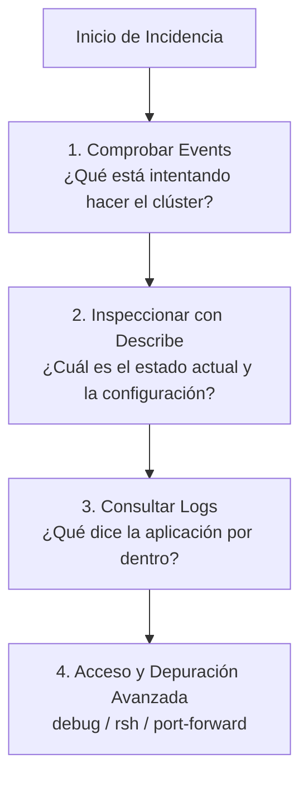
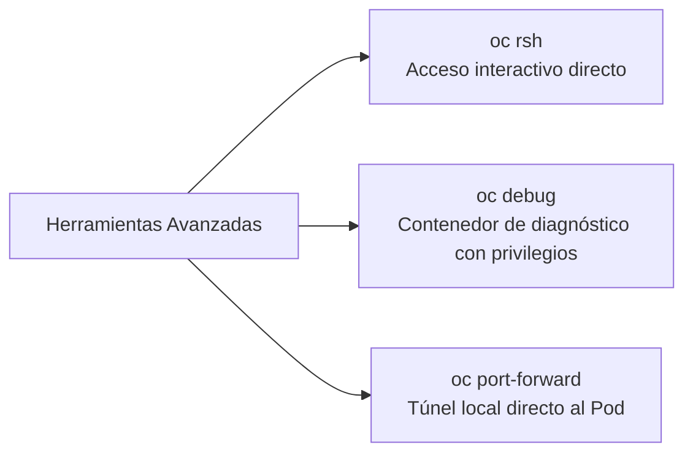

# 3.5 Diagnóstico de incidencias: el método `events` → `describe` → `logs` y herramientas de resolución

## Objetivos de aprendizaje

Al finalizar este apartado serás capaz de:

- Aplicar un método estructurado de resolución de problemas (*troubleshooting*) basado en la secuencia `events` → `describe` → `logs`.
- Identificar y resolver los síntomas y errores más frecuentes en OpenShift (`Pending`, `CrashLoopBackOff`, `ImagePullBackOff`, `OOMKilled`, PVC en `Pending`).
- Utilizar herramientas avanzadas de inspección y depuración como `oc debug`, `oc rsh` y `oc port-forward`.
- Comprender qué es `must-gather` y cuándo debe utilizarse para la recogida de diagnósticos del clúster.
- Evaluar el criterio operativo para saber cuándo detener la investigación individual y derivar el problema a soporte avanzado o al equipo de plataforma.

---

## El método sistemático de diagnóstico: `events` → `describe` → `logs`

Cuando una aplicación desplegada en OpenShift no arranca, falla de forma intermitente o deja de responder, el error más común es comenzar a revisar logs de forma desordenada. 

Para evitar perder tiempo y resolver el incidente con eficacia, debemos seguir siempre un orden lógico de inspección:



### Paso 1: `events` (¿Qué está ocurriendo en el entorno?)
Los eventos de Kubernetes recogen el historial de acciones y errores recientes asociados a los objetos de un namespace (programación de pods, descargas de imágenes, cambios de estado o fallos de sondas).

Para consultar los eventos recientes ordenados cronológicamente:

```bash
oc get events --sort-by='.metadata.creationTimestamp'
```

#### ¿Qué se muestra por pantalla?
Este comando devuelve una tabla cronológica con columnas como `LAST SEEN`, `TYPE`, `REASON`, `OBJECT` y `MESSAGE`. 
- **`Normal`**: Indica acciones rutinarias y correctas del clúster (como la creación de un contenedor, la asignación a un nodo o la descarga correcta de una imagen).
- **`Warning`**: Alertas tempranas de que algo no va bien (por ejemplo, fallos recurrentes en las sondas de salud o problemas al montar volúmenes). Revisar esta salida permite ver el historial completo de lo que le ha ocurrido al pod desde su nacimiento.

---

### Paso 2: `describe` (¿Cuál es la radiografía completa del objeto?)
Si los eventos nos daban una pista general, el comando `describe` nos muestra la estructura detallada, el estado de los contenedores, las sondas configuradas y las condiciones exactas de fallo en un momento dado:

```bash
oc describe pod <nombre-del-pod>
```

#### ¿Qué se muestra por pantalla?
Este comando genera un informe estructurado muy completo dividido en secciones:
- **Cabecera (Name, Namespace, Node):** Indica en qué servidor físico o virtual del clúster (`Node`) se encuentra alojado el pod y qué cuenta de servicio utiliza.
- **Status y Containers:** Muestra si el estado actual es `Running`, `Waiting` o `Terminated`, el ID del contenedor (*Container ID*), la imagen exacta desplegada, los recursos configurados (*Limits* y *Requests*) y el estado de las sondas (*Liveness*, *Readiness* y *Startup*).
- **Events:** Al final del todo, muestra una sección de eventos específicos filtrados únicamente para ese pod (como la asignación correcta al nodo `Scheduled`, la descarga de la imagen con su tamaño en bytes, o errores críticos de arranque). Es la herramienta perfecta para comprobar si un contenedor ha fallado y qué motivo exacto ha registrado el nodo.

---

### Paso 3: `logs` (¿Qué error interno emite el proceso?)
Una vez que sabemos que el pod está intentando ejecutarse o que ha fallado, los registros de salida estándar (`stdout` y `stderr`) nos muestran la causa raíz interna de la aplicación (excepciones de código, fallos de conexión a bases de datos, errores de sintaxis, etc.).

---

## Catálogo de síntomas, causas y soluciones

A continuación, analizamos los errores más habituales con los que se enfrentará cualquier operador de OpenShift.

### 1. `Pending`
- **Síntoma:** El Pod se queda indefinidamente en estado `ContainerCreating` o `Pending`, sin llegar a arrancar nunca.
- **Causa probable:** Falta de recursos de CPU o memoria en los nodos del clúster, problemas con los selectores de nodos (*nodeSelector*), o un PVC asociado que todavía no se ha enlazado.
- **Cómo diagnosticarlo:** 
  ```bash
  oc describe pod <nombre-del-pod>
  ```
  *(Buscar al final del comando en la sección `Events` si el planificador indica falta de recursos).*
- **Solución:** Liberar recursos, ajustar los *requests* del despliegue, o revisar el estado del almacenamiento asociado.

### 2. `CrashLoopBackOff`
- **Síntoma:** El Pod arranca, pero falla inmediatamente, se reinicia y vuelve a fallar en un bucle continuo.
- **Causa probable:** Error crítico en el código de la aplicación al iniciar, falta de variables de entorno obligatorias, fallo de conexión contra una base de datos o fallo en una sonda de arranque.
- **Cómo diagnosticarlo:**
  ```bash
  oc logs <nombre-del-pod> --previous
  ```
  *(El parámetro `--previous` es vital porque nos muestra los registros del contenedor antes de que sufriera el último reinicio).*
- **Solución:** Corregir el código de la aplicación, rellenar los ConfigMaps/Secrets que falten o corregir la orden de ejecución.

### 3. `ImagePullBackOff`
- **Síntoma:** El contenedor no puede arrancar porque OpenShift es incapaz de descargar la imagen del registro.
- **Causa probable:** Nombre de imagen o etiqueta errónea, falta de permisos (*ImagePullSecret*) para acceder a un registro privado, o caída temporal del repositorio.
- **Cómo diagnosticarlo:**
  ```bash
  oc describe pod <nombre-del-pod>
  ```
  *(Los eventos mostrarán claramente errores como `ErrImagePull` o `ImagePullBackOff` junto al motivo detallado).*
- **Solución:** Verificar que la ruta de la imagen es correcta y comprobar las credenciales de acceso al registro.

### 4. `OOMKilled` (*Out Of Memory*)
- **Síntoma:** El Pod muere de manera repentina sin que aparezcan errores aparentes en los logs de la aplicación. Al hacer un `describe`, el campo `Last State` muestra `OOMKilled` con código de salida `137`.
- **Causa probable:** La aplicación ha superado estrictamente el límite de memoria (`limit`) configurado en su manifiesto debido a una carga excesiva o a un dimensionamiento insuficiente.
- **Cómo diagnosticarlo:**
  ```bash
  oc describe pod <nombre-del-pod>
  ```
  *(Buscar la línea `OOMKilled: true` y `Exit Code: 137`).*
- **Solución:** Ampliar el límite de memoria en el Deployment u optimizar el consumo de la aplicación.

### 5. PVC en estado `Pending`
- **Síntoma:** Desplegamos una aplicación con persistencia, pero el Pod no arranca porque el volumen no se crea ni se enlaza.
- **Causa probable:** La *StorageClass* solicitada no existe, el proveedor de almacenamiento externo no responde, o se ha solicitado un modo de acceso incompatible.
- **Cómo diagnosticarlo:**
  ```bash
  oc describe pvc <nombre-del-pvc>
  ```
- **Solución:** Comprobar las clases de almacenamiento disponibles en el clúster con `oc get storageclass` y corregir el manifiesto del PersistentVolumeClaim.

---

## Herramientas avanzadas de inspección: `oc debug`, `rsh` y `port-forward`

Cuando los comandos básicos de consulta no son suficientes para comprender el origen del fallo, OpenShift proporciona herramientas de acceso avanzado.



### 1. `oc rsh` (Remote Shell)
Permite abrir una sesión interactiva de terminal dentro del contenedor en ejecución para revisar ficheros de configuración locales, comprobar rutas de red o probar conectividad:

```bash
oc rsh pod/<nombre-del-pod>
```
*(Nota: Requiere que la imagen del contenedor disponga de un intérprete de comandos como `/bin/sh` o `/bin/bash`).*

### 2. `oc debug`
Si el contenedor se encuentra en un bucle de reinicios constantes (`CrashLoopBackOff`) y resulta imposible ejecutar `rsh` porque la aplicación se cae al instante, podemos lanzar un pod de depuración efímero clonando la configuración pero cambiando el comando de arranque por una shell interactiva:

```bash
oc debug pod/<nombre-del-pod>
```
Esto nos permite examinar el sistema de ficheros interno del contenedor tal y como estaba configurado, sin que se ejecute el proceso defectuoso de la aplicación.

### 3. `oc port-forward`
Si sospechamos que nuestra aplicación funciona internamente pero el problema reside en el enrutamiento o en la Route externa, podemos abrir un túnel directo desde nuestra máquina local hacia el Pod saltándonos temporalmente los servicios de red:

```bash
oc port-forward pod/<nombre-del-pod> 8080:8080
```
A partir de ese momento, podremos abrir `http://localhost:8080` en nuestro navegador local para verificar el comportamiento exacto de la aplicación.

---

## `must-gather`: cuándo y cómo recopilar diagnósticos globales

En ocasiones, el fallo no corresponde a una aplicación concreta, sino que afecta de manera global al clúster (fallos generalizados de red, operadores degradados, errores de nodos). 

Para reportar incidencias a soporte técnico o analizar el estado profundo de la plataforma, OpenShift incluye la herramienta `must-gather`.

### ¿Qué es `must-gather`?
Es un comando oficial que recopila de manera automatizada todos los registros clave del clúster, configuraciones de los operadores, estados de etcd, logs del plano de control y volúmenes de diagnóstico, empaquetándolos en un directorio comprimible.

```bash
oc adm must-gather
```

!!! warning "Cuándo dejar de investigar solo"
    Como operador o desarrollador, debes conocer tus límites de actuación:
    - **Ámbito de aplicación:** Si el fallo ocurre en tu código, en tus variables de entorno o en la configuración de tus recursos, debes resolverlo tú.
    - **Ámbito de plataforma:** Si el comando `oc get co` muestra operadores degradados de forma persistente, si los nodos principales (*control plane*) sufren caídas de disco, o si `etcd` pierde quórum, **debes dejar de investigar a nivel de aplicación y escalar inmediatamente el incidente al equipo central de operaciones o soporte de OpenShift**.

---


## Ideas clave para recordar

!!! tip "Resumen"
    - El diagnóstico de incidencias debe seguir siempre un método estructurado: `events` $\to$ `describe` $\to$ `logs`.
    - Los estados como `Pending`, `CrashLoopBackOff`, `ImagePullBackOff` u `OOMKilled` indican problemas específicos de recursos, configuración o código.
    - El parámetro `--previous` en `oc logs` es imprescindible para depurar contenedores que se reinician constantemente.
    - Herramientas avanzadas como `oc rsh`, `oc debug` y `oc port-forward` permiten inspeccionar y aislar problemas complejos de red y ejecución.
    - El comando `oc adm must-gather` centraliza la recopilación de información diagnóstica para soporte avanzado.
    - Es fundamental saber cuándo un problema pertenece al ámbito de la aplicación (responsabilidad del equipo de desarrollo) o al ámbito de la plataforma (derivación a soporte de OpenShift).

