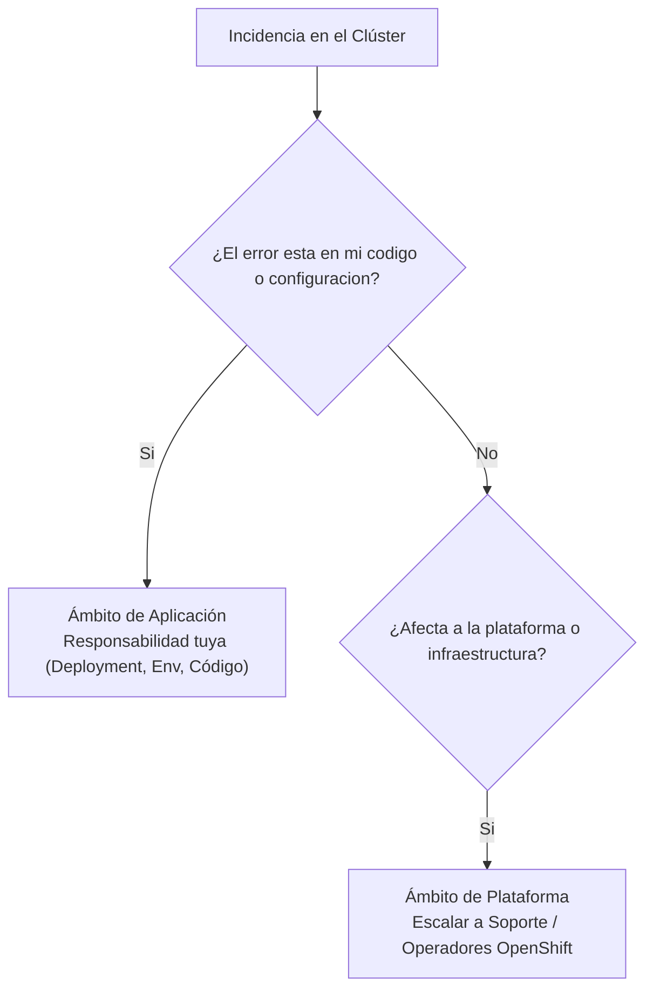

# 3.6 **¿Es mi aplicación o es la plataforma?** 

## Objetivos de aprendizaje

Al finalizar este apartado serás capaz de:

- Diagnosticar con precisión si una incidencia se originó en el código de tu aplicación o en la infraestructura del clúster.
- Interpretar el estado general de los componentes del clúster mediante `oc get co` (*Cluster Operators*).
- Identificar y analizar nodos en estado `NotReady` y su impacto directo sobre las cargas de trabajo.
- Consultar el consumo global de recursos a nivel de infraestructura utilizando `oc adm top nodes`.
- Aplicar criterios claros para decidir cuándo escalar una incidencia desde el nivel de desarrollo o aplicación hacia el equipo central de soporte de OpenShift.

---

## El gran dilema del operador: ¿Aplicación o Plataforma?

Cuando una aplicación desplegada en OpenShift deja de responder, devuelve un error 503 o directamente no arranca, la primera reacción suele ser culpar al código de la aplicación o, por el contrario, asumir de inmediato que la plataforma está rota.

En entornos distribuidos basados en Kubernetes y OpenShift, la realidad es que ambos mundos conviven de forma estrecha, y un fallo en la plataforma puede simular un error en la aplicación (o viceversa).

Para no perder tiempo persiguiendo falsas pistas, un operador eficiente debe saber responder a una pregunta fundamental:

> *¿El problema afecta únicamente a mi espacio de trabajo (*namespace*), o es un síntoma de que la plataforma subyacente está degradada?*

Para resolver esta duda con rigor, disponemos de una serie de comandos y herramientas de inspección directa del clúster.

---

## 1. El estado de los operadores: `oc get co`

En OpenShift, gran parte de la inteligencia del clúster se basa en **Operadores del Clúster** (*Cluster Operators*). Son los encargados de gestionar, actualizar y mantener en buen estado los componentes internos esenciales de la plataforma (red, almacenamiento, autenticación, registros, consola web, etc.).

Si un componente crítico de OpenShift falla, las aplicaciones que dependen de él dejarán de funcionar correctamente, aunque su código sea impecable.

Para comprobar el estado de salud global de la plataforma ejecutamos:

```bash
oc get co
```

### ¿Qué nos devuelve este comando?

El comando muestra una lista con todos los operadores del clúster y cuatro columnas clave:

```text
NAME                                       VERSION   AVAILABLE   PROGRESSING   DEGRADED   SINCE   MESSAGE
authentication                             4.14.0    True        False         False      4d      
ingress                                    4.14.0    True        False         False      4d      
monitoring                                 4.14.0    True        False         False      4d      
network                                    4.14.0    True        False         False      4d      
storage                                    4.14.0    True        False         False      4d      
```

- **AVAILABLE (`True` / `False` / `Unknown`):** Indica si el operador está en ejecución y operativo. Si un operador crítico muestra `False`, la plataforma tiene un problema grave.
- **PROGRESSING (`True` / `False`):** Indica si el operador se encuentra aplicando cambios, actualizaciones o reconciliando su estado (habitual durante un proceso de actualización del clúster).
- **DEGRADED (`True` / `False`):** Es la columna más importante para la detección de incidencias. Si un operador muestra `DEGRADED = True`, significa que no ha podido alcanzar el estado deseado y existe una anomalía interna persistente.

### ¿Cómo profundizar en un operador degradado?

Si detectamos que un operador muestra valores anómalos, podemos obtener su descripción detallada del mismo modo que lo hacemos con un Pod:

```bash
oc describe clusteroperator <nombre-del-operador>
```

Esta orden nos mostrará los mensajes de error exactos emitidos por el operador y el motivo por el cual se encuentra degradado.

---

## 2. Salud de los nodos: Identificando nodos en `NotReady`

Los nodos (*Nodes*) son los servidores físicos o virtuales que proporcionan la potencia de cálculo (CPU y memoria) donde se ejecutan realmente nuestros Pods.

Si un nodo sufre un corte de red, se queda sin espacio en disco, su servicio de contenedorización colapsa o pierde comunicación con el plano de control, el clúster lo marcará automáticamente como `NotReady`.

Para comprobar el estado de salud de todos los nodos del clúster:

```bash
oc get nodes
```

### Ejemplo de salida en un escenario de fallo:

```text
NAME                           STATUS     ROLES    AGE   VERSION
worker-infra-01.example.com    Ready      worker   10d   v1.28.0
worker-infra-02.example.com    NotReady   worker   10d   v1.28.0
master-01.example.com          Ready      master   10d   v1.28.0
```

### ¿Qué ocurre cuando un nodo pasa a estado `NotReady`?

1. **Evacuación de cargas:** Kubernetes deja de programar nuevos Pods en ese nodo.
2. **Reubicación (si aplica):** Los Pods que corrían en ese servidor y formaban parte de un Deployment con múltiples réplicas comenzarán a ser recreados automáticamente en otros nodos sanos (siempre que haya capacidad disponible).
3. **Afectación directa:** Si una aplicación crítica corría exclusivamente en ese nodo y no disponía de alta disponibilidad, sufrirá una caída de servicio hasta que el nodo recupere la normalidad.

### Diagnóstico básico de un nodo afectado

Si observamos un nodo en estado `NotReady`, podemos inspeccionar sus condiciones y eventos recientes ejecutando:

```bash
oc describe node <nombre-del-nodo>
```

Nos fijaremos especialmente en las secciones de **Conditions** (donde se evalúa el estado de la memoria, el disco y la presión de red) y en los eventos del sistema al final del informe.

---

## 3. Consumo global de infraestructura: `oc adm top nodes`

En el apartado 3.1 analizamos las métricas de nuestros propios contenedores. Sin embargo, para saber si el clúster en su conjunto sufre una saturación generalizada de recursos que esté afectando al rendimiento general, utilizamos el comando de administración de nodos:

```bash
oc adm top nodes
```

### Ejemplo de salida:

```text
NAME                          CPU(cores)   CPU%   MEMORY(bytes)   MEMORY%
master-01.example.com         1250m        31%    8192Mi          52%
worker-infra-01.example.com   3400m        85%    14200Mi         91%
worker-infra-02.example.com   4800m        120%   15800Mi         98%
```

### ¿Cómo interpretar estos datos?

- Si un nodo muestra un porcentaje de CPU o memoria cercano al **100%** (o superior, en el caso de la CPU debido al uso de *bursts*), el servidor se encuentra bajo una presión extrema.
- La saturación de memoria suele provocar que el núcleo del sistema operativo (*kernel*) active mecanismos de protección (*OOM Killer*), matando procesos de manera imprevisible.
- Cuando los nodos se saturan globalmente, el programador de OpenShift (*Scheduler*) es incapaz de ubicar nuevos Pods, provocando que múltiples despliegues se queden permanentemente en estado `Pending`.

---

## Ámbito de responsabilidad: El criterio para subir un nivel y escalar a soporte

Como desarrolladores, operadores de aplicaciones o administradores de nivel 1, es fundamental establecer una frontera clara sobre hasta dónde debemos investigar y cuándo debemos transferir la responsabilidad al equipo central de operaciones o soporte avanzado de OpenShift.



### Matriz de decisión operativa

| Situación detectada | Ámbito | ¿Quién debe actuar? |
| :--- | :--- | :--- |
| Excepciones en el código de la aplicación o variables de entorno incorrectas | Aplicación | Equipo de desarrollo / propietario del servicio |
| *Requests* o *Limits* mal dimensionados en el Deployment | Aplicación | Equipo de desarrollo / propietario del servicio |
| Un *PersistentVolumeClaim* (PVC) apunta a una *StorageClass* inexistente | Configuración | Equipo de desarrollo / operaciones del namespace |
| Operadores del clúster degradados (`oc get co`) de forma persistente | Plataforma | Equipo central de operaciones / Soporte OpenShift |
| Nodos completos en estado `NotReady` por problemas de hipervisor o red | Infraestructura | Equipo de infraestructura / Soporte OpenShift |
| Pérdida de quórum o latencia extrema en la base de datos `etcd` | Plataforma crítica | Equipo de operaciones avanzado |

!!! warning "Cuándo escalar de inmediato"
    Si tras aplicar el método sistemático de diagnóstico (`events` $\to$ `describe` $\to$ `logs`) compruebas que los recursos de red generales fallan, que los nodos principales del plano de control (*control plane*) sufren caídas de disco, o que los operadores del núcleo de OpenShift muestran errores irrecuperables, **debes dejar de investigar a nivel de aplicación y escalar inmediatamente la incidencia al equipo central de plataforma o soporte técnico**.

---

## Ideas clave para recordar

!!! tip "Resumen"
    - Distinguir si un fallo pertenece a la aplicación o a la plataforma evita perder tiempo en diagnósticos erróneos.
    - El comando `oc get co` permite evaluar de un vistazo la salud de todos los operadores del núcleo de OpenShift.
    - Un nodo en estado `NotReady` indica que el servidor ha perdido la comunicación o sufre un fallo grave que afecta a los Pods alojados en él.
    - `oc adm top nodes` ayuda a identificar cuellos de botella globales de CPU y memoria a nivel de infraestructura.
    - Conocer los límites de actuación permite separar claramente las incidencias de código/configuración (responsabilidad del equipo de desarrollo) frente a las incidencias de plataforma (derivación a soporte de OpenShift).