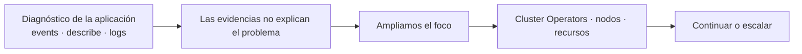

# 3.6 ¿Es mi aplicación o es la plataforma?

## Objetivos de aprendizaje

Al finalizar este apartado serás capaz de:

- Ampliar el ámbito de investigación cuando las evidencias no expliquen el fallo desde la aplicación o desde los recursos de su proyecto.
- Interpretar el estado general de los componentes de OpenShift mediante `oc get co`.
- Identificar nodos en estado `NotReady` y comprender su posible impacto sobre las cargas de trabajo.
- Consultar el consumo global de recursos de los nodos mediante `oc adm top nodes` sin extraer conclusiones a partir de una única métrica.
- Reconocer cuándo una incidencia debe continuar tratándose en el ámbito de la aplicación y cuándo conviene recopilar evidencias y escalarla al equipo responsable de la plataforma.

---

## Del diagnóstico de la aplicación a la salud de la plataforma

En el apartado anterior aprendimos a investigar una incidencia siguiendo un recorrido basado en evidencias: `events` → `describe` → `logs`. Este método permite localizar problemas relacionados con el código, la configuración y los objetos que gestiona el equipo de la aplicación.

Sin embargo, ese recorrido puede conducirnos a una situación diferente: los recursos de nuestro proyecto parecen correctamente configurados, pero el problema continúa, afecta a varias aplicaciones o apunta a un componente compartido del clúster.

En ese momento no debemos repetir indefinidamente las mismas comprobaciones sobre el Pod. Debemos **ampliar el foco** y responder a una nueva pregunta:

> **¿Sigue siendo un problema de mi aplicación o existen indicios de que la plataforma está degradada?**

El objetivo de este apartado no es realizar un diagnóstico avanzado del clúster. Se trata de comprobar unas pocas señales generales, relacionarlas con las evidencias ya obtenidas y decidir si debemos seguir trabajando en el ámbito de la aplicación o escalar la incidencia.



!!! note "Ampliar el foco no significa abandonar el método"
    Seguimos trabajando con evidencias. Un operador degradado, un nodo `NotReady` o un consumo elevado son indicios que deben relacionarse con el síntoma observado. Ninguna comprobación aislada explica por sí sola todas las incidencias.

---

## 1. Comprobar el estado de los Cluster Operators

En la sesión 1 vimos que OpenShift utiliza operadores para gestionar componentes esenciales de la plataforma. Ahora no necesitamos volver a estudiar su funcionamiento interno: los utilizaremos como una primera señal de la salud general del clúster.

```bash
oc get co
```

La salida muestra el estado de los *Cluster Operators*:

```text
NAME              VERSION   AVAILABLE   PROGRESSING   DEGRADED   SINCE   MESSAGE
authentication    4.x       True        False         False      4d
console           4.x       True        False         False      4d
ingress           4.x       True        False         False      4d
monitoring        4.x       True        False         False      4d
network           4.x       True        False         False      4d
storage           4.x       True        False         False      4d
```

Las columnas más relevantes son:

- **`AVAILABLE`**: indica si el operador dispone de sus componentes operativos.
- **`PROGRESSING`**: indica que el operador está aplicando cambios o intentando alcanzar el estado deseado. Puede ser normal durante una actualización o una reconciliación.
- **`DEGRADED`**: indica que el operador ha detectado una condición que impide que alguno de sus componentes funcione como se espera.
- **`MESSAGE`**: proporciona un resumen que puede orientar la investigación.

No debemos interpretar automáticamente cualquier valor distinto de `False` en `PROGRESSING` como una incidencia. Lo importante es comprobar si existe una degradación persistente, si el mensaje guarda relación con el síntoma y si el componente afectado es relevante para nuestra aplicación.

Por ejemplo:

- si varias Routes dejan de responder y el operador de `ingress` aparece degradado, existe una relación que debe investigar el equipo de plataforma;
- si un operador no relacionado está aplicando un cambio temporal, puede no tener ninguna conexión con nuestra incidencia;
- si todos los operadores aparecen disponibles y sin degradación, esta comprobación no demuestra que la aplicación esté bien, pero reduce la probabilidad de un problema general visible en la plataforma.

### Consultar un operador concreto

Si existe un valor anómalo y disponemos de permisos, podemos consultar información adicional:

```bash
oc describe clusteroperator <nombre-del-operador>
```

La descripción permite revisar sus condiciones y mensajes. En este nivel no intentaremos reparar el operador: utilizaremos esa información para documentar la incidencia y facilitar su escalado.

!!! warning "Diferencia con el apartado siguiente"
    Aquí utilizamos los *Cluster Operators* como indicadores de salud de OpenShift. En el apartado 3.7 estudiaremos otra perspectiva: cómo se instalan y gestionan operadores adicionales mediante OperatorHub y OLM, utilizando recursos como `Subscription` y `ClusterServiceVersion` (`CSV`).

---

## 2. Comprobar el estado de los nodos

Los Pods se ejecutan sobre los nodos del clúster. Si un nodo pierde comunicación con el plano de control o presenta un problema grave, puede pasar a estado `NotReady`.

```bash
oc get nodes
```

Ejemplo:

```text
NAME                           STATUS     ROLES    AGE   VERSION
worker-01.example.com          Ready      worker   10d   v1.x
worker-02.example.com          NotReady   worker   10d   v1.x
control-plane-01.example.com   Ready      master   10d   v1.x
```

La pregunta inicial es sencilla:

> **¿Todos los nodos están en estado `Ready`?**

Un nodo `NotReady` constituye una evidencia relevante, especialmente cuando:

- el Pod afectado estaba ejecutándose en ese nodo;
- varios Pods ubicados en el mismo nodo presentan problemas;
- el clúster no encuentra capacidad suficiente para reubicar las cargas;
- la incidencia afecta a más de un proyecto o aplicación.

OpenShift dejará de programar nuevos Pods en un nodo que no esté disponible. Las cargas gestionadas por un controlador, como un Deployment, pueden recrearse en otros nodos si el clúster determina que corresponde hacerlo y existe capacidad y configuración compatibles. Este proceso no siempre es inmediato y no garantiza la continuidad de una aplicación con una única réplica.

### Consultar las condiciones de un nodo

Si disponemos de permisos, podemos ampliar la información:

```bash
oc describe node <nombre-del-nodo>
```

Nos fijaremos principalmente en:

- la sección **`Conditions`**;
- los mensajes asociados a `Ready`;
- las condiciones de presión de memoria, disco o procesos;
- los eventos recientes del nodo.

El objetivo no es reparar el nodo desde este apartado. Si la evidencia apunta a un problema de infraestructura, debemos registrar el nodo afectado, el momento de la incidencia y los mensajes relevantes para trasladarlos al equipo responsable.

---

## 3. Consultar el consumo global de los nodos

En el apartado 3.1 analizamos las métricas de nuestros propios Pods. Cuando necesitamos ampliar el foco, podemos consultar el consumo actual de CPU y memoria de los nodos:

```bash
oc adm top nodes
```

Ejemplo:

```text
NAME                           CPU(cores)   CPU%   MEMORY(bytes)   MEMORY%
control-plane-01.example.com   1250m        31%    8192Mi          52%
worker-01.example.com          3400m        85%    14200Mi         91%
worker-02.example.com          3800m        76%    15100Mi         95%
```

Esta información puede ayudarnos a comprobar si el síntoma coincide con un uso elevado o generalizado de recursos. Sin embargo, debemos interpretarla con prudencia:

- una lectura puntual elevada no demuestra por sí sola una incidencia;
- el consumo debe relacionarse con los eventos, el estado de los Pods y la evolución temporal de las métricas;
- un Pod en `Pending` no implica automáticamente falta de CPU o memoria: el mensaje de `FailedScheduling` indicará la causa concreta;
- la presión de memoria puede afectar a las cargas, pero un porcentaje alto no permite afirmar por sí solo que se hayan producido terminaciones por falta de memoria;
- el comando puede no estar disponible para usuarios sin permisos de administración o si las métricas necesarias no están accesibles.

!!! tip "Las métricas aportan contexto, no una sentencia"
    Si varios nodos mantienen un consumo muy elevado y aparecen eventos de planificación por falta de recursos, ambas evidencias se refuerzan. Si observamos únicamente un valor alto durante unos segundos, necesitamos más información antes de relacionarlo con la incidencia.

---

## 4. Saber cuándo escalar

Después de revisar nuestra aplicación y estas señales generales de la plataforma, no necesitamos determinar la causa exacta de todos los problemas. Lo importante es reconocer cuándo la investigación ha salido de nuestro ámbito.

| Evidencia | Actuación |
|---|---|
| `events`, `describe` o `logs` apuntan a nuestra aplicación o configuración | Continuar el diagnóstico en el ámbito de la aplicación |
| Varias aplicaciones o proyectos presentan síntomas similares | Ampliar el foco a la plataforma |
| Un *Cluster Operator* relacionado aparece degradado de forma persistente | Recoger la evidencia y escalar |
| Uno o varios nodos aparecen `NotReady` | Recoger la evidencia y escalar |
| No disponemos de permisos para continuar la investigación | Trasladar al equipo responsable las evidencias obtenidas |

!!! tip "Escalar con evidencias"
    Al escalar una incidencia conviene indicar qué aplicación y proyecto están afectados, el síntoma observado, cuándo comenzó y qué comprobaciones se han realizado. El objetivo es que el siguiente nivel pueda continuar la investigación, no empezarla desde cero.

---

## Ideas clave para recordar

!!! tip "Resumen"
    - El apartado 3.5 permite diagnosticar la aplicación; este apartado amplía el foco cuando esas evidencias no explican el problema.
    - `oc get co` muestra señales generales sobre la salud de los componentes gestionados de OpenShift.
    - Un valor `PROGRESSING` no implica necesariamente un fallo; debemos prestar atención al contexto, a `DEGRADED` y a los mensajes asociados.
    - `oc get nodes` permite comprobar si todos los nodos se encuentran `Ready`.
    - `oc adm top nodes` aporta contexto sobre el consumo global, pero una lectura aislada no demuestra la causa de una incidencia.
    - El objetivo no es administrar en profundidad la plataforma, sino reconocer cuándo el problema ha salido del ámbito de la aplicación.
    - Una buena escalada incluye evidencias concretas y las comprobaciones ya realizadas.

---

## Del estado de los operadores a su gestión

En este apartado hemos utilizado los *Cluster Operators* como una señal de salud de la plataforma. En el siguiente cambiaremos de perspectiva: veremos cómo OpenShift permite incorporar y gestionar operadores adicionales mediante OperatorHub y OLM, y qué implican recursos como `Subscription` y `CSV`.
