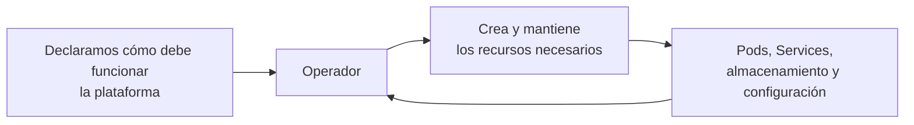
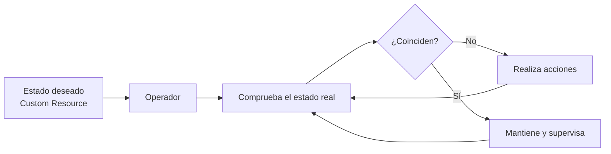

## 3.7 Operadores en la práctica: automatizar la operación de componentes complejos

### Objetivos de aprendizaje

Al finalizar este apartado serás capaz de:

- Comprender el concepto de operador en OpenShift como un mecanismo para automatizar la instalación y operación de componentes y plataformas avanzadas.
- Relacionar los operadores con las tareas de observación, diagnóstico y operación estudiadas durante esta sesión.
- Reconocer que un operador reutiliza el patrón de estado deseado y reconciliación presentado al comienzo del curso.
- Conocer la diferencia entre los componentes estándar de Kubernetes y las capacidades adicionales que añaden los recursos personalizados.
- Reconocer en el catálogo de software el contenido basado en operadores disponible para el proyecto.
- Diferenciar entre operadores proporcionados por Red Hat, operadores certificados y operadores de la comunidad.
- Comprender por qué los cambios deben realizarse sobre el recurso personalizado y no directamente sobre los recursos gestionados por el operador.

---

### De diagnosticar aplicaciones a automatizar su operación

A lo largo de esta sesión hemos aprendido a **observar y diagnosticar nuestras aplicaciones**: revisar su estado, consultar métricas, analizar logs, interpretar eventos y utilizar `oc describe` para comprender qué está ocurriendo.

Hasta ahora hemos realizado directamente esas tareas sobre aplicaciones relativamente sencillas. Sin embargo, algunas plataformas requieren una operación mucho más especializada. Una base de datos, un sistema de mensajería o una plataforma de monitorización pueden necesitar procedimientos concretos para preparar el almacenamiento, configurar réplicas, gestionar credenciales, comprobar la salud de sus componentes y realizar actualizaciones ordenadas.

En esos casos no basta con desplegar un contenedor. Es necesario aplicar conocimiento específico sobre la tecnología durante todo su ciclo de vida.

Un **operador** permite incorporar parte de ese conocimiento operativo al clúster. Actúa como un controlador especializado que instala, configura y mantiene una aplicación o un componente siguiendo las reglas definidas por su proveedor.

!!! note "El salto que damos en este apartado"
    Hasta ahora hemos aprendido a operar y diagnosticar directamente nuestras cargas. Los operadores amplían este enfoque: permiten que OpenShift automatice parte de la operación de componentes más complejos mediante conocimiento específico de cada tecnología.



#### Un mecanismo que ya conocemos: estado deseado y reconciliación

La forma de trabajar de un operador no introduce un mecanismo completamente nuevo. Se apoya en el mismo patrón de **estado deseado y reconciliación** que vimos al comienzo del curso.

En la sesión 1 comprobamos que, si eliminábamos un Pod gestionado por un Deployment, Kubernetes creaba otro para recuperar el número de réplicas declarado. El controlador comparaba el estado real con el estado deseado y actuaba para reducir la diferencia.

Un operador aplica ese mismo principio, pero incorpora además conocimiento específico sobre la tecnología que gestiona:

- observa la configuración que hemos declarado;
- comprueba el estado real de la plataforma;
- realiza las acciones necesarias para acercarlo al estado deseado;
- vuelve a comprobarlo de forma continua.



!!! important
    No estamos aprendiendo de nuevo el bucle de reconciliación. Estamos reutilizando un concepto ya conocido para comprender cómo OpenShift puede automatizar la operación de plataformas más complejas.

#### ¿Cómo sabe el operador lo que tiene que hacer?

Kubernetes conoce de forma nativa recursos como Pods, Deployments o Services. Un operador puede ampliar esta API incorporando nuevos tipos de recursos específicos para la tecnología que gestiona.

Para ello se utilizan dos conceptos:

- Una **Custom Resource Definition (CRD)** define un nuevo tipo de recurso y su estructura.
- Un **Custom Resource (CR)** es una instancia concreta de ese tipo, en la que declaramos cómo queremos que funcione la plataforma.

El operador observa ese recurso personalizado y se encarga de crear y coordinar los recursos internos necesarios.

Las CRD son recursos de ámbito de clúster. Un usuario con permisos adecuados puede consultar las definiciones registradas con:

```bash
oc get crd
```

En entornos de laboratorio con permisos restringidos, como el utilizado en este curso, esta consulta puede no estar autorizada. Para nuestro objetivo no es necesario listar las CRD del clúster: lo importante es comprender que una CRD define un nuevo tipo de recurso que un operador puede utilizar.

!!! note
    Que una CRD esté registrada no significa necesariamente que cualquier usuario pueda utilizarla. También deben existir el controlador correspondiente y los permisos necesarios.

---

### Operadores en el catálogo de software

OpenShift permite descubrir capacidades y aplicaciones disponibles para el proyecto desde **Software Catalog**. En versiones recientes de la consola, este catálogo puede reunir distintos mecanismos para incorporar software, como plantillas, gráficos Helm y contenido proporcionado mediante operadores.

Los elementos identificados como **Operator Backed** están respaldados por un operador. Esto permite relacionar lo que aparece en la consola con el concepto estudiado: detrás de ese elemento existe software que incorpora conocimiento específico para gestionar su ciclo de vida dentro del clúster.

#### Cómo acceder desde la consola web

1. Accede a **Software Catalog**.
2. Observa los distintos tipos de contenido disponibles.
3. Localiza, si están disponibles, elementos identificados como **Operator Backed**.
4. Compara esta etiqueta con otros mecanismos presentes en el catálogo, como **Helm Charts**.

!!! note
    La disponibilidad del contenido basado en operadores depende de la configuración del clúster, los catálogos habilitados y los permisos del usuario. En entornos de laboratorio con permisos restringidos algunas opciones pueden no estar disponibles.

---

### Origen y soporte de los operadores

En el catálogo pueden aparecer operadores de distintos proveedores y con diferentes niveles de soporte.

| Tipo | Qué indica | Consideración de uso |
| --- | --- | --- |
| **Red Hat** | Operador proporcionado y soportado por Red Hat conforme a sus condiciones de soporte. | Debe priorizarse cuando encaje con la necesidad y se requiera soporte del fabricante. |
| **Certified** | Operador de un socio, validado para su distribución en el ecosistema de Red Hat. | Deben revisarse el soporte del proveedor y la compatibilidad documentada. |
| **Community** | Operador mantenido por una comunidad o proyecto, sin el mismo compromiso de soporte comercial. | Requiere evaluar especialmente su mantenimiento, seguridad, compatibilidad y modelo de soporte. |

La etiqueta mostrada en el catálogo constituye una primera referencia, pero no sustituye la revisión de la ficha concreta del operador, la documentación del proveedor y las condiciones de soporte aplicables.

---

### No modificar directamente los recursos gestionados

Como el operador compara continuamente el estado real con el estado deseado, un cambio manual sobre un recurso interno puede ser revertido.

Por ejemplo, si modificamos directamente un Deployment creado por un operador, este puede detectar que ya no coincide con la configuración declarada en el recurso personalizado y restaurar el valor esperado.

La regla general es sencilla:

- no modificar directamente los Pods, Deployments, Services u otros recursos creados por el operador;
- realizar los cambios en el **Custom Resource** correspondiente o mediante el mecanismo indicado por la documentación del operador;
- utilizar las técnicas de diagnóstico estudiadas en esta sesión para revisar el estado del recurso personalizado, sus eventos y los logs del operador cuando el estado deseado no pueda alcanzarse.

!!! warning "La fuente de configuración es el recurso personalizado"
    Si un componente está gestionado por un operador, el cambio debe realizarse sobre el recurso que expresa el estado deseado. Modificar directamente los recursos internos puede producir cambios temporales, inconsistencias o correcciones automáticas por parte del operador.

---

### Demo guiada: reconocer operadores en la consola

Para este apartado es suficiente una **demo guiada por el profesor** o una exploración muy sencilla mediante la consola. El objetivo no es instalar un operador nuevo, sino conectar los conceptos explicados con los elementos que el entorno permita observar.

#### Recorrido propuesto

1. Acceder a **Software Catalog**.
2. Observar que OpenShift presenta distintos mecanismos para incorporar software al proyecto.
3. Localizar, si están disponibles, elementos identificados como **Operator Backed**.
4. Compararlos visualmente con otros mecanismos que aparecen en el catálogo, por ejemplo **Helm Charts**.
5. Abrir alguno de los elementos disponibles y observar la información que proporciona la consola.
6. No instalar ni modificar ningún componente.

!!! note
    Si el catálogo no carga completamente el contenido de operadores, la demostración puede limitarse a identificar los elementos marcados como **Operator Backed** y relacionarlos con los conceptos estudiados.

---

### Ideas clave para recordar

!!! tip "Resumen"
    - Durante esta sesión hemos aprendido a observar y diagnosticar directamente nuestras aplicaciones. Los operadores permiten automatizar parte de la operación de plataformas más complejas.
    - Un **operador** incorpora conocimiento especializado para instalar, configurar y mantener una tecnología dentro del clúster.
    - Un operador reutiliza el patrón de **estado deseado y reconciliación** que ya conocemos; no estamos aprendiendo de nuevo ese mecanismo.
    - Una **CRD** define un nuevo tipo de recurso y un **Custom Resource** expresa el estado deseado de una instancia concreta.
    - **Software Catalog** permite descubrir distintos tipos de contenido para el proyecto; los elementos identificados como **Operator Backed** están respaldados por un operador.
    - El origen y la etiqueta de un operador no sustituyen la revisión de su documentación, compatibilidad y condiciones de soporte.
    - Los componentes internos gestionados por un operador no deben modificarse directamente. El cambio debe realizarse sobre el recurso personalizado que expresa el estado deseado.
    - Para este nivel del curso basta con reconocer estos elementos mediante una **demo guiada en la consola**, sin realizar una instalación completa.
