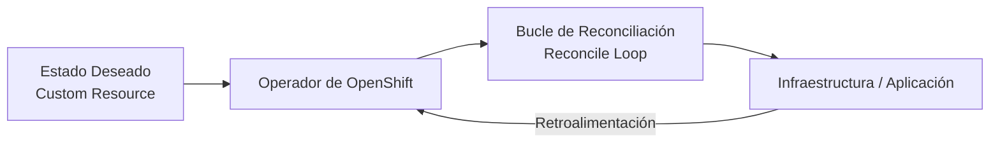
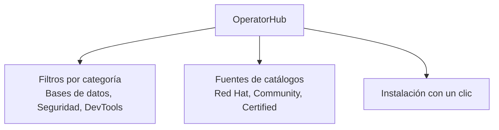
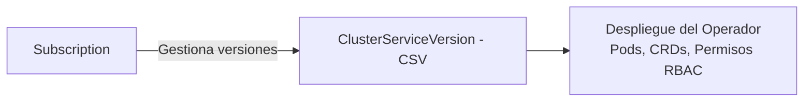
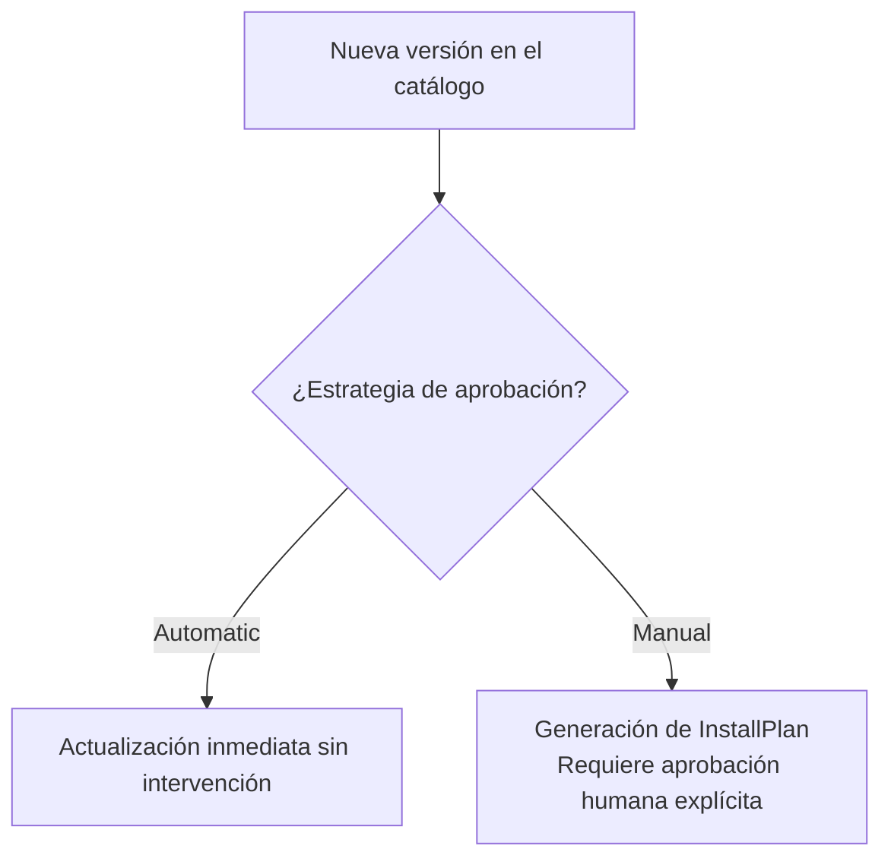

# 3.7 Operadores en la práctica: OperatorHub, subscription y CSV, canales de actualización, comunidad frente a certificado, y los riesgos (drift, reconcile en bucle)

## Objetivos de aprendizaje

Al finalizar este apartado serás capaz de:

- Comprender el concepto de operador en Kubernetes y OpenShift y su evolución desde controladores nativos.
- Utilizar OperatorHub como catálogo centralizado para descubrir e instalar extensiones en el clúster.
- Identificar los recursos fundamentales que gestionan un operador: *Subscription* y *ClusterServiceVersion (CSV)*.
- Entender el funcionamiento de los canales de actualización (*channels*) y las estrategias de gestión del ciclo de vida.
- Diferenciar entre operadores certificados por Red Hat y operadores de la comunidad, evaluando implicaciones de soporte y fiabilidad.
- Identificar y mitigar los riesgos operativos asociados al uso de operadores, como la deriva de configuración (*drift*) y los bucles infinitos de reconciliación (*reconcile loop*).

---

## ¿Qué es un operador y por qué surge este modelo?

Tradicionalmente, la administración de aplicaciones complejas con estado (como bases de datos distribuidas, sistemas de mensajería o herramientas de monitorización) en Kubernetes requería una enorme cantidad de intervención humana mediante scripts manuales o herramientas externas.

Para automatizar estas operaciones complejas, Red Hat y la comunidad introdujeron el concepto de **Operador** (*Operator*).

Un operador es un controlador personalizado que extiende la API de Kubernetes para automatizar la gestión completa del ciclo de vida de una aplicación compleja, empaquetando el conocimiento operativo (*operational knowledge*) directamente dentro del clúster.

El operador vigila constantemente los recursos personalizados (*Custom Resources* o CR) creados en el clúster y ejecuta un bucle continuo de reconciliación (*reconcile loop*) para asegurar que el estado real del sistema coincida exactamente con el estado deseado declarado por el administrador.

---

## OperatorHub: El catálogo centralizado de extensiones

En lugar de tener que buscar manifiestos dispersos por internet o compilar herramientas de manera manual, OpenShift incluye de serie **OperatorHub**.

OperatorHub es un catálogo integrado dentro de la consola web que centraliza el descubrimiento, la instalación y la gestión de operadores certificados y de terceros.

### Acceso a OperatorHub desde la consola web:
1. Cambia a la perspectiva **Administrator**.
2. Navega a **Operators → OperatorHub**.
3. Utiliza los filtros para buscar tecnologías específicas (por ejemplo, bases de datos, herramientas de integración o sistemas de seguridad).

---

## Las piezas clave bajo el capó: *Subscription* y *CSV*

Cuando seleccionamos e instalamos un operador desde OperatorHub, OpenShift no se limita a desplegar un simple Pod estanco; por debajo se configuran dos recursos fundamentales que automatizan su ciclo de vida:

### 1. Subscription (Suscripción)
La **Subscription** es el recurso que define qué operador queremos instalar, de qué catálogo (*CatalogSource*) debe obtenerse y a qué **canal de actualización** (*channel*) nos queremos suscribir. 

Su función principal es vigilar las actualizaciones disponibles y decidir si se aplican de forma automática o manual.

### 2. ClusterServiceVersion (CSV)
El **ClusterServiceVersion** es el manifiesto definitivo que contiene toda la metadata, la lógica y los requisitos del operador en una versión concreta:
- Los manifiestos de los Pods que componen el operador.
- Las definiciones de recursos personalizados (*CustomResourceDefinitions* o CRDs) que añade al clúster.
- Los permisos de seguridad y roles RBAC necesarios para funcionar.
- La descripción visual, iconos y documentación que aparecen en la consola web.

---

## Canales de actualización (*Channels*) y estrategias de ciclo de vida

Los operadores evolucionan constantemente. Para permitir que los administradores controlen el ritmo de los cambios sin romper los entornos de producción, OperatorHub organiza las versiones mediante **canales de actualización**.

Un canal (por ejemplo, `stable`, `fast`, `v1.4`, `release-2.0`) agrupa una línea evolutiva de versiones del operador.

### Estrategias de aprobación de actualizaciones (*Approval Strategies*)
Al configurar una *Subscription*, podemos definir cómo se aplicarán las nuevas versiones que aparezcan en el canal:

- **Automática (*Automatic*):** Tan pronto como el catálogo detecta una nueva versión en el canal seleccionado, el operador se actualiza solo sin intervención humana. Es ideal para entornos de desarrollo o laboratorios.
- **Manual (*Manual*):** Cuando se publica una nueva versión, el clúster genera una solicitud de aprobación (*InstallPlan*). El administrador debe revisar los cambios y aprobar explícitamente la actualización desde la consola antes de que se aplique. Es el enfoque recomendado en entornos críticos de producción para evitar sorpresas o incompatibilidades.

---

## Comunidad frente a Certificado: Origen y soporte de los operadores

No todos los operadores disponibles en OperatorHub tienen el mismo nivel de respaldo corporativo. Al desplegar un operador, debemos prestar especial atención a su distintivo de origen:

| Tipo de Operador | Proveedor / Origen | Nivel de Soporte y Garantía |
| :--- | :--- | :--- |
| **Red Hat / Red Hat Certified** | Desarrollados directamente por Red Hat o por socios tecnológicos oficiales | Soportados oficialmente por Red Hat. Garantía de compatibilidad total con las actualizaciones del clúster. |
| **Community (Comunidad)** | Mantenidos por desarrolladores independientes o proyectos de código abierto | Sin soporte oficial de Red Hat. Se utilizan bajo responsabilidad propia, habituales en entornos de pruebas o tecnologías secundarias. |

!!! note "Criterio de selección"
    En entornos empresariales y de producción, se recomienda priorizar operadores con certificación oficial (*Red Hat* o *Certified*) para garantizar la estabilidad del clúster y disponer de canales de soporte garantizados ante incidencias críticas.

---

## Los riesgos operativos de los operadores

Aunque los operadores aportan un enorme valor al automatizar tareas complejas, su uso incorrecto introduce riesgos arquitectónicos importantes que todo operador de OpenShift debe conocer.

### 1. Deriva de configuración (*Configuration Drift*)
La deriva de configuración ocurre cuando un administrador modifica manualmente componentes internos de una aplicación gestionada por un operador (por ejemplo, editando directamente un Deployment o un fichero de configuración creado por el operador) sin pasar por el recurso personalizado (*Custom Resource*).

- **¿Qué sucede?** Al cabo de unos segundos o minutos, el operador detectará que la realidad del clúster no coincide con el estado deseado declarado en el CR y **sobrescribirá o revertirá** los cambios manuales aplicados por el administrador.
- **Lección clave:** Con un operador activo, nunca se debe modificar de forma manual la infraestructura subyacente que este gestiona; cualquier cambio debe realizarse exclusivamente alterando el manifiesto del recurso personalizado.

### 2. Bucles infinitos de reconciliación (*Reconcile Loop*)
El bucle de reconciliación es el mecanismo fundamental mediante el cual el operador evalúa el estado del clúster. Sin embargo, si el código del operador está mal diseñado o la configuración inicial contiene errores sintácticos o lógicos recurrentes:

- **¿Qué sucede?** El operador puede entrar en un bucle infinito intentando corregir un estado erróneo sin conseguirlo, consumiendo masivamente recursos de CPU y memoria en el clúster, saturando los registros del sistema y bloqueando otras operaciones de la API.
- **Mitigación:** Es fundamental revisar los logs del propio operador ante comportamientos extraños y asegurarse de utilizar versiones estables y probadas.

---

## Ideas clave para recordar

!!! tip "Resumen"
    - Un **Operador** es un controlador personalizado que automatiza la gestión de aplicaciones complejas mediante un bucle continuo de reconciliación.
    - **OperatorHub** es el catálogo integrado de OpenShift para descubrir e instalar extensiones de forma centralizada.
    - La **Subscription** gestiona el origen y los canales de actualización, mientras que el **ClusterServiceVersion (CSV)** define los recursos y permisos reales del operador.
    - Los canales de actualización permiten elegir entre estrategias automáticas (ideales para desarrollo) o manuales (recomendadas en producción).
    - Los operadores **certificados por Red Hat** ofrecen soporte oficial y garantías de compatibilidad frente a los operadores de la **comunidad**.
    - La **deriva de configuración (*drift*)** se produce cuando se intenta modificar manualmente un recurso gestionado por un operador, siendo revertido automáticamente.
    - Un diseño defectuoso puede provocar **bucles infinitos de reconciliación**, saturando los recursos del clúster y requiriendo supervisión estricta de logs.