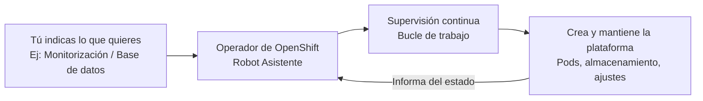
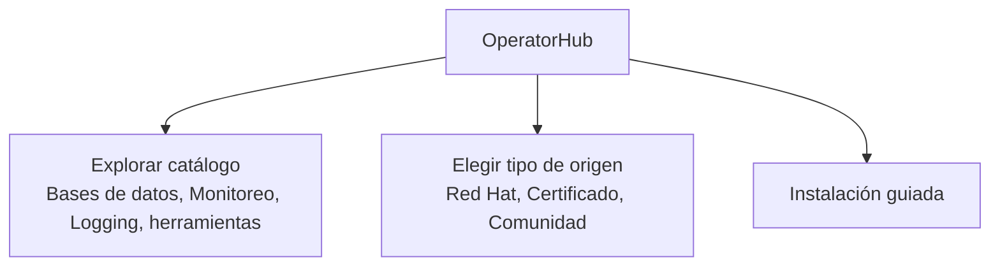
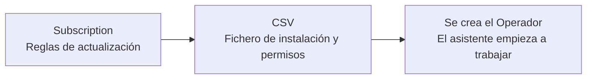

# 3.7 Operadores en la práctica: OperatorHub, subscription y CSV, canales de actualización, comunidad frente a certificado, y los riesgos (drift, reconcile en bucle)

## Objetivos de aprendizaje

Atendiendo a este apartado, al finalizar serás capaz de:

- Comprender el concepto de operador en OpenShift de forma sencilla como un "asistente automático" para instalar y mantener componentes y plataformas avanzadas.
- Conocer la diferencia entre los componentes estándar de Kubernetes y las capacidades adicionales que añaden los recursos personalizados.
- Navegar por OperatorHub como el catálogo central de aplicaciones y extensiones del clúster.
- Identificar y consultar mediante la línea de comandos los recursos clave de un operador que viene instalado de serie, como los operadores del subsistema de monitorización (*monitoring*).
- Entender el funcionamiento de los canales de actualización (*channels*) y cómo gestionar su ciclo de vida.
- Diferenciar entre operadores oficiales/certificados y operadores de la comunidad, evaluando las buenas prácticas corporativas de soporte y estabilidad.
- Reconocer los riesgos operativos de trabajar con operadores: cambios manuales sobrescritos (*drift*) y fallos en bucle (*reconcile loop*).

---

## ¿Qué es un operador y por qué existe?

Imagina que quieres instalar en un entorno productivo un sistema complejo o una plataforma avanzada, como una base de datos distribuida (ej. PostgreSQL), un sistema de mensajería (ej. AMQ) o una plataforma de monitorización integral. No basta con desplegar un contenedor suelto; se requiere un conjunto de tareas continuas: configuraciones específicas, copias de seguridad, gestión de failover, escalado y actualizaciones ordenadas.

Para automatizar estas tareas complejas, Kubernetes y OpenShift introdujeron el concepto de **Operador**.

Un **operador** es como un **"asistente automático"** o un **"robot de mantenimiento"** que vive dentro de OpenShift. Su trabajo es empaquetar todo el conocimiento de un experto en esa tecnología para instalarla, vigilarla y mantenerla funcionando sin que un humano tenga que intervenir constantemente.



### ¿Cómo sabe el operador lo que tiene que hacer?
Normalmente, Kubernetes entiende conceptos básicos como Pods o Servicios. Pero cuando instalamos un operador, este enseña a OpenShift "nuevas palabras" o ficheros de configuración específicos para esa tecnología (llamados **Recursos Personalizados** o *Custom Resources*).

Tú solo tienes que rellenar una plantilla sencilla diciendo qué componentes necesitas. El operador lee esa plantilla y se encarga automáticamente de crear y coordinar todos los recursos internos necesarios.

---

## OperatorHub: La tienda de aplicaciones del clúster

Para que no tengas que buscar scripts o archivos de configuración dispersos por internet, OpenShift incluye una pantalla centralizada llamada **OperatorHub**.

Es el equivalente a una tienda de extensiones y plataformas empresariales integrada directamente en la consola web.



### Cómo acceder desde la consola web:
1. Cambia a la perspectiva **Administrator**.
2. Ve al menú **Operators → OperatorHub**.
3. Usa el buscador o los filtros laterales para encontrar la plataforma o extensión que necesitas.

---

## Inspección práctica con operadores de serie (ej. Monitorización)

Además de la interfaz gráfica, podemos utilizar la línea de comandos para inspeccionar los componentes de los operadores que vienen integrados de serie en OpenShift, como el operador de monitorización (`monitoring`).

### 1. Comprobar los recursos personalizados del clúster (`oc get crd`)
Las **CRDs** (*Custom Resource Definitions*) son las "nuevas palabras" que los operadores añaden al vocabulario de OpenShift. Podemos auditar qué definiciones de recursos personalizados están registradas en el clúster ejecutando:

```bash
oc get crd
```

Si queremos localizar de forma específica las CRDs asociadas al operador de monitorización o métricas de la plataforma, podemos filtrar el resultado:

```bash
oc get crd | grep -i monitoring
```

### 2. Inspeccionar la suscripción del operador del sistema (`oc get subscription`)
La **Subscription** es el recurso que indica qué operador queremos mantener actualizado y de qué canal proviene. Dado que el operador de monitorización se despliega de manera nativa en el espacio de nombres del sistema (`openshift-monitoring`), podemos consultarlo directamente:

```bash
oc get subscription -n openshift-monitoring
```

Si queremos ver la información detallada de la suscripción del clúster para comprobar su canal y estado actual de sincronización:

```bash
oc describe subscription -n openshift-monitoring
```

---

## Las piezas clave bajo el capó: *Subscription* y *CSV*

Cuando se instala un operador (tanto los nativos de plataforma como los seleccionados desde OperatorHub), OpenShift configura automáticamente dos piezas clave por debajo:



1. **Subscription (Suscripción):** Es el recurso que define de qué catálogo debe obtenerse el operador y cómo debe gestionar sus actualizaciones cuando salga una versión nueva (si se aplican de forma automática o manual).
2. **ClusterServiceVersion (CSV):** Es el manifiesto definitivo que contiene la versión exacta, los metadatos, los permisos de seguridad (RBAC) y la descripción visual necesarios para que el operador funcione en el clúster.

---

## Canales de actualización (*Channels*)

Los desarrolladores de un operador publican mejoras y correcciones de forma continua. Para evitar cambios imprevistos que puedan romper el entorno, las versiones se organizan en **canales** (como *stable*, *fast*, *v1.4*).

Al configurar la suscripción, puedes elegir la estrategia de aprobación:

- **Estrategia Automática:** Si aparece una nueva versión en el canal seleccionado, OpenShift la descarga y la aplica sola. Es muy útil en entornos de pruebas o laboratorios.
- **Estrategia Manual:** Cuando hay una actualización disponible, OpenShift genera una solicitud y espera a que un administrador apruebe explícitamente el cambio. Es la opción recomendada en entornos corporativos de producción.

---

## Operadores Certificados frente a la Comunidad

En OperatorHub verás operadores con distintas etiquetas de origen. A la hora de elegir uno para tus proyectos, conviene tener en cuenta las siguientes buenas prácticas corporativas:

| Tipo | Origen | Recomendación de uso |
| :--- | :--- | :--- |
| **Red Hat / Red Hat Certified** | Desarrollados o validados oficialmente por Red Hat o socios tecnológicos oficiales. | **Recomendados para producción.** Cuentan con soporte técnico oficial y total garantía de compatibilidad ante actualizaciones del clúster. |
| **Community (Comunidad)** | Mantenidos por desarrolladores independientes o proyectos de código abierto. | **Ideales para pruebas y desarrollo.** Se utilizan bajo responsabilidad propia, ya que no disponen de soporte oficial garantizado por Red Hat. |

---

## Riesgos y fallos típicos al usar operadores

Aunque un operador automatiza tareas muy complejas, un uso incorrecto de los recursos que gestiona puede provocar situaciones inesperadas:

### 1. Deshacer cambios manuales (*Configuration Drift*)
Si un operador está gestionando una plataforma y un administrador intenta modificar algo "a mano" por su cuenta (por ejemplo, editando directamente un Pod o un Deployment creado por el operador):

- **¿Qué pasará?** Al cabo de unos segundos o minutos, el operador detectará que la realidad del clúster no coincide con el estado deseado declarado en su plantilla principal y **revertirá o sobrescribirá** tu cambio manual.
- **La regla de oro:** Nunca modifiques de forma manual la infraestructura interna que gestiona un operador. Si necesitas cambiar algún parámetro, hazlo siempre editando el recurso personalizado (*Custom Resource*) correspondiente.

### 2. El operador se queda en bucle (*Reconcile loop*)
El operador revisa de forma continua si el sistema se encuentra en el estado deseado. 

Si la configuración inicial contiene un error o la aplicación no puede arrancar (por ejemplo, por falta de recursos):
- El operador intentará corregirlo de manera insistente una y otra vez sin éxito.
- Esto puede generar un consumo elevado de CPU y saturar los registros del sistema.
- **Mitigación:** Si observas un comportamiento anómalo o un consumo sostenido, revisa los registros (*logs*) del propio operador y valida que los parámetros de configuración inicial sean correctos.

---

## Ideas clave para recordar

!!! tip "Resumen"
    - Un **operador** es un asistente automatizado que simplifica la gestión de plataformas y tecnologías complejas en OpenShift.
    - **OperatorHub** centraliza el descubrimiento y la instalación de operadores dentro de la consola web.
    - Los comandos `oc get crd` y `oc get subscription -n openshift-monitoring` permiten auditar de forma rápida las extensiones y suscripciones de los operadores nativos del clúster.
    - La **Subscription** gestiona los canales de actualización, mientras que el **ClusterServiceVersion (CSV)** agrupa la lógica y permisos del operador.
    - Es recomendable utilizar **estrategias de aprobación manual** en entornos de producción.
    - Prioriza operadores **certificados por Red Hat** en entornos corporativos para asegurar soporte y estabilidad.
    - **Evita realizar cambios manuales** en los componentes internos gestionados por un operador para prevenir la deriva de configuración (*drift*).
    - Un diseño defectuoso o una mala configuración puede provocar **bucles de reconciliación**, por lo que es vital supervisar los logs ante incidencias.