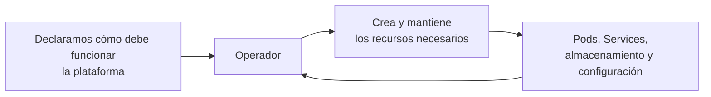
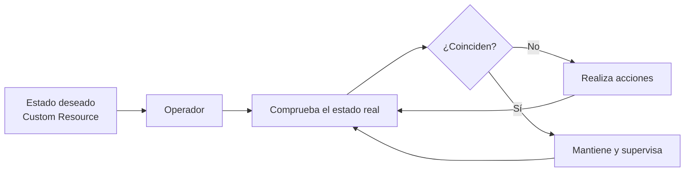
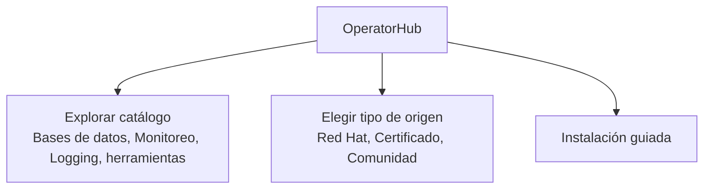
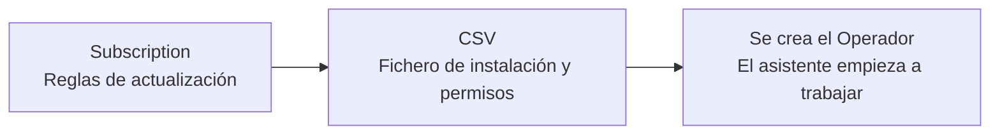

# 3.7 Operadores en la práctica: automatizar la operación de componentes complejos

## Objetivos de aprendizaje

Atendiendo a este apartado, al finalizar serás capaz de:

- Comprender el concepto de operador en OpenShift de forma sencilla como un "asistente automático" para instalar y mantener componentes y plataformas avanzadas.
- Conocer la diferencia entre los componentes estándar de Kubernetes y las capacidades adicionales que añaden los recursos personalizados.
- Navegar por OperatorHub como el catálogo central de aplicaciones y extensiones del clúster.
- Identificar y consultar mediante la línea de comandos los recursos clave de un operador que viene instalado de serie, como los operadores del subsistema de monitorización (*monitoring*).
- Entender el funcionamiento de los canales de actualización (*channels*) y cómo gestionar su ciclo de vida.
- Diferenciar entre operadores oficiales/certificados y operadores de la comunidad, evaluando las buenas prácticas corporativas de soporte y estabilidad.
- Comprender por qué los cambios deben realizarse sobre el recurso personalizado y no directamente sobre los recursos gestionados por el operador.

---

## De diagnosticar aplicaciones a automatizar su operación

A lo largo de esta sesión hemos aprendido a **observar y diagnosticar nuestras aplicaciones**: revisar su estado, consultar métricas, analizar logs, interpretar eventos y utilizar `oc describe` para entender qué está ocurriendo.

Hasta ahora hemos realizado directamente esas tareas sobre aplicaciones relativamente sencillas. Sin embargo, algunas plataformas requieren una operación mucho más especializada. Una base de datos, un sistema de mensajería o una plataforma de monitorización pueden necesitar procedimientos concretos para preparar el almacenamiento, configurar réplicas, gestionar credenciales, comprobar la salud de sus componentes y realizar actualizaciones ordenadas.

En esos casos no basta con desplegar un contenedor. Es necesario aplicar conocimiento específico sobre la tecnología durante todo su ciclo de vida.

Un **operador** permite incorporar parte de ese conocimiento operativo al clúster. Actúa como un controlador especializado que instala, configura y mantiene una aplicación o componente siguiendo las reglas definidas por su proveedor.

!!! note "El salto que damos en este apartado"
    Hasta ahora hemos aprendido a operar y diagnosticar directamente nuestras cargas. Los operadores amplían este enfoque: permiten que OpenShift automatice parte de la operación de componentes más complejos mediante conocimiento específico de cada tecnología.



### Un mecanismo que ya conocemos: estado deseado y reconciliación

La forma de trabajar de un operador no introduce un mecanismo completamente nuevo. Se apoya en el mismo patrón de **estado deseado y reconciliación** que vimos al comienzo del curso.

En la sesión 1 comprobamos que, si eliminábamos un Pod gestionado por un `Deployment`, Kubernetes creaba otro para recuperar el número de réplicas declarado. El controlador comparaba el estado real con el estado deseado y actuaba para reducir la diferencia.

Un operador aplica ese mismo principio, pero incorpora además conocimiento específico sobre la tecnología que gestiona:

1. observa la configuración que hemos declarado;
2. comprueba el estado real de la plataforma;
3. realiza las acciones necesarias para acercarlo al estado deseado;
4. vuelve a comprobarlo de forma continua.



!!! important
    No estamos aprendiendo de nuevo el bucle de reconciliación. Estamos reutilizando un concepto ya conocido para comprender cómo OpenShift puede automatizar la operación de plataformas más complejas.

### ¿Cómo sabe el operador lo que tiene que hacer?

Normalmente, Kubernetes entiende conceptos básicos como Pods o Servicios. Pero cuando instalamos un operador, este enseña a OpenShift "nuevas palabras" o ficheros de configuración específicos para esa tecnología (llamados **Recursos Personalizados** o *Custom Resources*).

Tú solo tienes que rellenar una plantilla sencilla diciendo qué componentes necesitas. El operador lee esa plantilla y se encarga automáticamente de crear y coordinar todos los recursos internos necesarios.

---

## OperatorHub: La tienda de aplicaciones del clúster

Para que no tengas que buscar scripts o archivos de configuración dispersos por internet, OpenShift incluye una pantalla centralizada llamada **OperatorHub**.

Es el equivalente a una tienda de extensiones y plataformas empresariales integrada directamente en la consola web.



### Cómo acceder desde la consola web:
1. Cambia a la perspectiva **Administrator**.
2. Ve al menú **Operators → OperatorHub**.
3. Usa el buscador o los filtros laterales para encontrar la plataforma o extensión que necesitas.

---

## Inspección práctica con operadores de serie (ej. Monitorización)

Además de la interfaz gráfica, podemos utilizar la línea de comandos para inspeccionar los componentes de los operadores que vienen integrados de serie en OpenShift, como el operador de monitorización (`monitoring`).

### 1. Comprobar los recursos personalizados del clúster (`oc get crd`)
Las **CRDs** (*Custom Resource Definitions*) son las "nuevas palabras" que los operadores añaden al vocabulario de OpenShift. Podemos auditar qué definiciones de recursos personalizados están registradas en el clúster ejecutando:

```bash
oc get crd
```

Si queremos localizar de forma específica las CRDs asociadas al operador de monitorización o métricas de la plataforma, podemos filtrar el resultado:

```bash
oc get crd | grep -i monitoring
```

### 2. Inspeccionar la suscripción del operador del sistema (`oc get subscription`)
La **Subscription** es el recurso que indica qué operador queremos mantener actualizado y de qué canal proviene. En los operadores instalados mediante OLM, podemos consultar las suscripciones en el espacio de nombres correspondiente:

```bash
oc get subscription -n <namespace-del-operador>
```

Si queremos ver la información detallada de la suscripción del clúster para comprobar su canal y estado actual de sincronización:

```bash
oc describe subscription <nombre> -n <namespace-del-operador>
```

---

## Las piezas clave bajo el capó: *Subscription* y *CSV*

Cuando se instala un operador instalado y gestionado mediante OLM, OpenShift configura automáticamente dos piezas clave por debajo:



1. **Subscription (Suscripción):** Es el recurso que define de qué catálogo debe obtenerse el operador y cómo debe gestionar sus actualizaciones cuando salga una versión nueva (si se aplican de forma automática o manual).
2. **ClusterServiceVersion (CSV):** Es el manifiesto definitivo que contiene la versión exacta, los metadatos, los permisos de seguridad (RBAC) y la descripción visual necesarios para que el operador funcione en el clúster.

---

## Canales de actualización (*Channels*)

Los desarrolladores de un operador publican mejoras y correcciones de forma continua. Para evitar cambios imprevistos que puedan romper el entorno, las versiones se organizan en **canales** (como *stable*, *fast*, *v1.4*).

Al configurar la suscripción, puedes elegir la estrategia de aprobación:

- **Estrategia Automática:** Si aparece una nueva versión en el canal seleccionado, OpenShift la descarga y la aplica sola. Es muy útil en entornos de pruebas o laboratorios.
- **Estrategia Manual:** Cuando hay una actualización disponible, OpenShift genera una solicitud y espera a que un administrador apruebe explícitamente el cambio. Es la opción recomendada en entornos corporativos de producción.

---

## Operadores Certificados frente a la Comunidad

En OperatorHub verás operadores con distintas etiquetas de origen. A la hora de elegir uno para tus proyectos, conviene tener en cuenta las siguientes buenas prácticas corporativas:

| Tipo | Origen | Recomendación de uso |
| :--- | :--- | :--- |
| **Red Hat / Red Hat Certified** | Desarrollados o validados oficialmente por Red Hat o socios tecnológicos oficiales. | **Recomendados para producción.** Cuentan con soporte técnico oficial y total garantía de compatibilidad ante actualizaciones del clúster. |
| **Community (Comunidad)** | Mantenidos por desarrolladores independientes o proyectos de código abierto. | **Ideales para pruebas y desarrollo.** Se utilizan bajo responsabilidad propia, ya que no disponen de soporte oficial garantizado por Red Hat. |

---

## No modificar directamente los recursos gestionados

Como el operador compara continuamente el estado real con el estado deseado, un cambio manual sobre un recurso interno puede ser revertido.

Por ejemplo, si modificamos directamente un `Deployment` creado por un operador, este puede detectar que ya no coincide con la configuración declarada en el recurso personalizado y restaurar el valor esperado.

La regla general es sencilla:

- no modificar directamente los Pods, Deployments, Services u otros recursos creados por el operador;
- realizar los cambios en el **Custom Resource** correspondiente o mediante el mecanismo indicado por la documentación del operador;
- utilizar las técnicas de diagnóstico estudiadas en esta sesión para revisar el estado del recurso personalizado, sus eventos y los logs del operador cuando el estado deseado no pueda alcanzarse.

!!! warning "La fuente de configuración es el recurso personalizado"
    Si un componente está gestionado por un operador, el cambio debe realizarse sobre el recurso que expresa el estado deseado. Modificar directamente los recursos internos puede producir cambios temporales, inconsistencias o correcciones automáticas por parte del operador.

---

## Demo guiada: explorar un operador desde la consola

Para este apartado es suficiente una **demo guiada por el profesor** o una exploración muy sencilla mediante la consola. El objetivo no es instalar un operador nuevo, sino reconocer dónde se encuentra la información relevante y relacionarla con los conceptos explicados.

### Recorrido propuesto

1. Acceder a **Operators → OperatorHub** desde la perspectiva **Administrator**.
2. Buscar un operador disponible en el clúster.
3. Abrir su ficha y localizar el proveedor, el nivel de soporte, los canales, el ámbito de instalación y los recursos personalizados que proporciona.
4. Acceder a **Operators → Installed Operators** y observar los operadores ya instalados, si los permisos y el entorno lo permiten.
5. Abrir uno de ellos e identificar su estado, versión y recursos proporcionados, sin modificar su configuración.

!!! note
    La disponibilidad de operadores y las opciones visibles dependen de los catálogos habilitados, la versión del clúster y los permisos del usuario. La demostración debe adaptarse al entorno utilizado durante la formación.

---

## Ideas clave para recordar

!!! tip "Resumen"
    - Un **operador** incorpora conocimiento especializado para automatizar la instalación y operación de plataformas complejas en OpenShift.
    - **OperatorHub** centraliza el descubrimiento y la instalación de operadores dentro de la consola web.
    - Los comandos `oc get crd` y `oc get subscription -n <namespace-del-operador>` permiten auditar de forma rápida las extensiones y suscripciones de los operadores nativos del clúster.
    - La **Subscription** gestiona los canales de actualización, mientras que el **ClusterServiceVersion (CSV)** agrupa la lógica y permisos del operador.
    - Es recomendable utilizar **estrategias de aprobación manual** en entornos de producción.
    - Prioriza operadores **certificados por Red Hat** en entornos corporativos para asegurar soporte y estabilidad.
    - Un operador reutiliza el patrón de **estado deseado y reconciliación** que ya conocemos, aplicado ahora a recursos personalizados y con conocimiento específico de una tecnología.
    - **Evita realizar cambios manuales** en los componentes internos gestionados por un operador; modifica el recurso personalizado que expresa el estado deseado.
    - Para este nivel basta con reconocer estos elementos mediante una **demo guiada en la consola**, sin realizar una instalación completa.
