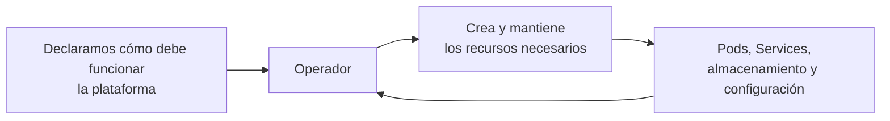
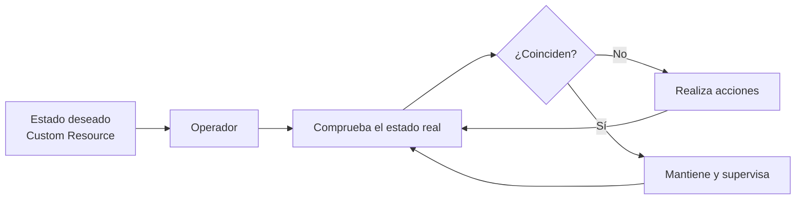
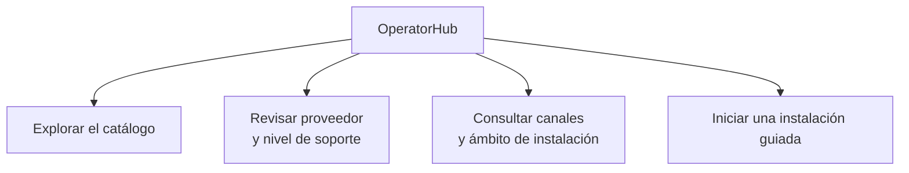
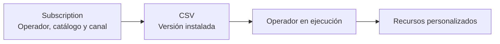

## 3.7 Operadores en la práctica: automatizar la operación de componentes complejos

### Objetivos de aprendizaje

Al finalizar este apartado serás capaz de:

- Comprender el concepto de operador en OpenShift como un mecanismo para automatizar la instalación y operación de componentes y plataformas avanzadas.
- Relacionar los operadores con las tareas de observación, diagnóstico y operación estudiadas durante esta sesión.
- Reconocer que un operador reutiliza el patrón de estado deseado y reconciliación presentado al comienzo del curso.
- Conocer la diferencia entre los componentes estándar de Kubernetes y las capacidades adicionales que añaden los recursos personalizados.
- Navegar por OperatorHub como catálogo de operadores disponibles para el clúster.
- Identificar los recursos principales utilizados por Operator Lifecycle Manager (OLM), especialmente `Subscription` y `ClusterServiceVersion` (`CSV`).
- Comprender el papel de los canales y las estrategias de aprobación en la actualización de un operador.
- Diferenciar entre operadores proporcionados por Red Hat, operadores certificados y operadores de la comunidad.
- Comprender por qué los cambios deben realizarse sobre el recurso personalizado y no directamente sobre los recursos gestionados por el operador.

---

### De diagnosticar aplicaciones a automatizar su operación

A lo largo de esta sesión hemos aprendido a **observar y diagnosticar nuestras aplicaciones**: revisar su estado, consultar métricas, analizar logs, interpretar eventos y utilizar `oc describe` para comprender qué está ocurriendo.

Hasta ahora hemos realizado directamente esas tareas sobre aplicaciones relativamente sencillas. Sin embargo, algunas plataformas requieren una operación mucho más especializada. Una base de datos, un sistema de mensajería o una plataforma de monitorización pueden necesitar procedimientos concretos para preparar el almacenamiento, configurar réplicas, gestionar credenciales, comprobar la salud de sus componentes y realizar actualizaciones ordenadas.

En esos casos no basta con desplegar un contenedor. Es necesario aplicar conocimiento específico sobre la tecnología durante todo su ciclo de vida.

Un **operador** permite incorporar parte de ese conocimiento operativo al clúster. Actúa como un controlador especializado que instala, configura y mantiene una aplicación o un componente siguiendo las reglas definidas por su proveedor.

!!! note "El salto que damos en este apartado"
    Hasta ahora hemos aprendido a operar y diagnosticar directamente nuestras cargas. Los operadores amplían este enfoque: permiten que OpenShift automatice parte de la operación de componentes más complejos mediante conocimiento específico de cada tecnología.



#### Un mecanismo que ya conocemos: estado deseado y reconciliación

La forma de trabajar de un operador no introduce un mecanismo completamente nuevo. Se apoya en el mismo patrón de **estado deseado y reconciliación** que vimos al comienzo del curso.

En la sesión 1 comprobamos que, si eliminábamos un Pod gestionado por un Deployment, Kubernetes creaba otro para recuperar el número de réplicas declarado. El controlador comparaba el estado real con el estado deseado y actuaba para reducir la diferencia.

Un operador aplica ese mismo principio, pero incorpora además conocimiento específico sobre la tecnología que gestiona:

- observa la configuración que hemos declarado;
- comprueba el estado real de la plataforma;
- realiza las acciones necesarias para acercarlo al estado deseado;
- vuelve a comprobarlo de forma continua.



!!! important
    No estamos aprendiendo de nuevo el bucle de reconciliación. Estamos reutilizando un concepto ya conocido para comprender cómo OpenShift puede automatizar la operación de plataformas más complejas.

#### ¿Cómo sabe el operador lo que tiene que hacer?

Kubernetes conoce de forma nativa recursos como Pods, Deployments o Services. Un operador puede ampliar esta API incorporando nuevos tipos de recursos específicos para la tecnología que gestiona.

Para ello se utilizan dos conceptos:

- Una **Custom Resource Definition (CRD)** define un nuevo tipo de recurso y su estructura.
- Un **Custom Resource (CR)** es una instancia concreta de ese tipo, en la que declaramos cómo queremos que funcione la plataforma.

El operador observa ese recurso personalizado y se encarga de crear y coordinar los recursos internos necesarios.

Podemos consultar las CRD registradas en el clúster con:

```bash
oc get crd
```

Si queremos localizar definiciones relacionadas con una tecnología concreta, podemos filtrar el resultado. Por ejemplo:

```bash
oc get crd | grep -i prometheus
```

!!! note
    Que una CRD esté registrada no significa necesariamente que cualquier usuario pueda utilizarla. También deben existir el controlador correspondiente y los permisos necesarios.

---

### OperatorHub: el catálogo de operadores del clúster

OpenShift incluye una pantalla centralizada denominada **OperatorHub**, desde la que se pueden descubrir e instalar operadores disponibles para el clúster.



#### Cómo acceder desde la consola web

1. Cambia a la perspectiva **Administrator**.
2. Ve al menú **Operators → OperatorHub**.
3. Usa el buscador y los filtros para localizar el operador deseado.
4. Abre su ficha y revisa su proveedor, nivel de soporte, canales, requisitos y ámbito de instalación.

OperatorHub facilita el descubrimiento y la instalación, pero no elimina la necesidad de evaluar cada operador antes de incorporarlo a un entorno corporativo.

---

### Las piezas principales bajo el capó: `Subscription` y `CSV`

Muchos de los operadores disponibles mediante OperatorHub se instalan y actualizan a través de **Operator Lifecycle Manager (OLM)**.

Para este curso no necesitamos estudiar OLM en profundidad. Basta con reconocer dos de sus recursos principales:



- **Subscription:** indica qué operador se desea mantener instalado, desde qué catálogo se obtiene y qué canal de actualización debe seguir.
- **ClusterServiceVersion (CSV):** representa una versión concreta del operador e incluye la información necesaria para instalarla y ejecutarla, como sus metadatos, requisitos y permisos.

Podemos consultar las suscripciones instaladas en un espacio de nombres con:

```bash
oc get subscriptions.operators.coreos.com -n <namespace-del-operador>
```

Y consultar las versiones instaladas mediante:

```bash
oc get csv -n <namespace-del-operador>
```

!!! tip
    No es necesario memorizar estos recursos. Lo importante es reconocer que la `Subscription` expresa qué operador y canal queremos mantener, mientras que el `CSV` representa una versión instalada.

!!! note "Operadores de plataforma y operadores gestionados por OLM"
    OpenShift utiliza operadores para mantener muchos de sus propios componentes, pero no todos se instalan mediante una `Subscription` de OLM. Los operadores de plataforma se consultan normalmente con `oc get clusteroperators`, mientras que `Subscription` y `CSV` corresponden a los operadores gestionados mediante OLM.

---

### Canales y aprobación de actualizaciones

Los operadores pueden publicar distintas líneas de actualización mediante **canales**. Sus nombres dependen de cada operador y pueden representar, por ejemplo, una versión concreta o una política de estabilidad.

Seleccionar un canal no significa instalar cualquier versión disponible. La suscripción seguirá la ruta de actualización publicada para el canal elegido.

Al configurar la suscripción también puede establecerse una estrategia de aprobación:

| Estrategia | Comportamiento | Consideración operativa |
| --- | --- | --- |
| **Automática** | OLM aprueba automáticamente las actualizaciones disponibles para la suscripción. | Reduce la intervención, pero requiere confiar en la ruta de actualización y en los controles definidos para el entorno. |
| **Manual** | Una persona autorizada debe aprobar el plan de instalación o actualización. | Permite revisar y coordinar el cambio antes de aplicarlo. |

En un entorno corporativo, la elección debe ajustarse a la política de gestión de cambios, las pruebas disponibles, el soporte del producto y el impacto del operador.

!!! warning
    Antes de cambiar de canal deben revisarse la documentación del operador, la compatibilidad con la versión de OpenShift y la ruta de actualización soportada.

---

### Origen y soporte de los operadores

En OperatorHub pueden aparecer operadores de distintos proveedores y con diferentes niveles de soporte.

| Tipo | Qué indica | Consideración de uso |
| --- | --- | --- |
| **Red Hat** | Operador proporcionado y soportado por Red Hat conforme a sus condiciones de soporte. | Debe priorizarse cuando encaje con la necesidad y se requiera soporte del fabricante. |
| **Certified** | Operador de un socio, validado para su distribución en el ecosistema de Red Hat. | Deben revisarse el soporte del proveedor y la compatibilidad documentada. |
| **Community** | Operador mantenido por una comunidad o proyecto, sin el mismo compromiso de soporte comercial. | Requiere evaluar especialmente su mantenimiento, seguridad, compatibilidad y modelo de soporte. |

La etiqueta mostrada en OperatorHub constituye una primera referencia, pero no sustituye la revisión de la ficha concreta del operador, la documentación del proveedor y las condiciones de soporte aplicables.

---

### No modificar directamente los recursos gestionados

Como el operador compara continuamente el estado real con el estado deseado, un cambio manual sobre un recurso interno puede ser revertido.

Por ejemplo, si modificamos directamente un Deployment creado por un operador, este puede detectar que ya no coincide con la configuración declarada en el recurso personalizado y restaurar el valor esperado.

La regla general es sencilla:

- no modificar directamente los Pods, Deployments, Services u otros recursos creados por el operador;
- realizar los cambios en el **Custom Resource** correspondiente o mediante el mecanismo indicado por la documentación del operador;
- utilizar las técnicas de diagnóstico estudiadas en esta sesión para revisar el estado del recurso personalizado, sus eventos y los logs del operador cuando el estado deseado no pueda alcanzarse.

!!! warning "La fuente de configuración es el recurso personalizado"
    Si un componente está gestionado por un operador, el cambio debe realizarse sobre el recurso que expresa el estado deseado. Modificar directamente los recursos internos puede producir cambios temporales, inconsistencias o correcciones automáticas por parte del operador.

---

### Demo guiada: explorar un operador desde la consola

Para este apartado es suficiente una **demo guiada por el profesor** o una exploración muy sencilla mediante la consola. El objetivo no es instalar un operador nuevo, sino reconocer dónde se encuentra la información relevante y relacionarla con los conceptos explicados.

#### Recorrido propuesto

1. Acceder a **Operators → OperatorHub** desde la perspectiva **Administrator**.
2. Buscar un operador disponible en el clúster.
3. Abrir su ficha y localizar:
   - el proveedor y el nivel de soporte;
   - los canales disponibles;
   - el ámbito de instalación;
   - los recursos personalizados que proporciona.
4. Acceder a **Operators → Installed Operators** y observar los operadores ya instalados, si los permisos y el entorno lo permiten.
5. Abrir uno de ellos e identificar su estado, versión y recursos proporcionados, sin modificar su configuración.

!!! note
    La disponibilidad de operadores y las opciones visibles dependen de los catálogos habilitados, la versión del clúster y los permisos del usuario. La demostración debe adaptarse al entorno utilizado durante la formación.

---

### Ideas clave para recordar

!!! tip "Resumen"
    - Durante esta sesión hemos aprendido a observar y diagnosticar directamente nuestras aplicaciones. Los operadores permiten automatizar parte de la operación de plataformas más complejas.
    - Un **operador** incorpora conocimiento especializado para instalar, configurar y mantener una tecnología dentro del clúster.
    - Un operador reutiliza el patrón de **estado deseado y reconciliación** que ya conocemos; no estamos aprendiendo de nuevo ese mecanismo.
    - Una **CRD** define un nuevo tipo de recurso y un **Custom Resource** expresa el estado deseado de una instancia concreta.
    - **OperatorHub** centraliza el descubrimiento y la instalación de operadores disponibles para el clúster.
    - En los operadores gestionados mediante OLM, la `Subscription` indica el operador y el canal que se desean mantener, mientras que el `CSV` representa una versión instalada.
    - Los canales y la estrategia de aprobación forman parte de la política de actualización y deben alinearse con la gestión de cambios del entorno.
    - El origen y la etiqueta de un operador no sustituyen la revisión de su documentación, compatibilidad y condiciones de soporte.
    - Los componentes internos gestionados por un operador no deben modificarse directamente. El cambio debe realizarse sobre el recurso personalizado que expresa el estado deseado.
    - Para este nivel del curso basta con reconocer estos elementos mediante una **demo guiada en la consola**, sin realizar una instalación completa.
