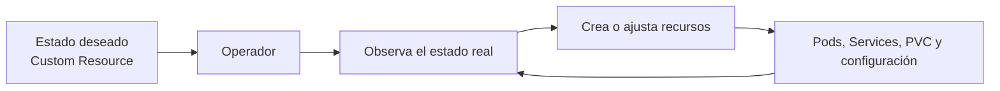
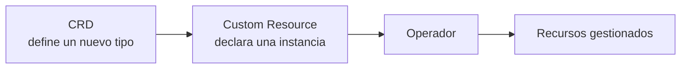
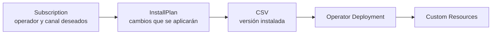
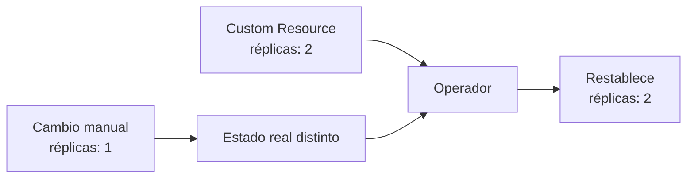

# 3.7 Operadores en la práctica

## Objetivos de aprendizaje

Al finalizar este apartado serás capaz de:

- Comprender qué es un operador y qué problema resuelve en OpenShift.
- Relacionar el funcionamiento de un operador con el patrón de reconciliación que ya utiliza Kubernetes.
- Distinguir entre una **Custom Resource Definition (CRD)** y un **Custom Resource (CR)**.
- Reconocer el papel de **OperatorHub** y de los principales recursos gestionados por **Operator Lifecycle Manager (OLM)**.
- Interpretar de forma básica una `Subscription`, un `InstallPlan` y un `ClusterServiceVersion` (`CSV`).
- Comprender cómo influyen los canales y las estrategias de aprobación en la actualización de un operador.
- Valorar el origen, el soporte y la compatibilidad de un operador antes de utilizarlo.
- Evitar modificaciones directas sobre recursos gestionados por un operador.

---

## ¿Qué es un operador?

En los apartados anteriores hemos trabajado con el comportamiento declarativo de Kubernetes y OpenShift: indicamos el estado que deseamos y diferentes controladores intentan mantenerlo.

Un **operador** aplica ese mismo principio a aplicaciones o componentes que requieren conocimiento específico para su instalación y operación.

Por ejemplo, desplegar una base de datos no consiste únicamente en crear un Pod. También puede implicar:

- preparar el almacenamiento;
- generar o utilizar credenciales;
- configurar réplicas;
- comprobar el estado del servicio;
- actualizar sus componentes en un orden determinado;
- ejecutar tareas de recuperación o mantenimiento.

Un operador incorpora parte de ese conocimiento operativo y lo automatiza dentro del clúster.

!!! note "Una forma sencilla de entenderlo"
    Un operador es un controlador especializado que observa recursos de Kubernetes y actúa para mantener una aplicación o componente en el estado deseado.



El operador no sustituye a Kubernetes. Se apoya en su API y en su modelo declarativo para automatizar tareas que, de otro modo, tendría que realizar una persona o un procedimiento externo.

---

## CRD y Custom Resource

Kubernetes conoce de forma nativa objetos como `Pod`, `Deployment`, `Service` o `ConfigMap`. Un operador puede ampliar esa API mediante nuevos tipos de recursos.

Para ello intervienen dos conceptos:

- **Custom Resource Definition (CRD):** define un nuevo tipo de recurso y su estructura.
- **Custom Resource (CR):** es una instancia concreta de ese nuevo tipo, en la que declaramos la configuración deseada.

Por ejemplo, un operador de bases de datos podría añadir al clúster un tipo de recurso denominado `Database`. A partir de esa definición, un administrador podría crear un recurso concreto indicando el tamaño, el almacenamiento o el número de réplicas requerido.



Podemos consultar las CRD registradas en un clúster con:

```bash
oc get crd
```

La lista suele ser extensa. Para localizar definiciones relacionadas con una tecnología concreta podemos utilizar un filtro, por ejemplo:

```bash
oc get crd | grep -i prometheus
```

!!! important
    Que exista una CRD no significa por sí solo que podamos utilizarla. También deben existir el controlador correspondiente, los permisos necesarios y, cuando proceda, una instancia correctamente configurada.

---

## Operadores de plataforma y operadores instalados mediante OLM

En OpenShift conviene distinguir dos ámbitos que no deben confundirse:

1. **Operadores de plataforma:** forman parte de la propia instalación de OpenShift y mantienen componentes esenciales del clúster. Su estado general se consulta mediante los recursos `ClusterOperator`.
2. **Operadores gestionados mediante OLM:** se incorporan desde catálogos, normalmente a través de OperatorHub, y su ciclo de vida se gestiona mediante recursos como `Subscription`, `InstallPlan` y `ClusterServiceVersion`.

Para consultar el estado de los operadores que mantienen la plataforma podemos ejecutar:

```bash
oc get clusteroperators
```

O mediante su forma abreviada:

```bash
oc get co
```

Este comando no muestra las suscripciones de OperatorHub. Muestra el estado de los operadores que mantienen los componentes principales de OpenShift.

!!! note
    Algunos componentes de OpenShift utilizan operadores internamente, pero eso no implica que todos estén instalados mediante una `Subscription` de OLM ni que aparezcan como operadores añadidos desde OperatorHub.

---

## OperatorHub

**OperatorHub** es el catálogo integrado en la consola web de OpenShift desde el que pueden descubrirse e instalarse operadores disponibles para el clúster.

Para acceder:

1. Selecciona la perspectiva **Administrator**.
2. Abre **Operators → OperatorHub**.
3. Utiliza el buscador y los filtros para localizar el operador deseado.
4. Revisa su proveedor, nivel de soporte, canales disponibles, requisitos y ámbitos de instalación antes de iniciar el proceso.

OperatorHub simplifica la instalación, pero no elimina la necesidad de evaluar el operador. Antes de incorporarlo a un entorno corporativo deben revisarse, como mínimo:

- el proveedor y el nivel de soporte;
- la compatibilidad con la versión de OpenShift;
- los permisos que necesita;
- los espacios de nombres en los que actuará;
- los recursos personalizados que añade;
- el procedimiento de actualización y desinstalación;
- el impacto sobre almacenamiento, red y copias de seguridad.

---

## Cómo gestiona OLM el ciclo de vida

**Operator Lifecycle Manager (OLM)** gestiona la instalación y actualización de muchos de los operadores disponibles a través de OperatorHub.

Las piezas que interesa reconocer en este curso son:



### Subscription

La `Subscription` indica qué operador queremos instalar o mantener, desde qué origen se obtiene y qué canal de actualización debe seguir.

Podemos consultar las suscripciones visibles en todos los espacios de nombres con los permisos adecuados:

```bash
oc get subscriptions.operators.coreos.com -A
```

También podemos limitarnos a un espacio de nombres concreto:

```bash
oc get subscriptions.operators.coreos.com -n <namespace>
```

### InstallPlan

El `InstallPlan` describe los recursos y cambios que OLM aplicará para instalar o actualizar el operador.

```bash
oc get installplans.operators.coreos.com -n <namespace>
```

Cuando la aprobación es manual, el `InstallPlan` queda pendiente hasta que una persona autorizada lo aprueba.

### ClusterServiceVersion

El `ClusterServiceVersion` o `CSV` representa una versión instalada de un operador. Incluye metadatos, requisitos, permisos y la información necesaria para ejecutar esa versión.

```bash
oc get clusterserviceversions.operators.coreos.com -n <namespace>
```

La forma abreviada habitual es:

```bash
oc get csv -n <namespace>
```

!!! tip
    No es necesario memorizar todos estos recursos. Lo importante es comprender la secuencia: la `Subscription` expresa qué operador y canal queremos, el `InstallPlan` concreta la instalación o actualización y el `CSV` representa la versión instalada.

---

## Canales y aprobación de actualizaciones

Los operadores pueden publicar distintas líneas de actualización mediante **canales**. Sus nombres dependen de cada operador y pueden representar, por ejemplo, una versión concreta o una política de estabilidad.

Seleccionar un canal no equivale a instalar siempre la versión más reciente disponible en cualquier canal. La suscripción seguirá la ruta de actualización publicada para el canal elegido.

OLM permite dos estrategias de aprobación:

| Estrategia | Comportamiento | Consideración operativa |
| --- | --- | --- |
| **Automatic** | OLM aprueba automáticamente los `InstallPlan` generados para la suscripción. | Reduce la intervención, pero exige confiar en la ruta de actualización y en los controles previos establecidos. |
| **Manual** | Una persona autorizada debe aprobar el `InstallPlan`. | Permite revisar y coordinar el cambio antes de aplicarlo. |

En un entorno corporativo, la elección no debe reducirse a "automático para pruebas" y "manual para producción". Debe ajustarse al procedimiento de cambios, las pruebas disponibles, el soporte del producto y el impacto del operador.

!!! warning
    Cambiar de canal puede modificar la ruta de actualización disponible. Antes de hacerlo deben revisarse la documentación del operador, las versiones intermedias requeridas y la compatibilidad con la versión del clúster.

---

## Origen y soporte de los operadores

OperatorHub puede mostrar operadores de distintos proveedores y niveles de soporte. La etiqueta del catálogo es una primera referencia, pero no sustituye la evaluación técnica.

| Origen habitual | Qué indica | Uso recomendado |
| --- | --- | --- |
| **Red Hat** | Operador proporcionado y soportado por Red Hat conforme a sus condiciones de soporte. | Prioritario cuando encaje con la necesidad y se requiera soporte del fabricante. |
| **Certified** | Operador de un socio, validado para su distribución en el ecosistema de Red Hat. | Adecuado cuando existe soporte del proveedor y compatibilidad documentada. |
| **Community** | Operador mantenido por una comunidad o proyecto sin el mismo compromiso de soporte comercial. | Útil para evaluación o casos asumidos expresamente, tras revisar mantenimiento, seguridad y compatibilidad. |

Antes de seleccionar un operador deben comprobarse siempre la ficha concreta, la documentación del proveedor y las condiciones de soporte aplicables. Un operador certificado no garantiza por sí solo que cualquier configuración, versión o producto asociado quede cubierto por soporte.

---

## El bucle de reconciliación y los cambios manuales

Un operador observa continuamente el estado del recurso que gestiona. Si detecta una diferencia entre el estado deseado y el estado real, intenta corregirla. Este proceso se denomina **reconciliación**.

Supongamos que un operador ha creado un `Deployment` con dos réplicas. Si alguien modifica directamente ese `Deployment` para dejar una sola réplica, el operador puede detectar la diferencia y restaurar el valor definido en el Custom Resource.



!!! warning "No modificar directamente recursos gestionados"
    Los recursos creados por un operador no deben editarse manualmente salvo que la documentación del operador lo indique expresamente. El cambio debe realizarse en el Custom Resource o mediante el mecanismo soportado por el proveedor.

Si el operador no puede alcanzar el estado deseado, seguirá intentando reconciliarlo. En ese caso pueden aparecer eventos repetidos, estados degradados o mensajes recurrentes en sus logs. La respuesta adecuada no es detener el proceso sin analizarlo, sino revisar:

- el estado del Custom Resource;
- sus condiciones y mensajes de error;
- los eventos relacionados;
- los logs del operador;
- los permisos, cuotas, almacenamiento u otras dependencias necesarias.

Los métodos de diagnóstico estudiados en los apartados anteriores siguen siendo válidos, pero deben aplicarse teniendo en cuenta que el operador es quien gestiona el ciclo de vida de esos recursos.

---

## Demo guiada: explorar un operador desde la consola

Para este apartado es suficiente una **demo guiada por el profesor** o una exploración muy sencilla mediante la consola. El objetivo no es instalar un operador nuevo, sino reconocer dónde se encuentra la información relevante.

### Recorrido propuesto

1. Acceder a **Operators → OperatorHub** desde la perspectiva **Administrator**.
2. Buscar un operador disponible en el clúster.
3. Abrir su ficha y localizar:
   - proveedor y nivel de soporte;
   - canales disponibles;
   - modo de instalación;
   - espacios de nombres en los que puede actuar;
   - recursos personalizados que proporciona.
4. Acceder a **Operators → Installed Operators** y observar los operadores ya instalados, si los permisos y el entorno del laboratorio lo permiten.
5. Abrir uno de ellos e identificar su estado, versión y recursos proporcionados, sin modificar su configuración.

!!! note
    La disponibilidad de operadores y las opciones visibles dependen de los catálogos habilitados, la versión del clúster y los permisos del usuario. La demostración debe adaptarse al entorno utilizado durante la formación.

---

## Ideas clave para recordar

!!! tip "Resumen"
    - Un **operador** es un controlador especializado que automatiza el ciclo de vida de una aplicación o componente.
    - Una **CRD** define un nuevo tipo de recurso y un **Custom Resource** declara una instancia y su estado deseado.
    - Los **operadores de plataforma** no deben confundirse con los operadores instalados desde OperatorHub mediante OLM.
    - **OperatorHub** permite descubrir operadores, pero antes de instalarlos deben revisarse soporte, compatibilidad, permisos e impacto operativo.
    - En OLM, la `Subscription` expresa el operador y canal deseados, el `InstallPlan` concreta los cambios y el `CSV` representa la versión instalada.
    - Los canales y la estrategia de aprobación forman parte de la política de actualización y deben alinearse con la gestión de cambios del entorno.
    - Los recursos gestionados por un operador no deben modificarse directamente, porque el bucle de reconciliación puede restaurar el estado declarado.
    - Para este nivel del curso basta con reconocer estos elementos mediante una **demo guiada en la consola**, sin realizar una instalación completa.
