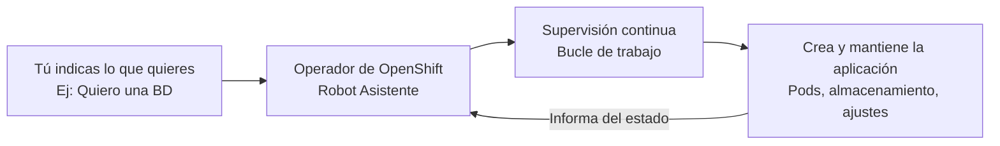
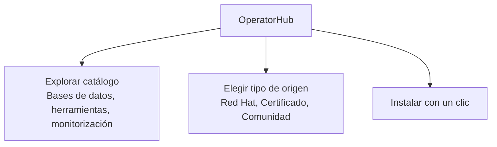
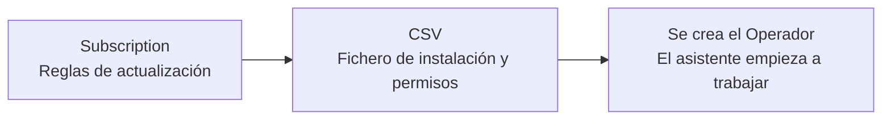

# 3.7 Operadores en la práctica: OperatorHub, subscription y CSV, canales de actualización, comunidad frente a certificado, y los riesgos (drift, reconcile en bucle)

## Objetivos de aprendizaje

Al finalizar este apartado serás capaz de:

- Comprender el concepto de operador en OpenShift de forma sencilla como un "asistente automático" para instalar y mantener aplicaciones[cite: 2].
- Conocer la diferencia entre los componentes estándar de Kubernetes y las capacidades adicionales que añaden los recursos personalizados[cite: 2].
- Navegar por OperatorHub como el catálogo central de aplicaciones y extensiones del clúster[cite: 2].
- Identificar la función de la **Subscription** (suscripción) y del **ClusterServiceVersion (CSV)** en el despliegue de un operador[cite: 2].
- Entender el funcionamiento de los canales de actualización (*channels*) y cómo gestionar su ciclo de vida[cite: 2].
- Diferenciar entre operadores oficiales/certificados y operadores de la comunidad[cite: 2].
- Reconocer los riesgos operativos de trabajar con operadores: cambios manuales sobrescritos (*drift*) y fallos en bucle (*reconcile loop*)[cite: 2].

---

## ¿Qué es un operador y por qué existe?

Imagina que quieres instalar en tu ordenador una base de datos o un sistema de mensajería complejo. No basta con descargar el programa; necesitas un técnico o un administrador de sistemas que la configure, haga copias de seguridad, compruebe si funciona y la actualice cuando haga falta[cite: 2].

En Kubernetes y OpenShift ocurre lo mismo. Para aplicaciones sencillas nos basta con un *Deployment*, pero para aplicaciones complejas que guardan datos o requieren tareas continuas de mantenimiento, hacer todo a mano lleva mucho tiempo y provoca errores[cite: 2].

Para solucionar esto surge el concepto de **Operador**[cite: 2].

Un **operador** es como un **"asistente automático"** o un **"robot de mantenimiento"** que vive dentro de OpenShift. Su trabajo es empaquetar todo el conocimiento de un experto en esa aplicación para instalarla, vigilarla y mantenerla funcionando sin que un humano tenga que intervenir constantemente[cite: 2].

### ¿Cómo sabe el operador lo que tiene que hacer?
Normalmente, Kubernetes entiende conceptos básicos como Pods o Servicios[cite: 2]. Pero cuando instalamos un operador, este enseña a OpenShift "nuevas palabras" o ficheros de configuración específicos para esa aplicación (llamados **Recursos Personalizados** o *Custom Resources*)[cite: 2].

Tú solo tienes que rellenar una plantilla sencilla diciendo: *"Quiero una base de datos con 2 Gigas de memoria"*[cite: 2]. El operador lee esa plantilla y se encarga automáticamente de crear todos los componentes internos necesarios[cite: 2].

---

## OperatorHub: La tienda de aplicaciones del clúster

Para que no tengas que buscar scripts o archivos raros por internet, OpenShift incluye una pantalla llamada **OperatorHub**[cite: 2].

Es el equivalente a la "tienda de aplicaciones" (*App Store*) de tu teléfono móvil o sistema operativo, pero pensada para el clúster[cite: 2].

### Cómo acceder desde la consola web:
1. Cambia a la perspectiva **Administrator**[cite: 2].
2. Ve al menú **Operators → OperatorHub**[cite: 2].
3. Usa el buscador o los filtros laterales para encontrar la herramienta que necesitas[cite: 2].

---

## ¿Qué ocurre cuando instalas un operador? (*Subscription* y *CSV*)

Cuando haces clic en "Instalar" dentro de OperatorHub, OpenShift crea automáticamente dos piezas invisibles por debajo que gestionan todo[cite: 2]:

1. **Subscription (Suscripción):** Es la regla que le dice a OpenShift de dónde debe descargar el operador y cómo debe actualizarlo cuando salga una versión nueva (si solo quieres avisos o si prefieres que se actualice solo)[cite: 2].
2. **ClusterServiceVersion (CSV):** Es el documento de identidad y manual de instrucciones del operador. Contiene la versión exacta, el icono, la descripción y los permisos que necesita para funcionar en el clúster[cite: 2].

---

## Canales de actualización (*Channels*)

Los creadores de un operador publican mejoras continuamente[cite: 2]. Para no romper tus aplicaciones por sorpresa, las versiones se organizan en **canales** (como *stable*, *fast*, *v1.0*)[cite: 2].

Al instalarlo, eliges cómo quieres recibir las novedades[cite: 2]:

- **Estrategia Automática:** Si sale una versión nueva en el canal, OpenShift la descarga y la aplica sola. Útil para entornos de pruebas[cite: 2].
- **Estrategia Manual:** Cuando hay una actualización, OpenShift te avisa con un mensaje y espera a que un administrador pulse el botón de aprobar. Es la opción recomendada para entornos de trabajo reales o producción[cite: 2].

---

## Operadores Certificados frente a la Comunidad

En OperatorHub verás operadores con distintas etiquetas[cite: 2]. Es importante saber de dónde vienen[cite: 2]:

| Tipo | Origen | ¿Es seguro para producción? |
| :--- | :--- | :--- |
| **Red Hat / Red Hat Certified** | Creados o probados oficialmente por Red Hat o socios de confianza[cite: 2]. | **Sí.** Cuentan con soporte oficial y garantía de que no fallarán tras actualizar OpenShift[cite: 2]. |
| **Community (Comunidad)** | Creados por usuarios o proyectos de código abierto independientes[cite: 2]. | **Para pruebas.** Se usan bajo tu propia responsabilidad, ya que no tienen soporte garantizado[cite: 2]. |

!!! tip "Consejo"
    En proyectos de trabajo reales o corporativos, utiliza siempre operadores **Red Hat** o **Certificados**[cite: 2].

---

## Riesgos y fallos típicos al usar operadores

Aunque un operador nos quita mucho trabajo de encima, debemos tener cuidado con dos situaciones muy habituales[cite: 2]:

### 1. Deshacer cambios manuales (*Configuration Drift*)
Si un operador está gestionando una aplicación y tú intentas cambiar algo "a mano" por tu cuenta (por ejemplo, editando directamente un Pod o un Deployment que creó el operador)[cite: 2]:

- **¿Qué pasará?** El operador se dará cuenta en unos segundos de que alguien ha tocado su trabajo, borrará tu cambio manual y lo volverá a dejar exactamente como estaba[cite: 2].
- **La regla de oro:** Nunca modifiques a mano los componentes que ha creado un operador[cite: 2]. Si quieres cambiar algo, edita la plantilla principal (*Custom Resource*) que le dio origen[cite: 2].

### 2. El operador se queda en bucle (*Reconcile loop*)
El operador está todo el tiempo comprobando: *"¿La aplicación está como me pidieron?"*[cite: 2].

Si la configuración tiene un error de escritura o la aplicación no puede arrancar por falta de memoria[cite: 2]:
- El operador intentará arreglarlo una y otra vez sin conseguirlo[cite: 2].
- Esto puede provocar que el operador consuma mucha CPU intentando solucionar el problema continuamente[cite: 2].

!!! warning "Atención"
    Si ves que una aplicación creada por un operador no termina de arrancar, revisa la configuración que le has dado o consulta los logs para ver qué está intentando corregir[cite: 2].

---

## Ideas clave para recordar

!!! tip "Resumen"
    - Un **operador** es un robot de software que automatiza la instalación y el mantenimiento de aplicaciones en OpenShift[cite: 2].
    - **OperatorHub** es la tienda centralizada donde puedes buscar e instalar operadores[cite: 2].
    - La **Subscription** controla las actualizaciones y el **CSV** guarda los datos e instrucciones de la versión instalada[cite: 2].
    - Elige **actualizaciones manuales** en producción para evitar cambios no planificados[cite: 2].
    - Prioriza los operadores **certificados** frente a los de la comunidad para tener soporte y estabilidad[cite: 2].
    - **No cambies cosas a mano:** El operador borrará tus cambios manuales para mantener el estado que tiene programado[cite: 2].