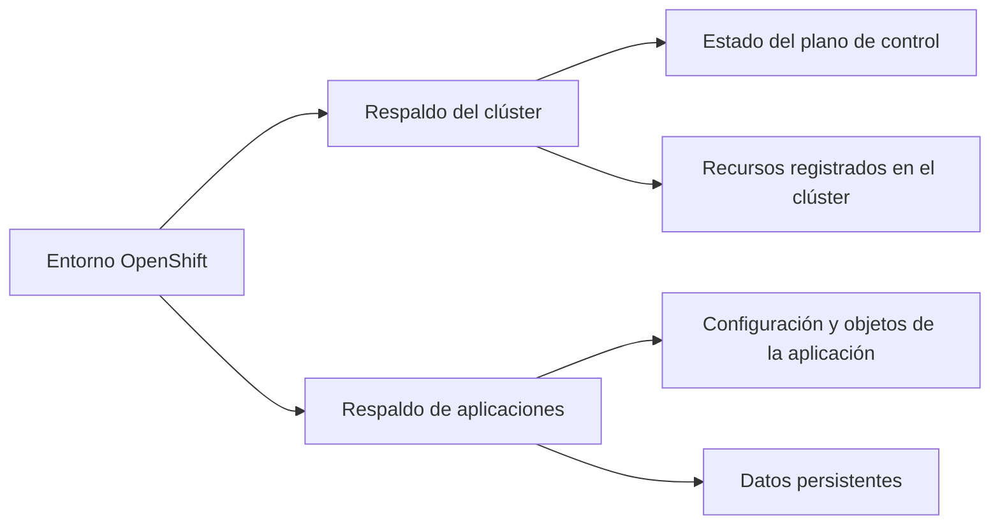
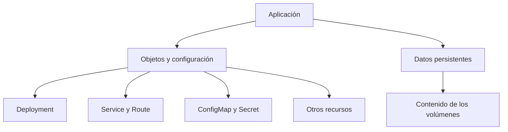

## 3.8 Copias de seguridad

### Objetivos de aprendizaje

Al finalizar este apartado serás capaz de:

- Comprender por qué la autorrecuperación de OpenShift no sustituye a una estrategia de copias de seguridad.
- Diferenciar entre el respaldo del clúster y el respaldo de las aplicaciones.
- Identificar qué elementos deben protegerse para poder recuperar una aplicación.
- Reconocer que una estrategia de respaldo debe incluir tanto la realización de las copias como la comprobación periódica de su restauración.

### La autorrecuperación tiene límites

A lo largo de esta sesión hemos visto cómo OpenShift permite observar el estado de la plataforma, detectar problemas y diagnosticar sus causas mediante métricas, alertas, logs, eventos y comandos como `oc describe`.

También hemos comprobado que OpenShift trabaja continuamente para mantener el estado deseado. Si un Pod falla, un controlador puede crear otro. Si una aplicación dispone de varias réplicas, el servicio puede continuar disponible mientras se sustituye la instancia afectada. Del mismo modo, los operadores supervisan determinados componentes y actúan para mantenerlos en el estado esperado.

Sin embargo, estos mecanismos de autorrecuperación tienen límites:

- OpenShift puede recrear un Pod, pero no recuperar por sí solo los datos que se hayan borrado de una aplicación.
- Un `Deployment` puede volver a crear sus Pods, pero no reconstruye necesariamente todos los recursos asociados a la aplicación si estos se han eliminado.
- Un volumen persistente evita que los datos desaparezcan cuando se sustituye un Pod, pero no protege frente a un borrado accidental, una corrupción o la pérdida del propio almacenamiento.
- La reconciliación de un operador mantiene un estado deseado, pero no sustituye a una copia que permita volver a un estado anterior.
- Un fallo grave del plano de control puede requerir recuperar el estado del clúster completo.

Por tanto, **alta disponibilidad, autorrecuperación y copia de seguridad son conceptos relacionados, pero no equivalentes**.

!!! note "Una distinción fundamental"
    La autorrecuperación intenta mantener el servicio en funcionamiento ante determinados fallos. Una copia de seguridad permite recuperar información o configuraciones que se han perdido, dañado o eliminado.

### ¿Qué significa respaldar un entorno OpenShift?

En una plataforma OpenShift no existe una única copia capaz de resolver cualquier situación. Antes de definir una estrategia de respaldo debemos identificar **qué queremos recuperar**.

Podemos distinguir dos ámbitos principales:

1. **El clúster**, es decir, el estado de la plataforma y de los recursos registrados en ella.
2. **Las aplicaciones**, formadas por sus objetos de Kubernetes/OpenShift y, cuando existen, por sus datos persistentes.

Estos dos ámbitos están relacionados, pero responden a necesidades diferentes. El respaldo de uno no sustituye al respaldo del otro.

### Respaldo del clúster

OpenShift utiliza **etcd** para conservar el estado de los objetos gestionados por el plano de control. En etcd se registra, entre otra información, qué recursos existen en el clúster y cuál es su configuración.

El respaldo del clúster está orientado a escenarios graves de recuperación, por ejemplo:

- pérdida o corrupción del estado del plano de control;
- fallo catastrófico de los nodos que lo componen;
- necesidad de reconstruir el clúster conservando su estado anterior.

Una copia de etcd permite proteger el estado del plano de control y de los recursos registrados en el clúster. Sin embargo, **no incluye por sí misma el contenido de los volúmenes persistentes utilizados por las aplicaciones**.

Por este motivo, recuperar el estado del clúster no significa necesariamente haber recuperado también todos los datos de negocio.

!!! warning "El respaldo de etcd no es un respaldo completo de las aplicaciones"
    La copia puede conservar la definición de un `PersistentVolumeClaim`, pero eso no implica que contenga los datos almacenados en el volumen asociado.

La realización y restauración de estas copias forma parte de la administración de la plataforma. En este curso no entraremos en el procedimiento técnico, pero sí debemos retener tres principios:

- las copias deben realizarse de forma planificada;
- deben almacenarse fuera del propio clúster o del componente que se pretende proteger;
- el procedimiento de restauración debe estar documentado y probado.

### Respaldo de una aplicación

En apartados anteriores hemos desplegado aplicaciones y hemos trabajado con varios objetos de OpenShift. Esto permite comprender que **una aplicación no es únicamente un Pod**.

Una aplicación puede estar formada por:

- un `Deployment` que describe cómo deben ejecutarse sus Pods;
- un `Service` que proporciona acceso estable dentro del clúster;
- una `Route` que permite acceder desde el exterior;
- `ConfigMap` y `Secret` que aportan configuración;
- un `PersistentVolumeClaim` que solicita almacenamiento persistente;
- otros recursos relacionados con permisos, políticas o funcionamiento de la aplicación.

Además, la aplicación puede guardar información en uno o varios volúmenes persistentes. Por tanto, una estrategia de respaldo de aplicaciones debe considerar dos elementos:

1. **Los objetos y la configuración de la aplicación.**
2. **Los datos almacenados en sus volúmenes persistentes.**

Respaldar solamente los objetos permitiría reconstruir la estructura de la aplicación, pero no recuperar sus datos. Respaldar solamente el volumen conservaría los datos, pero podría no ser suficiente para volver a desplegar la aplicación con la misma configuración.

El respaldo de aplicaciones puede utilizarse, por ejemplo, para:

- recuperar una aplicación o un proyecto eliminado accidentalmente;
- restaurar sus datos después de una corrupción o un error;
- volver a un punto anterior cuando sea necesario;
- trasladar una aplicación entre clústeres, siempre que la solución y el almacenamiento utilizados sean compatibles.

En OpenShift, **OADP** (_OpenShift API for Data Protection_) proporciona una solución para coordinar la protección y recuperación de aplicaciones. En este apartado no estudiaremos su instalación ni su configuración interna. Lo importante es comprender que este tipo de solución permite seleccionar aplicaciones o proyectos y proteger tanto sus recursos como, según la configuración y las capacidades del almacenamiento, sus datos persistentes.

### Respaldo del clúster y respaldo de aplicaciones

| Criterio | Respaldo del clúster | Respaldo de aplicaciones |
|---|---|---|
| **Qué protege** | El estado del plano de control y de los recursos registrados en el clúster. | Los objetos que forman una aplicación y sus datos persistentes. |
| **Ámbito** | Global, orientado a la recuperación de la plataforma. | Granular, orientado a una o varias aplicaciones o proyectos. |
| **Escenario habitual** | Pérdida grave o corrupción del estado del clúster. | Borrado accidental, corrupción de datos, recuperación o traslado de una aplicación. |
| **Datos de los volúmenes** | No protege por sí mismo su contenido. | Deben incluirse expresamente en la estrategia de respaldo. |
| **Responsabilidad principal** | Administración de la plataforma. | Debe coordinarse entre administración de la plataforma y responsables de las aplicaciones. |

!!! tip "Son estrategias complementarias"
    El respaldo del clúster permite recuperar el estado de la plataforma. El respaldo de aplicaciones permite recuperar sus recursos y sus datos. Una estrategia completa debe contemplar ambos niveles según las necesidades del entorno.

### Planificar la recuperación

Una estrategia de copias de seguridad no consiste únicamente en ejecutar una herramienta. Debe partir de las necesidades reales de recuperación.

Antes de definirla conviene responder, al menos, a estas preguntas:

- **¿Qué debemos recuperar?** El clúster completo, una aplicación, un proyecto o determinados datos.
- **¿Hasta qué momento debemos poder retroceder?** No todas las aplicaciones admiten la misma pérdida de información.
- **¿Cuánto tiempo puede permanecer indisponible el servicio?** La restauración debe ser compatible con las necesidades de la organización.
- **¿Dónde se almacenan las copias?** Deben conservarse en una ubicación independiente y suficientemente protegida.
- **¿Quién es responsable de realizarlas y verificarlas?** Las responsabilidades deben estar claramente definidas.
- **¿Se ha probado la restauración?** Una copia que nunca se ha restaurado no ofrece garantías suficientes de recuperación.

Estas preguntas suelen relacionarse con dos objetivos:

- **RPO** (_Recovery Point Objective_): cantidad máxima de información que la organización puede aceptar perder, expresada normalmente como un periodo de tiempo.
- **RTO** (_Recovery Time Objective_): tiempo máximo previsto para recuperar el servicio después de una interrupción.

Por ejemplo, si una aplicación admite perder como máximo una hora de información, su estrategia de respaldo debe permitir recuperar un estado con una antigüedad no superior a ese periodo. Si, además, debe volver a estar disponible en cuatro horas, el procedimiento de restauración debe poder completarse dentro de ese tiempo.

No es necesario profundizar ahora en el diseño de estos objetivos. Lo importante es comprender que **la frecuencia de las copias y el procedimiento de restauración deben responder a necesidades concretas**, no aplicarse de la misma forma a todas las aplicaciones.

### Ideas clave para recordar

!!! tip "Resumen"
    - OpenShift puede recrear determinados recursos, pero la autorrecuperación no sustituye a una copia de seguridad.
    - El respaldo del clúster y el respaldo de aplicaciones tienen objetivos diferentes y son complementarios.
    - La copia de etcd protege el estado del plano de control y de los recursos registrados, pero no contiene por sí misma los datos de los volúmenes persistentes.
    - Una aplicación está formada por objetos de OpenShift y, en muchos casos, por datos persistentes. Ambos elementos deben considerarse en su recuperación.
    - OADP permite coordinar la protección de aplicaciones, pero su configuración técnica queda fuera del alcance de este apartado.
    - Una estrategia de respaldo debe definir qué se protege, con qué frecuencia, dónde se conservan las copias y cómo se comprueba la restauración.
    - Una copia de seguridad solo resulta útil si puede restaurarse correctamente.
