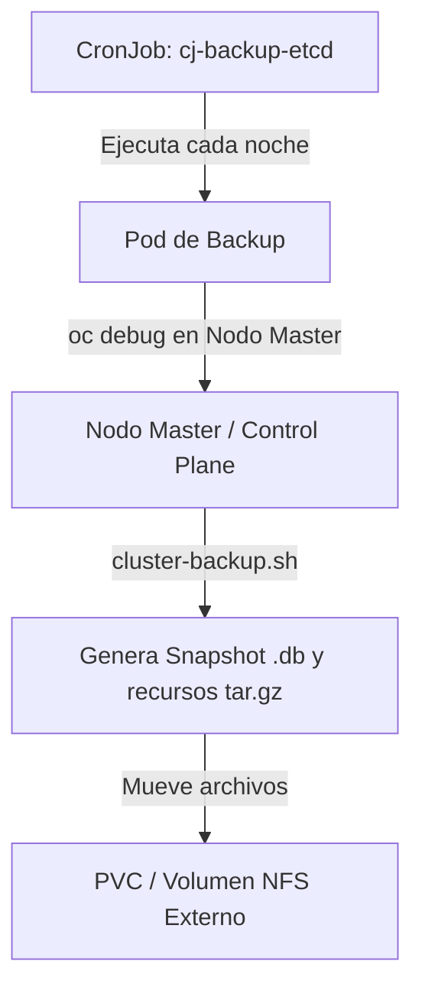

# 3.8 Copias de seguridad: qué entra en un backup y qué no. OADP y Velero: destino, programación y retención. Backup del clúster (etcd) frente a backup de una aplicación — no son sustitutos ★

## Objetivos de aprendizaje

Al finalizar este apartado serás capaz de:

- Comprender la diferencia fundamental entre el respaldo del estado global de la infraestructura del clúster (`etcd`) y el respaldo granular de aplicaciones (*workloads* y persistent volumes).
- Argumentar por qué las copias de seguridad de `etcd` y las de aplicaciones no son sustitutos, sino estrategias complementarias e indispensables.
- Conocer la arquitectura y componentes del operador **OADP** (*OpenShift API for Data Protection*) y su motor subyacente **Velero**.
- Identificar la necesidad del almacenamiento de objetos compatible con S3 (ej. MinIO, AWS S3, NooBaa) como destino principal de las copias de seguridad.
- Configurar y desplegar recursos personalizados de respaldo (`DataProtectionApplication`, `Backup`, `Restore`) definiendo destinos, programación (*schedules*) y políticas de retención (*TTL*).
- Automatizar las copias de seguridad del plano de control (`etcd`) mediante *CronJobs* con almacenamiento persistente en red (NFS/SAN).

---

## Dos mundos complementarios: Backup de Clúster (`etcd`) vs. Backup de Aplicación

En la gestión de entornos OpenShift, uno de los errores conceptuales más graves consiste en asumir que un único mecanismo de copia de seguridad cubre todas las necesidades de recuperación ante desastres.

Es crucial entender que en una plataforma de contenedores existen dos planos de persistencia totalmente diferenciados:

```mermaid
flowchart TD
    subgraph ClusterLevel ["Plano de Infraestructura / Clúster"]
        ETCD[("etcd (Key-Value Store)")<br>Estado global, RBAC, Nodos, CRDs, Operadores]
        ScriptETCD["Script / CronJob de etcd"]
    end

    subgraph AppLevel ["Plano de Aplicación / Namespace"]
        K8sResources["Manifiestos y Recursos<br>(Deployments, Services, ConfigMaps, Secrets)"]
        PVData[("Volúmenes Persistentes (PV/PVC)")<br>Datos de negocio (Bases de Datos, Archivos)]
        OADP["OADP / Velero + Restic/Kopia"]
    end

    ScriptETCD -->|Respalda| ETCD
    OADP -->|Respalda metadatos| K8sResources
    OADP -->|Respalda datos| PVData
```

### 1. Backup del Clúster (`etcd`)
La base de datos `etcd` es el cerebro del clúster. Almacena el estado completo de la infraestructura de Kubernetes/OpenShift: definiciones de nodos, estado de los operadores de la plataforma, roles y permisos (RBAC), rutas, secretos del sistema y objetos declarados.

- **Propósito:** Recuperación ante un desastre catastrófico del plano de control (*Disaster Recovery* del clúster). Por ejemplo, la pérdida de quórum irreversible en los nodos *master* o la corrupción generalizada de la API.
- **¿Qué NO cubre?** No realiza copias consistentes ni legibles de los datos contenidos dentro de los volúmenes persistentes (`PersistentVolumeClaims`) de los usuarios.

### 2. Backup de una Aplicación (OADP / Velero)
Respalda el conjunto de recursos que componen un servicio de negocio dentro de uno o varios namespaces especificos, junto con la información almacenada en sus volúmenes de datos.

- **Propósito:** Recuperar una aplicación concreta borrada por error, migrar un proyecto entre clústeres o restaurar la base de datos de un entorno a un punto anterior en el tiempo.
- **¿Qué NO cubre?** No sirve para reconstruir la infraestructura base de OpenShift si el clúster completo queda inoperativo.

---

## Matriz comparativa: ¿Por qué NO son sustitutos?

| Criterio | Backup del clúster (`etcd`) | Backup de aplicación (OADP / Velero) |
| :--- | :--- | :--- |
| **Objeto respaldado** | Base de datos `etcd` del plano de control. | Objetos del namespace (Deployments, PVCs, Secrets, Routes) y datos de volúmenes. |
| **Ámbito** | Global (Todo el clúster). | Granular (Proyectos/Namespaces seleccionados o etiquetas). |
| **Respaldo de datos en PVCs** | **NO** (Solo guarda los metadatos/definiciones del PVC, no su contenido). | **SÍ** (Mediante *snapshots* CSI o copia a nivel de archivos con Restic/Kopia). |
| **Frecuencia típica** | Diaria / Horaria (Automática). | Según el RPO del negocio por aplicación. |
| **Destino de almacenamiento** | Almacenamiento externo en red (NFS, SAN) o bastión fuera de los nodos master. | Almacenamiento de objetos (*Object Storage*) compatible con S3. |
| **Escenario de uso** | Fallo total de los nodos *master* o corrupción del plano de control. | Borrado accidental de un namespace, corrupción de base de datos o migración de app. |

!!! warning "Principio fundamental de operación"
    Un backup de `etcd` no te permitirá restaurar una tabla borrada por error en el MySQL de un desarrollador sin destruir los cambios del resto del clúster. 
    
    Por su parte, un backup de OADP no te permitirá levantar un clúster desde cero si los nodos de infraestructura colapsan. **Ambos sistemas son indispensables y complementarios.**

---

## Backup de Aplicaciones: OADP y Velero

Red Hat proporciona la solución **OADP** (*OpenShift API for Data Protection*), un operador certificado disponible en OperatorHub que empaqueta y extiende la herramienta de código abierto **Velero** junto con integraciones nativas para OpenShift (como el soporte de rutas, plantillas y plugins de almacenamiento).

```mermaid
flowchart LR
    subgraph OpenShift ["OpenShift Cluster"]
        OADPOp["OADP Operator"] --> DPA["DataProtectionApplication (DPA)"]
        DPA --> VeleroPod["Velero Pod"]
        DPA --> ResticDaemonSet["Restic / Kopia (DaemonSet)"]
    end

    subgraph StorageBackend ["Destino Externo"]
        S3[("Object Storage S3 / MinIO")<br>Buckets de respaldo]
    end

    VeleroPod -->|Exporta manifiestos YAML| S3
    ResticDaemonSet -->|Transfiere bloques de PVs| S3
```

### Arquitectura y componentes clave

- **OADP Operator:** Gestiona el ciclo de vida e instalación de los componentes de respaldo en el espacio de nombres `openshift-adp`.
- **DataProtectionApplication (DPA):** Recurso personalizado (CR) donde se configura la conexión al almacenamiento de objetos, los plugins requeridos y la habilitación de herramientas de volumen.
- **Velero:** Componente central que interactúa con la API de OpenShift para capturar los metadatos y definiciones YAML de los recursos seleccionados.
- **Restic / Kopia:** Agentes en formato `DaemonSet` que se ejecutan en los nodos para realizar copias de seguridad de los datos contenidos en los volúmenes persistentes a nivel de sistema de archivos, independientemente del tipo de almacenamiento subyacente.
- **Object Storage (S3 / MinIO):** El destino obligatorio donde Velero y Restic depositan tanto las definiciones de los manifiestos como los bloques de datos de los volúmenes.

---

## Configuración paso a paso de OADP con almacenamiento S3/MinIO

A continuación analizaremos la estructura técnica para poner en marcha el respaldo de aplicaciones utilizando un almacenamiento de objetos basado en **MinIO** (o AWS S3).

### 1. Secreto de credenciales para el destino de almacenamiento

Antes de instanciar el operador, es necesario registrar un `Secret` en el namespace `openshift-adp` con las claves de acceso al almacenamiento de objetos:

```yaml
apiVersion: v1
kind: Secret
metadata:
  name: cloud-credentials-minio
  namespace: openshift-adp
type: Opaque
stringData:
  cloud: |
    [default]
    aws_access_key_id=minio-access-key
    aws_secret_access_key=minio-secret-key
```

---

### 2. Definición del recurso `DataProtectionApplication` (DPA)

El manifiesto `DPA` establece la vinculación entre Velero y el bucket S3 de destino, además de activar la copia de volúmenes mediante Restic:

```yaml
apiVersion: oadp.openshift.io/v1alpha1
kind: DataProtectionApplication
metadata:
  name: velero-minio-config
  namespace: openshift-adp
spec:
  backupLocations:
    - velero:
        config:
          insecureSkipTLSVerify: 'true'
          region: minio
          s3ForcePathStyle: 'true'
          s3Url: '[https://minio.tenant-minio.svc.cluster.local:443](https://minio.tenant-minio.svc.cluster.local:443)'
        credential:
          key: cloud
          name: cloud-credentials-minio
        default: true
        objectStorage:
          bucket: bucket-backups-openshift
          prefix: velero-data
        provider: aws
  configuration:
    restic:
      enable: true
    velero:
      defaultPlugins:
        - openshift
        - aws
```

!!! note "Validación del despliegue"
    Cuando la instancia de `DataProtectionApplication` se procesa correctamente, su estado cambia a `Condition: Reconciled`, y el operador genera automáticamente un recurso `BackupStorageLocation` (BSL) en estado `Phase: Available`.

---

## Ejecución de Backups, Programación y Retención (TTL)

Una vez desplegada la infraestructura de OADP, la gestión de copias de seguridad y restauraciones se realiza de forma puramente declarativa mediante Recursos Personalizados.

### 1. Creación de un Backup puntual de una aplicación

Para respaldar un proyecto o namespace concreto (`test-app`), definiendo un periodo de retención (*Time To Live* - TTL) de 30 días (720 horas):

```yaml
apiVersion: velero.io/v1
kind: Backup
metadata:
  name: backup-test-app-v1
  namespace: openshift-adp
spec:
  includedNamespaces:
    - test-app
  defaultVolumesToRestic: true
  snapshotVolumes: true
  storageLocation: velero-minio-config-1
  ttl: 720h0m0s
```

#### Parámetros clave:
- **`includedNamespaces`:** Lista de proyectos que se incluirán en el paquete de respaldo.
- **`defaultVolumesToRestic: true`:** Fuerza la copia a nivel de archivos de todos los PVCs vinculados a los pods del proyecto.
- **`ttl`:** Determina cuánto tiempo se conservará el backup en el almacenamiento de objetos antes de que Velero lo purgue automáticamente.

---

### 2. Programación automática de copias (*Schedules*)

Para automatizar la ejecución periódica de backups, se utiliza el recurso `Schedule` expresado en sintaxis estándar de Cron:

```yaml
apiVersion: velero.io/v1
kind: Schedule
metadata:
  name: schedule-diario-test-app
  namespace: openshift-adp
spec:
  schedule: "0 2 * * *"
  template:
    includedNamespaces:
      - test-app
    defaultVolumesToRestic: true
    ttl: 168h0m0s
```

---

### 3. Restauración de un respaldo (`Restore`)

En caso de desastre o borrado del namespace, la restauración se solicita haciendo referencia al nombre exacto de la copia guardada. Es posible mapear el contenido hacia un nuevo namespace (`test-app-restaurado`):

```yaml
apiVersion: velero.io/v1
kind: Restore
metadata:
  name: restore-test-app
  namespace: openshift-adp
spec:
  backupName: backup-test-app-v1
  includedNamespaces:
    - test-app
  namespaceMapping:
    test-app: test-app-restaurado
  restorePVs: true
  excludedResources:
    - nodes
    - events
    - backups.velero.io
    - restores.velero.io
```

---

## Backup del clúster: Automatización de la copia de `etcd`

Dado que `etcd` reside en los nodos *master* del clúster, su copia de seguridad no se gestiona mediante Velero, sino mediante el script oficial `/usr/local/bin/cluster-backup.sh` integrado en la imagen del CLI de OpenShift (`ose-cli`).

Para garantizar la disponibilidad periódica sin intervención manual, la práctica estandarizada consiste en desplegar un **CronJob** con privilegios que guarde las instantáneas directamente en un volumen de almacenamiento persistente externo (NFS/SAN).



---

### Manifiesto completo del `CronJob` de backup de `etcd`

Este manifiesto programa la ejecución diaria a las 02:00 AM, ejecuta el script de respaldo en uno de los nodos *master* y guarda el resultado en un PVC conectado a un servidor NFS externo:

```yaml
apiVersion: batch/v1
kind: CronJob
metadata:
  name: cronjob-etcd-backup
  namespace: openshift-etcd
spec:
  schedule: "0 2 * * *"
  concurrencyPolicy: Forbid
  successfulJobsHistoryLimit: 3
  failedJobsHistoryLimit: 1
  jobTemplate:
    spec:
      template:
        spec:
          nodeSelector:
            node-role.kubernetes.io/master: ''
          restartPolicy: OnFailure
          serviceAccountName: installer-sa
          hostNetwork: true
          containers:
            - name: etcd-backup
              image: registry.redhat.io/openshift4/ose-cli:latest
              command:
                - /bin/bash
                - '-c'
                - >-
                  oc get no -l node-role.kubernetes.io/master --no-headers -o name | head -n 1 | xargs -I {} -- oc debug {} -- bash -c 'chroot /host sudo -E /usr/local/bin/cluster-backup.sh /home/core/backup' ;
                  echo 'Moviendo respaldos locales al volumen PVC montado...';
                  mv /home/core/backup/* /etcd-backup/;
                  echo 'Eliminando copias con antigüedad superior a 30 días...';
                  find /etcd-backup/ -type f -mtime +30 -exec rm {} \;
              securityContext:
                privileged: true
                runAsUser: 0
              volumeMounts:
                - name: host-backup
                  mountPath: /home/core/backup
                - name: etcd-pvc-storage
                  mountPath: /etcd-backup
          volumes:
            - name: host-backup
              hostPath:
                path: /home/core/backup
            - name: etcd-pvc-storage
              persistentVolumeClaim:
                claimName: backup-etcd-pvc
          tolerations:
            - operator: Exists
              effect: NoSchedule
            - operator: Exists
              effect: NoExecute
```

#### Archivos generados en cada copia de `etcd`:
Al completarse con éxito el Job, el almacenamiento externo recibirá dos ficheros críticos identificados con la fecha y hora de la copia:
1. `snapshot_<timestamp>.db`: La instantánea binaria comprimida de la base de datos `etcd`.
2. `static_kuberesources_<timestamp>.tar.gz`: Los recursos estáticos y manifiestos del plano de control necesarios para la reconstrucción del clúster.

---

## Ideas clave para recordar

!!! tip "Resumen"
    - **No sustitución:** El backup de `etcd` salva el plano de control del clúster; OADP/Velero salva las aplicaciones y sus volúmenes de datos. Ambos son estrictamente necesarios.
    - **OADP** es el operador de Red Hat que integra **Velero** y **Restic/Kopia** para orquestar la copia de seguridad de proyectos.
    - OADP requiere obligatoriamente un destino de **almacenamiento de objetos (*Object Storage*) compatible con S3** (AWS S3, MinIO, NooBaa).
    - Los metadatos de las aplicaciones (manifiestos YAML) se exportan mediante Velero; los archivos de los volúmenes persistentes se copian bloque a bloque mediante Restic.
    - Las políticas de retención se gestionan mediante el parámetro **`ttl`** dentro de los recursos de tipo `Backup` o `Schedule`.
    - El backup del clúster (`etcd`) se realiza invocando el script `/usr/local/bin/cluster-backup.sh` desde un nodo *master*, automatizándose mediante un **CronJob** con salida a un almacenamiento externo (NFS/SAN).