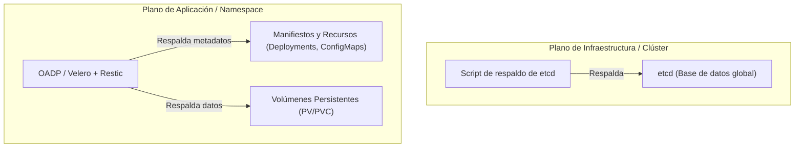
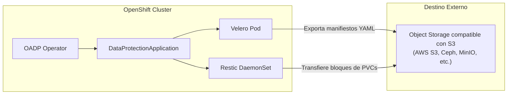
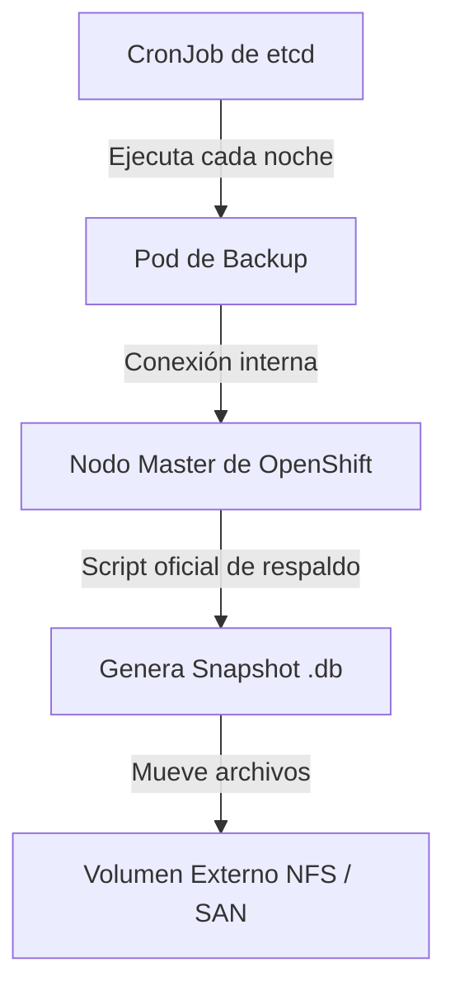

# 3.8 Copias de seguridad: qué entra en un backup y qué no. OADP y Velero: destino, programación y retención. Backup del clúster (etcd) frente a backup de una aplicación — no son sustitutos ★

## Objetivos de aprendizaje

Al finalizar este apartado serás capaz de:

- Comprender la diferencia fundamental entre el respaldo del estado global de la infraestructura del clúster (`etcd`) y el respaldo granular de aplicaciones (*workloads* y persistent volumes).
- Argumentar por qué las copias de seguridad de `etcd` y las de aplicaciones no son sustitutos, sino estrategias complementarias e indispensables.
- Conocer la arquitectura y componentes del operador **OADP** (*OpenShift API for Data Protection*) y su motor subyacente **Velero**.
- Identificar la necesidad de un almacenamiento de objetos compatible con la API S3 (ej. AWS S3, Ceph, NooBaa, MinIO) como destino principal de las copias de seguridad.
- Configurar y desplegar recursos personalizados de respaldo (`DataProtectionApplication`, `Backup`, `Restore`) definiendo destinos, programación (*schedules*) y políticas de retención (*TTL*).
- Automatizar las copias de seguridad del plano de control (`etcd`) mediante *CronJobs* con almacenamiento persistente en red (NFS/SAN).

---

## Dos mundos complementarios: Backup de Clúster (`etcd`) vs. Backup de Aplicación

En la gestión de entornos OpenShift, uno de los errores conceptuales más graves consiste en asumir que un único mecanismo de copia de seguridad cubre todas las necesidades de recuperación ante desastres.

Es crucial entender que en una plataforma de contenedores existen dos planos de persistencia totalmente diferenciados:



### 1. Backup del Clúster (`etcd`)
Imagina que un clúster de OpenShift es como una gran ciudad automatizada. Para que todo funcione, alguien tiene que apuntar absolutamente todo lo que ocurre: qué aplicaciones corren, qué usuarios tienen permisos, cuántos servidores hay y cómo están configurados. 

* **`etcd` es el cerebro y la memoria oficial del clúster.** Es una base de datos ultrarrápida donde se guarda el estado entero de la plataforma.
* **Propósito:** Recuperación ante un desastre catastrófico (*Disaster Recovery*). Si `etcd` se corrompe o se pierde, OpenShift olvida qué aplicaciones existían y el clúster deja de funcionar.
* **¿Qué NO cubre?** No realiza copias de los datos internos contenidos en los discos o volúmenes de las aplicaciones de los usuarios.

### 2. Backup de una Aplicación (OADP / Velero)
Respalda el conjunto de recursos que componen un servicio de negocio dentro de un proyecto o namespace, junto con la información almacenada en sus volúmenes de datos.

- **Propósito:** Recuperar una aplicación concreta borrada por error, migrar un proyecto entre clústeres o restaurar una base de datos a un punto anterior.
- **¿Qué NO cubre?** No sirve para reconstruir la infraestructura base de OpenShift si los servidores principales colapsan.

---

## Matriz comparativa: ¿Por qué NO son sustitutos?

| Criterio | Backup del clúster (`etcd`) | Backup de aplicación (OADP / Velero) |
| :--- | :--- | :--- |
| **Objeto respaldado** | Base de datos `etcd` del plano de control. | Objetos del namespace (Deployments, PVCs, Secrets) y datos de volúmenes. |
| **Ámbito** | Global (Todo el clúster). | Granular (Proyectos/Namespaces seleccionados). |
| **Respaldo de datos en PVCs** | **NO** (Solo guarda los metadatos del PVC, no su contenido). | **SÍ** (Mediante copias a nivel de archivos con Restic/Kopia). |
| **Frecuencia típica** | Diaria / Horaria (Automática). | Según el RPO de cada aplicación de negocio. |
| **Destino de almacenamiento** | Almacenamiento externo en red (NFS, SAN). | Almacenamiento de objetos compatible con S3. |
| **Escenario de uso** | Fallo total de los nodos principales (*masters*). | Borrado accidental de un namespace o migración de app. |

!!! warning "Principio fundamental de operación"
    Un backup de `etcd` no te permitirá restaurar una tabla borrada por error en una base de datos de un desarrollador. 
    
    Por su parte, un backup de OADP no te permitirá levantar un clúster desde cero si la infraestructura base colapsa. **Ambos sistemas son indispensables y complementarios.**

---

## Backup de Aplicaciones: OADP y Velero

Red Hat proporciona la solución **OADP** (*OpenShift API for Data Protection*), un operador certificado disponible en OperatorHub que empaqueta y extiende la herramienta de código abierto **Velero** junto con integraciones nativas para OpenShift.



### Arquitectura y componentes clave

- **OADP Operator:** Gestiona el ciclo de vida de las herramientas de respaldo en el clúster.
- **Velero:** Componente central que interactúa con la API para capturar los metadatos y definiciones de los recursos.
- **Restic / Kopia:** Agentes encargados de realizar copias de seguridad de los datos de los volúmenes persistentes a nivel de archivos.
- **Object Storage (S3):** El destino obligatorio donde Velero y Restic depositan las copias. *(Nota: El protocolo subyacente debe ser compatible con la API **S3**, pudiendo utilizarse múltiples proveedores como AWS S3, Ceph, NooBaa o MinIO).*

---

## Configuración paso a paso de OADP con almacenamiento S3

### 1. Secreto de credenciales para el almacenamiento
Se registra un `Secret` en el namespace `openshift-adp` con las claves de acceso al almacenamiento de objetos:

```yaml
apiVersion: v1
kind: Secret
metadata:
  name: cloud-credentials-s3
  namespace: openshift-adp
type: Opaque
stringData:
  cloud: |
    [default]
    aws_access_key_id=s3-access-key
    aws_secret_access_key=s3-secret-key
```

### 2. Definición del recurso `DataProtectionApplication` (DPA)
El manifiesto `DPA` conecta Velero con el bucket S3 y activa Restic para los volúmenes:

```yaml
apiVersion: oadp.openshift.io/v1alpha1
kind: DataProtectionApplication
metadata:
  name: velero-s3-config
  namespace: openshift-adp
spec:
  backupLocations:
    - velero:
        config:
          insecureSkipTLSVerify: 'false'
          region: us-east-1
          s3ForcePathStyle: 'true'
          s3Url: '[https://s3.eu-central-1.amazonaws.com](https://s3.eu-central-1.amazonaws.com)'
        credential:
          key: cloud
          name: cloud-credentials-s3
        default: true
        objectStorage:
          bucket: bucket-backups-openshift
          prefix: velero-data
        provider: aws
  configuration:
    restic:
      enable: true
    velero:
      defaultPlugins:
        - openshift
        - aws
```

---

## Ejecución de Backups, Programación y Retención (TTL)

Una vez configurado OADP, los respaldos y restauraciones se gestionan mediante recursos personalizados.

### 1. Creación de un Backup puntual
Para respaldar un proyecto concreto (`test-app`) con un periodo de retención (*TTL*) de 30 días:

```yaml
apiVersion: velero.io/v1
kind: Backup
metadata:
  name: backup-test-app-v1
  namespace: openshift-adp
spec:
  includedNamespaces:
    - test-app
  defaultVolumesToRestic: true
  snapshotVolumes: true
  storageLocation: velero-s3-config-1
  ttl: 720h0m0s
```

### 2. Programación automática (*Schedule*)
Para automatizar copias periódicas mediante sintaxis Cron:

```yaml
apiVersion: velero.io/v1
kind: Schedule
metadata:
  name: schedule-diario-test-app
  namespace: openshift-adp
spec:
  schedule: "0 2 * * *"
  template:
    includedNamespaces:
      - test-app
    defaultVolumesToRestic: true
    ttl: 168h0m0s
```

### 3. Restauración de un respaldo (*Restore*)
Para recuperar un backup y opcionalmente moverlo a un nuevo namespace (`test-app-restaurado`):

```yaml
apiVersion: velero.io/v1
kind: Restore
metadata:
  name: restore-test-app
  namespace: openshift-adp
spec:
  backupName: backup-test-app-v1
  includedNamespaces:
    - test-app
  namespaceMapping:
    test-app: test-app-restaurado
  restorePVs: true
```

---

## Backup del clúster: Automatización de la copia de `etcd`

Dado que `etcd` reside de forma interna en los servidores principales del clúster (*nodos master*), sus copias de seguridad no se realizan con Velero. En su lugar, OpenShift incluye de serie un **script oficial de respaldo** integrado en sus herramientas internas de administración.

Para automatizar esta tarea sin intervención humana, la práctica habitual consiste en desplegar un **CronJob** con privilegios que ejecute dicho script periódicamente y guarde la instantánea resultante en un volumen de almacenamiento en red externo (NFS/SAN).



### Manifiesto del `CronJob` de backup de `etcd`

```yaml
apiVersion: batch/v1
kind: CronJob
metadata:
  name: cronjob-etcd-backup
  namespace: openshift-etcd
spec:
  schedule: "0 2 * * *"
  concurrencyPolicy: Forbid
  jobTemplate:
    spec:
      template:
        spec:
          nodeSelector:
            node-role.kubernetes.io/master: ''
          restartPolicy: OnFailure
          serviceAccountName: installer-sa
          hostNetwork: true
          containers:
            - name: etcd-backup
              image: registry.redhat.io/openshift4/ose-cli:latest
              command:
                - /bin/bash
                - '-c'
                - >-
                  oc get no -l node-role.kubernetes.io/master --no-headers -o name | head -n 1 | xargs -I {} -- oc debug {} -- bash -c 'chroot /host sudo -E /usr/local/bin/cluster-backup.sh /home/core/backup' ;
                  mv /home/core/backup/* /etcd-backup/;
                  find /etcd-backup/ -type f -mtime +30 -exec rm {} \;
              securityContext:
                privileged: true
                runAsUser: 0
              volumeMounts:
                - name: host-backup
                  mountPath: /home/core/backup
                - name: etcd-pvc-storage
                  mountPath: /etcd-backup
          volumes:
            - name: host-backup
              hostPath:
                path: /home/core/backup
            - name: etcd-pvc-storage
              persistentVolumeClaim:
                claimName: backup-etcd-pvc
```

#### Archivos generados en cada copia:
1. `snapshot_<timestamp>.db`: La instantánea binaria de la base de datos `etcd`.
2. `static_kuberesources_<timestamp>.tar.gz`: Manifiestos estáticos del plano de control necesarios para reconstruir el clúster.

---

## Ideas clave para recordar

!!! tip "Resumen"
    - **No sustitución:** El backup de `etcd` salva el cerebro y la memoria del clúster; OADP/Velero salva las aplicaciones de los usuarios y sus datos. Ambos son imprescindibles.
    - **OADP** es el operador de Red Hat que integra **Velero** y **Restic** para orquestar la copia de seguridad de proyectos de forma sencilla.
    - OADP requiere un almacenamiento de objetos compatible con la API **S3** (como AWS S3, Ceph, NooBaa o MinIO).
    - Los metadatos de las aplicaciones se guardan con Velero y los volúmenes persistentes se copian mediante Restic.
    - El backup del clúster (`etcd`) se automatiza mediante un **CronJob** que ejecuta el script oficial de OpenShift y vuelca la instantánea en un almacenamiento externo seguro.