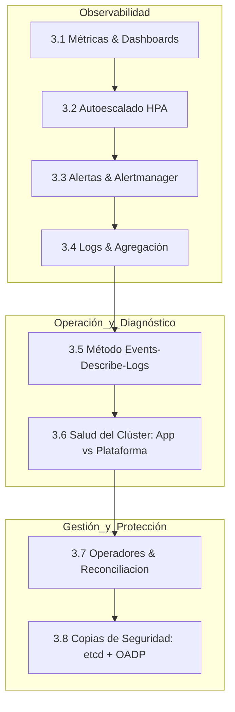

# 3.9 Cierre de la Sesión 3

## Resumen de lo aprendido

En esta tercera sesión hemos completado una visión panorámica e integral sobre la operación, observabilidad, autogestión y protección de cargas de trabajo en OpenShift.

A lo largo de los distintos apartados hemos aprendido a:

- **Observar y evaluar la plataforma (3.1 - 3.4):** Comprender el stack nativo de monitorización basado en Prometheus, Thanos y Alertmanager, consultar métricas reales de CPU/memoria e interpretar tendencias, configurar el autoescalado horizontal (HPA) vinculado a *requests*, gestionar el ciclo de vida de las alertas (`Pending` vs `Firing`), aplicar silencios (*Silences*) temporales y analizar flujos de *logs* efímeros y agregación centralizada.
- **Diagnosticar incidencias (3.5 - 3.6):** Utilizar de forma metódica `events`, `describe` y `logs` como recorrido inicial basado en evidencias, adaptando el orden al síntoma observado; reconocer y solucionar estados críticos (`CrashLoopBackOff`, `ImagePullBackOff`, `OOMKilled`, PVC en `Pending`), utilizar herramientas de inspección avanzada (`oc debug`, `oc rsh`, `oc port-forward`) y determinar mediante `oc get co`, `oc get nodes` y `oc adm top nodes` si una anomalía pertenece a la aplicación o a la plataforma.
- **Extender y proteger el clúster (3.7 - 3.8):** Comprender el paradigma de Operadores, los recursos personalizados (CRD y Custom Resource), el estado deseado y la reconciliación, y diseñar una estrategia de copias de seguridad que contemple tanto el respaldo del clúster mediante `etcd` como la protección de aplicaciones y datos persistentes mediante **OADP**, según las necesidades del entorno.

---

## Hitos operacionales alcanzados

Con los conocimientos adquiridos en este bloque, ya dispones de las competencias necesarias para operar aplicaciones en entornos corporativos sobre Red Hat OpenShift:

| Dominio | Competencia adquirida | Herramienta / Recurso principal |
| :--- | :--- | :--- |
| **Monitoreo** | Consulta de métricas y validación de *Requests*/*Limits* | Consola Web, PromQL, `container_memory_working_set_bytes` |
| **Autoescalado** | Configuración de respuestas automáticas ante incrementos de carga | `HorizontalPodAutoscaler` (`oc autoscale`) |
| **Alertado** | Gestión de notificaciones, silencios y gobierno de avisos | `Alertmanager`, Consola `Observe -> Alerting` |
| **Logs** | Inspección local y comprensión de la persistencia centralizada | `oc logs`, `ClusterLogForwarder` |
| **Troubleshooting** | Resolución sistemática de errores y aislamiento de problemas | `oc get events`, `oc describe`, `oc logs --previous` |
| **Plataforma** | Evaluación del estado de salud de infraestructura y operadores | `oc get co`, `oc get nodes`, `oc adm top nodes` |
| **Extensibilidad** | Comprensión de la gestión declarativa mediante Operadores | CRD, Custom Resource, estado deseado y reconciliación |
| **Resiliencia** | Protección ante desastres a nivel de clúster y aplicación | `etcd`, OADP, RPO/RTO y pruebas de restauración |

---

## Ideas clave para recordar

!!! tip "Resumen final de la Sesión 3"
    - **Medir antes de escalar:** El autoescalado (HPA) depende estrictamente de que la aplicación tenga definidos sus *requests* correctamente.
    - **Gobierno de alertas:** Una alerta que no le llega a nadie no existe, pero el exceso de avisos provoca fatiga de alertas e inoperatividad.
    - **Método estructurado de diagnóstico:** Ante un fallo de un Pod, utiliza `events`, `describe` y `logs` como recorrido inicial basado en evidencias, adaptando el orden al síntoma observado. Si necesitas consultar los logs de la instancia anterior de un contenedor reiniciado, utiliza el flag `--previous`.
    - **Aislamiento de responsabilidades:** Valida con `oc get co` y `oc get nodes` si el fallo está en tu código o si la plataforma subyacente requiere la intervención del equipo de infraestructura.
    - **Respetar la lógica del Operador:** Nunca modifiques manualmente componentes gestionados por un operador; edita siempre el recurso personalizado (*Custom Resource*) para evitar que la reconciliación sobrescriba tus cambios.
    - **Estrategia de backups por niveles:** La copia de `etcd` protege el estado del clúster, mientras que OADP permite proteger aplicaciones y sus datos. Una estrategia completa debe contemplar ambos niveles según las necesidades del entorno.