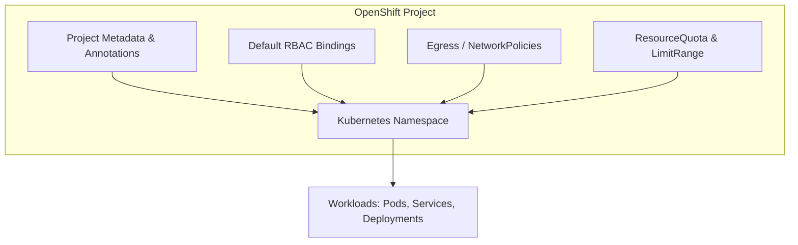
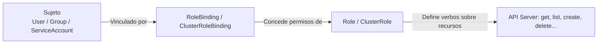
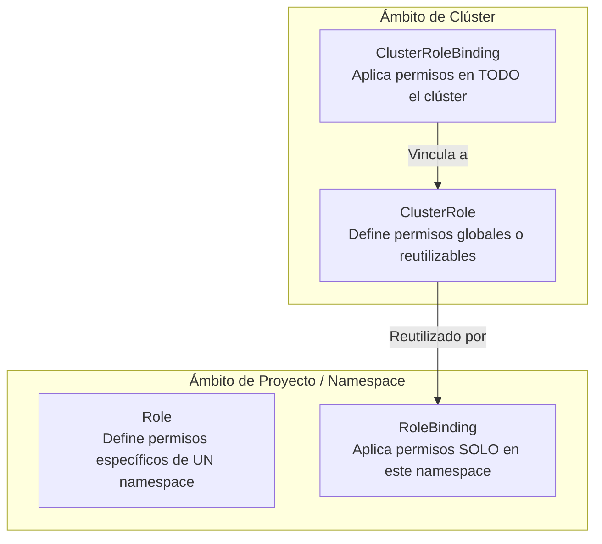
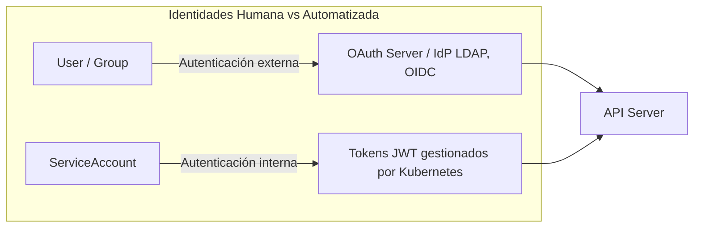
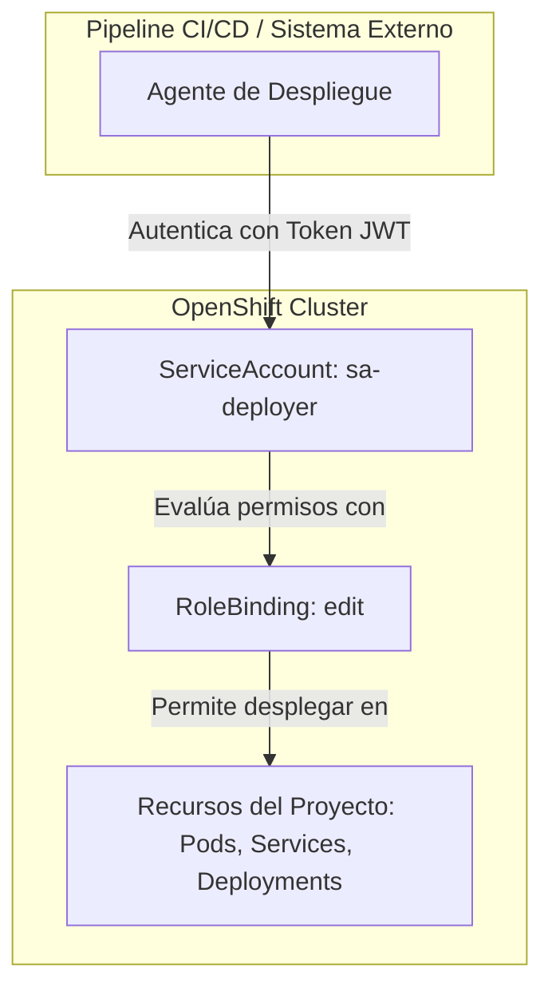
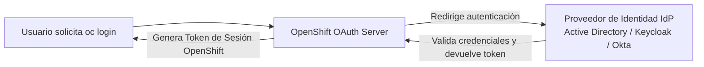
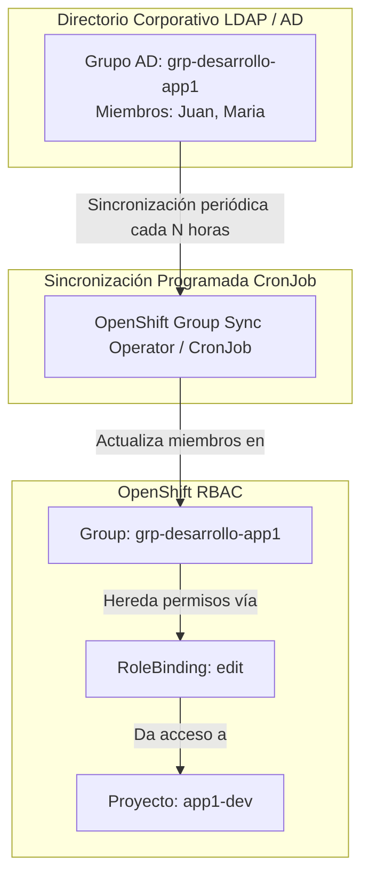

# 4.1 Proyectos y permisos: RBAC, roles predefinidos `admin`/`edit`/`view`, Roles y RoleBindings. Usuarios frente a ServiceAccounts, y la SA como identidad de despliegue. Proveedores de identidad y altas de externos. Grupos y sincronización con el directorio

## Objetivos de aprendizaje

Al finalizar este apartado serás capaz de:

- Comprender la arquitectura de seguridad y control de acceso basado en roles (RBAC) en OpenShift.
- Diferenciar entre el recurso estándar de Kubernetes (`Namespace`) y la abstracción extendida de OpenShift (`Project`).
- Asignar y evaluar los roles predefinidos del sistema (`admin`, `edit`, `view`).
- Mapear correctamente autorizaciones mediante `Roles`, `ClusterRoles`, `RoleBindings` y `ClusterRoleBindings`.
- Distinguir entre identidades humanas (`Users`) y cuentas de servicio automatizadas (`ServiceAccounts`).
- Utilizar una `ServiceAccount` como identidad de ejecución y despliegue para procesos de CI/CD e infraestructuras.
- Entender el flujo de integración de Proveedores de Identidad (IdP) para el alta y autenticación de usuarios externos.
- Aplicar la buena práctica de asignación de permisos por **grupos**, comprendiendo el impacto operativo y la ventana de sincronización programada con el directorio corporativo.

---

## Proyectos frente a Namespaces: El aislamiento en OpenShift

En Kubernetes estándar, el mecanismo fundamental para dividir un clúster físico en parcelas lógicas aisladas es el **Namespace**. Sin embargo, un `Namespace` por sí solo no proporciona mecanismos nativos de autoprovisión, cuotas por defecto o anotaciones de gobierno.

OpenShift extiende este concepto introduciendo el recurso **Project** (`projects.project.openshift.io`).



Un **Proyecto** en OpenShift es una capa envolvente sobre el `Namespace` de Kubernetes que añade:

- **Autoprovisión controlada:** Permite a usuarios no administradores solicitar sus propios proyectos mediante la CLI (`oc new-project`) o la consola web, activando automáticamente un conjunto de permisos predeterminados.
- **Aislamiento multinavegador (*Multi-tenancy*):** Asocia automáticamente límites de seguridad, cuotas de recursos y políticas de red por omisión.
- **Anotaciones organizativas:** Facilita la asignación de descripciones, etiquetas de centro de coste y propietarios del proyecto.

!!! note "Relación 1 a 1"
    Técnicamente, cada `Project` en OpenShift se corresponde exactamente con un `Namespace` subyacente en Kubernetes. Al ejecutar `oc get projects`, estás consultando los namespaces del clúster enriquecidos con la capa de gestión de OpenShift.

---

## Control de Acceso Basado en Roles (RBAC)

Para garantizar la seguridad en un entorno corporativo donde coexisten múltiples equipos, OpenShift implementa **RBAC** (*Role-Based Access Control*). El principio de RBAC establece que nadie tiene acceso a nada por defecto; cada acción sobre la API Server debe estar explícitamente autorizada.

El control de acceso basado en roles (RBAC) es un mecanismo formal de autorización de la API de Kubernetes. Su arquitectura se compone conceptualmente de cuatro elementos clave que responden a una pregunta muy clara: **¿Quién puede hacer qué sobre qué objetos?**



1. **Sujeto (*Subject*):** La identidad que realiza la petición a la API. Puede ser un usuario humano (`User`), un grupo de trabajo (`Group`) o una cuenta automatizada (`ServiceAccount`)[cite: 4].
2. **Rol (*Role* / *ClusterRole*):** El documento que define un conjunto de permisos. Un rol es estrictamente una lista declarativa que asocia **Verbos** con **Recursos**.
   - **Recursos (*Resources*):** Son los objetos del plano de control sobre los que se actúa (por ejemplo: `pods`, `services`, `deployments`, `routes`, `secrets`)[cite: 4].
   - **Verbos (*Verbs*):** Son las operaciones permitidas sobre dichos recursos (por ejemplo: `get`, `list`, `watch`, `create`, `update`, `patch`, `delete`)[cite: 4].
3. **Vinculación (*RoleBinding* / *ClusterRoleBinding*):** El objeto que actúa como puente operativo, asociando uno o varios **Sujetos** con un **Rol** dentro de un ámbito determinado (local a un namespace o global al clúster)[cite: 4].
4. **API Server:** El componente central que evalúa la petición entrante contrastándola con las vinculaciones y roles activos para permitir o denegar el acceso.

---

## Roles predefinidos del sistema: `admin`, `edit` y `view`

OpenShift incluye un conjunto de roles globales preconfigurados (*ClusterRoles*) diseñados para cubrir las necesidades operativas habituales de los equipos sin necesidad de escribir reglas RBAC desde cero. Estos roles predefinidos actúan como plantillas o conjuntos de permisos preconfigurados que la plataforma ya trae listos para usar de serie[cite: 4].

| Rol predefinido | Ámbito de actuación | Capacidades principales | Limitaciones clave |
| :--- | :--- | :--- | :--- |
| **`admin`** | Proyecto / Namespace | Control total sobre los recursos del proyecto. Puede otorgar permisos RBAC a otros usuarios dentro de su proyecto, gestionar cuotas y configurar variables/secretos. | No puede modificar el propio recurso `Project`, ni alterar nodos, ni conceder permisos a nivel de clúster. |
| **`edit`** | Proyecto / Namespace | Permite crear, modificar y eliminar cargas de trabajo (Deployments, Pods, Services, Routes, ConfigMaps, Secrets, PVCs). Pensado para desarrolladores. | **No puede gestionar permisos RBAC** (no puede añadir o quitar acceso a otros usuarios) ni modificar cuotas de proyecto. |
| **`view`** | Proyecto / Namespace | Acceso de solo lectura a la mayoría de los objetos del proyecto (ver Pods, consultar estados, revisar Deployments). | No puede ver objetos sensibles como `Secrets`, no puede ejecutar `oc rsh`/`oc exec`, ni modificar ningún recurso. |

Esto evita que los administradores tengan que redactar desde cero las reglas de recursos y verbos para las tareas más habituales de un equipo[cite: 4]. Por ejemplo, en lugar de crear un rol personalizado que permita listar y crear *deployments* o *pods* manualmente, simplemente vinculas el rol predefinido `edit` a los desarrolladores de un proyecto mediante un `RoleBinding` y obtienen esos permisos de forma inmediata[cite: 4].

!!! tip "Gestión rápida de permisos desde la CLI"
    Puedes vincular estos roles a usuarios dentro de un proyecto activo mediante los comandos rápidos de `oc`:
    ```bash
    # Conceder acceso de desarrollo a un usuario
    oc adm policy add-role-to-user edit usuario-dev -n mi-proyecto

    # Conceder acceso de solo lectura
    oc adm policy add-role-to-user view usuario-auditor -n mi-proyecto
    ```

---

## Roles y RoleBindings frente a ClusterRoles y ClusterRoleBindings

Para diseñar políticas de acceso a medida, es necesario comprender la diferencia entre el alcance local (a nivel de proyecto) y el alcance global (a nivel de todo el clúster).



### 1. Definición de Permisos: `Role` vs `ClusterRole`
- **`Role`:** Define reglas de acceso que aplican **únicamente dentro de un namespace específico**.
- **`ClusterRole`:** Define reglas de acceso a nivel global de clúster. Se utiliza para:
  - Definir permisos sobre recursos no asociados a namespaces (ej. `Node`, `PersistentVolume`, `StorageClass`).
  - Definir plantillas de permisos estándar para ser reutilizadas en múltiples proyectos mediante `RoleBindings` locales.

#### Ejemplo de un `Role` personalizado (local) en YAML:
```yaml
apiVersion: rbac.authorization.k8s.io/v1
kind: Role
metadata:
  namespace: mi-proyecto
  name: operador-despliegues
rules:
  - apiGroups: ["apps"]
    resources: ["deployments", "replicasets"]
    verbs: ["get", "list", "watch", "restart", "update"]
```

---

### 2. Aplicación de Permisos: `RoleBinding` vs `ClusterRoleBinding`
- **`RoleBinding`:** Concede los permisos definidos en un `Role` o `ClusterRole` a un sujeto **exclusivamente dentro del namespace del RoleBinding**.
- **`ClusterRoleBinding`:** Concede los permisos de un `ClusterRole` a un sujeto en **todos los namespaces del clúster**, incluyendo el acceso a los recursos globales del sistema.

#### Ejemplo de un `RoleBinding` vinculando un sujeto a un rol local:
```yaml
apiVersion: rbac.authorization.k8s.io/v1
kind: RoleBinding
metadata:
  name: vincular-operador-despliegues
  namespace: mi-proyecto
subjects:
  - kind: User
    name: carlos.garcia
    apiGroup: rbac.authorization.k8s.io
roleRef:
  kind: Role
  name: operador-despliegues
  apiGroup: rbac.authorization.k8s.io
```

!!! warning "Cuidado con los ClusterRoleBindings"
    Asignar un `ClusterRoleBinding` con un rol elevado (como `cluster-admin`) otorga control absoluto sobre toda la infraestructura de OpenShift. En entornos corporativos, su uso está estrictamente restringido al equipo de administración de la plataforma.

---

## Usuarios frente a ServiceAccounts

En OpenShift existen dos categorías de identidades claramente diferenciadas que interactúan con la API Server:



### 1. Usuarios (`Users`)
Representan a **personas físicas** (desarrolladores, administradores, auditores).
- No son creados mediante archivos YAML tradicionales en el clúster.
- Su identidad se gestiona externamente a través de un **Proveedor de Identidad (IdP)**.
- Se autentican mediante la emisión de tokens OAuth tras iniciar sesión en la consola o CLI (`oc login`).

### 2. Cuentas de Servicio (`ServiceAccounts`)
Representan a **procesos, aplicaciones o herramientas automatizadas** que necesitan interactuar con la API de OpenShift sin intervención humana.
- Son recursos nativos del clúster (`apiVersion: v1`, `kind: ServiceAccount`).
- Pertenecen a un namespace específico.
- Autentican sus peticiones mediante tokens de tipo JWT (*JSON Web Token*) almacenados y rotados por el propio sistema.

---

## La ServiceAccount como identidad de despliegue y ejecución

Un error común en etapas iniciales es utilizar credenciales de un usuario humano para automatizar pipelines de CI/CD (Jenkins, GitLab CI, GitHub Actions) o para permitir que una aplicación interactúe con el clúster.

En un modelo gobernado, **toda automatización debe utilizar una `ServiceAccount` dedicada como su identidad de ejecución**.



### Patrón de uso: Creación y delegación de permisos a una ServiceAccount

1. **Creación de la ServiceAccount en el proyecto:**
   ```bash
   oc create serviceaccount sa-deployer -n mi-proyecto
   ```

2. **Asignación del rol necesario (ej. `edit`) a la ServiceAccount:**
   ```bash
   oc adm policy add-role-to-user edit -z sa-deployer -n mi-proyecto
   ```
   *(El parámetro `-z` es un acceso rápido para hacer referencia a una ServiceAccount en el namespace actual).*

3. **Uso en Manifiestos (`deployment.yaml`):**
    Las aplicaciones ejecutadas dentro del clúster pueden asumir automáticamente la identidad de una `ServiceAccount` asignándola en la especificación de sus Pods:

   ```yaml
   apiVersion: apps/v1
   kind: Deployment
   metadata:
     name: mi-aplicacion
     namespace: mi-proyecto
   spec:
     replicas: 2
     template:
       spec:
         serviceAccountName: sa-deployer
         containers:
           - name: app
             image: [registry.ejemplo.com/app:v1.0](https://registry.ejemplo.com/app:v1.0)
   ```

!!! note "Seguridad en la ejecución del Pod"
    Asignar una `ServiceAccount` específica a un Pod permite que el proceso que corre dentro del contenedor interactúe únicamente con las APIs de OpenShift autorizadas para esa cuenta, respetando el principio de mínimo privilegio.

---

## Proveedores de Identidad (IdP) y altas de usuarios externos

OpenShift no incluye una base de datos propia para almacenar contraseñas de usuarios finales. En su lugar, el subconjunto de autenticación de OpenShift (*OAuth Server*) se integra de forma nativa con los **Proveedores de Identidad (IdP)** existentes en la organización.



### Mecanismos de integración más habituales:
- **Active Directory / LDAP:** Para la validación directa de credenciales corporativas contra un directorio central.
- **OpenID Connect (OIDC) / OAuth2:** Integración con gestores de identidad modernos (ej. Keycloak, Okta, Ping Identity, Azure AD / Entra ID).
- **HTPasswd:** Utilizado habitualmente en entornos de laboratorio o pruebas locales mediante un archivo de contraseñas cifradas.

### El flujo de alta de un usuario externo
1. El administrador de identidad da de alta al usuario en el sistema centralizado de la organización (ej. Active Directory).
2. El usuario accede a OpenShift por primera vez mediante la consola web o la CLI.
3. El servidor OAuth valida las credenciales con el IdP corporativo.
4. Tras la autenticación exitosa, OpenShift crea automáticamente un objeto `User` en la API del clúster (*Just-In-Time Provisioning*).
5. Por defecto, un usuario recién autenticado **no tiene acceso a ningún proyecto** existente hasta que un administrador o las reglas de grupo le asignen permisos RBAC.

---

## Grupos y sincronización con el directorio

En organizaciones medianas y grandes, gestionar permisos asignando roles a personas individuales es una práctica ineficiente e insostenible a largo plazo.

!!! warning "Principio de administración"
    **Los permisos deben asignarse siempre a Grupos, no a personas individuales.**
    
    Las personas cambian de departamento, rotan de proyecto o salen de la organización. Si los permisos se asignan individualmente, los archivos RBAC se llenan de identidades obsoletas, generando brechas de seguridad y sobrecoste operativo.



### Ventana de sincronización y su impacto en la operación

En OpenShift, los grupos corporativos se representan mediante el recurso `Group`. Para mantener estos grupos actualizados, se configura un proceso automatizado de sincronización (*LDAP / OIDC Group Sync*) que consulta periódicamente el directorio central.

Es vital comprender cómo funciona esta sincronización para evitar malentendidos durante la gestión de altas y bajas:

1. **La sincronización es programada, no instantánea:** El proceso de sincronización se ejecuta en intervalos definidos (por ejemplo, cada 1 hora, o en ejecuciones nocturnas).
2. **Impacto en Altas:** Si un nuevo desarrollador es incorporado al grupo de Active Directory a las 10:00 AM, **no podrá acceder al proyecto en OpenShift** hasta que el proceso de sincronización se haya ejecutado y haya actualizado el recurso `Group` en el clúster (o un administrador fuerce la sincronización manualmente).
3. **Impacto en Bajas:** Del mismo modo, si un usuario es retirado del grupo en el directorio corporativo, sus permisos en OpenShift **permanecerán activos** hasta que la siguiente ventana de sincronización elimine al usuario del objeto `Group` dentro de la plataforma.

### Comando para inspeccionar y forzar sincronizaciones

Un administrador de la plataforma puede auditar los grupos existentes o forzar una sincronización puntual desde la CLI:

```bash
# Consultar los grupos registrados en el clúster y sus miembros
oc get groups

# Inspeccionar los miembros de un grupo concreto
oc describe group grp-desarrollo-app1

# (Administrador) Ejecutar sincronización manual desde archivo de configuración LDAP
oc adm groups sync --sync-config=ldap-sync-config.yaml --confirm
```

---

## Ideas clave para recordar

!!! tip "Resumen"
    - En OpenShift, un **`Project`** es una abstracción sobre el `Namespace` de Kubernetes que añade autoprovisión, gestión de seguridad y cuotas organizativas.
    - **RBAC** controla el acceso evaluando Sujetos (`Users`, `Groups`, `ServiceAccounts`), Verbos (`get`, `create`, `delete`) y Recursos (`pods`, `services`).
    - Los roles predefinidos **`admin`**, **`edit`** y **`view`** cubren la mayoría de necesidades operativas dentro de un proyecto.
    - Los **`Roles`** y **`RoleBindings`** aplican a nivel de un único namespace; los **`ClusterRoles`** y **`ClusterRoleBindings`** aplican de forma global en todo el clúster.
    - Las **`ServiceAccounts`** son identidades automatizadas diseñadas para tareas de CI/CD y para la ejecución interna de Pods, evitando el uso de cuentas humanas.
    - La autenticación de usuarios se delega en **Proveedores de Identidad (IdP)** corporativos (Active Directory, OIDC, Keycloak).
    - **Asigna siempre los permisos a Grupos, nunca a usuarios individuales.**
    - La sincronización con el directorio corporativo es **programada**, por lo que los cambios de alta o baja en el directorio no se reflejan en OpenShift hasta que corre el proceso de sincronización.