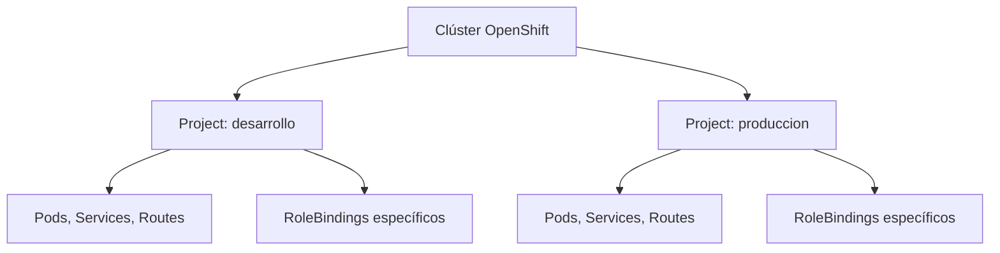
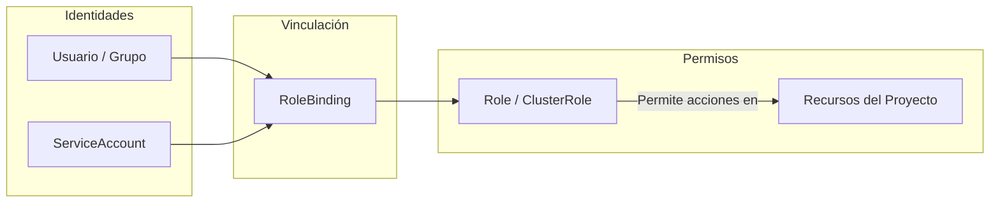
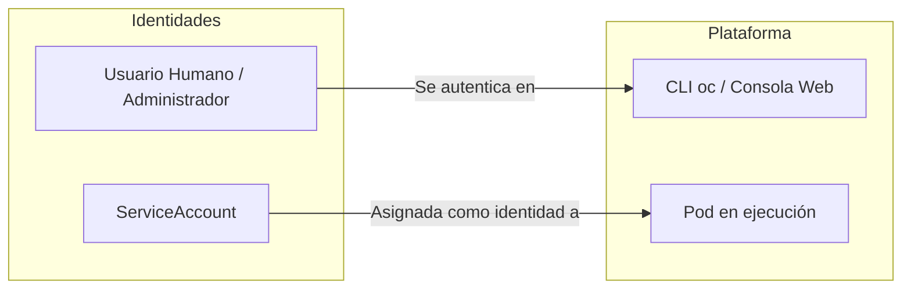
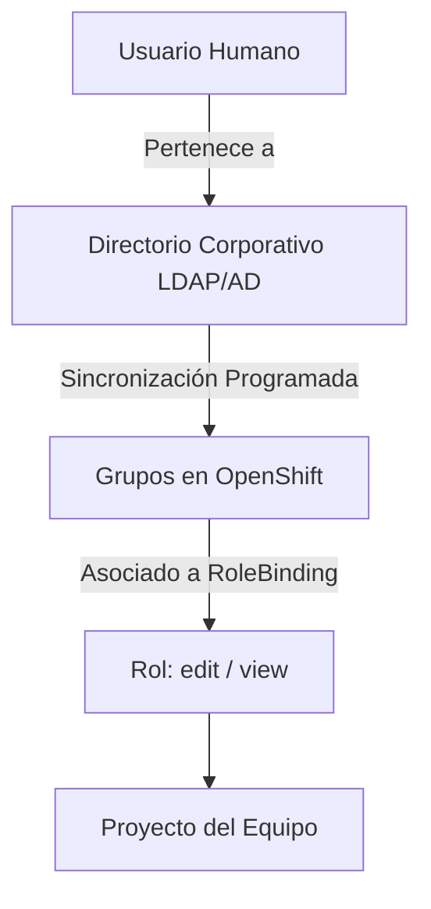

# 4.1 Proyectos y permisos: RBAC, Roles y Grupos

## Objetivos de aprendizaje
Al finalizar este apartado serás capaz de:
* Comprender la diferencia conceptual y práctica entre **Proyectos** y **Namespaces**.
* Entender el modelo **RBAC** (Role-Based Access Control) y cómo OpenShift gestiona la autorización mediante **Roles**, **ClusterRoles**, **RoleBindings** y **ClusterRoleBindings**.
* Distinguir los roles predefinidos de la plataforma (`admin`, `edit`, `view`).
* Diferenciar entre usuarios humanos y **ServiceAccounts**, entendiendo a estas últimas como identidades de despliegue y automatización.
* Conocer el funcionamiento de los proveedores de identidad y la **sincronización de grupos** con directorios corporativos.

---

## 1. Del Namespace de Kubernetes al Proyecto de OpenShift

En Kubernetes estándar, la unidad lógica de aislamiento se denomina **Namespace**. Un Namespace proporciona un ámbito (scope) para los nombres de los recursos, permitiendo que varios equipos compartan el mismo clúster sin colisionar.

OpenShift extiende Kubernetes añadiendo el concepto de **Project** (`Project`). Un Project es, en esencia, un Namespace de Kubernetes enriquecido con metadatos adicionales, políticas de seguridad preconfiguradas y herramientas de control de acceso integradas.



Cuando un usuario ejecuta comandos o interactúa con la consola web en un Project, OpenShift valida de forma estricta qué acciones tiene permitidas realizar sobre los objetos contenidos en dicho espacio.

---

## 2. Control de Acceso: El Modelo RBAC

El control de acceso en OpenShift se rige por **RBAC (Role-Based Access Control)**. Este modelo desacopla la identidad del usuario (quién eres) de los permisos que posee (qué puedes hacer).

Los elementos fundamentales del RBAC son:
* **Role / ClusterRole**: Definen un conjunto de reglas o permisos (por ejemplo: leer pods, crear deployments, borrar servicios). Un `Role` opera dentro de un proyecto concreto, mientras que un `ClusterRole` define permisos aplicables a todo el clúster.
* **RoleBinding / ClusterRoleBinding**: Conectan una identidad (usuario, grupo o ServiceAccount) con un Role o ClusterRole, otorgando efectivamente dichos permisos en un ámbito determinado.



### Roles predefinidos en un proyecto
Para facilitar la gestión diaria sin necesidad de construir políticas complejas desde cero, OpenShift incorpora roles estándar listos para asignar en cualquier proyecto:

* **`admin`**: Concede control total sobre el proyecto, incluyendo la capacidad de gestionar permisos RBAC para otros usuarios dentro de ese mismo espacio.
* **`edit`**: Permite crear, modificar y eliminar la mayoría de los objetos de la aplicación (deployments, servicios, rutas, configuraciones), pero impide alterar los permisos del proyecto.
* **`view`**: Otorga permisos de solo lectura. Permite inspeccionar el estado de los recursos, logs y métricas, pero prohíbe cualquier alteración.

---

## 3. Usuarios frente a ServiceAccounts

En OpenShift conviven dos tipos de identidades completamente diferenciadas según su naturaleza y propósito:

| Característica | Usuarios (Users / Identidades Externas)[cite: 1, 2] | ServiceAccounts (SA)[cite: 1, 2] |
| :--- | :--- | :--- |
| **Naturaleza** | Personas físicas (desarrolladores, operadores, arquitectos)[cite: 1, 2]. | Identidades de máquina o aplicación dentro del clúster[cite: 1, 2]. |
| **Origen** | Proveedores externos (LDAP, Active Directory, OAuth, htpasswd). | Gestionados de forma nativa por la API de Kubernetes/OpenShift. |
| **Ámbito** | Globales al clúster (mapeados mediante identidades). | Especificadas y acotadas a un proyecto (`Namespace`) concreto. |
| **Uso principal** | Acceso a la consola web y a la CLI (`oc`) para tareas de gestión o desarrollo[cite: 1, 2, 3]. | Utilizadas por los pods, pipelines de CI/CD y controladores para autenticarse ante la API[cite: 1, 2]. |



### La ServiceAccount como identidad de despliegue
Cada vez que despliegas una aplicación, el pod utiliza una identidad asociada para interactuar con el entorno si lo necesita[cite: 1, 2]. Por defecto, los proyectos utilizan una ServiceAccount denominada `default` que se asigna automáticamente a los Pods[cite: 1, 2]. 

Sin embargo, en entornos productivos o automatizados, es una buena práctica crear ServiceAccounts específicas para componentes que requieran privilegios acotados (por ejemplo, agentes de integración continua o pods que necesiten consultar la API de OpenShift de manera segura)[cite: 1, 2].

```bash
# Crear una ServiceAccount dedicada para automatización
oc create sa sa-despliegue
```

---

## 4. Proveedores de Identidad y Gobierno de Accesos

OpenShift no almacena contraseñas de usuarios locales por defecto en entornos empresariales. Delegar la autenticación en **Proveedores de Identidad (IdP)** externos es la norma estándar:
* Directorios Activos corporativos (LDAP / Active Directory).
* Proveedores basados en OpenID Connect (OIDC) como Keycloak, Azure AD / Entra ID, u Okta.
* Sistemas de autenticación OAuth externos.

### Grupos y sincronización con el directorio
En organizaciones medianas y grandes, **los permisos jamás se asignan directamente a personas físicas**, ya que las plantillas de personal cambian constantemente (altas, bajas, cambios de departamento). 

* **El principio de asignación a grupos**: Los permisos de RBAC mediante `RoleBindings` se otorgan a **grupos** (por ejemplo, `equipo-pagos-admin`, `desarrolladores-frontend`).
* **Sincronización programada**: OpenShift permite configurar tareas automatizadas (cron jobs o sincronizadores nativos) que consultan periódicamente el directorio corporativo (LDAP/AD). Si un empleado cambia de equipo o deja la compañía, su pertenencia al grupo se actualiza automáticamente en el directorio origen.



!!! warning "Latencia en la sincronización de altas y bajas ★"
    Dado que la sincronización entre el directorio de identidad corporativo y OpenShift es **programada** (ejecutada a intervalos regulares de tiempo), un alta o una baja realizada en el directorio central **no se refleja instantáneamente** en el clúster. Es necesario esperar a que se complete el ciclo de sincronización configurado por los administradores de la plataforma para que el acceso sea efectivo o revocado.

---

## 5. Ejemplos Prácticos de Gestión de Permisos

A continuación se muestran los comandos habituales y los manifiestos YAML correspondientes para gestionar permisos en un proyecto.

### Asignar un rol predefinido a un usuario o grupo mediante CLI

```bash
# Otorgar el rol 'edit' al usuario 'juan' en el proyecto actual
oc adm policy add-role-to-user edit juan

# Otorgar el rol 'view' al grupo 'desarrolladores' en el proyecto actual
oc adm policy add-role-to-group view desarrolladores
```

### Manifiesto YAML de un RoleBinding
El equivalente declarativo del comando anterior se representa mediante el siguiente recurso:

```yaml
apiVersion: rbac.authorization.k8s.io/v1
kind: RoleBinding
metadata:
  name: desarrolladores-view-binding
  namespace: mi-proyecto
subjects:
- kind: Group
  name: desarrolladores
  apiGroup: rbac.authorization.k8s.io
roleRef:
  kind: ClusterRole
  name: view
  apiGroup: rbac.authorization.k8s.io
```

---

## Ideas clave para recordar

!!! tip "Puntos principales a recordar"
    * **Proyectos vs Namespaces**: Un proyecto en OpenShift es un Namespace enriquecido con características de seguridad y gestión visual integradas.
    * **RBAC jerárquico**: Los permisos se componen de Roles (qué se puede hacer) y RoleBindings (quién lo puede hacer en un ámbito dado).
    * **Roles estándar**: Utiliza `admin`, `edit` y `view` para cubrir el ciclo de vida habitual de los equipos sin otorgar privilegios excesivos.
    * **ServiceAccounts**: Son identidades técnicas y acotadas al namespace, diseñadas para que las aplicaciones e integraciones interactúen con la API de forma segura[cite: 1, 2].
    * **Sincronización de grupos**: Los permisos se asignan a grupos corporativos. Ten en cuenta que la sincronización es programada y no instantánea ★.
